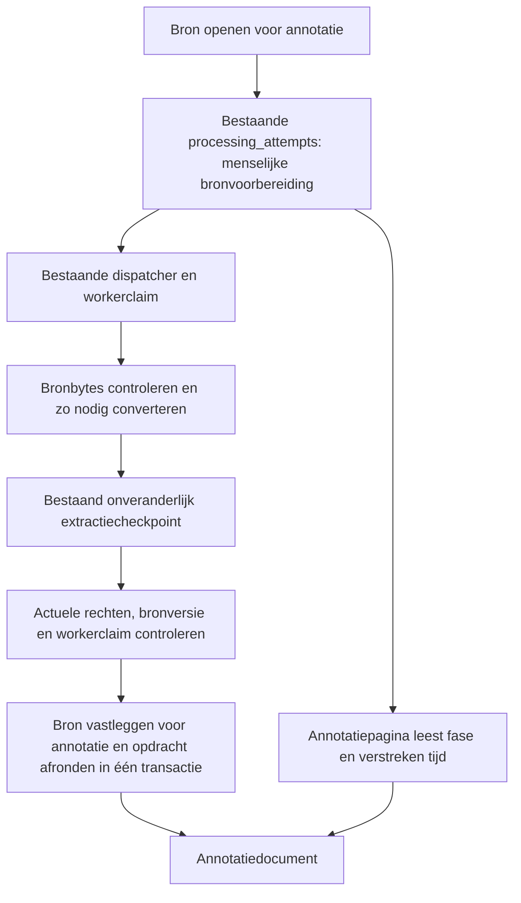

# Bron openen voor annotatie

De expliciete bron-openopdracht reserveert bronvoorbereiding in de bestaande verwerkingspogingen. De webaanvraag keert daarna terug naar de annotatiepagina. De bestaande dispatcher voert broncontrole en extractie buiten de webaanvraag uit; de pagina leest alleen de actuele voortgang. Een PDF kan daardoor minuten converteren zonder dezelfde HTTP-aanvraag open te houden.

Een dubbele klik maakt geen tweede lopende voorbereiding. Na een procesuitval kan de bestaande dispatcher dezelfde opdracht terugvinden; een afgerond extractiecheckpoint wordt hergebruikt. Verouderde of onbevoegde workers mogen geen bron vastleggen. Een fout blijft zichtbaar met een expliciete herstelactie.

Deze voorbereiding roept geen taalmodel aan en maakt geen kennisobjecten, beoordelingen of publicaties. De conversie zelf wordt hiermee niet sneller. Een crash vóór het opgeslagen extractiecheckpoint kan conversie opnieuw noodzakelijk maken.

Migratie 041 voegt de begrensde bronvoorbereidingsvariant toe aan bestaande guards. Bestaande bronnen die al voor annotatie zijn vastgelegd blijven direct leesbaar. Zie het [wijzigingscontract](../change-contracts/annotation-source-background.md) voor compatibiliteit, herstel en verificatie.
