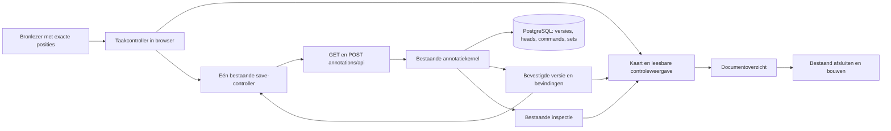
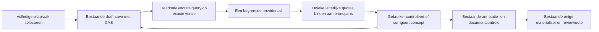

# Architectuur: een begrijpelijke annotatiewerkplek

Status: vastgelegd ontwerp; uitvoering van de volledige driestappenbediening
loopt via #1051 / MET-71. De technische implementatie wordt op de werkbranch
geverifieerd; merge, uitrol en gebruikersacceptatie zijn afzonderlijke stappen. Onderzocht op `main`
`fdf852841ddac688bab4dc02062b8c3fc82cbd0c` op 10 november 2026.

Doel: een inhoudelijk deskundige medewerker kan brongetrouw annoteren zonder de
interne begrippen bereikrol, betekenisveld, opslagstatus en gereedmelding zelf
te moeten coördineren. De werkplek voorkomt voorspelbare bedieningsfouten en
maakt resterende inhoudelijke twijfel zichtbaar. Zij garandeert geen foutloos
inhoudelijk oordeel.

## Besluit en afbakening

Kies **een begeleide client boven de bestaande annotatiekernel**. De gebruiker
ziet drie taken: **Uitspraak aanwijzen → Betekenis en context aanvullen →
Controleren en afronden**. De stappen zijn navigeerbaar, geen nieuwe opgeslagen
workflowstatussen. De kernel blijft eigenaar van alle opgeslagen annotaties,
bronposities, versies, relatieverplichtingen en controles.

Het ontwerp en de gevraagde projectskill zijn vastgelegd. De eerste uitvoering
loopt via [#1043](https://github.com/WilliamGomes41/Metis-DS/issues/1043) en
[MET-67](https://linear.app/metis-phoenix/issue/MET-67): één contextkoppeling
met het bijbehorende betekenisveld, een expliciete essentialiteitskeuze en
geen vooraf gekozen eerste passage. Het
[change contract](../change-contracts/1043-annotation-binding.md) begrenst deze
slice en het bewijs. De overige begeleide stappen worden als samenhangende gebruikersroute uitgevoerd in #1051 / MET-71. Het ontwerp
veronderstelt voor de eerste implementatie Class B, stateful, `Rewrite risk:
none`: dezelfde opgeslagen domeinbetekenis en schrijfgrens blijven bestaan.
Een wijziging aan gereed-semantiek, bronidentiteit, review-invalidatie of het
gedeelde opslagcontract vraagt vóór implementatie herclassificatie volgens
het [ontwikkelmodel](../agents/continuous-development.md), zo nodig Class A/high.

## Wat er nu werkelijk gebeurt

| Onderdeel | Gevestigde eigenaar en gedrag | Gevolg voor dit ontwerp |
| --- | --- | --- |
| Serverpagina | `human_annotation_ui_v1.install/editor` levert brontekst, annotaties en `field_contract` in de HTML-bootstrap | Geen nieuwe lijst veldvereisten naast dit contract onderhouden |
| Browser | `human_annotation_editor.js` beheert selectie, formulier, 600ms autosave en HTTP-verzoeken in één closure | Splits taaklogica en opslagcoördinatie, zonder frameworkmigratie |
| GET `/annotations/api` | `annotations.overview` leest bron, actuele heads/revisies, generation en objectbindingen | Deze GET bevat nu **geen** `field_contract`; hergebruik de bootstrap bij herladen |
| POST `/annotations/api` | `annotations.save` valideert, controleert versies en bewaart een volledige selectie met een command receipt | Eén samengestelde gebruikershandeling wordt één bestaande schrijfopdracht |
| Selectie `ready` | `_validate` controleert onder meer kern, type, onderbouwing/NA en open bereik/verband | Dit bewijst niet alle semantische velden of documentdekking |
| Documentoverzicht | `build.overview` gebruikt `inspect_document`, met strengere veld-, betekenis- en dekkingsbevindingen | Deze bestaande inspectie blijft de inhoud van de controles bepalen |
| Afsluiten en bouwen | `build.finalize/execute`, seal en bestaande dispatcher | Geen directe bouw, kennisobjectvorming of review vanuit een selecteerknop |
| Review/publicatie | Bestaande exacte objectversies, deelnemers, readiness en publicatieregistry | Annoteren verleent geen goedkeuring of publicatierecht |

**Waargenomen:** de kaart bevat verschillende gelijkvormige acties, een
vooraf actieve eerste bronpassage en permanente onderbouwingskeuzes. De huidige
client heeft serverbevestigde autosave en bewaart ook `pending_range`.
**Afleiding:** verwisseling tussen aanwijzen, koppelen en afronden is aannemelijk.
**Onbekend:** de werkelijke foutfrequentie en welke termen gebruikers zelfstandig
begrijpen; die zijn niet gemeten.

## Gebruik eerst: drie concrete taken

1. **Een uitspraak vastleggen.** De gebruiker kiest ‘Nieuwe annotatie’, markeert
   een passage en kiest ‘Gebruik als kernuitspraak’. De kaart toont de letterlijke
   tekst en vraagt welk type uitspraak het is. Niets is vooraf als uitspraak
   gekozen. Een titel of kop krijgt ook de expliciete alternatieve taak
   ‘Bronfunctie vastleggen’, via de bestaande `disposition`-route.
2. **Een noodzakelijke voorwaarde toevoegen.** De gebruiker kiest bij de huidige
   uitspraak ‘Voorwaarde aanwijzen’, selecteert tekst en bevestigt ‘Voeg toe als
   voorwaarde’. De selectie, rol, eventuele veldbinding en expliciete keuze over
   noodzakelijkheid worden in één contractprojectie gekoppeld en opgeslagen.
   De gebruiker hoeft niet eerst een bereik toe te voegen en daarna dezelfde
   tekst opnieuw te selecteren om een betekenisveld te vullen.
3. **Controleren en afronden.** De kaart toont kern, type, onderdelen, context en
   onderbouwing met hun bronplaatsen. Na opgeslagen wijzigingen leest zij de
   serverbevindingen. De medewerker corrigeert open punten en bevestigt daarna
   ‘Annotatie klaar voor documentcontrole’. ‘Volgende annotatie’ komt pas daarna
   als duidelijke vervolgactie; tussentijds weggaan bewaart uitsluitend een concept.

De tekstvoorbeelden zijn bedieningscopy, geen wijziging van de gesloten
domeinvocabulaire. Een zelfstandige voorwaarde als uitspraak blijft mogelijk;
een voorwaarde bij een aanbeveling blijft context bij diezelfde annotatie.
De interface legt dat onderscheid met voorbeelden uit en kiest het niet zelf.

## Van huidige kaart naar taakgerichte bediening

| Before | After | Why |
| --- | --- | --- |
| Type, bereikrol en betekenisveld tegelijkertijd | Uitspraaktype bij de kern; contextacties bij de uitspraak; betekenisvragen bij het betreffende onderdeel | De gebruiker beantwoordt herkenbare vragen, geen drie classificaties tegelijk |
| ‘Hele passage aanwijzen’ en daarna ‘Geselecteerde tekst toevoegen’ | Eén zichtbare bevestiging: ‘Gebruik deze tekst als …’; volledige alinea selecteren blijft een secundair hulpmiddel | De reikwijdte en uitkomst van de handeling zijn expliciet |
| Standaard eerste passage/titel actief | Start zonder selectie; uitleg en een inactieve koppelactie totdat de gebruiker zelf een bereik kiest | Een documenttitel wordt geen onbedoelde kernuitspraak |
| Onderbouwingsfunctie altijd zichtbaar | Samenvatting met ‘Onderbouwing toevoegen’; functie onderbouwt/verklaart alleen tijdens die taak | Vermindert afleidende keuzes zonder de open verplichting te verbergen |
| Checkbox ‘essentieel’ | Contextvraag: ‘Verandert de betekenis als dit ontbreekt?’ met uitleg en ja/nee bij een nieuwe binding | Maakt de inhoudelijke keuze begrijpelijk; geen automatische essentialiteit |
| Opgeslagen werk en gereed lijken hetzelfde | ‘Concept opgeslagen’, ‘Controlepunten open’ en ‘Klaar voor documentcontrole’ zijn afzonderlijk zichtbaar | Serveropslag wordt niet aangezien voor volledigheid of goedkeuring |
| Twee soorten ‘terugnemen’ | ‘Selectie wissen’, ‘Deze bronkoppeling verwijderen’ en ‘Hele annotatie terugnemen’ op hun eigen plek | Vermindert fouten door onduidelijke reikwijdte |

Er is per taak één primaire knop. Bewaren is continu zichtbaar maar geen
concurrerende primaire actie. Een volledige annotatie terugnemen staat onder
‘Meer acties’, met een korte inline bevestiging die de annotatie noemt.
Context verwijderen respecteert de bestaande verplichting tot herstel of een
reden voor het terugnemen van een essentieel verband.

## Samenstelling en eigenaarschap



**Console:** keuze van sectie, focus, actuele aanwijstaak en onbevestigde
bewerkingen zijn tijdelijk en niet gezaghebbend. **Kernel:** bronidentiteit,
annotation_id/revision, document-generation, objectfrontier, opgeslagen selectie,
verplichte relaties, transacties en historie blijven gezaghebbend.

De harde regels veranderen niet:

| Regel | Bestaande handhaving | Falsificerende proef bij implementatie |
| --- | --- | --- |
| Elk bereik verwijst naar dezelfde vastgelegde bron en exacte tekens | `annotations.save`, bron/extractie/normalisatie en ankervalidatie | Gewijzigde bron of graphemegrens wordt geweigerd |
| Een oude tab overschrijft geen nieuw werk | Kernelcontrole op revision, generation en objectfrontier | Twee conflicterende tabs leveren één commit en één conflict |
| Een essentiële relatie verdwijnt niet door alleen tekst weg te halen | `_relationship_history`, `required_links` en native guards | Verwijderen blijft een open verplichting na herladen |
| Een onzekere retry maakt geen dubbele versie | `annotation_commands` en request hash | Dezelfde opdracht na responseverlies geeft hetzelfde receipt |
| Annoteren verleent geen review/publicatie | Bestaande preview, seal/build, review en registry | Een client die lokaal ‘klaar’ toont kan geen gate passeren |
| Opgeslagen historie wordt niet stil hervertaald | Bestaande inputversies en immutable annotation_versions | Een oudere of uitgedunde writer wordt geweigerd |

De drie zichtbare taken, standaard lege selectie en knophiërarchie zijn
presentatiekeuzes. Een nieuw duurzaam bewijs dat iedere vraag expliciet is
beantwoord is nadrukkelijk geen bestaande invariant en wordt hier niet ingevoerd.

### Gegevens vóór functies

Onderstaande typen zijn ontwerpschetsen, geen al geïmplementeerde interfaces.

```ts
type SourceBasis = {
  snapshot_id: string; working_revision_id: string;
  extraction_hash: string; normalization: string;
  generation: number; objects_revision: string;
};
type Anchor = { block_id: string; start: number; end: number; quote: string };
type BindingTarget =
  | { kind: 'core' }
  | { kind: 'context'; role: ContextRole }
  | { kind: 'field'; field: FieldKey }
  | { kind: 'evidence'; function: 'supported_by' | 'explains' };
type Workspace = {
  basis: SourceBasis; confirmed: Annotation; draft: Annotation;
  target: BindingTarget | null; selected: Anchor | null;
  save: 'clean' | 'dirty' | 'saving' | 'error' | 'conflict';
};
```

`Annotation`, `ContextRole` en `FieldKey` verwijzen naar de bestaande gesloten
contracten. `BindingTarget` bestaat alleen voor de bediening en wordt geen
nieuw opslagveld. De bestaande selectie bevat nog steeds `ranges`,
`pending_range`, `field_evidence`, `recommendation_semantics`,
`evidence_not_applicable`, `required_links` en eventueel `disposition`.

Dominante patronen: bron eenmaal openen; vaak aanwijzen en één annotatie wijzigen;
na 600ms rust dezelfde annotatie bewaren; soms annotatie wisselen of het hele
document controleren. Twee tabs en meerdere bevoegde actors kunnen dezelfde
generation wijzigen. De gemelde bron heeft 46 pagina's en 923 fragmenten; dat
is één concrete bron, geen algemene volumemeting. Gebruik bestaande ID-maps
voor bronblokken en annotaties, niet matching op citaattekst. Gelijke tekst op
twee plaatsen blijft twee verschillende bronankers.

Een write verstuurt alleen de volledige huidige annotatie plus precondities;
geen documenthistorie, bronbestand of alle annotaties per muisklik. Geen nieuwe
database-index, cache, opslaglaag of offline-queue zonder gemeten noodzaak.

### Een kleine, diepe clientmodule

Voorgesteld: één pure taakmodule `human_annotation_workspace.mjs`; de bestaande
editor blijft de DOM/transportadapter. Geen React-, Motion- of bundlerafhankelijkheid.

```ts
applyBindingTask(draft, target, anchor, answers, fieldContract): Draft | InputIssue
projectWorkspace(confirmed, draft, localState, serverFindings): ViewModel
serializeSelection(draft): ExistingSelectionPayload
```

De taakmodule bundelt de moeilijke bestaande samenhang: een doelgroep buiten de
kern kan zowel een contextbereik als een veldverwijzing nodig hebben. Het is
geen mechanische één-op-één rol/veld-mapping. Vooral `scope_span` kan uit meerdere
toegestane contextrollen komen. `explanation` als bereikrol en onderbouwing met
functie `explains` worden niet samengevoegd. Alleen mappings die de huidige
`source_bound_fields_v3`-binder toestaat worden aangeboden. De server blijft
de geldigheid controleren. De serializer gebruikt een allowlist en stuurt
geen leesmetadata zoals auteur, hashes of opgeslagen revision in `selection`.

De editor heeft één save-controller; taakcomponenten doen niet zelf `fetch`.
Bronmarkeringen worden pas na een bewuste taakbinding bijgewerkt, zonder tijdens
het selecteren de onderliggende DOM-selectie te vervangen. Bestaande
Unicode/codepoint- en graphemebescherming blijft behouden.

## Bestaande API en beperkte nieuwe leesprojectie

De schrijfroute blijft:

```text
POST /annotations/api
  snapshot_id, annotation_id, command_id,
  expected_revision, expected_generation, expected_objects_revision,
  extraction_hash, normalization, selection
→ bevestigde revision, generation, status, eventueel objects_revision
```

Voor een nieuwe taak voert de client `applyBindingTask` eenmaal uit, zet status
naar `draft` en laat de save-controller de bestaande opdracht versturen.
`field_contract` wordt uit de HTML-bootstrap hergebruikt. Een toekomstige
toevoeging aan GET `/annotations/api` moet expliciet worden geïmplementeerd;
het ontwerp doet niet alsof dat nu al bestaat. Waar de taakmodule toegestane
contextrollen per veld nodig heeft, breidt de server de bootstrap expliciet uit
met metadata afgeleid uit `source_bound_fields_v3.CONTEXT_FIELDS` en het bestaande
`ROLE_MAP`. Dat is een voorgestelde contractprojectie, geen huidige GET-eigenschap
of tweede handmatig onderhouden toelatingslijst. Rolbenamingen komen uit
dezelfde serverpresentatie voor bronkaart en client.

**Voorgestelde toevoeging voor controle dichtbij de annotatie:** een alleen-lezen
query onder de bestaande annotatieroute, bijvoorbeeld
`GET /annotations/check?document=…&annotation=…`. Deze leest de opgeslagen head
en retourneert `basis`, annotatierevision, bevindingen met veld/bereik en de
relevante bronverwijzing. Het is geen nieuwe opslag-, gereed- of publicatieautoriteit.
De definitieve URL is een implementatiedetail; de semantiek is dat alleen de
huidige serverversie wordt gecontroleerd.

Haal daarvoor de bestaande per-annotatiecontrole uit `inspect_document` naar
een gedeelde interne functie in dezelfde preview-owner. Zowel documentinspectie
als deze query gebruiken die functie. Geen tweede validator in JavaScript en
geen nieuwe afwijkende betekenis van `ready`. Documentdekking blijft uitsluitend
bij de hele-documentcontrole, evenals controles die andere annotaties nodig
hebben, zoals dubbele kernidentiteiten. Een geldige annotatie verantwoordt niet de rest
van de bron. Bevindingen tonen precies het betreffende onderdeel met een link
‘Hier aanvullen’. Een conceptstatus is zichtbaar, geen reden om alle inhoudelijke
controlepunten tot na gereedmelden uit te stellen.

Afronden: eerst flush → actuele servercontrole → gebruiker bevestigt → bestaande
`ready`-POST met actuele precondities → serverbevestiging. Een wijziging na de
controle maakt de lokale controleweergave opnieuw te controleren. Directe oudere
API-callers behouden hun huidige contract; de definitieve document/buildgate
blijft altijd gelden. Een productwens dat **iedere** `ready`-write voortaan alle
veldcontroles moet garanderen is een apart domeinbesluit, niet verborgen in dit
interfaceontwerp.

## Betekenis, twijfel en volledigheid

- Toon alle type-relevante betekenisvragen uit het servercontract, inclusief
  onderwerp/gezegde, de typevelden en bij aanbevelingen relevante doelgroep,
  uitvoerder, situatie, voorwaarden, richting en vermelde sterkte. Groepeer ze
  begrijpelijk; verberg verplichte betekenis niet achter ‘Geavanceerd’.
- Gebruik voor ontbrekende velden de bestaande redenen `uncertain`, `not_stated`
  en `not_applicable`. ‘Nog uitzoeken’ is niet ‘Niet in de bron genoemd’.
- Onderbouwing krijgt een blijvende samenvatting: ‘Nog niet gekoppeld’,
  ‘Brononderbouwing toegevoegd’ of ‘Expliciet niet van toepassing’. Een lege
  selectie met `evidence_not_applicable:false` bewijst geen zoekhandeling.
  Onderbouwing en NA tegelijk blijven ongeldig. Geen automatische NA op type.
- `required_for_meaning:false` bewijst niet dat iemand expliciet ‘niet essentieel’
  heeft beoordeeld. Vraag dat bij nieuwe contextbinding zonder voorgeselecteerd
  antwoord. Koppel pas na een keuze. Een tussentijds opgeslagen `pending_range`
  is herstel van de bronselectie, geen bewijs van een beantwoord formulier.
- Hervatten bewaart exacte ankers en bestaande rollen; de tijdelijke veldtaak
  is niet altijd reconstrueerbaar. Vraag dan opnieuw waaraan tekst moet worden
  gekoppeld. Raad geen veld, essentialiteit of onderbouwingsbetekenis.
- Bestaande false-waarden krijgen ‘Niet als essentieel vastgelegd’; geen
  retroactief vinkje ‘Gecontroleerd’. Duurzaam aantonen dat iedere vraag beantwoord
  is vereist nieuwe versiegebonden semantiek en valt buiten deze variant.

De controleweergave toont letterlijke kerntekst met context in afzonderlijke,
gelabelde regels. Zij maakt geen herschreven ‘verbeterde uitspraak’ en geen
kandidaat-ID. Alleen de bestaande deterministische materialiser maakt vóór
review kennisobjecten. De medewerker blijft verantwoordelijk voor de inhoud;
technisch geldige bronposities bewijzen geen juiste interpretatie.

## Opslag, fouten en gelijktijdige wijzigingen

| Situatie | Afgesproken gedrag |
| --- | --- |
| Lokale bewerking | Direct zichtbare reactie; ‘Wijzigingen nog niet opgeslagen’ |
| Request loopt | ‘Opslaan…’; alleen de verzonden snapshot kan bevestigd worden, latere edits blijven dirty |
| Serverantwoord | ‘Concept opgeslagen’ met de bevestigde revision/generation; nooit succes op basis van een timer |
| Netwerk/time-out | Bewaar exact body én command_id voor dezelfde onzekere opdracht; retry leest hetzelfde receipt, geen tweede versie |
| Validatiefout | Inline melding bij onderdeel en samenvatting; werk blijft zichtbaar, bewuste correctie maakt een nieuwe opdracht |
| Andere tab/actor | Bestaande generation/revision/objectfrontier weigert stale writes; toon eigen werk en actuele serverversie, geen automatische merge of blind opnieuw versturen met verse generation |
| Gewijzigde bron/contract | Stop de binding, heropen de juiste bron; geen stille offsetmigratie |
| Essentieel bereik verwijderd | Bewaar relationship_id/verplichting; opnieuw aanwijzen of de bestaande reden voor intrekking vragen |
| Kern of type vervangen | Toon eerst welke velden en eventuele bestaande objectbeoordelingen geraakt worden; behoud opgeslagen werk tot bewuste bevestiging en maak de controleweergave opnieuw te controleren |
| Pauzeren/wisselen | Wacht op serverbevestigd flush; een fout blokkeert vertrek niet stilzwijgend door te doen alsof bewaren gelukt is |
| Tab/crash | Herstel bevestigde annotatie en opgeslagen pending_range uit kernel; meld dat alleen bevestigde wijzigingen hersteld zijn |

De bestaande `annotations.save`-transactie bewaart annotatieversie, head,
generation, command receipt en bestaande correctie-/reviewgevolgen samen of
helemaal niet. Bronlezen en UI-presentatie staan buiten de schrijflock. Een
nieuw scherm bouwt geen eigen auditlog; bestaande auteur, revision, receipts en
bronprovenance blijven leidend. Zet geen documentinhoud in algemene UI-telemetrie.

De bewaartoestanden `clean/dirty/saving/error/conflict` zijn presentatie, niet
de opgeslagen domeinstatussen `draft/ready/uncertain/withdrawn`. Gepubliceerde
versies worden hiermee niet bewerkbaar. Nieuwe werkversie, gerichte invalidatie
en herbeoordeling blijven de bestaande routes.

## Ontwerprichting volgens Emil en Impeccable

De [geïnstalleerde Emil-skill](../../.agents/skills/emil-design-eng/SKILL.md) is
toegepast op goede standaardkeuzes, samenhang tussen componenten, directe feedback
en taakfrequentie. De bestaande [Impeccable-integratie](../agents/impeccable.md)
blijft verplicht; de werkplek is een taakgerichte Operate-interface.

Een vaste taakbalk toont annotatie, fase en opslagstatus. Desktop houdt bron en
kaart naast elkaar; mobiel wisselt met een duidelijke teruglink die dezelfde
annotatie en bronpositie bewaart. Focus keert na binding terug naar het gekozen
onderdeel; fouten verplaatsen focus naar de eerste relevante vraag. Fieldsets,
labels, zichtbare focus en een rustige `aria-live`-regio zijn verplicht.
Touchdoelen mikken op minimaal 44×44 CSS-pixels en werken zonder hover.

Herhaalde selectie-, veld- en toetsenbordacties reageren onmiddellijk, zonder
bewegingsanimatie. Eventuele incidentele feedback gebruikt de bestaande tokens,
expliciete CSS-properties en korte overgangen; reduced motion verwijdert
positie-/schaalbeweging. Status, fouten en verplichte keuzes blijven leesbaar,
ook nadat een tijdelijke feedbackmelding verdwenen is. Geen decoratieve
animatiebibliotheek of nieuwe visuele stijl nodig om de taak duidelijk te maken.

## Vergelijking van twee structurele kandidaten

Twee afzonderlijke agentanalyses met dezelfde bronbasis zijn gebruikt:
`annotation_candidate_a` en `annotation_candidate_b`, beide binnen deze sessie.
Dit is geen vergelijking tussen verschillende modellen en geen gebruikersonderzoek.

| Criterium | A: begeleide client, bestaande annotatie als enige duurzame taak | B: servergestuurde wizard met eigen cursor en intent-opdrachten |
| --- | --- | --- |
| Begrijpelijke bediening | Drie taken, één bindingsactie; tijdelijke stap bij hervatten opnieuw afleiden | Server bepaalt volgende vraag en kan cursor onthouden |
| Domeinintegriteit | Bestaande write, receipts, CAS en finale controle blijven leidend | Kan die hergebruiken, maar moet cursor en annotatierevisie samen begrenzen |
| Opslag en compatibiliteit | Geen nieuwe tabellen of schemawijziging voorzien | Cursoropslag/nieuwe endpoints en migratie van oude invoer nodig |
| Herstel | Bestaande annotatie/pending_range herstellen; geen bewezen beantwoording erbij verzinnen | Preciezer hervatten mogelijk als nieuwe duurzame semantiek expliciet is ontworpen |
| Uitbreidingskosten | Kleine pure taakmodule plus bestaande transport-/preview-owner | Meer opdrachten, transacties en kans op dubbele waarheid over voortgang |

**Kies A.** Het aangetoonde probleem betreft onduidelijke handelingen en feedback;
een nieuwe duurzame wizard is daarvoor niet noodzakelijk. Neem van B alleen het
principe over dat inhoudelijke bevindingen uit de server komen, uitgevoerd via de
bestaande inspectie. Neem geen cursor, wizardtabel of tweede validiteitsstatus over.
Als betrouwbaar hervatten van iedere afzonderlijke beantwoording later een
bewezen eis wordt, moet B opnieuw op domeinmodel en versiebeleid worden beoordeeld.

We accepteren dat een tijdelijke aanwijstaak na herladen opnieuw gekozen moet
worden, in ruil voor één duurzame waarheid en behoud van bestaande data. We
accepteren inhoudelijke broncontroles op expliciete controlemomenten, in ruil
voor geen volledige documentinspectie per tekstselectie. We accepteren dat een
deskundige de betekenis blijft beoordelen, in ruil voor geen heuristische
invulling van ontbrekende context.

## Bouwvolgorde en eerste stap

1. **Eén binding in één handeling.** Leg een falende browserproef vast voor een
   gebruiker die een voorwaarde aanwijst en zonder dubbele selectie aan dezelfde
   annotatie koppelt. Bouw de pure taakmodule en behoud de bestaande save-route.
   Trek de dubbele hoofdknoppen pas terug wanneer deze route toetsenbord en
   touch ondersteunt. Geen noodzakelijke legacy-/herstelroute vooraf verwijderen.
2. **Eerlijke opslag en veilige wissels.** Eén save-controller, zichtbare
   pending/dirty/error/conflict, idempotente retry, bewust wisselen en pauzeren.
   Geen nieuwe offline-queue, eventbus of framework.
3. **Controles naast de inhoud.** De gedeelde per-annotatie-inspectie en read-only
   query, met dezelfde bron/revision/generation en concrete herstelacties. Laat
   documentdekking en bestaande seal/build intact.
4. **Geleide kaart en controleweergave.** Taakgerichte type-/context-/veldvragen,
   expliciete onderbouwing en essentiële verbanden, heldere scope van verwijderen.
   Bestaande ankers, v1/v2-contracten en history blijven leesbaar; alleen openen
   schrijft of migreert niets.
5. **Praktijkacceptatie en gefaseerde vervanging.** Eerst kleine gebruiksproef,
   daarna review en een expliciete deployment. De oude presentatie kan terug
   zolang dezelfde payloadversies leesbaar blijven; rollback verwijdert geen werk.

Dit zijn toekomstige gedragsslices, geen reeds uitgevoerde wijzigingen.
Iedere implementatie herclassificeert haar eigen bereik. De eerste stap is
de browserproef uit punt 1, niet een database- of frameworkproject.

## Bewijs voor implementatie en gebruik

| Te bewijzen belofte | Vereiste proef |
| --- | --- |
| Geen verkeerde standaardselectie | Open nieuwe annotatie; titel wordt niet gekoppeld zonder expliciete selectie |
| Eén taak, juiste bron en betekenis | Selecteer voorwaarde/doelgroep, bind eenmaal, herlaad; exact bereik, juiste rol/veld, geen tweede annotatie of vrij herschreven tekst |
| Twijfel blijft twijfel | Onbekende velden en lege onderbouwing blijven open; NA wordt nooit automatisch ingevuld |
| Bewaren is echt | Onderbreek request vóór en na commit; dezelfde opdracht levert één revision/receipt; onbevestigd werk heet niet opgeslagen |
| Twee tabs verliezen geen werk | Stale generation/conflicterende revision geeft herstelweergave, geen overschrijving of automatische bronverschuiving |
| Essentieel verband blijft behouden | Verwijderen vraagt herstel of bestaande intrekkingsreden; geen stil verdwijnen bij wisselen/typewijziging |
| Gereed is geen goedkeuring | Controlepunten blijven zichtbaar; document/buildgate, named review en publicatie blijven vereist |
| Compatibele invoer | Oude annotaties lezen zonder write; v2 niet downgraden; identieke tekst op andere bronpositie en samengestelde Unicode-tekens behouden |
| Toegankelijke bediening | Alleen toetsenbord, touch, focusherstel, schermlezerstatus, smal scherm en reduced motion |

Doe vervolgens een kleine vergelijkende gebruiksproef met bijvoorbeeld 5–8
beoogde gebruikers en vooraf inhoudelijk vastgestelde opdrachten. Vergelijk
huidige en voorgestelde kaart met afgewisselde volgorde. Laat een inhoudelijke
beoordelaar de bronkoppelingen controleren. Rapporteer kritieke verkeerde
koppelingen, gemiste essentiële voorwaarden, NA-misbruik, foutief gereedmelden,
hulpvragen en herstel; aantallen gebruikers, taken en gebruikers met fouten zijn
verschillende noemers. Kies acceptatiegrenzen vooraf met de inhoudelijk eigenaar.
Zo'n kleine proef ontdekt problemen, maar levert geen betrouwbare algemene
foutkans of bewijs van foutloosheid. Technische tests meten geen juiste interpretatie.

## Bronnen, grenzen en open punten

- [Huidige serverpagina en bootstrap](../../src/vorming/human_annotation_ui_v1.py),
  [huidige editor en autosave](../../src/vorming/human_annotation_editor.js).
- [Annotatievalidatie, transacties en reads](../../src/vorming/human_annotation_v1.py),
  [gesloten annotatiecontract](../../src/vorming/human_annotation_contract_v1.py),
  [veld-/contexttoelaatbaarheid](../../src/vorming/source_bound_fields_v3.py).
- [Bestaande inspectie](../../src/vorming/human_annotation_preview_v1.py),
  [afsluiten en bouwen](../../src/vorming/human_annotation_build_v1.py),
  [brongebonden contextkeuze](../change-contracts/1015-human-annotation-source.md),
  [historisch veldbewijsbesluit](../adr/source-bound-fields-v2.md).
- Relevante bestaande bewijzen: [input/herstel/concurrency](../../tests/test_human_annotation_input_v2_postgres.py),
  [preview](../../tests/test_human_annotation_preview.py),
  [volledige menselijke keten](../../tests/test_human_annotation_review_postgres.py),
  [browserbediening](../../tests/browser_human_annotation_check.cjs).

Nog inhoudelijk te toetsen: begrijpelijkheid van de typekeuze, wanneer een
zelfstandige voorwaarde wenselijk is, uitleg van essentialiteit en de gewenste
toekomstige zekerheid over beantwoording van vragen. Voer geen nieuw beleid
daarover als bijwerking van presentatie in.

In deze opdracht zijn code en contracten onderzocht en de Emil-skill daadwerkelijk
geïnstalleerd en bytegewijs aan upstream gecontroleerd. Er is geen prototype
gerenderd, gebruikerstest uitgevoerd of productgedrag gewijzigd. De Impeccable
engine was eerder niet beschikbaar; de bestaande projectrichtlijnen en vendored
Operate-guidance zijn gebruikt. Geen detector-, bruikbaarheids- of releasebewijs
wordt hiermee geclaimd.

## Eén selectie met betekenisvoorstel (#1055 / MET-73)

De eerdere verplichte tweede aanwijzingsronde wordt vervangen door een voorstel:
**Uitspraak kiezen → Voorstel controleren → Afronden**. De handmatige route
blijft beschikbaar voor correcties en provideruitval.



De query schrijft niets en controleert vóór en na provider-I/O dezelfde bron-,
werk-, annotatie- en objectversie. Bij fout of stale antwoord blijven opgeslagen
keuzes intact; er volgt geen automatische retry of invulling met gegokte tekst.
Zie [ontwerp en bewijsgrenzen](../change-contracts/1055-meaning-proposals.md).

## Aanwijzen, daarna alleen open punten (#1058 / MET-74)

Na het voorstel opent de editor de controle in plaats van het veldformulier:
**Uitspraak kiezen → open punten beantwoorden → Afronden**. Het voorstelantwoord
benoemt vluchtig waarom een onderdeel open bleef; de editor toont dat als gerichte
vraag en keert na het antwoord terug naar de controle. Het volledige formulier
blijft bereikbaar via ‘Zelf corrigeren’. Opslag, controle, bouw en de reviewkaart
zijn ongewijzigd. Zie [contract en bewijs](../change-contracts/1058-annotation-point-then-check.md).
