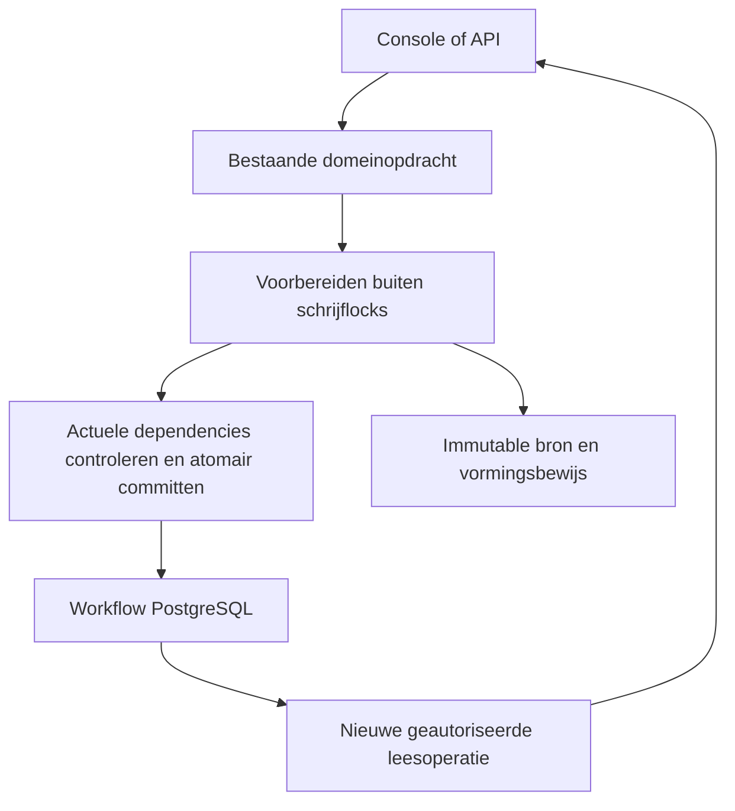

# Metis domeinarchitectuur voor begrensd lezen en schrijven

Status: architectuurvoorstel, 1 november 2026. Grondslag: main `dc53f61d3fd5fd55969ee52ef050dc05c70bb938`. Dit voorstel wijzigt geen runtimecontract en verleent geen implementatie-, merge- of deployopdracht.

**Ontwerpbesluit:** behandel de WorkingRevision als consistentiegrens, maar laad en schrijf per opdracht alleen de werkelijk geraakte gegevens en benodigde afhankelijkheden. Houd bron- en vormingsbewijs bij hun bestaande eigenaren. Laat documentbrede beoordeling expliciet plaatsvinden wanneer het domein dat vereist.

Doel: een passage openen, een bronbesluit opslaan en opnieuw openen zonder werk aan onafhankelijke historie of niet-gerelateerde objecten. Correcte bronbinding, actuele bevoegdheden en publicatievoorwaarden blijven doorslaggevend.

## 1. Classificatie en eigenaarschap

Lezen, zoeken en presenteren zijn stateless gedrag. Review, bronbesluiten, herverwerking, rechtenwijziging en publicatie zijn stateful. De beoogde vervanging van gedeelde lees-/schrijfgrenzen raakt lifecycle en herstel: uitvoering valt onder **Class A, Rewrite risk: high**. Het schrijven van dit voorstel implementeert die vervanging niet.

De HTTP-console bewaart uitsluitend reconstructeerbare weergave- en sessiecontext. De Azure-hosted backendkernel bezit domeinregels, duurzame workflow, transacties, herstel en audit. `OperationsConsole` is in deze repository backendorkestratie; de naam maakt deze klasse niet tot frontend of nieuwe authority.

| Begrip | Verantwoordelijkheid en bestaande authority | Voorgestelde toegang |
|---|---|---|
| LogicalDocument | Stabiele documentidentiteit en releaselineage | Bestaande lifecycle- en publicatieoperaties |
| SourceSnapshot | Onveranderlijke ontvangen bron; bronbytes in bestaande immutable bronopslag/Azure Blob | Exact geadresseerde, geverifieerde bronreferentie |
| WorkingRevision | Actuele curatorwerkstaat, objectversies, review en bronafhandeling; workflow-PostgreSQL | Gerichte domeinopdracht onder bestaande documentgrens |
| Objectgeschiedenis | Versies van één object binnen de werkrevisie | Op identiteit geselecteerde geschiedenis, bestaande append-volgorde |
| Vormingsbewijs en verwerkingshistorie | Vastgelegd bewijs van productie; bestaande FormationTaskStore en archiefinputs | Immutable referentie en expliciete benodigde leden |
| Reviewfacts | Afgeleide intrinsieke invoer voor review, geen zelfstandig besluit | Alleen geraakte facts; gecontroleerd volledig voorbereiden als aparte operatie |
| PublicationRelease en serving | Onveranderlijke release; publicatieregister bepaalt actieve serving | Bestaande canonieke publicatie- en intrekkingsgrens |
| Account en sessie | Account bezit bevoegdheden; sessie bezit aanmelding | Gescheiden sessieaanmaak en bevoegdheidsovergang |

Fysieke objectopslag is nu op `snapshot_id` geadresseerd. Dit voorstel introduceert geen nieuwe betekenis voor die sleutel en geen tweede objecttabel. De bestaande mapping naar WorkingRevision blijft leidend; uitbreiding naar meerdere werkrevisies vraagt een eigen lifecyclebesluit.

## 2. Wat vaststaat en wat nog onzeker is

De huidige `_write_objects_locked` schrijft objectverschillen. De eerdere volledige DELETE/INSERT-beschrijving is op deze head achterhaald. De bestaande losse reviewroute heeft al gerichte histories en `apply_review_changes`.

Er blijven aantoonbaar brede grenzen:

- `write_bundle` leest bestaande objecten ook zonder aangeboden objectwijziging en gebruikt `maintain(..., complete=True)` bij een objectset.
- `_install` doet een upsert voor ieder aangeboden factrecord, ook zonder vergelijking met de reeds opgeslagen record.
- `_source_batch` houdt schrijflocks vast tijdens bronverificatie, fragmentlezing, eventlezing en objectvoorbereiding.
- Reviewautorisatie gebruikt `FOR SHARE` op accounts; Entra-aanmelden gebruikt `FOR UPDATE` en een gedeeld identity-advisoryslot.

De uitgevoerde geïsoleerde helperproeven gebruikten een registrerende verbinding, geen PostgreSQL. Bij één gewijzigde objectrij gaven 10 en 1.000 aangeboden records respectievelijk 1 objectwrite plus 10 en 1.000 fact-upserts. Een metadata-only `write_bundle` las respectievelijk 10 en 1.000 objectpayloads. Dit bewijst uitvoeringsvorm en SQL-uitgifte, geen productieoorzaak of gemeten productiewachttijd.

De compacte operationele documentinputs van #950/MET-41 staan al op main. Zij worden hergebruikt; de grote envelope wordt niet opnieuw als algemeen operationeel model ontworpen. Of bestaande productiegegevens al zijn omgezet en welke binary daar draait, is niet vastgesteld.

## 3. Gebruik vanuit de aanroeper

Onderstaande namen beschrijven voorgestelde contracten; het zijn geen reeds geïmplementeerde API's.

| Gebruik | Invoer en resultaat | Verplichting van de aanroeper |
|---|---|---|
| Passage openen | actor, werkrevisie, passage-id → geautoriseerde passageweergave, relevante relaties, actuele preconditie | Geen state opslaan; onbeschikbaar bewijs zichtbaar behandelen |
| Brongroep uitsluiten | actor, werkrevisie, getoonde ids, bestaande groepshash, reden, command-id en preconditie → gecommitte besluitresultaat | Exact de beoordeelde groep aanbieden; bij conflict verversen en opnieuw beoordelen |
| Document beoordelen/publiceren | actor, werkrevisie en bestaande preconditie → actuele volledige beoordeling of canonieke release | Readiness als toelichting behandelen; publiceren blijft een aparte geautoriseerde opdracht |

De aanroeper levert de intentie. Hij coördineert geen objectwrites, bindingwrites, factonderhoud of audit. UI, API, worker en herstelpad gebruiken dezelfde passende domeineigenaar.

## 4. Twee mogelijke architecturen

Beide alternatieven zijn door één model uitgewerkt; dit is geen onafhankelijke architectuurreview.

**A — Gerichte domeinopdrachten binnen de bestaande kernel.** Werkrevisie, bewijs en publicatie behouden hun huidige eigenaren. Bestaande gerichte reviewcommits worden verdiept en uitgebreid met expliciete bron- en andere mutatieopdrachten. Readcontracten onderscheiden passage, overzicht, documentbeoordeling en historie.

**B — Gebeurtenissen als primaire schrijfbron met zelfstandig bijgewerkte leesmodellen.** Opdrachten voegen gebeurtenissen toe; projectors bouwen objecttoestand, reviewfacts en scherminputs op. Dit verplaatst de primaire state-representatie en introduceert replay, projectorfalen, consistentielag en een migratie van bestaande historie.

| Criterium | A | B |
|---|---|---|
| Bestaande authority en publicatie behouden | Directe aansluiting | Brede nieuwe vertaling en bewijsvoering |
| Kleine mutaties begrenzen | Gericht lezen en schrijven nodig | Append klein; projectie- en leeswerk moeten nog worden begrensd |
| Actuele besluiten | Bestaande atomaire PostgreSQL-grens | Extra regels voor lag en consistentie tussen modellen |
| Historie | Bestaande versies en audit behouden | Nieuwe replay-/eventsemantiek noodzakelijk |
| Migratie en herstel | Gefaseerd per domeinhandeling | Grote authority- en reconstructiemigratie |

**Kies A.** De aangetroffen problemen rechtvaardigen een scherpere gedeelde grens, maar onderbouwen geen vervanging van het opslagmodel door event sourcing. Er komt geen extra database, cachelaag, messagebus of generiek commandframework.

## 5. Gegevensvorm volgt het gebruik

| Gegevensvorm | Omvang en toegang | Afweging |
|---|---|---|
| Compacte documentheader en huidige inputrefs | Puntlezing op bestaande documentidentiteit | Hergebruik #950; geen lijst historische payloads |
| Objectgeschiedenis | Op gevraagde object-id plus noodzakelijke afhankelijkheden | Geen complete objectset voor iedere mutatie; diepe historie van een geraakt object blijft relevante kost |
| Immutable bron-/vormingsinput | Exacte ref, contract, hash en benodigde membership | Historie wordt expliciet gelezen; een hash alleen bewijst geen complete membership |
| Opdrachtcapture | Tijdelijke intentie, dependencies en preconditie | Geen duurzame tweede workflow of vertrouwd clientbewijs |
| Voorgestelde objectdelta | Toevoegingen, toegestane huidige updates en geraakte ids | Geen verwijder- of herordenoperatie in de normale mutatievorm |
| Reviewfact | Bestaand intrinsiek record per object met geldige bronbinding | Alleen geraakte records schrijven; globale counters/epochs blijven correct |

Gebruik expliciete resultaatvarianten voor succes, conflict, weigering en ontbrekende/corrupte/incompatibele input. Een ontbrekende ref is geen lege complete set. Een objectdelta is pas geldig na runtimevalidatie en controle onder de opslaggrens; een type alleen beschermt de database niet.

Schaaldefinities: D is de geraakte verzameling, A de noodzakelijke afhankelijkheden, H de daarbij behorende geschiedenis en N de volledige documentset. Gewone passage- en mutatiekosten volgen D + A + H, niet onafhankelijke N of archiefomvang. Documentclosure en publicatie mogen N nodig hebben. Universele constante tijd wordt niet beloofd.

## 6. Invarianten en handhaving

Bestaande broncontracten staan in [lifecycle-vsa](../agents/lifecycle-vsa.md), [abstraction-boundaries](../agents/abstraction-boundaries.md), [MET-36](../change-contracts/met36-objectversies-alleen-toevoegen.md) en het [operationele inputcontract](../change-contracts/met41-operational-document-inputs.md). Deze blijven normatief; onderstaande mechanismen zijn doelontwerp.

| Regel | Eigenaar en handhaving | Gedekte ingangen en tegenproef |
|---|---|---|
| Bronbytes, vastgelegd bewijs en gepubliceerde inhoud blijven onveranderlijk | Bestaande bron-/bewijs-/releaseowners, hashes, constraints en publicatieguards | Alle writers; gewijzigde bron/hash of published mutatie wordt geweigerd |
| Eén candidate-creator vóór menselijke review | Deterministische materialisatie; bestaande vormingscontracten | Producer, retry, recovery; alternatief candidatepad wordt geweigerd |
| Reviewmutatie, bindings, vereiste facts en audit zijn atomair | Bestaande gedeelde workflowtransactie; voorgestelde gerichte commitgrens | UI/API/worker/repair; fout tussen writes laat geen halve toestand achter |
| Bestaande objecthistorie blijft intact | Revisionvalidator onder slot, gerichte writer en voorgestelde vervangingsweigering na cutover | Alle objectmutaties; verwijderen, herordenen of historische inhoud wijzigen faalt |
| Verouderde of onbevoegde invoer autoriseert geen besluit | Live autorisatie en expliciete actuele dependencycontrole onder commitlocks | Ook bindings-only/policy/sourcewijziging; stale capture faalt of wordt opnieuw berekend |
| Afgeleide facts bepalen geen zelfstandig curatorbesluit | Bestaande domeinregels en factvaliditeit; onderhoud in dezelfde transactie | Ontbrekende/dirty facts geven onbeschikbaarheid, geen gereedheid |
| GET verandert geen domeintoestand | Expliciete readoperatie; geen migratie, voorbereiding of herstel door lezen | Alle pure GET-routes; objecten, bindings, revisies en audit blijven gelijk |
| Serving blijft uitsluitend registerbesluit | Bestaande canonieke publicatie-/intrekkingsowner | Opvolger, intrekking en restart; nooit twee actieve releases of heractivatie |

Prestatiecontracten zijn aanvullend: geen writes aan ongewijzigde objecten/facts voor een lokale mutatie; geen volledige objectpayloadlezing voor zuivere metadata zonder objectpreconditie. Batchgrootte en tijdsbudgetten zijn beleidskeuzes die met native metingen worden vastgelegd.

## 7. Lifecycle blijft bij de bestaande eigenaren

De WorkingRevision behoudt `processing`, `in_review`, `blocked`, `ready_for_publication` en `closed` onder de bestaande voorwaarden. Deze termen vormen geen simpele onvoorwaardelijke keten: open bronafhandeling en review houden de revisie in review; een technische blokkade is geen vervanging voor open curatorwerk.

Een review- of bronopdracht wijzigt uitsluitend toegestaan actueel werk en de daarvan afgeleide toestand. Een succesreceipt betekent dat die opdracht is gecommit, niet dat het document publiceerbaar is.

Publiceren sluit de werkrevisie en volgt de bestaande canonieke opvolgertransitie. Een actieve v1 blijft beschikbaar terwijl v2 wordt beoordeeld. Intrekking maakt een release inactief en restart activeert die niet opnieuw. De architectuur introduceert geen nieuwe lifecycle-status.

## 8. De nieuwe opdrachtgrens

Voorbereiding en commit zijn fasen binnen één domeinoperatie, geen nieuwe publieke services of opslaglagen.

1. **Buiten de buitenste schrijflock:** valideer de opdrachtvorm, lees de benodigde bron-/vormingsinputs, verifieer immutable bytes/membership en bereken het voorstel. Voorbereiding verleent geen bevoegdheid.
2. **Binnen één korte workflowtransactie:** neem de bestaande autorisatie- en documentlocks in een aantoonbaar consistente volgorde; hercontroleer live actor, mutable status, bron-/proofpins, relevante beleid/deelnemers/bindings en preconditie. Lees de geraakte histories, toets het voorstel en schrijf de delta.
3. **In dezelfde transactie:** schrijf bindingdelta, noodzakelijke geraakte facts/epochs en bestaand auditevent/receipt. Geen asynchrone factlag gebruiken voor commitkritische beslissingen.
4. **Na commit:** geef het resultaat terug; redirect opent een nieuwe leesoperatie. Geen volledige reconstructie als verplicht onderdeel van de POST-response.

Immutable Blob-input staat buiten de SQL-transactie. De commit hercontroleert de actuele gepinde identiteit en het oorspronkelijke contract; een SQL-snapshot bewijst geen atomaire consistentie met externe opslag.

Een voorbereide capture bevat alleen dependencies die de concrete opdracht werkelijk gebruikt. `object_generation` alleen dekt geen binding-, beleids-, rol- of bronpinwijziging. Gebruik bewezen bestaande revisies en locks; waar dekking ontbreekt worden actuele gerichte gegevens onder hun ownerlock vergeleken. Geen nieuwe algemene revisieteller voordat een concrete ontbrekende dependency is aangetoond.

## 9. Verantwoordelijkheden in de code

| Bestaande plek | Doelverantwoordelijkheid |
|---|---|
| `review_command_v1.execute_review_command` en domeincommands | Intentie, dependencyselectie, domeinvalidatie en één commit |
| `source_context_review_v1` | Losse/batch/groepsbronbesluiten via dezelfde bronversieschrijver; voorbereiding vóór buitenste lock |
| `workflow_document_concurrency_v1` en documentstore | Actuele gerichte histories, lifecycle-/revisionguards en delta toepassen |
| `workflow_review_postgres_v1` | Gerichte bindings en bestaand audit-/autorisatiecontract |
| `review_card_inputs_postgres_v1` | Alleen geraakte facts onderhouden; volledige voorbereiding expliciet |
| `operational_document_inputs_v1` en FormationTaskStore | Compacte huidige inputrefs, immutable bewijs en expliciete historie |
| Bestaande readoperaties en read snapshots | Geautoriseerde, coherente weergave binnen één operatie |
| `console_entra_v1` en identitystore | Sessieaanmaak scheiden van bevoegdheidswijziging |
| Bestaande publicatieowner | Volledige actuele publicatiecontrole en canonieke transactie/herstel |

Verdiep bestaande modules waar dat voldoende is. Voeg alleen een contracttype of gerichte methode toe wanneer meerdere echte routes dezelfde verantwoordelijkheid nodig hebben. Aanroepers mogen geen losse persistencehelpers combineren tot hun eigen commitprotocol.

## 10. Leesgrenzen en consistentie

Overzichten lezen compacte headers en geldige summaries. Passagelezing haalt één passage en de noodzakelijke context/dependencies op. Exacte documentqueues en volledige beoordeling behouden hun expliciete documentbrede invoer. Historische diagnose/export leest archieven uitsluitend op verzoek.

Capture relationele inputs in de bestaande begrensde coherente readtransactie waar die nodig is; sluit die vóór renderen en externe I/O. Een ContextVar of hergebruikte dictionary alleen levert geen databasesnapshot. Bron- en publicatieautoriteit volgen hun eigen oorspronkelijke consistentiecontract.

Iedere nieuwe HTTP-operatie leest opnieuw actuele gegevens. Een lopende operatie mag een eerder coherent beeld tonen; de daaropvolgende mutatie valideert actueel en conflicteert zo nodig. Geen mutable procesmap als writerinput en geen readresultaat als commandoautorisatie.

## 11. Aanmelden en bevoegdheden afzonderlijk behandelen

Het accountslot beschermt bevoegdheden, maar gewone sessieaanmaak hoeft het account niet exclusief te wijzigen. Het huidige `sign_in` schrijft ook bij gelijke rollen de accountrolrij.

**Voorgestelde voorkeur:** voor een bestaande, toegelaten identiteit met ongewijzigde rechten alleen sessiegegevens schrijven. Controleer account/identitystatus onder passende compatibele locks. Verwijder de globale identity-lock uit deze gewone route; behoud noodzakelijke serialisatie voor provisioning en echte bevoegdheidsovergangen.

Een rolwijziging, blokkering of pensionering blijft een afzonderlijke securitytransitie die met lopende domeinopdrachten wordt geserialiseerd. Kies als doelvolgorde: een al toegelaten opdracht commit vóór de overlappende rechtenwijziging; elke volgende opdracht ziet de wijziging en wordt waar nodig geweigerd. Geen claim van onmiddellijk afbreken van al lopend werk.

Dit is een **voorgestelde afwijking van de technische D1-uitwerking in MET-36**. Alleen `FOR SHARE` vervangen door `FOR KEY SHARE` lost de semantiek niet op: `FOR KEY SHARE` verhindert geen niet-sleutelupdate aan rollen of retirement. Het D1-contract moet vóór implementatie expliciet worden afgestemd op het gekozen autorisatiemoment en de bewezen lockmatrix.

De absolute belofte “aanmelden wacht nooit” wordt daarom gepreciseerd: sessieaanmaak bij ongewijzigde bevoegdheden wacht niet op documentreview; een aanmelding met rechtenwijziging volgt de securitytransitie. Dit wijzigt geen contract zonder expliciet besluit.

## 12. Falen, duplicaten en gelijktijdigheid

| Situatie | Vereiste uitkomst |
|---|---|
| Bron of bewijs ontbreekt/corrupt/incompatibel | Expliciete weigering of onbeschikbaarheid; geen leeg compleet resultaat |
| Voorbereiding lukt, commitpreconditie verandert | Conflict of herberekening via dezelfde domeinregels; geen stale write |
| Fout tussen object, binding, facts en audit | Eén rollback; bestaand menselijk werk blijft staan |
| Proces stopt vóór commit | PostgreSQL rollback; voorbereiding is geen besluit |
| Response verdwijnt na commit | Bestaande command-id/receipt herkent gecommit resultaat |
| Zelfde command-id, andere inhoud | Bestaand conflictrecht behouden; payloadhash mismatch weigeren |
| Twee opdrachten concurreren | Bestaande preconditievariant bepaalt conflict/merge; geen universele first-wins-regel invoeren |
| Canonieke publicatie slaagt, workflowprojectie faalt | Bestaande expliciete reconciliatie; nooit suggereren dat canonieke commit is teruggedraaid |

Niet iedere huidige route heeft dezelfde idempotentie. Behoud bestaande contracten; voeg voor een omgezette risicovolle route alleen waar nodig een duurzame receipt toe via de bestaande auditowner. Geen algemene exactly-once-garantie.

Audit behoudt actor, opdrachtidentiteit waar aanwezig, doelrevisie/objecten, reden en relevante versie-/bewijsreferenties. Logs meten fouten en duur; zij zijn geen vervanging van audit. Provenance verbindt bron, materialisatie en menselijke revisies. Geen opschoning van gepinde historie als generiek herstel.

## 13. Migratie in gebruikersgerichte slices

Het voorstel sluit aan op MET-36/#729, #942 en #948 met #950–#953. Het creëert geen parallel acceptatieproject.

| Slice | Volledige belofte en bewijs |
|---|---|
| Een bronbesluit opslaan zonder documentbreed onderhoud | Begin met één bronuitsluiting, daarna batch/groep. Intentie → bronvoorbereiding → actuele guards → object-/binding-/factdelta → audit → redirect → opnieuw openen. Vergelijk exacte inhoud en historie met de bestaande route |
| Metadata wijzigen zonder objectpayloads te laden | Compacte input en bestaande lifecycleguard gebruiken. Oude objectsetprecondities expliciet apart houden; geen stille downgrade van controle |
| Passage openen zonder onafhankelijke historie | Expliciete scope en bewijsleden; ontbrekende context weigert. Volledige documentbeoordeling blijft apart bereikbaar |
| Aanmelden tijdens review | Gewone sessieaanmaak voltooit onafhankelijk; overlappende rolwijziging/retirement volgt expliciete securityvolgorde |
| Bestaand werk veilig voortzetten | Expliciete voorbereiding, parity, stale-CASweigering, nieuw proces en bestaande publicatie-/intrekkingsketen |

Volgorde: eerst de oorspronkelijke brede route meetbaar maken; daarna één volledige gebruikersslice omzetten; vervolgens andere callers migreren; pas daarna de compatibele brede mutatieroute afsluiten. Bronbesluiten zijn de eerste slice omdat daar zowel volledige factwrites als bronwerk binnen locks samenkomen.

Veilige subtractie: verwijder een oude actieve call pas wanneer de vervangende slice haar semantiek en herstel bewijst. Noodzakelijk gedeeld fundament blijft beperkt tot dependencycapture/delta die de bestaande owners aantoonbaar missen. Geen voorafgaand frameworkproject.

## 14. Cutover, rollback en opruimen

Rewrite target: gedeelde object-/factmutatiegrens, metadatacommit, bronvoorbereiding en signincontention. De opslagauthorities blijven gelijk. Ondersteun beide bestaande FastBadge CompleteWorkflow-composities met PostgreSQL en de bestaande lokale/Azure bronadapter; geen nieuwe multi-hostgarantie.

Expand: voeg gerichte capabilities onder bestaande owners toe. Migrate: zet callers per domeinhandeling om en bewijs parity. Contract: weiger brede vervanging voor omgezette bestaande werkrevisies en verwijder hun oude calls. Aanmaak en expliciete gecontroleerde voorbereiding houden hun onderscheiden contract.

Normale deltawrites gebruiken bestaande rijen, versies en refs. Eventuele aanvullende schemawijziging vraagt een afzonderlijk migratie-/backupcontract. Respecteer de al geactiveerde compacte opslaglayout: terugrollen naar een oude incompatibele binary is geen herstelplan.

Cutover vereist native bewijs, beide composities en gecontroleerde bestaande-dataovergang waar van toepassing. Een fout hoort hoogstens de betrokken opdracht/revisie te weigeren; nooit stille reviewwijziging of servingverlies.

Opruimcriterium: geen tweede actieve schrijver voor dezelfde bronbeslissing, geen volledige factmaintenance bij lokale mutaties, geen archiefhydratatie in gewone reads, geen bron-I/O onder buitenste writeslot en geen oude brede fallback voor gemigreerde paden. Werk runtimecompositiediagrammen bij zodra implementatie de compositie werkelijk verandert.

## 15. Acceptatie en weerlegging

**Eerste uitvoeringsstap:** maak één native PostgreSQL-regressie voor één bronuitsluiting met 1.500 objectversies. Meet de echte POST, commit, redirect en nieuwe GET; tel object- én factwrites en lockduur. De rode conditie is documentbrede factmaintenance of bronwerk binnen de beschermde commit, niet alleen een trage helper.

Vergroot daarna uitsluitend onafhankelijke objecten/archieven, met dezelfde geraakte histories en dependencies. Verwacht geen lineaire groei van gelezen/geschreven payloads voor deze lokale handeling. Meet SQL, triggers, bytes en echte buitenste lockduur; een gemeten transactiescope is niet automatisch exacte lockduur. Tijdsgrenzen volgen de bestaande acceptatiebudgetten.

Verplicht adversarieel bewijs:

- bindings-only-, policy-, bronpin- en accountwijziging tussen capture en commit;
- twee reviewers en publicatierace, ook uit verschillende processen;
- fout na objectwrite vóór audit/facts, stale receipt en verloren response;
- ontbrekende/corrupte/legacy proof, onafhankelijke archiefgroei;
- gepubliceerd v1 plus werkende v2, opvolgerpublicatie, intrekking, restart en backuprestore;
- sessieaanmaak bij gelijke rechten versus daadwerkelijke rechtenwijziging;
- alternatieve ondersteunde writers en producers; geen bypass van de gedeelde owner.

Het ontwerp wordt herzien als een ogenschijnlijk lokale bronopdracht domeinmatig iedere huidige kandidaat nodig blijkt te hebben. Dan moet die afhankelijkheid expliciet en gericht worden onderbouwd, of wordt de handeling als volledige documentopdracht geclassificeerd. Geen ontbrekende veiligheidscontrole wegoptimaliseren om een kostenclaim te halen.

## 16. Bewijs en open besluiten

Uitgevoerd in de diagnose: broncodeinspectie op de genoemde main, controle van open werkpakketten en geïsoleerde SQL-uitgifteproeven met 10/1.000 records. Geen actuele productiebenchmark; native PostgreSQL-tests konden in deze omgeving niet starten. Dit voorstel is niet geïmplementeerd of extern onafhankelijk gereviewd.

Vóór uitvoering te sluiten: D1-autorisatiemoment en signinbelofte; dekking van iedere mutable dependency door bestaande locks/precondities; actuele productiebinary en opslaglayout; toepasselijke native/Azure budgetten. Deze vragen blokkeren niet het lezen van het ontwerp, maar mogen niet stil als bewezen implementatiedetail worden aangenomen.

We accepteren documentserialisatie voor dezelfde werkrevisie in ruil voor behoud van coherente besluiten. We accepteren gerichte dependencyselectie en gefaseerde migratiekosten in ruil voor minder onnodige I/O. Volledige beoordeling blijft expliciet duur waar het domein die volledigheid vereist.

### Bronverwijzingen

- [Bestaande commit en gerichte review](../../src/review/review_command_v1.py)
- [Generieke concurrente documentwriter](../../src/workflows/workflow_document_concurrency_v1.py)
- [Objectverschillen en bestaande storageadapter](../../src/workflows/workflow_documents_cutover_v1.py)
- [Bronbesluiten](../../src/review/source_context_review_v1.py)
- [Reviewfactonderhoud](../../src/workflows/review_card_inputs_postgres_v1.py)
- [Bestaande SQL-transactiebinding](../../src/workflows/workflow_transaction_v1.py)
- [Entra-aanmelden](../../src/console_entra_v1.py)
- [Actuele accountcontrole](../../src/workflows/workflow_identity_postgres_v1.py)
