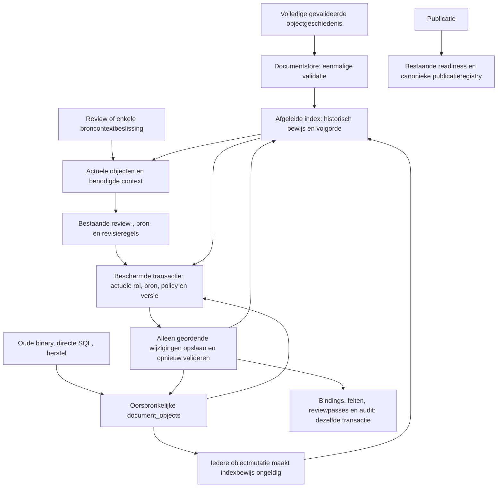

# Begrensde mutaties met behoud van volledige versiegeschiedenis

De documentstore blijft eigenaar van `document_objects`. Review verwerkt na
expliciete voorbereiding alleen de actuele objecten, hun noodzakelijke context en
de opeenvolgende wijzigingen. De oorspronkelijke versiegeschiedenis blijft staan.

Migratie 032 maakt de index en legt alleen bestaande objectidentiteiten vast.
Dit geeft oude geschiedenissen geen positief bewijs. De beheerder bereidt een
bestaand snapshot expliciet voor met `scripts/prepare_revision_frontiers.py`;
`--check` controleert zonder mutatie. Het document hoeft niet opnieuw ingevoerd.
Volledige validatie vindt buiten de schrijflock plaats; installatie weigert een
ondertussen gewijzigde geschiedenis. Nieuwe volledige writers valideren en
onderhouden de index binnen hun oorspronkelijke transactie.

Een database-trigger registreert ook wijzigingen die geen documentgeneratie
ophogen, waaronder oude en directe writers. Een ontbrekend of ongeldig bewijs
kan geen verkorte controle autoriseren. Het bestaande volledige compatibiliteitspad
blijft beschikbaar. De index is geen objecthistorie, kandidaatmaker,
reviewgoedkeuring of publicatieauthority. De optionele Reviewkaartindex uit
migratie 027 is geen vereiste voor deze mutaties.

Bij broncontext worden ook de werkelijke aangrenzende passages meegenomen,
inclusief voorwaarden zonder bestaande koppeling. Bij onvolledig voorbereide
context blijft de volledige oorspronkelijke controle gelden. Broncontrole wordt
voor de beschermde stap uitgevoerd en daarna aan de actuele invoer gebonden.
De oorspronkelijke bron- en toelatingsregels blijven beslissen.

Deze eerste implementatie omvat gewone Review en één broncontextbeslissing.
Groepsbeslissingen en overige migratie-/opschoningscriteria blijven expliciet
open in #729. De bestaande `m2`-compatibiliteit blijft volledig documentgebonden;
nieuwe HTTP-formulieren behouden hun generatievoorwaarde tot de commitcontrole.
Intrekking van een account weigert het volgende commando; aanmelden hoeft geen
inhoudelijke reviewtransactie af te wachten.

Rollback naar de oude binary verwijdert geen gegevens. Oude writes maken het
nieuwe indexbewijs ongeldig. Herstel van oorspronkelijke objecten bouwt de
indexdekking opnieuw op en vereist opnieuw expliciete voorbereiding. De index
mag nooit de oorspronkelijke rijen verwijderen. Publicatieherstel blijft bij de
bestaande canonieke owner.

Zie [het wijzigingscontract](../change-contracts/729-bounded-revision-inputs.md)
voor de exacte bewijsgrenzen en gemeten lokale kosten. Dit diagram beschrijft
code en is geen bevestiging van productieherstel.
