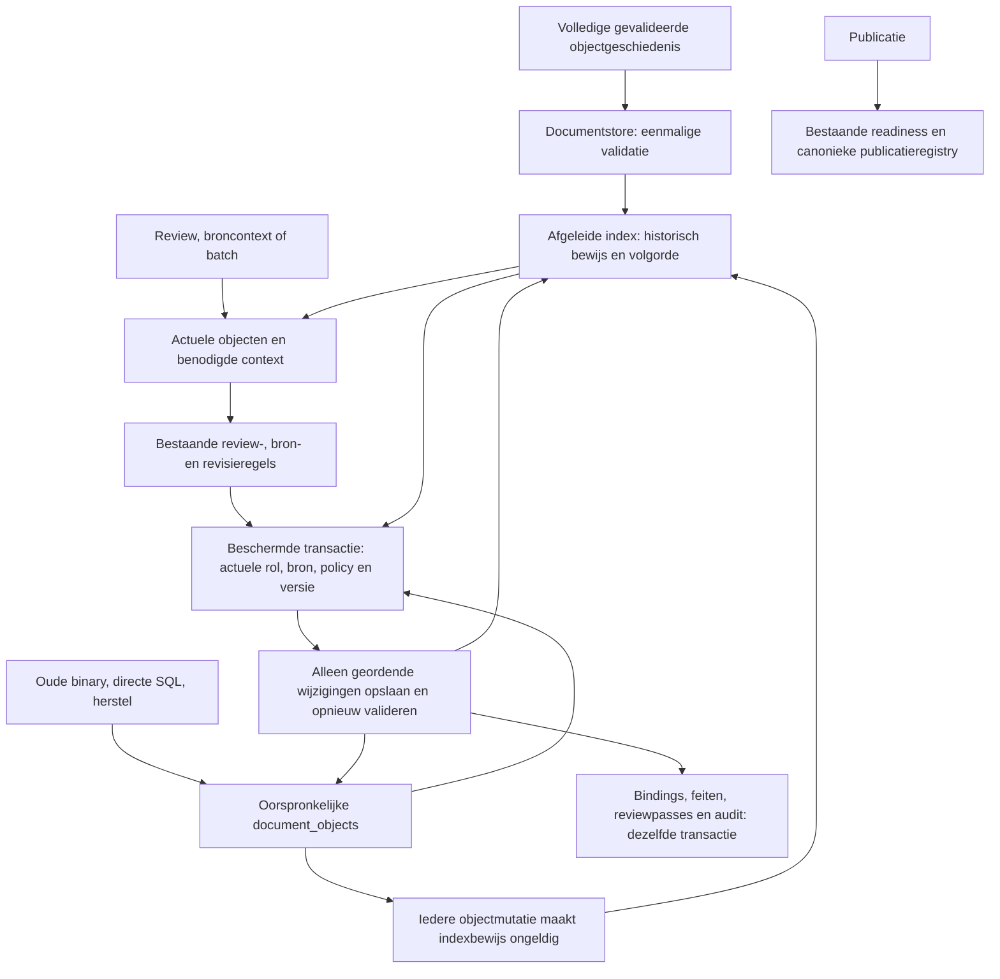
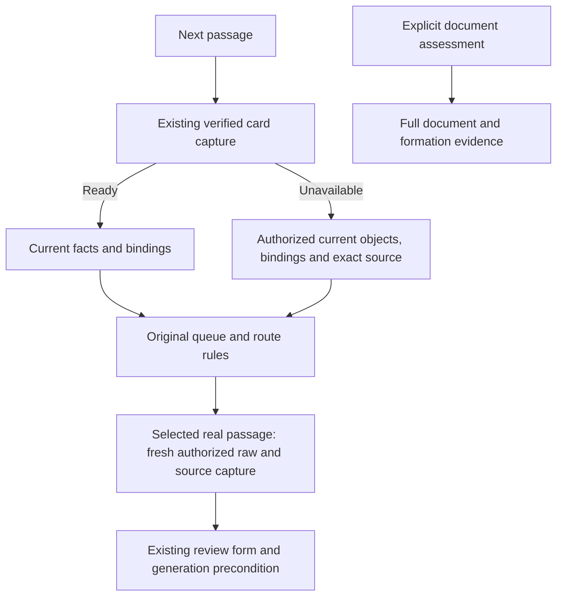

# Begrensde mutaties met behoud van volledige versiegeschiedenis

De documentstore blijft eigenaar van `document_objects`. Review verwerkt na
expliciete voorbereiding alleen de actuele objecten, hun noodzakelijke context en
de opeenvolgende wijzigingen. De oorspronkelijke versiegeschiedenis blijft staan.

Migratie 032 maakt de index en legt alleen bestaande objectidentiteiten vast.
Dit geeft oude geschiedenissen geen positief bewijs. De beheerder bereidt een
bestaand snapshot expliciet voor met `scripts/prepare_revision_frontiers.py`;
`--check` controleert zonder mutatie. Het document hoeft niet opnieuw ingevoerd.
Volledige validatie vindt buiten de schrijflock plaats; installatie weigert een
ondertussen gewijzigde geschiedenis. Nieuwe volledige writers valideren en
onderhouden de index binnen hun oorspronkelijke transactie.

Een database-trigger registreert ook wijzigingen die geen documentgeneratie
ophogen, waaronder oude en directe writers. Een ontbrekend of ongeldig bewijs
kan geen verkorte controle autoriseren. Het bestaande volledige compatibiliteitspad
blijft beschikbaar. De index is geen objecthistorie, kandidaatmaker,
reviewgoedkeuring of publicatieauthority. De optionele Reviewkaartindex uit
migratie 027 is geen vereiste voor deze mutaties.

Bij broncontext worden ook de werkelijke aangrenzende passages meegenomen,
inclusief voorwaarden zonder bestaande koppeling. Bij onvolledig voorbereide
context blijft de volledige oorspronkelijke controle gelden. Broncontrole wordt
voor de beschermde stap uitgevoerd en daarna aan de actuele invoer gebonden.
De oorspronkelijke bron- en toelatingsregels blijven beslissen.

De runtime omvat gewone Review, broncontext met groepsbeslissingen en reset,
en voorbereide koppen-/normale batches. Overige graph-/herstelroutes en de
volledige migratie-/opschoningsacceptatie blijven open in #729. De bestaande `m2`-compatibiliteit blijft volledig documentgebonden;
nieuwe HTTP-formulieren behouden hun generatievoorwaarde tot de commitcontrole.
Intrekking van een account weigert het volgende commando; aanmelden hoeft geen
inhoudelijke reviewtransactie af te wachten.

Rollback naar de oude binary verwijdert geen gegevens. Oude writes maken het
nieuwe indexbewijs ongeldig. Herstel van oorspronkelijke objecten bouwt de
indexdekking opnieuw op en vereist opnieuw expliciete voorbereiding. De index
mag nooit de oorspronkelijke rijen verwijderen. Publicatieherstel blijft bij de
bestaande canonieke owner.

Zie [het wijzigingscontract](../change-contracts/729-bounded-revision-inputs.md)
voor de exacte bewijsgrenzen en gemeten lokale kosten. Dit diagram beschrijft
code en is geen bevestiging van productieherstel.

## Source batches and full-writer physical proof

Source exclusion, group confirmation and reset now enter the same Review command
boundary. The shown member set is captured with its OID and automatic block/span
context dependencies. The original source partition and role writer retain their
rules. Reset reads only the exact retained predecessors named by the immutable
group receipt. Source verification precedes protected writes; objects, bindings,
facts, frontier certificates and audit commit or roll back together.

Generic full writers retain their necessary full-history domain validation.
Their store-owned physical baseline and verified SQL delta replace a second full
payload reread/revalidation. Every changed/deleted row returns its exact identity,
position and raw JSON; the complete native epoch map and final physical identity
order detect additional writes before certificates are installed. This is
transaction-local execution evidence, not a caller-issued or persisted authority.

Prepared current-only readers reuse that same validated history. Source forms
capture their compact generation with current heads/bindings in one read
snapshot. Legacy m2 callers retain their whole-objectset comparison and receipt
semantics. Processing start/resume still uses its original row-bound m2 CAS;
polling without a start form no longer computes an unused historical token.

## Batch preparation before protected writes

The same prepared executor also handles ordinary compact generation forms.
Their original single-object kernel runs without workflow I/O or the outer
write lock. Source/original checks are pinned beforehand; the protected commit
recaptures current dependencies, bindings, scoped events and actor before
applying the existing prepared delta and audit intents atomically. Old m2/None,
nested and unprepared-history commands keep the explicit serial adapter.

After POST, candidate navigation reads the existing verified current card/fact
owner and current bindings in one authorized capture. Original queue/route
rules choose a candidate; the selected real passage then gets its own scoped
raw/source capture. Card projections provide neither a command token nor
document/publication closure. With unavailable cards, navigation captures the
complete current object/binding/source inputs under the existing read snapshot,
without expanding historical processing/formation evidence. Explicit document
assessment retains the full document reader. GET never installs preparation or
silently truncates work. See [the navigation contract](../change-contracts/972-navigation-fallback.md).

Ground: actual20-member HTTP1.879s, process/document/auth write hold1.776s
with no retained-history/global reads. The original member kernel still repeats
CPU work inside the write boundary. Existing raw writer triggers in032 also
serialize on the document row; native0 cannot change dependencies during commit.

Usage stays `batch_review_normal_risk(...)` / `batch_confirm_headings(...)`.
Explicit generation forms select this preparation path; m2/None and source
receipt commands retain their existing precondition/replay order. No new public
precondition, durable authority, candidate creator or publication gate is added.

A compared shape keeps optimizing in-lock immutable reads. Measurements above
falsify sufficiency for250ms. Another shape uses per-member read-only SQL
transactions: original calls remain but each accounts/source/event lookup repeats
round trips. Independent runner prefers captured pure kernel: current actors,
exact source/original checks, scoped events and ledger head are captured first;
CPU operates with no SQL access and no long read/write transaction. Missing input
fails closed rather than acquiring an accidental database lock.

Types: existing ReviewCommandInputs additionally carries captured account/events/
ledger head for preparation only. ReviewChangeSet remains disposable immutable
stages. The document store alone issues an opaque single-use prepared-write
handle after all existing ordered revision/shape validators. Its private registry
retains exact immutable inputs, outputs, count and chain. Forged, wrong-store,
mutated or reused handles cannot skip validation. There is no stored certificate.

Commit: existing process/auth/document/account lock order; current role, canonical
seal, exact generation, full recaptured dependency selectors including new incoming
edges/all headings/native0 adjacency, raw heads/frontiers, header/source/tree/
quality and binding parity. Global interaction identity is checked again under
the ledger lock. Only then the issued exact SQL delta is consumed; original raw
RETURNING/rowcount/epoch/physical guards still apply. Buffer flush is inside that
same bound write transaction, including actual outer COMMIT failure rollback.
Failure unwinds pending buffers with the actual exception; no successful cleanup
flush after a refusal. Ordinary serial ledger-chain conflicts remain strict. The explicit prepared
batch ledger mode described below assigns final audit order at commit; it never
rewrites an existing event or changes a prepared human decision. Canonical
publication remains separately authoritative.

Verification before completion: actual20-member and heavy-heading HTTP timing,
250ms real outer write hold/500ms write transaction/3s response; no SQL during
preparation; role/roster/source/policy/quality/binding/native0 closure/interaction/
ledger-head changes between phases; suppressed/rewritten SQL and final COMMIT
rollback, fresh-runtime state and original m2/None parity. Concurrent independent
reviews must be measured: moving CPU out while losing every action to ledger
conflicts is not acceptable. UI conflict recovery/scoped public preconditions
are separate behavior changes; this execution change does not claim them.

Change class A; rewrite risk high: existing #729 contract/authority map and
rollback remain applicable. New execution mode is disposable and additive, no
schema/data rewrite. Previous binary consumes original rows unchanged. First
current correctness/performance and adversarial proof, then exact-head CI; no
merge/deploy or complete Review/publication claim from this sketch.

### Audit intent placement for independent prepared batches

A real counterexample appended an unrelated event between preparation and commit.
The original strict global-head buffer rejected the valid independent batch.
This was reproduced with an actual separate-thread native append, not a mock.
Changing every buffer to relinkable was rejected: ordinary callers can rely on
the existing strict hash/link contract.

Only prepared normal/heading batches enter `prepared_batch_events(base_head)`.
Their original kernel stages exact uncommitted events; it does not consume the
returned draft hashes as durable identifiers. The ledger owner validates the
original local chain and seals a deeply immutable ordered intent sequence.
Actual event type/object/version/actor/occurred_at/details remain byte-equivalent
in JSON meaning. At commit, after current document/actor/source/dependency/
binding/global-interaction checks and under the same ledger lock, the ledger
owner sets previous_event_hash and computes the final existing event hash from
the actual committed head. This is the first durable placement of these events.
No committed event is updated, no review is rerun or silently applied to new
content, no public review precondition is weakened.

The current pending buffer must exactly match the sealed sequence. Tampered
payload/hash/order/membership refuses the whole write; missing/sealed/reused or
wrong-store contexts refuse. Inserts verify exact actual RETURNING payload/hash
and one row. Native SQL errors and real deferred COMMIT failure roll everything
back; exceptional ExitStack unwinding never flushes outside that transaction.
Ordinary `buffered()` keeps the strict head equality and tamper checks.

Readiness evidence must include independent concurrent audit success, foreign
interaction identity refusal, changed current dependencies, late SQL/commit
rollback and the ordinary strict-buffer negative. The schema/event shape is
unchanged; old binaries read the same canonical hash-chained records. There is
no persisted intent log or new publication authority and no new migration.

### Removing the remaining full-envelope and retained-heading read

A real quality-audit regression forbids `get_envelope` and was red on the full
legacy fetch. Quality projection now consumes the already captured compact
header (or captures one when called alone), retains latest-run/first-candidate
ordering and archive source/reference checks. Its actual evidence is compared
with the independent original full-envelope oracle. Legacy SQL may still detoast
the latest legacy run on the server; operational-input preparation remains the
existing route for large legacy envelopes. No claim is made that legacy SQL
never detoasts.

A protected-heading profile also exposed a latest-history GROUP BY join whose
planner could inspect retained payloads. With032 FK identity coverage, heading
discovery probes exactly one raw head per known OID using LATERAL before the type
filter. No certificate/type/permission decision is cached; invalid native0 heads
still participate in discovery and require the original later validation. The
old-schema adapter keeps its original SQL.

Prepared object UPDATE/INSERT use one ordered delta statement per kind with
exact returned cardinality, identities, raw JSON and positions; native epochs
remain independently checked. Fact and authorization additions use ordered
set-based inserts, with original per-row values and duplicate/NULL-position
behavior retained. Authorization and audit RETURNING guards reject silently
suppressed or rewritten rows. This removes repeated round trips instead of
raising any timeout or benchmark threshold.

### Existing buffer/transaction ownership

A reproduced direct composition opened an ordinary audit buffer without an
outer native transaction. A nested review could commit its objects before the
parent buffer flushed, splitting the atomic outcome. Checking only whether a
transaction exists at command entry is insufficient: buffer→transaction→command
has the same wrong ownership.

An ordinary buffer now records its creating native transaction identity. Any
Review command joining an existing root requires that same active transaction.
No transaction, or a root created before it, is refused before mutations. Valid
transaction→buffer→command commit/rollback behavior is preserved. Ledger-only
buffers remain usable; explicitly prepared batch intents retain their separate
deferred placement contract. This adds no durable authority or workflow state.

The final commit still exceeded the250-ms hold in one max-20 timing (261.7ms),
although HTTP1.767s and TX261.5ms passed their own budgets. Native profiling
identified per-member audit INSERTs and frontier UPDATEs. These owners now write
one ordered audit set and one exact frontier set in the same original TX, with
returned count/identity/order/raw payload/projection verification and frontier
hash checking. Original raw-head/epoch validation, audit hashing/ledger lock and
actual current-input recapture are retained. Serial buffers still use their
original append path. No acceptance threshold changes.
