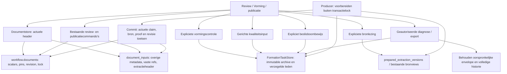

# Actuele documentgegevens en expliciete verwerkingsinputs

De bestaande documentaggregate houdt identiteit, scalars, revisie, objectgeneratie,
bron- en proofpins en de documentlock. De compacte zijrij is dezelfde aggregate,
geen aparte workflow- of afsluitautoriteit.

Voor nieuwe ontvangst kiest expliciete configuratie de opslagvorm. Voor bestaande
gegevens bereidt een afzonderlijke operatie de oorspronkelijke inputs voor; een
CAS op dezelfde documentrij activeert de representatie. Reads migreren niets.
Een geactiveerde compacte representatie blijft actief als nieuwe admission wordt
uitgezet; oudere writers worden geweigerd.

De beslisgraaf, reviewbesluiten en deelnameafspraken blijven actuele mutable
gegevens. Broninventory, vormingsherkomst en constructiebewijs blijven exact
bewaard. De kleine kaartprojectie is uitsluitend een weergave en levert geen
bewijs voor commando's of publicatie. De bestaande publicatieregistratie blijft
bepalen wat geleverd wordt.

Backupversie 9 neemt de compacte gegevens, refs en verzegelde archiefleden op in
de bestaande atomische workflowbackup. Productiecutover van bestaande gegevens
valt onder MET-44; dit diagram beschrijft de code en geen gedeployde omgeving.
