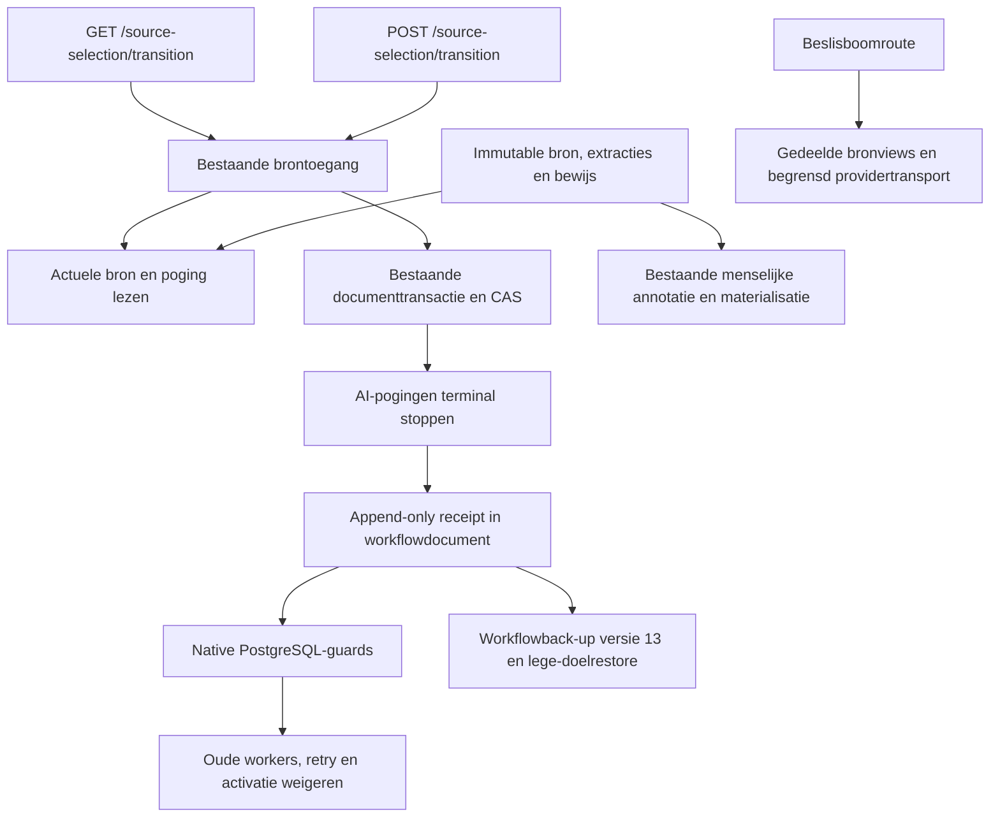

# Gecontroleerd stoppen van AI-proza

Deze uitbreiding van HA-4 biedt een expliciet stopcommando per ongepubliceerde
WorkingRevision. Installeren stopt geen taken. De menselijke annotatieroute
blijft een afzonderlijke, bestaande handeling; globale cutover volgt pas na
praktijkacceptatie. Zie [het lifecyclecontract](../change-contracts/1017-prose-transition.md).



`prose_transition_v1.stop` gebruikt de bestaande autorisatie en documentlock.
De receipt pint actor, command, reden, snapshot, bronhash/-versie, werkrevisie,
poging en verwachte objectrevisie. Herhaling van hetzelfde command retourneert
dezelfde receipt; een afwijkende opdracht conflicteert. Stop en terminale
pogingen worden atomair opgeslagen. Een externe providercall die al verstuurd
is kan eindigen; het antwoord krijgt na de stop geen activatierecht.

GET met query `document=<snapshot-id>` geeft de actuele bronpins, objectrevisie,
pogingen en eventuele stopreceipt. De geauthenticeerde POST accepteert uitsluitend:

```json
{
  "snapshot_id": "<snapshot-id>",
  "attempt_id": "<actuele-poging-id>",
  "command_id": "stop-prose-001",
  "expected_revision": "<objects_revision-uit-GET>",
  "reason": "Overgang naar menselijke bronselectie"
}
```

De server bepaalt de actor. Gepubliceerde werkrevisies, beslisbomen en menselijke
bouwpogingen worden geweigerd. Bronbytes, checkpoints, historische kandidaten,
reviews en publicatieregistry blijven behouden. De stop verleent geen nieuwe
review- of publicatierechten. Huidige kandidaten die takeover verhinderen blijven
zichtbaar; zij worden niet stilzwijgend vervangen.

De drie guards beschermen beide documentinputlayouts en relationele pogingen
tegen oude writers die stopbewijs laten vallen of AI opnieuw laten lopen.
Workflowback-upversie 13 bewaart de receipt; herstel van stopbewijs vereist deze
guards en weigert een oud versielabel. Een destructieve downmigratie na gebruik
is geen ondersteunde rollback. Oude uitvoerende proza-ingangen blijven vóór de
praktijkcutover aanwezig, maar gedeelde lezers en boomtransport importeren ze niet.
