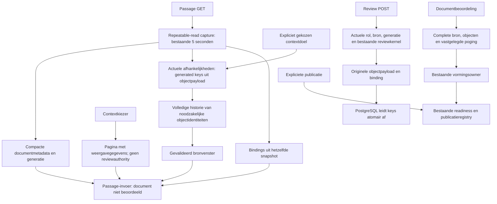

# Review: passage-invoer en documentbeoordeling

Een passage toont de actuele kandidaat met alle noodzakelijke verbonden context.
Een niet berekende documentbeoordeling betekent niet dat de vorming compleet is.
De bestaande vormings- en publicatieowners blijven die uitkomst bepalen.

`document_objects.payload` blijft de enige objectauthority. Migratie 031 voegt
een opgeslagen, automatisch afgeleide dependencywaarde toe. Alle oorspronkelijke
writers, inclusief directe SQL en herstel, onderhouden die waarde via PostgreSQL.
Historische edges bepalen geen actuele context; volledige historie blijft nodig
voor de lineagecontrole van geselecteerde identiteiten. De picker is geen extra
recursieve contextseed. Expliciete doelen en opgeslagen koppelingen zijn dat wel.

Bij compacte documentopslag worden pogingen en bewijsverwijzingen binnen hetzelfde
snapshot als objecten en bindings vastgelegd. Immutable bewijs wordt daarna via
die verwijzingen gelezen. Een ondertussen gestarte nieuwe poging wordt niet met
de eerdere bron/objectgeneratie gecombineerd. De legacy documentbeoordeling
behoudt haar expliciete volledige invoer tot de afzonderlijke opslagovergang.

Migratie vindt vóór de nieuwe binary plaats. Startup weigert een ontbrekende of
vervalste gewone kolom. Een oude binary kan de oorspronkelijke payload blijven
schrijven; rollback vereist geen verwijdering van bewijs of besluiten. Backup en
restore gebruiken de oorspronkelijke payload en bouwen de afleiding opnieuw op.

Dit diagram beschrijft de implementatie, geen bewijs van productieherstel.
Zie het [wijzigingscontract](../change-contracts/met42-scoped-review-inputs.md)
voor scope, compatibiliteit, metingen en de resterende live verificatie.
