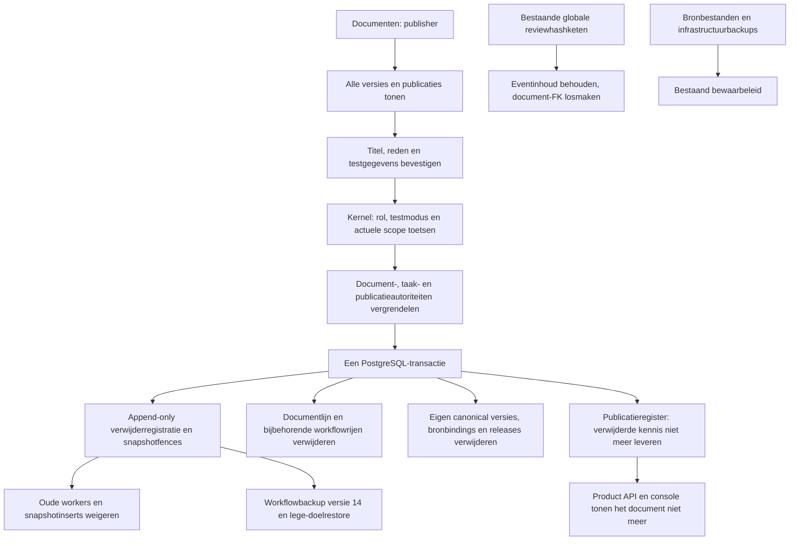

# Publisher verwijdert een testdocument

Deze functie is standaard uitgeschakeld. Alleen tijdens de expliciet
ingeschakelde testfase kan een publisher de volledige opgeslagen documentlijn
verwijderen. De console toont een voorstel en bevestiging; de kernel beslist
en schrijft alle domeingegevens in één PostgreSQL-transactie.

De identiteit komt uit `logical_document_id`, nooit uit een titelvergelijking.
Een gemengde publicatie of een verwijzing vanuit een andere documentlijn wordt
geweigerd. Lopende verwerking moet eerst gestopt zijn. Een gewijzigd voorstel
vraagt opnieuw bevestiging. Eenzelfde command ID met dezelfde inhoud geeft
dezelfde opgeslagen uitkomst; afwijkende inhoud conflicteert.
De korte SQL-transactie sluit ook gelijktijdige starts van operationele taken
uit. Bij een al actieve schrijver weigert verwijderen direct; de bestaande
verwerking behoudt haar gegevens en de publisher kan later opnieuw proberen.
Ook documentrijen worden vóór het voorstel opnieuw wordt gecontroleerd
vergrendeld. Een annotatiebewerking met hetzelfde aantal annotaties maakt een
oude bevestiging ongeldig. Broncontroles en publicatieweigeringen gebruiken
dezelfde snapshotvergrendeling als verwijderen; databasefences weigeren late
registratie voor een reeds verwijderd document.
De lockvolgorde begint bij de bestaande autorisatiegrens, zodat een gelijktijdige
rolwijziging vóór de accountcontrole kan afronden. Bezette document- en
publicatiereserveringen worden direct geweigerd. Het verwijder-event blijft aan
het publisher-account gekoppeld via de bestaande auditresolutie.

De SQL-fences blijven actief na uitschakelen van de functie of terugrollen van
applicatiecode. Workflowbackup 14 neemt de registraties op. Een oude archivevorm
met nieuwe verwijdergegevens wordt geweigerd; een expliciet oudere back-up mag
alleen via de bestaande lege-doelprocedure worden hersteld.
Ook een oudere exporter bewaart het globale verwijder-event. De huidige lezer
herkent daarmee ontbrekende nieuwe tabellen; een uitgestelde databasecontrole
weigert de import van dat event zonder bijbehorende receipt en snapshotfences.

## Installeren en later uitschakelen

De normale containerreleaseprocedure blijft gelden. Pas migraties 039 en 040 via het gecontroleerde migratieplan toe. Deze
migraties verwijderen geen bestaande gegevens. Migratie 040 herstelt de
cascadebeveiliging voor de verwerkingsindex: verwijderen van het hele document
werkt bij beide FK-volgorden; losse indexverwijdering blijft geweigerd zolang
document en verwerkingstaak bestaan. Gebruik bij het controleren van de runtimegrants expliciet
`verify --runtime-role <rol> --test-document-deletion`; alleen dit profiel vraagt
de ontbrekende SELECT- en DELETE-grants op de canonical tabellen en operationele
documentregels. SELECT is ook nodig voor de verwijdervoorwaarden op
`view_checks` wanneer die functie uitstaat en er nog geen leesrechten zijn.
De verifier voert GRANT-statements niet uit.
Bij een installatie met alleen workflowtabellen mag de bestaande workflow
doorgaan. De verwijderfunctie vereist daarnaast canonical bronlijnmigratie 001;
voer 039 daarna opnieuw uit om ook de bronfence te installeren. Ontbreekt die
fence, dan blijven verificatie en de verwijderopdracht geblokkeerd.

Na succesvolle review en release kan de beheerder
`CONSOLE_TEST_DOCUMENT_DELETION=on` instellen. Zet deze instelling na de testfase
weer op `off`. Verwijder de receipt-/fencetabellen en triggers niet als rollback;
code terugrollen herstelt geen verwijderde documenten.

Zie het [volledige lifecyclecontract](../change-contracts/1037-publisher-test-document-deletion.md)
voor autoriteiten, fout-/herstelgedrag en bewijsgrenzen. Dit document verklaart
geen productie-uitrol of uitgevoerde verwijdering.
