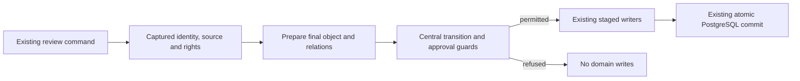

# KO-4 architectural brief

Grounded on `main` `9cd19ab7` in `/workspace/Metis-ko4`. This brief synthesizes two read-only explorers (`ko4_how_review` and `ko4_how_repairs`) and targeted source checks by this explainer. All used the actual inherited session model. This is independent workstream grounding, not cross-model consensus. No tests, servers or external writes were run by this explainer.

## Overview

The existing PostgreSQL review command already owns authorization, captured source/object/binding inputs, revision freshness, the transaction and the final commit. KO-4 should centralize the rules that permit a state-changing event **inside that command**, then retain its current writers. It should not introduce a second command/transaction owner or derive state by rereading the database before invoking the old command.

The most consequential placement constraint is that approval prepares its final semantic tuple before writing approval: type, parent, strength and confirmed relations can change in the same atomic action. The central approval guard must inspect that prepared tuple. A guard on the initial UI state alone is insufficient.

## Key Concepts

- **Current review authority:** exact object-version/hash bindings, not the governance stamp or the transition table. See `src/publication/publish_authorization_v1.py` and the existing binding calls in `src/operations_console_v1.py`.
- **Request-owned inputs:** `ReviewCommandInputs` captures the bounded histories, bindings and prepared fragments needed by the whole MRO. `execute_review_command` owns their currentness (`src/review/review_command_v1.py:224`).
- **Prepared command changes:** `_commit_prepared_store` stages into an active review command (`src/workflows/workflow_review_cutover_v1.py:289`). The outer command applies the object and binding deltas together.
- **Derived KO state:** `derive_ko_state` is a read projection. It is not persisted authority. Its approved branch precedes evidence checking (`src/review/knowledge_object_state_v1.py:209`).
- **Successor revision:** `revise_object` prepares a new version with cleared approvals and exact predecessor lineage (`src/review/revision_workflow.py:109`). An explicit correction needs re-review; semantic confirmation inside one approval can produce and approve its exact successor in that same command.

## How It Works

### First review and approval

The public path is `ReviewClosureConsole.review_object` → `execute_review_command` → the existing review MRO → `OperationsConsole.review_object`. The intervening deterministic-repair and closed-loop layers enforce executable repairs and suitability/disposition rules. The base command performs role/participation, source, object/CAS, current duty, policy, type and semantic checks.

`execute_review_command` prepares source inputs, locks authorizations and the document row, rechecks current rights and source/generation identity, captures bounded histories/bindings, invokes the full kernel, then commits its staged object/binding/audit changes. The new transition control should consume these captured facts rather than add SQL reads.

`OperationsConsole.review_object` then prepares type/parent/strength and confirmed knowledge relations. It can create a canonical successor before `_apply_review_state` at line 3728. The evidence/three-answer guard belongs after final preparation and before approval/binding staging. A proposed supporting relation that is removed during confirmation must not satisfy it.

An exact duplicate approval can return without mutation when its `review_command_hash` and binding still match (`src/operations_console_v1.py:3349`). Preserve this replay result: replay is not a new approval decision and must not acquire a duplicate event or binding.

### Second review, type confirmation and explicit correction

`approve_second_review` (`src/operations_console_v1.py:3862`) rechecks actor, policy, source and exact current approvers, then adds the independent authorization and audit through the existing atomic mutation. The central table must preserve risk-dependent second review; it must not require two reviewers universally.

`confirm_object_type` (line 1112) validates scope/admission/source and prepares a successor when required. `correct_object` (line 4092) prepares the literal source-bound correction, rechecks actor/source/CAS/mutability under the existing reprocessing transaction and commits the open successor plus invalidated bindings and evidence. Published working revisions remain immutable.

### Deterministic repairs and merge

`submit_review_resolution` (`src/review/deterministic_review_repair_v1.py:728`) preflights the submitted repair, prepares source data, then repeats freshness checks inside its existing transaction. Source and merge repairs call **`OperationsConsole.correct_object` directly**, bypassing outer overrides. The base mutation boundary therefore needs coverage; an outer `ReviewClosureConsole` guard alone leaves a supported bypass.

`_supersede_merge_targets` (line 509) is an internal writer within the validated repair command. It marks exact merged-away versions as superseded, records their target and invalidates bindings. It is not an independently authorized public event.

Support and classification repairs currently invoke `super().review_object(decision='revise')` first. `resolve_support_relation` (`src/review/closed_review_loop_v1.py:523`) then requires raw `validation_status='revise'` and a latest revise event whose original suitability is `alleen_onderbouwing`. Removing new persisted `revise` writes therefore requires replacing this in-command protocol with explicit validated repair context. Merely renaming the status breaks support repair. Keep legacy input/recovery compatibility separate from new writes.

### Atomicity and recovery

The actual production atomic owner is `_PostgresWorkflowReviewMixin._atomic_snapshot_mutation` (`src/workflows/workflow_review_cutover_v1.py:391`): it joins the active command/savepoint or store command, otherwise uses the native transaction and buffered audit. On failure it refreshes process projections from PostgreSQL. The similarly named document mixin is not the review owner (`src/workflows/workflow_documents_cutover_v1.py:1311`). KO-4 must retain this ownership and must prove refusal/partial failure without object, binding or audit writes.

## Where Things Live

| Concern | Existing owner |
| --- | --- |
| Whole first-review command and captured inputs | `src/review/review_command_v1.py`, `review_command_state_v1.py` |
| Review/type/second-review/correction operations | `src/operations_console_v1.py` |
| Suitability and support repair | `src/review/closed_review_loop_v1.py` |
| Structured source/classification/support/merge repair | `src/review/deterministic_review_repair_v1.py` |
| Published-work refusal and outer repair evidence | `src/review/review_closure_v1.py` |
| Exact successor preparation | `src/review/revision_workflow.py` |
| PostgreSQL staging, savepoints and rollback | `src/workflows/workflow_review_cutover_v1.py` |
| Derived state and current evidence predicate | `src/review/knowledge_object_state_v1.py` |
| Source role mutation and dependent KO reopening | `src/review/source_context_review_v1.py` |

## Design Recommendation — Not Existing Implementation

Prefer one central transition policy accepting the current derived state, event and already-captured authoritative facts. Invoke it at the existing mutation boundaries and let the current commands call their current writers. This fits bounded reads, avoids MRO recursion and preserves transaction ownership.

Reject a dispatcher that independently reads the console, derives state and then calls the old public command. Its precheck can be stale, it repeats reads and it can recursively redispatch through overrides. A safe dispatcher would need the same captured facts passed inward, converging toward the recommended shape.

The transition table must express policy-dependent targets and same-command preparation. The actual resulting state stays derived after the authorized write; the table must not store a second lifecycle status or treat its target as serving authority.

## Gotchas, Resolved Decisions and Remaining Boundaries

**Observed prerequisite mismatch.** KO-2 PR #1001 was merged to `docs/review-card-receipt-agreements` after that parent had already merged to main. The KO-2 runtime modules and three-answer contract are absent at `9cd19ab7`; its original `76444a4c` is not an ancestor. Root has assigned prerequisite #1004 to integrate the existing approved implementation separately. Do not design a replacement assessment contract on the old main UI.

**Observed evidence gap.** `has_evidence` at `knowledge_object_state_v1.py:122` currently accepts proposed or confirmed `supported_by`/`explains`. It consumes no recorded evidence-N/A decision. Also, an already approved object can derive `Goedgekeurd` without passing that evidence branch. Every genuinely new approval must therefore check final evidence facts, irrespective of its initial label.

**Resolved operator decision, 6 November 2026.** The same mandatory-evidence rule applies to **every next approval**, including existing unpublished knowledge objects. Explicit recorded “niet van toepassing” remains allowed. Existing publications stay immutable. Do not ask the grandfathering question again or silently grant a historical exemption. Reads alone must not rewrite historical approvals.

**Design still to specify.** An evidence-N/A fact needs a bounded durable representation tied to the exact reviewed object/version/hash, recorded through the existing review writer and invalidated by relevant change. No representation was found in the inspected source. Unrelated source-coordinate `not_applicable` values are not such a decision. This choice belongs in the implementation contract before product code; it is not a new lifecycle-status authority.

**Real external dependency.** #942 owns consolidation of the single-source `_confirm_source_context` writer (line 566) onto `source_role_version` (line 212), already used by batch/group/reset. KO-4 must not absorb that work or introduce a third source-role writer. The source-context phase remains explicitly pending until #942. Source-role rows can have derived state `None`, while their command versions and reopens dependent KOs, clears approvals and invalidates bindings. A future source-context table integration must cover those effects without requiring a source row to be a KO.

**Verification boundary.** This brief contains source grounding and design recommendations, not test results or an implementation-completion verdict. The independent review/repair core can proceed after the KO-2 integration and a complete high-risk contract. Full KO-4 cannot be claimed complete while its source-context phase remains pending.
