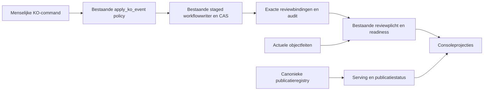

Change class: A
Promise: KO-review en publicatiestatus gebruiken uitsluitend bestaande exacte bindingen, centrale transitieregels en het canonieke publicatieregister; de in KO-5 benoemde parallelle uitvoeringspaden verdwijnen zonder wijziging van bestaande besluiten of serving.
Proof: bestaande native ingest→review→tweede review waar vereist→publicatie→intrekking/herstart blijft gelijk; oude opgeslagen payloads blijven leesbaar; een geplante omweg wordt door de single-way-controle ontdekt; volledige CI en start-/reviewprestatiepoort.
Touches lifecycle invariants: yes
Rewrite risk: high

## Opdracht en startcriterium

William geeft expliciet opdracht: “Start KO5”. Uitvoering onder #995 / MET-56 volgens [KO-programmaplan](https://github.com/WilliamGomes41/Metis-DS/blob/main/docs/plans/ko-statechart-program.md#delete-the-parallel-ways-of-working-ko-5).

Uitvoeringsbase: main `07db5080666f0428a454f5a705e50825a4fc5506`, inclusief W1 prepared source-resolution en W4 statement-generation/CAS. Bestaande operatorcriteria blijven ongewijzigd; eventuele productie-uitvoer staat afzonderlijk in MET-56 en niet in dit GitHub-dossier.

Het broncontextdeel van KO-4/#942 blijft afzonderlijk. KO-5 stopt alleen niet-authoritatieve spiegelsynchronisatie in bestaande bronrolwriters. Rolbesluit, exacte contextlinks, named-reviewercontrole, versieopvolging en bindinginvalidering blijven behouden. De twee bronrolwriters worden niet geconsolideerd en #942 wordt niet afgesloten.

Geen merge, deployment of KO-6-datamigratie in deze opdracht. De GO voor KO-5 is gegeven; opnieuw om dezelfde toestemming vragen is niet nodig.

## Gevonden uitvoering, geen lijst met verondersteld dode bestanden

1. Startup: console_asgi.build_app neemt bestaande store-lock, herlaadt, voert bootstrap en migrate_legacy_revise_to_review uit, daarna reconcile_durable_publications. Alleen de revise-herstelcall en bijbehorende functie zijn KO-5-doel; bestaande publicatiereconciliatie en locking blijven behouden.
2. CLI: review_workflow_v3.apply_reviews is geblokkeerd; de interne _apply_review_state heeft nog een actieve import vanuit OperationsConsole. Niet het hele bestand verwijderen.
3. SQLite: src/publication/canonical_store.py heeft een compatibility-CLI src/canonical_store.py. Geen gewone productimport gevonden behalve die wrapper; tests/test_architecture_invariants.py importeert nog gedeelde hashfuncties uit de pilot. Eerst die callers naar de bestaande integriteitskern omzetten en equivalentieregel bewijzen.
4. Publicatiestatus: document_status_v1._local_release_serving_status wordt nog gebruikt door derive_document_status en de canonical-store-fallback in DocumentStatusReadinessMixin. Badgecode heeft drie canonical_publication_store-is-None-paden. Alle ondersteunde PostgreSQL-ingangen/MRO-varianten moeten hun bestaande registry-eigenaar blijven gebruiken.
5. Spiegelvelden: second_review wordt nog gelezen in review_duty_v1 (bindings=None-boomroute), source_context_review_v1 en de KO-invariantdiagnostiek; publication_status in revision_workflow/deterministic_review_repair; review_passes in mutatie-/concurrentieguards; clinical_rereview_required in badge-SQL en documentstoreprojecties. Eerst gedrag uit bindingen/registry/actueel reviewwerk afleiden, dan de spiegelupdates verwijderen.
6. Contractgrens: knowledge_object.schema.v1.0 t/m v1.4 vereisen nog publication_status en second_review. De fysieke workflowkolom clinical_rereview_required en serialisatie zijn geen dode code. Geen gepubliceerde payload herschrijven of vereiste schemaonderdelen blind schrappen. Vereiste vorm bij constructie/nieuwe revisie blijft tot KO-6 behouden: second_review.required volgt bestaande hashgebonden risk.requires_second_review; geen akkoord/reviewer/completion uit spiegels. Schema’s en historische opgeslagen payloads blijven ongewijzigd.
7. Testgrens: het programmaplan beschrijft een verbod op validation_status-writes buiten ko_transitions_v1. Het geïmplementeerde KO-4-contract koos juist centrale guards met bestaande staged writers; apply_ko_event schrijft zelf geen validation_status. Initialisatie van kandidaten is bovendien eigendom van de bestaande deterministische materialisatie. De guardtest bewaakt menselijke KO-besluiten vóór de bestaande atomaire commit. Voorbereide kopieën en deterministische kandidaatinitialisatie zijn geen tweede duurzame writer. Het plan wordt hiermee gelijkgetrokken met het reeds vastgelegde KO-4-contract; geen nieuwe writer-allowlist.

## Verwijdervolgorde

- Volledige caller-/readerkaart en contractcompatibiliteit afmaken; productie-inventaris beoordelen.
- Hash-/CLI-callers naar bestaande eigenaars migreren; geblokkeerde review-CLI en SQLite-pilot plus wrapper verwijderen.
- PostgreSQL-status-/badgelezen op dezelfde bestaande registry afleiden; lokale fallbacks verwijderen.
- Spiegelafhankelijkheden per eigenaar omzetten; verwijderde legacytests benoemen en noodzakelijke gedrags-/weigeringsproeven behouden.
- Startup-herstelroute pas na aangetoond nul legacy revise verwijderen.
- Verouderde topologyregels in knowledge-context-foundation.md, source-accountability-recovery.md, bounded-model-processing.md, source-containers.md en recoverable-formation.md actualiseren zonder historische meetclaims te herschrijven.

## Rewrite mitigation

Rewrite target: compatibiliteitslezers, obsolete CLIs, mirror-updates en startup-revise-herstel uit het bestaande KO-programma.
Why local patching is insufficient: alleen functies verwijderen laat actieve readers, verplichte schemastructuur en alternatieve MRO-/CLI-routes achter.
Current authority/writer/reader map: bestaande OperationsConsole/mixin-commandketen en ko_transitions_v1; workflow_transaction en PostgresConcurrentWorkflowDocumentStore; exacte object_review_bindings; review_duty/KO-afleiding; canonieke PostgresCanonicalPublicationStore/publication_registry; DocumentStatusReadinessMixin, badge-SQL, source-rolecommands en bestaande recovery. Bovenstaande zeven families vormen de implementatiekaart; onafhankelijke grounding is gecontroleerd op de exacte uitvoeringsbase.
Supported runtime topologies: ondersteunde PostgreSQL-runtime, één/twee workers, lokale immutable bronopslag en Azure immutable bronadapter. Geen SQLite- of bestandsworkflow-runtime introduceren.
Persisted-state impact: geen historische backfill, fysieke kolomverwijdering, nieuwe statuskolom, nieuwe authorisatie- of servingautoriteit. KO-6 blijft eigenaar van opgeslagen velden strippen.
Compatibility/migration plan: aanroepers eerst, legacy APIs daarna; reads uit bestaande autoriteiten. Oude payloads op dezelfde database blijven leesbaar. Constructor-/opvolgervorm blijft niet-authoritatief schema-compatibel tot KO-6. Single-way bewaakt de KO-4-guard vóór commit, niet iedere dictionary-assignment.
Rollback/recovery plan: vorige KO-4-image moet op dezelfde database kunnen starten; geen data strippen. Startup/herstart en coderollback vergelijken op fysieke bindings, publicaties en afgeleide toestanden.
Cutover trigger: programma-startcriterium met operatorcounts, volledige caller-/contractkaart en vervolgens exact-head unit/native/live/perf/CI plus onafhankelijke adversariële verificatie; merge/deploy door operator.
Cleanup/decommission criteria: benoemde legacy entrypoints/imports verdwenen; geen runtimebesluit gebaseerd op mirrors; geen dubbele final-statussets; noodzakelijke schemacompatibiliteit expliciet begrensd tot KO-6.
Failure blast radius: reviewverplichtingen, object-/documentlabels, badges, herverwerking en restart. Fouten mogen nooit ongereviewde objecten laten serveren, reviewwerk laten verdwijnen of een publicatie heropenen.
Adversarial proof matrix: directe/base/MRO/CLI-ingangen, bindings=None-lezers, oude payloads, verkeerde versie/hash/reviewer, spiegel die autoriteit tegenspreekt, gepubliceerde v1 met werkende v2, twee workers, restart, recovery, withdrawal en coderollback.

## Lifecycle slice

Lifecycle entity: bestaande WorkingRevision, exacte KO-tuples/bindingen en bestaande canonieke PublicationRelease.
Lifecycle transition: bestaande open review→geautoriseerd akkoord→Goedgekeurd/Tweede review en bestaande publicatie/intrekking; KO-5 verwijdert parallelle uitvoering zonder deze transities te herdefiniëren.
Initial durable state: PostgreSQL-fixture met open en gereviewde objecten, actieve/ingetrokken publicaties en oude spiegelpayloads.
Trigger: bestaande review/publicatie-/herverwerkingscommand of restart van de console.
Authorization: bestaande named-reviewer-, onafhankelijke tweede-review- en publisherregels; geen nieuwe bevoegdheid.
Validation: bestaande KO-4-guards, exacte tuple/bindingen, bronimmobiliteit, CAS, readiness en canonieke registry.
Mutable entities: alleen bestaande ongepubliceerde commandmutaties via bestaande workflowwriter; geen datamigratie door KO-5.
Immutable entities: bronbytes, historische objectversies/besluiten, gepubliceerde releases, hashes en registryhistorie.
Workflow state before: bestaande processing/in_review/blocked/ready_for_publication/closed volgens fixture.
Workflow state after: identiek aan dezelfde bestaande command op KO-4; lezen en restart voegen geen reviewerbesluit toe.
Release state before: none/published/superseded/withdrawn volgens bestaande registry.
Release state after: alleen bestaande geautoriseerde publicatie-/withdrawcommand verandert release; reads/restart wijzigen niets.
Serving state before: bestaande active/inactive-set.
Serving state after: dezelfde registryset als vóór de codecutover; withdrawn/superseded blijft inactive.
Expected API result: exact dezelfde canoniek actieve, goedgekeurde objectversies; geen nieuwe werkversie in serving.
Expected UI result: consistente kaart/bon/readiness/badges en vereiste tweede review uit bestaande autoriteiten, ook met tegenstrijdige mirrors.
Failure result: bestaande command weigert en rolt terug zonder gedeeltelijke binding, audit of servingwijziging.
Restart result: geen legacy-revise-schrijfactie bij startup; overige bestaande geautoriseerde recovery behouden.
Recovery result: bestaande duurzame technische herstelgrens mag geen nieuw review-/publicatiebesluit verzinnen.
Legacy-data result: oude spiegelvelden blijven opgeslagen en leesbaar, zonder beslissende autoriteit; fysieke verwijdering uitsluitend KO-6.
Required black-box scenario: GIVEN exact gereviewde/gepubliceerde en open opvolgertuples met oude spiegels WHEN KO-5 start en bestaande review/publicatie/intrekking uitvoeren THEN dezelfde bindings, verplichtingen en serving als KO-4; restart en coderollback bewaren dat resultaat.
Explicit non-goals: KO-6, dataverwijdering, #942-bronrolconsolidatie, #991-publicatieactie, performanceprogramma #729, nieuwe state/store/gate of autonome merge/deployment.

Part of MET-56.

## Ontwerpkeuze en bewijs vóór code

Twee onafhankelijke read-only onderzoeken op c26b01d0, gericht hercontroleerd op base07db5080. KO-4 koos centrale policy met bestaande staged writer. Optie A behoudt verplichte compatibiliteitsvorm zonder beslissende rol; optie B laat velden nu weg en versoepelt schema’s. A gekozen: B breekt oude-imagevalidatie na rollback en trekt KO-6-contractwerk naar voren. Pure fixtureproeven toonden required-property-fouten onder schema1.1/1.4 bij ontbrekende sleutels met ongewijzigde canonieke hash; high-risk vlag vereist overeenkomende second_review.required. Dit is schema-/hashbewijs, geen native rollbackbewijs.

- Oude governancevorm bij nieuwe objecten/opvolgers blijft valide; riskfeiten blijven behouden; geen completion/reviewerbesluit uit spiegels.
- Tegenstrijdige second_review/publication_status/review_passes/clinical_rereview_required mogen geen reviewplicht verbergen of serving activeren.
- Native anti-bypass-proef vervangt centrale policy tijdelijk door herkenbare weigering: iedere relevante public/directe command weigert zonder fysieke object-/binding-/eventwrites. Eén geïsoleerde echte beleidsomzeiling moet de proef rood maken.
- Prepared-source-arm gebruikt echte source_units plus expected_revision, controleert tijdens policy preparing=True/store_lock_depth=0/geen workflowtransactie, en reset van review-eventbuffer. Whole-objectset epoch/CAS blijft staan.
- Ordinary en boom, hoog-risico-opvolger, publicatie/intrekking, twee workers, herstart en echte oude-image coderollback op dezelfde testdatabase.
- Bestaande W1/test_prepared_source_resolution.py en W4-activation/generation-proeven blijven geldig. Geen extra zware leesronde of buitenste transactie.
- Starttijd en reviewkaart p95: vooraf vastgelegde afwisselende vergelijking tegen deze base, maximaal5% regressie. Geen snelheidswinst afleiden uit minder regels.

KO-5 verwijdert parallelle legacy review/publicatiepaden binnen de geïmplementeerde KO-4-kern. Dit realiseert de nog geplande #942-broncontextconsolidatie niet.

## Uitvoering en begrensd bewijs

De codecutover verwijdert startup-reviseherstel, de geblokkeerde publieke JSONL-reviewingang en de SQLite-publicatiepilot/wrapper. De private staged reviewtransformer blijft achter de bestaande KO-4-policy. Hashproeven gebruiken rechtstreeks de bestaande integriteitskern. Documentstatus, lijststatus en navigatiereview sluiten bij ontbrekende canonieke authority; een envelope kan serving niet activeren.

Alle runtimebeslissingen uit de vier benoemde mirrors zijn vervangen door exacte bindingen, actuele objectfeiten of de bestaande canonieke registry. De boomroute zonder bindingen veronderstelt geen akkoord meer. De oude frontiercertificaatsleutel `historical_has_publication` blijft een inert compatibiliteitsveld; de bestaande registrycontrole onder de writerlock blijft de publicatieseal. De opslagdelta voor review synchroniseert geen envelope-reviewticks meer. Vereiste nieuwe-object-/opvolgervorm blijft tot KO-6 bestaan; een nieuwe opvolger reset een oud akkoordpatroon zonder reviewer, binding of completion te verzinnen. Historische payloads en fysieke clinical-kolom/serializers blijven behouden.

De oude `clinical_rereview_required`-boomkamerindicator vervalt als parallelle reviewteller. De huidige navigatie toont geen automatische werkbadges; de bestaande kernproef `test_c_kernel_counts_remain_available_without_automatic_navigation_badges` bewaakt dat. Het historische navigatiecontract laat bij Documenten alleen een eventuele persoonlijke familie-/klasseactiequeue toe, geen globale reviewqueue. Die afzonderlijke actiequeue bestaat hier niet. De response behoudt daarom een inactieve `tree: 0`-compatibiliteitssleutel voor alle rollen. Werkelijke toegewezen review-/bronafhandeling blijft uitsluitend bij de bestaande Review-projectie. Geen globale objectmaterialisatie, extra query, nieuwe queue of SQL-kopie van review-/bronregels. De native proef bewaakt echt open reviewwerk naast afgehandelde ongepubliceerde en gepubliceerde revisies met contextkoppen; true/false-mirrors veranderen geen van deze uitkomsten.

Gerichte native `test_ko_single_way.py` vervangt de centrale policy tijdelijk door één herkenbare weigering voor akkoord, direct basisakkoord, tweede review, correctie, directe basiscorrectie, type, relaties, afwijzen, later, steun, merge en echte voorbereide source_units. De proef vergelijkt fysieke object-/bindingrijen en auditevents, controleert bufferreset en bewijst voor de voorbereide bronroute `preparing=True`, lockdiepte nul en geen workflowtransactie. Een begrensde AST-proef ontdekt dubbele eindstatussets; de twee bestaande reparatielezers hergebruiken nu de bestaande constante. Kandidaatinitialisatie blijft bij de bestaande materialisator.

Testmigratie bij verwijderde ingangen:

- `test_storage_publication_v2.py` en de SQLite/CLI-sectie van `test_h2a_approvals_independent_v1.py` vervallen met de pilot. Native canonieke publicatie-, autorisatie-, onafhankelijkheids- en weigeringsproeven blijven behouden.
- De geblokkeerde-JSONL-proef in `test_t9_review_knowledge_authority.py` vervalt met de publieke API; de native autoriteits- en hashproeven in dat bestand blijven behouden.
- De startup-migratieproef in `test_review_closure_v1.py` vervalt met de migrator. Publicatie-/source-contextproeven roepen die verwijderde migrator niet meer aan; hun bestaande immutabiliteits- en lifecycleclaims blijven behouden.
- Mirrordiagnostiek-, badge-, klassewijzigings-, tweede-review-, frontier- en opslagtests toetsen de bestaande autoriteit in plaats van mirrorcompletions. Concurrente verwerking gebruikt werkelijk duurzaam reviewwerk/bindingen in plaats van een los envelope-vlaggetje; de bestaande native review-tijdens-reextractproef blijft behouden.

Dit lokale dossier bevat geen productiemetadata. Volledige CI (PostgreSQL 16), onafhankelijke native/live-/rollback-/prestatiecontrole en operatorreview blijven afzonderlijke exacte-head-poorten; lokale PostgreSQL 17-proeven zijn geen productie- of mergeclaim.

Actuele compositie na de codecutover (geen nieuwe owner):

Aanvullende reviewbevindingen: de offline `prepublication_gate_v3`-CLI kon geen exacte duurzame bindingen lezen. Een schema-/hash-/bronvalide synthetisch bestand dat onder de oude file-policy slaagde, leverde na de readercutover uitsluitend `object_tuple_required` op. Deze nog geïnventariseerde file-verdict-route is expliciet uitgefaseerd: `prepublish`, beide module-entrypoints en de uitsluitend daarvoor gebruikte `eligibility_policy` verdwijnen. `audit-current` behoudt exact zijn bestaande schema-, hash-, bronfragment- en parentintegriteitscontroles, maar rapporteert geen publicatieverdict of publicatieblockertelling. Zijn status betekende al uitsluitend `integrity_ok`; hij verleent geen publicatierecht. Geen PostgreSQL-console-/ASGI-ingang importeerde deze offline gate. De bestaande native readiness/publicatieowner blijft ongewijzigd. De actieve publicatielayout en infrastructuurinventaris verwijzen nu naar PostgreSQL; dit beweert geen Azure-provisioning.

De uitsluitend aan de verwijderde offline verdict-API gebonden test in `test_protocol_v2.py` vervalt; de bestaande bron-/hashintegriteitsproeven blijven. Nieuwe subprocessproeven gebruiken schema-/hash-/bronvalide synthetische bestanden: verwijderde ingangen maken geen rapportbestand; de behouden integrity-audit slaagt voor intacte input en weigert een niet opnieuw gehashte tekstwijziging. De drie onafhankelijke D-SEC-3-publicatiecontractproeven in `test_h2a_approvals_independent_v1.py` zijn integraal behouden, inclusief de injectie van een extra echte publicatieblocker.

Bij de native CI-regressies bleek een tweede-reviewbinding op dezelfde objectversie/hash tijdens de voorbereidingsfase geen object-m2-wijziging meer te veroorzaken zodra de spiegelcorrect verdween. Een expliciete m2-reviewcommand hergebruikt daarom de documentcounters die de bestaande inputreader al vóór de voorbereiding levert, en vergelijkt die met de reeds onder lock gelezen counters. Een tussenkomende bindings-/documentwriter weigert; de volledige objectsetvergelijking blijft behouden. Dit voegt geen query, tokenformat, mirror of authority toe. Het m2-token blijft een objectsettoken: deze aanvullende controle beschermt de tijd tussen voorbereiding en commit, en beweert niet dat een al vóór voorbereiding uitgegeven m2-token zelfstandig alle bindingshistorie bevat. Generatiecommands en onvoorwaardelijke semantische replay behouden hun bestaande contract.

Twee geïsoleerde leesfixtures zijn aangepast aan de vereiste expliciete canonieke input; hun workflow-querybudgetten blijven ongewijzigd en geen runtimefallback is hersteld. De legacy-lineageproef behoudt de publicatie-intrekkingsweigering, nu met werkelijke duurzame canonieke releasehistorie aan de bestaande native writer en een fysieke no-write-controle. Alleen een gezet `governance.publication_status`-veld kon die invariant niet bewijzen; de bestaande volledige native publicatie-/herstart-/immutabiliteitsproef blijft daarnaast staan.

De bestaande D5-coderollbackproef vergelijkt de volledige duurzame/productuitvoer met een oudere image. Onafhankelijke recursieve vergelijking vond alleen de verwachte extra `review_passes`-tick die die image nog schrijft voor de nieuwe, werkelijk geaudite goedkeuring. De proef controleert eerst dat de huidige code de oude mirror exact behoudt en dat de oudere code precies één tick schrijft voor de verwachte reviewer, het exacte object en `passed=True`, met een geldige timestamp en zonder extra sleutels. Uitsluitend dat ene veld van die ene nieuwe snapshot wordt vervolgens op de vooraf gemeten vorm teruggezet voor de bestaande volledige vergelijking. Andere snapshots, mirrors, objecten, bindingen, registerregels, audit en Product API-uitvoer blijven exact vergeleken; geen algemene mirror-normalisatie of verzwakte publicatiepoort.
