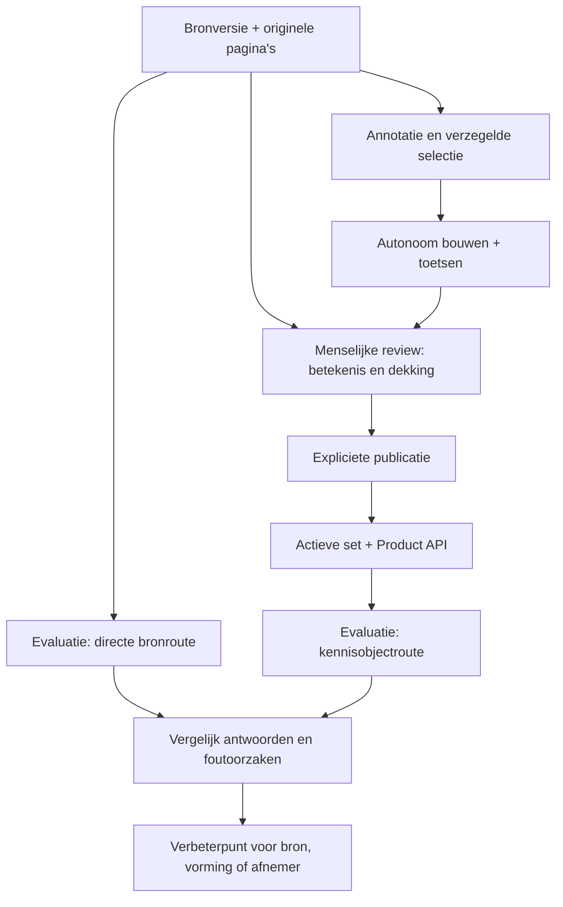

# Metis — Architectuur voor betekenisbetrouwbaarheid

**Ontwerpvoorstel ter beoordeling** · 18 november 2026 · Metis-DS main `ef96729e`

Bouw voort op de bestaande keten. Voeg bij de autonome vorming herleidbare bevindingen toe, beoordeel de dekking vanuit het hele brondocument en meet de meerwaarde voor AI-antwoorden in een afzonderlijke evaluatie. De eerste bouwstap is een controle per documentversie, gekoppeld aan het bestaande vormingsbewijs. Begin met richtlijnen. Beslisbomen behouden hun eigen verplichte graaf- en padreview.

Werkpakket [MET-109](https://linear.app/metis-phoenix/issue/MET-109/1098-ontwerp-betekenisbetrouwbaarheid-en-documentdekking) · GitHub [#1098](https://github.com/WilliamGomes41/Metis-DS/issues/1098)

## 1. Route en eigenaarschap

| Onderdeel | Verantwoordelijkheid | Aansluiting op Metis-DS |
|---|---|---|
| Vorming | De bestaande deterministische bouwer materialiseert kandidaten. Deterministische controles valideren bereik, bronversie, benodigde velden en relaties. Semantische controles signaleren mogelijk betekenisverlies. | `human_annotation_build_v1`, `materialise_knowledge_candidates`, Admission en `FormationEvidence`. |
| Review | De beoordelaar toetst de exacte objectversie en de noodzakelijke context. In de documentweergave vergelijkt de beoordelaar de hele bron met de set en behandelt hiaten via de bestaande bronafhandeling. | `source_accountability`, passage-disposition, `review_duty_for` en het bestaande reviewcommand. |
| Publicatie | Een bevoegde uitgever publiceert expliciet via de huidige gereedheidscontrole. PostgreSQL beheert de actieve set. | `publication_readiness_v1` en `DurablePublicationConsole._publish_locked`. |
| Evaluatie | Een herhaalbare proef vergelijkt directe bronraadpleging met gebruik van de Metis-output. De afnemer genereert de antwoorden. | `src/evaluation`, bestaande brongebonden referentiesets, retrieval en de Product API met `retrieve/abstain`. |

De workflow is **stateful**. De Metis-backend in Azure bezit de duurzame versies, transacties, bevindingen en beslissingen. De console toont projecties en dient bestaande commands in. Azure PostgreSQL blijft de autoriteit voor toestand en verwijzingen. Originele bronbestanden en daarvoor bestemde immutabele bewijsbestanden blijven in de bestaande Azure Blob-opslag. Een inhoudelijke vergelijking kan als pure berekening draaien op vastgezette invoer. Een geregistreerde evaluatierun is afgeleid bewijs binnen dezelfde Azure-opslaggrens. Alleen synthetische, expliciet vrijgegeven testgegevens gaan naar de repository.

## 2. Wat de test aanlevert

**Bij bouwen.** De worker leest het originele bronbestand en de exacte extractie en annotatieverzegeling. Hij gebruikt bestaande Admission- en integriteitscontroles. Een aanvullende semantische controle zoekt naar verschoven modaliteit, doelgroep, voorwaarden, uitzonderingen, negatie, eenheden en betekenisdragende tabelkoppen of voetnoten. Zij levert bevindingen met bronverwijzingen voor de kaart op. Sluit aan op de bestaande categorieën voor brondiscrepanties. Een automatisch signaal blijft herkenbaar als signaal van de worker. Voor herstel past de medewerker of reviewer de bestaande annotatiekaart aan en gebruikt opnieuw bouwen. De test verandert de kandidaat nergens zelf.

**Bij documentcontrole.** Maak in de proef eerst een onafhankelijke inventaris vanuit de volledige bron. Leg per bepaling vast wat zij zegt, de dragende bronplekken en wat toepassing verandert. Koppel de inventaris vervolgens aan de huidige kennisobjectset. Toon per bepaling of zij is gedekt, gedeeltelijk is gedekt, ontbreekt of met reden buiten de afgesproken scope valt. Een bepaling kan door meerdere objecten worden gedekt als hun noodzakelijke samenhang expliciet, bevestigd en versiegebonden is. Hergebruik `recommendation_coverage_v1` als aanwijzing en `extract_metrics_v1.independent_quality_claim_checks` voor bestaande referentiecontroles en `source_accountability` als aansluiting op bestaand bronwerk. De huidige heuristiek telt herkenbare passages en levert geen onafhankelijke referentie voor inhoudelijke volledigheid.

**Bij gebruik.** Bevries dezelfde bronversies en vraagset voor beide proefroutes. Geef één model gelijkwaardige instructies en contextbudgetten. Laat beoordelaars eerst het verwachte gedrag en de dragende passages vastleggen. Bewaar per antwoord de gevonden bronplekken of objectversies, de werkelijk aan het model aangeboden context en het antwoord. Als een fout voorkomt, bepaal of kennis ontbreekt in de set, niet is opgehaald of verkeerd wordt toegepast. Bied zo nodig de juiste bronpassages rechtstreeks aan als diagnose.

### Gegevenscontract

| Gegeven | Exacte binding en inhoud | Functie |
|---|---|---|
| Vormingsbewijs | `snapshot_id`, bronhash, extractiehash, bestaande seal en buildpoging, exacte object-ID/versie/hash, controleversie. | Herleidt elke bevinding naar de invoer waarop zij is vastgesteld. |
| Bevinding | Controlecode, resultaat `geslaagd / afwijking / niet beoordeeld`, bronbereiken, betrokken objecttuples, reden en herkomst van de controle. | Ondersteunt review. Technische integriteitsfouten volgen de bestaande harde controles. Een semantisch signaal kan nooit een reviewbesluit vastleggen. |
| Documentdekking | Bronversie, afgebakend gebruik, beoordeelde setrevisie, bepaling met één of meer bronplekken, gekoppelde objecten en afhandeling. | Toont hiaten in de set. Proefreferenties horen bij Audit. De operationele afhandeling gebruikt bestaand bronwerk. |
| Evaluatiebewijs | Vastgezette vraagset, bron- en release-identiteiten, retrieval-/modelconfiguratie, uitkomsten, foutklasse, beoordelaars en tijd. | Maakt dezelfde vergelijking uitlegbaar en herhaalbaar. |

Sla aanvullende bevindingen op als versiegebonden onderdeel van het bestaande bewijs, mits het opslagcontract versie-compatibele uitbreiding ondersteunt. Bewaar bij onbewezen legacy-invoer de bestaande contracten. Er komt geen backfill. De conceptstatus op het scherm is een afleiding van actuele gegevens. Zodra een relevante selectie, extractie of objectversie verandert, blijven eerdere bevindingen historisch en verdwijnen ze uit de actuele set. Eerder menselijk besluitbewijs behoudt zijn bestaande exacte binding.

**Aansluiting voor aanroepers.** De onderstaande namen beschrijven invoer en resultaat van de nieuwe berekeningen. Het zijn interne contracten binnen de bestaande ingangen.

| Aanroeper | Invoer | Resultaat |
|---|---|---|
| Bestaande buildworker | Verzegelde invoer, gematerialiseerde kandidaten en versie van de controles. | Bevindingen bij het bestaande bewijs van de bouwpoging. |
| Bestaande documentweergave | Actuele snapshot en setrevisie, bronpassages, gekoppelde objecten en beschikbare bevindingen. | Dekkingsbeeld met exacte bronplek en de bestaande actie om het bronwerk te herstellen. |
| Evaluatierunner | Bevroren corpus en release, referentieset en vastgezette configuratie voor zoeken en genereren. | Uitkomst per vraag, antwoordspoor en vergelijking tussen de twee routes. |

Lees de documentgegevens per snapshot in één gebundelde lezing. Groepeer bronplekken en objecttuples eenmaal voor de vergelijking. Een overzicht van meerdere documenten voert de volledige bronvergelijking van ieder document pas uit bij een expliciete evaluatie. Werk in de reviewweergave met de huidige revisie. Gebruik de bevroren revisie om een eerdere evaluatie te reproduceren.

## 3. Transacties, herstel en publicatie

- **Bouwpoging.** Bind de berekening aan de reeds gereserveerde poging. Bereken en schrijf immutabele bewijsbytes buiten een langlopende databasevergrendeling. Activeer de kandidaten en hun bewijsverwijzing pas nadat de huidige werkrevisie en workerclaim opnieuw zijn gevalideerd. Volg de bestaande bundelcommit en terugleescontrole. Een Blob-write zonder geslaagde activatie geeft geen actueel bewijs.
- **Herhaling of concurrentie.** Gebruik de bestaande command-ID en gecontroleerde poging. Een identieke herhaling geeft het bestaande resultaat. Een vertraagde worker mag een nieuwere annotatie of een overgenomen poging niet overschrijven. Een onbeschikbare aanvullende semantische toets betekent `niet beoordeeld`. De bestaande technische weigeringen blijven leidend.
- **Review en vrijgave.** Bevoegde mensen beslissen op exact de actuele versie. Bestaande regels voor onafhankelijke tweede review blijven gelden. Review en publicatie zijn afzonderlijke acties. Zolang de documenttoets in de proef alleen bevindingen levert, laat de bestaande publicatiepolicy zich ongewijzigd toepassen. Een nieuwe inhoudelijke blokkade vraagt een expliciete protocolwijziging en hoort daarna in dezelfde bestaande publicatiegrens.
- **Opvolging en intrekking.** Gebruik de bestaande handelingen voor releasebeheer. PostgreSQL blijft bepalen welke exacte objecten actief zijn. Herbouw afgeleide toestand vanuit die autoriteit. Test uitgifte na intrekking bij de werkelijke leesroute, inclusief herstart. De proef test ook of de afnemer nieuw bewijs gebruikt wanneer een bron wijzigt.
- **Audit.** Bewaar resultaten en beslissingen met bronversie, revisie, actor, tijdstip en reden. Een publicatiebesluit blijft uit het bestaande beslisbewijs reconstrueerbaar. Operationele logs en afgeleide rapporten dragen geen beslissingsrecht.

## 4. Architectuurkeuze

| Variant | Sterkte | Besluit |
|---|---|---|
| Toetsing binnen het bestaande Metis-proces | Exacte versie en bestaande eigenaar zijn beschikbaar op het moment dat een beoordelaar iets kan herstellen. | Gebruiken voor vormingsbevindingen en documentreview. |
| Evaluatie als aparte lezer | De proef kan met bevroren invoer herhaald worden en ook de afnemende AI testen. | Gebruiken voor de vergelijking. Productie blijft gevrijwaard van experimentele schrijfrechten. |

De combinatie benut de bestaande grenzen. Een aparte evaluatiedienst met vrijgavebevoegdheid zou de vastgelegde workflowbeslissingen moeten dupliceren of synchroniseren. Een benchmark in de publicatietransactie zou de beschikbaarheid van modeldiensten onderdeel maken van het vrijgavepad. Beide oplossingen voegen afhankelijkheden toe zonder aangetoonde noodzaak.

## 5. Bouwvolgorde en acceptatie

| Bouwstap | Afgebakende oplevering | Vereist bewijs |
|---|---|---|
| 1. Dekking zichtbaar maken | Eén document krijgt in de bestaande documentweergave herleidbare dekking en hiaten. Koppel aan gerealiseerde objectversies en bestaand bronwerk. Laat de proef beginnen met een vastgezette Smetten-regressieset. | Alle aanwezige objecten kunnen afzonderlijk slagen terwijl een opzettelijk weggelaten uitzondering als hiaat zichtbaar blijft. Een legitieme uitsluiting is herkenbaar. Een nieuwe revisie kan oud bewijs niet als actueel tonen. |
| 2. Bevindingen uit de autonome bouw tonen | Voeg gerichte controles en exacte bewijsverwijzing toe aan het bestaande bouw- en reviewpad. | De test ontdekt een verkeerde bronversie, verwijderde tabelvoetnoot en betekenisverschuiving. Dubbele aanvraag, workerherstart en een tussentijdse annotatiewijziging geven geen dubbele of ongeldige activatie. |
| 3. Effect op AI-antwoorden meten | Breid de bestaande evaluatie uit met een gepaarde bronroute en objectroute. Gebruik vooraf vastgelegde vragen, beoordelingscriteria en een eindtoets op ongebruikte documenten. | Rapporteer ernstige bronafwijkingen per antwoord met teller en noemer, gemiste uitzonderingen, terecht terughoudende antwoorden en onnodige weigeringen. Leg per fout vast waar die ontstond. Toets wijziging en intrekking via de echte uitgifte. |
| 4. Karakter van de toets besluiten | Bepaal met proefresultaten welke bevindingen helpen in review en welke eventuele aanvullende harde regel nodig is. | Een geautomatiseerde controle wordt pas een harde regel bij een expliciet protocolbesluit en toetsbare foutcondities. Patiëntspecifiek beslisgebruik vereist afzonderlijke evaluatie in de praktijk. |

**Eerste implementatieslice.** Neem documentdekking op in het bestaande project Kennisobjecten, beoordeling en publicatie. Bewijs eerst met een bronvariant waarin de uitzondering op een andere plek staat dan de aanbeveling. De bestaande individuele objecttest blijft groen en de documenttoets moet het ontbrekende onderdeel met bronplek teruggeven. Deze slice is voorgesteld als Class B met `Rewrite risk: none` zolang zij alleen bevindingen toont. Een wijziging van vrijgavevoorwaarden vraagt herclassificatie volgens de repo-regels. Voeg voor deze eerste stap geen nieuwe workflowmotor, afgeleide publicatiestatus of migratie van bestaande releases toe.

## Bronnen en verificatiegrens

- Geïnspecteerde productcode en protocollen op [Metis-DS ef96729e](https://github.com/WilliamGomes41/Metis-DS/tree/ef96729e300191f3b98875f66d9395ded93747a0), in het bijzonder [PROTOCOL.md](https://github.com/WilliamGomes41/Metis-DS/blob/ef96729e300191f3b98875f66d9395ded93747a0/PROTOCOL.md), [de eigenaarskaart](https://github.com/WilliamGomes41/Metis-DS/blob/ef96729e300191f3b98875f66d9395ded93747a0/docs/agents/abstraction-boundaries.md) en [Kwaliteit & werkproces](https://github.com/WilliamGomes41/Metis-DS/blob/ef96729e300191f3b98875f66d9395ded93747a0/docs/QUALITY_WORKPROCESS.md).
- Aansluitende trajecten omvatten [Kennisobjecten, beoordeling en publicatie](https://linear.app/metis-phoenix/project/metis-kennisobjecten-beoordeling-en-publicatie-09d3f6fa01f8), [Menselijke annotatie en bronverantwoording](https://linear.app/metis-phoenix/project/metis-menselijke-annotatie-en-bronverantwoording-2f0f2c4b9697) en [Dataopslag en bewijscontrole](https://linear.app/metis-phoenix/project/metis-dataopslag-en-bewijscontrole-3d7928743f40).
- De proefopzet steunt op [WHO SMART Guidelines](https://www.who.int/teams/digital-health-and-innovation/smart-guidelines), [CheckList](https://aclanthology.org/2020.acl-main.442/), [CounterMem](https://aclanthology.org/2026.findings-emnlp.1054/), [beoordeling van betekenisfouten en weglatingen in klinische tekst](https://www.nature.com/articles/s41746-025-01670-7) en [DECIDE-AI](https://www.bmj.com/content/377/bmj-2022-070904.full).

Dit is een uitvoeringsontwerp op de geïnspecteerde hoofdbranch. Het gedrag van de nieuwe bouwstappen is voorgesteld. Voor uitvoering van productcode werkt Metis-DS met één expliciet toegewezen, uitvoerbaar `ready-for-agent`-issue.

De repository-preflight en de controle op architectuurgrenzen zijn geslaagd op deze hoofdbranch. De geselecteerde runtime-tests konden niet starten doordat PostgreSQL 16 hier ontbreekt. De nieuwe toets is nog niet geïmplementeerd of gevalideerd.
