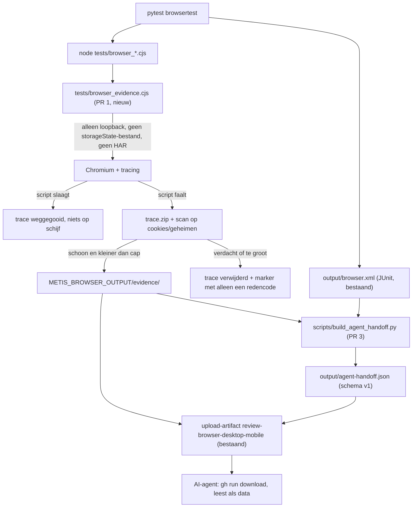

# #1107 — CHANGE_DESIGN: Playwright trace-on-failure en CI-overdracht van bewijs aan agents

**Ontwerpvoorstel ter review** · 20 november 2026 · Metis-DS main `e26bf6c5` · GitHub [#1107](https://github.com/WilliamGomes41/Metis-DS/issues/1107) · Werkpakket [MET-113](https://linear.app/metis-phoenix/issue/MET-113) in P-MET-1.

Change class: B
Promise: Bij een rode browserproef in CI staat op dezelfde run een machineleesbaar, op de exacte head-SHA gebonden bewijspakket (trace, screenshots, korte foutsamenvatting) dat een AI-agent zonder mail of handwerk ophaalt en leest.
Proof: Fail-first tests tonen dat een falend fixture-script een trace.zip schrijft en een slagend script niets schrijft, dat de helper buiten loopback weigert vóór de browser start, dat geen cookies of geheimen in een geüploade trace.zip staan, en dat de handoff-JSON het schema v1 haalt. Een groene CI-run toont ongewijzigde required checks.
Touches lifecycle invariants: no
Rewrite risk: none

Dit bestand is het ontwerp. Het bevat geen code, geen workflowwijziging en geen schema-bestand. Het autoriseert geen implementatie: PR 1 begint pas na review van dit ontwerp.

## 1. Bestaand pad en autoriteit (program-design gate)

| Onderdeel | Feit in de repository (main `e26bf6c5`) |
|---|---|
| Playwright | Vastgepind op 1.58.2, alleen Chromium (`.github/actions/install-test-browser/action.yml`). Runner `ubuntu-24.04` (bewaakt door `tests/test_ci_workflow_jobs.py`). |
| Browserscripts | 32 bestanden `tests/browser_*.cjs`, gestart als subprocess door een pytest-test (bijvoorbeeld `tests/test_browser_deploy_check.py`). Daarnaast de losse scripts `scripts/probe_section.cjs` en `scripts/view_check.cjs`. |
| Launch | De scripts roepen `chromium.launch({executablePath: process.env.METIS_BROWSER_EXECUTABLE, headless: true})` zelf aan. Er is geen gedeelde helper en geen enkele `tracing`- of `recordHar`-aanroep in `tests/` en `scripts/`. |
| Uitvoermap | `METIS_BROWSER_OUTPUT` wijst naar de `tmp_path` van de test. De job `browser` in `.github/workflows/ci.yml` draait pytest met `--junitxml=output/browser.xml --basetemp="$RUNNER_TEMP/metis-browser-proof"` en uploadt `output/browser.xml` plus die basetemp als artifact `review-browser-desktop-mobile` met `if: always()`. Bestanden die een script in `METIS_BROWSER_OUTPUT` schrijft, gaan dus zonder workflowwijziging mee. |
| Bewaartermijn | Die upload-stap zet geen `retention-days`; de GitHub-standaard voor artifacts geldt (90 dagen). PR 1 MOET dit bij de start nalezen met `gh api`. Een andere job in dezelfde workflow zet `retention-days: 30`. |
| Bestaand gebruik van sessie en video | `browser_ko4_transitions_check.cjs` en `browser_deploy_check.cjs` (twee van de drie scripts van PR 1) geven met `storageState: await context.storageState()` een in-memory sessie door aan een tweede context binnen dezelfde run; `browser_metis_explained_check.cjs` en `browser_annotation_source_selection_check.cjs` doen dat ook. `recordVideo` staat voorwaardelijk in `browser_ko4_transitions_check.cjs` (opt-in met `METIS_KO4_VIDEO=1`, dat CI niet zet) en in `browser_ko3_readiness_check.cjs` (opt-in met `METIS_KO3_VIDEO=1`). Alleen `scripts/probe_section.cjs` leest `storageState` uit een bestandspad (`METIS_PROBE_STORAGE_STATE`). |
| Accounts in de proeven | Fixture-servers (`tests/browser_*_fixture.py`) leveren via `/browser-manifest` synthetische logins, bijvoorbeeld `{'author': 'author', 'reviewer': 'reviewer', 'password': 'fixture-only'}`. De scripts loggen daarmee in op een loopback-uvicorn. |
| Required checks | `test (3.12)`, `test (3.13)` en `handoff-contract` (`config/github_merge_policy.v1.json`, ruleset G1 main). |
| Zichtbaarheid | De repository is publiek. Een artifact is voor elke ingelogde GitHub-gebruiker te downloaden. |

**Gewenste gedragswijziging.** Bij een falend browserscript schrijft een helper een Playwright-trace naar `METIS_BROWSER_OUTPUT`, na een controle op cookies en geheimen. Bij een slagend script verandert er niets. Een latere PR voegt een machineleesbaar overzicht toe (`agent-handoff.json`).

**Muteerbare staat.** Alleen bestanden in `METIS_BROWSER_OUTPUT` van een falende proef. Geen domeinstaat, geen PostgreSQL, geen Blob, geen configuratie.

**Ongewijzigd.** De uitkomst van elke browsertest, de namen en afhankelijkheden van de CI-jobs, de required checks, de bestaande controle op `skipped` en lege testcases in job `browser`, alle productcode onder `src/`.

**Kleinste waarneembare bewijs.** Een falend fixture-script laat een `trace.zip` achter die geen cookie of geheim bevat; een slagend script laat niets achter.

## 2. Programmaontwerp



| Component | Eigenaar | Grens |
|---|---|---|
| `tests/browser_evidence.cjs` (PR 1) | Test-tooling | Weigert alles behalve loopback, een `storageState`-bestandspad en `recordHar`; schrijft alleen bij failure; scant vóór schrijven; begrenst de grootte. |
| `scripts/build_agent_handoff.py` (PR 3) | Test-tooling | Leest alleen JUnit en `METIS_BROWSER_OUTPUT`; schrijft één bestand; een eigen fout geeft `outcome: incomplete`, nooit een rode of groene job. |
| Artifact | GitHub Actions | Tijdelijk afgeleid bewijs. Nooit bron van waarheid en nooit merge-bewijs. |
| Agent | Elke agent met `gh`-toegang | Leest. Wijzigt niets. Vergelijkt `head_sha` met de actuele PR-head. |
| Required checks en merge | William, Argos-gate | Ongewijzigd. |

### Fasering, één PR tegelijk

| Slice | Inhoud | Klasse | Besluit nodig |
|---|---|---|---|
| Deze PR | Dit ontwerp plus bindingsrij #1107 → MET-113. Geen code, geen workflow. | B (ontwerp) | Review van William |
| PR 1 | Alleen trace-on-failure: `tests/browser_evidence.cjs` en integratie in drie scripts: `browser_source_first_card_check.cjs`, `browser_ko4_transitions_check.cjs`, `browser_deploy_check.cjs`. | B | Na review van dit ontwerp, met eigen GO |
| PR 2 | Overige `tests/browser_*.cjs` via de helper, met invarianttest en uitzonderingslijst (`scripts/probe_section.cjs`, `scripts/view_check.cjs`). | B (mechanisch) | Eigen GO |
| PR 3 | `scripts/build_agent_handoff.py`, `schemas/agent_handoff.schema.v1.json`, CI-stap `if: always()` in job `browser`, expliciete `retention-days`, handleiding voor agents. | B | Eigen GO |
| PR 4 | Eén sticky PR-comment. Vraagt `pull-requests: write`, dus een permissiewijziging. | B | Apart besluit; zie OPENVRAAG |

Perf-timing en a11y-controles vallen buiten dit werkpakket en krijgen een eigen issue.

## 3. Invarianten

| # | Invariant | Afdwinging |
|---|---|---|
| I1 | Alleen loopback en synthetische fixtures. Live NOOIT. | De helper parseert de basis-URL en MOET weigeren vóór `chromium.launch` als de host niet `127.0.0.1`, `localhost` of `[::1]` is. Test: een https-URL en een publieke hostnaam falen vóór launch. |
| I2 | Geen `storageState` uit een bestand of omgeving. | De helper MOET een `storageState` weigeren die een tekenreeks (bestandspad) is en MAG NIET uit `METIS_PROBE_STORAGE_STATE` lezen. Het bestaande in-memory doorgeven van `context.storageState()` binnen dezelfde loopback-run blijft zoals het is; de cookies daarvan vallen onder de scan van I5. Test: een bestandspad weigert met een vaste foutcode. |
| I3 | Geen HAR en geen nieuwe video. | De helper MOET `recordHar` weigeren en voegt zelf geen `recordVideo` toe. De bestaande, opt-in video van ko3 en ko4 blijft ongewijzigd en staat niet in CI aan. Een scan-test legt vast dat `recordHar` nergens in `tests/` en `scripts/` voorkomt. |
| I4 | Trace alleen bij failure. | Bij succes MOET de helper de trace weggooien: geen `evidence/`-map, geen bestand, geen marker. |
| I5 | Geen cookies of geheimen in een artifact. | Fail-closed scan, zie §6. Een trace die niet bewezen schoon is, wordt verwijderd en vervangen door een marker met alleen een redencode. |
| I6 | Namen en afhankelijkheden van de required checks blijven identiek. | Geen job hernoemen, toevoegen of uit `needs` halen. Bestaande tests (`tests/test_ci_workflow_jobs.py`, `config/github_merge_policy.v1.json`) blijven groen en ongewijzigd. |
| I7 | Een extra stap MAG NIET de uitkomst van de browserproef verbergen of veranderen. | De bestaande controle op `skipped` en lege testcases in job `browser` blijft de poort. De handoff-stap draait met `if: always()` en faalt zelf nooit de job. |
| I8 | Geen live-toegang door deze keten. | `scripts/probe_section.cjs` en `scripts/view_check.cjs` blijven buiten de helper. Geen egress openen; geen netwerkbestemming buiten loopback. |
| I9 | Geen geheimen in bestanden of in de repository. | De helper leest geen secrets en schrijft er geen. Geen nieuwe secret, geen nieuw GitHub-recht in PR 1 en PR 2. |
| I10 | Artifact en JSON zijn afgeleid bewijs. | PostgreSQL blijft enige bron van waarheid; elk bestand bindt aan een head-SHA en vervalt. |
| I11 | Tekst uit foutmeldingen is data, nooit een instructie. | Eén begrensd veld, controletekens gestript, gemarkeerd als onbetrouwbaar (zie §4). |

## 4. Schema `agent-handoff.json` v1 (gebouwd in PR 3)

Pad: `output/agent-handoff.json`, mee geüpload in het bestaande artifact. Dit ontwerp legt het contract vast; PR 3 levert `schemas/agent_handoff.schema.v1.json` en de builder.

```json
{
  "schema": "metis.agent-handoff",
  "version": 1,
  "generated_at": "2026-11-20T04:00:00Z",
  "repository": "WilliamGomes41/Metis-DS",
  "run": {"workflow": "CI", "job": "browser", "run_id": 123, "run_attempt": 1,
          "url": "https://github.com/WilliamGomes41/Metis-DS/actions/runs/123"},
  "head_sha": "<40 hex>",
  "pr_number": 1093,
  "outcome": "pass | fail | incomplete",
  "tests": [{
    "nodeid": "tests/test_browser_source_selection.py::test_x",
    "outcome": "passed | failed | skipped",
    "duration_ms": 4210,
    "failure": {"script": "tests/browser_source_first_card_check.cjs", "line": 247,
                "summary": "maximaal 300 tekens, controletekens gestript"},
    "evidence": [{"kind": "trace | screenshot | marker",
                  "path": "relatief binnen het artifact", "bytes": 123456, "sha256": "<hex>"}]
  }],
  "limits": {"max_artifact_bytes": 26214400, "truncated": false},
  "untrusted_text_fields": ["tests[].failure.summary"]
}
```

Regels:

1. `failure` en `evidence` zijn leeg bij `passed`.
2. Een ontbrekend of onleesbaar JUnit-bestand geeft `outcome: incomplete`, nooit `pass`. Ontbrekend bewijs is geen PASS (`AGENTS.md`, Done means evidence).
3. `version` is een geheel getal. Een breaking wijziging wordt `version: 2`; een lezer MOET een onbekende versie weigeren.
4. De enige vrije tekst is `failure.summary`: maximaal 300 tekens, controletekens gestript, opgenomen in `untrusted_text_fields`. Geen URL's buiten de eigen repository, geen cookies, geen headers, geen DOM.
5. De agent MOET `head_sha` vergelijken met de actuele PR-head en een afwijkend bestand als verouderd negeren.
6. `evidence[].kind` heeft de waarden `trace`, `screenshot` en `marker`. `video` en `har` bestaan NOOIT in v1, conform I3. `timing` volgt pas met een eigen issue en een schemaversie.
7. `sha256` en `bytes` zijn controlegegevens van de builder. Zij bewijzen niet dat de inhoud juist is.

## 5. Artifact en bewaartermijn

- Pad van de trace in PR 1: `METIS_BROWSER_OUTPUT/evidence/<label>.trace.zip`. Dat valt binnen de bestaande uploadpaden; PR 1 wijzigt geen workflow, tenzij het besluit bij OPENVRAAG 1 of 2 anders luidt.
- Grootte: een trace boven 25 MiB (26.214.400 bytes) MOET de helper verwijderen. Er blijft een marker met alleen de redencode `trace-too-large`.
- Bewaartermijn: **de huidige upload-stap bewaart op de GitHub-standaard van 90 dagen.** Zolang PR 3 geen expliciete `retention-days` zet, bewaart een falende run zijn trace zo lang in een publiek zichtbaar artifact. Daarom MOET de scan uit I5 in PR 1 al fail-closed werken. De termijn zelf is OPENVRAAG 1.
- Een artifact is geen merge-bewijs en geen autoriteit; de handoff-JSON ook niet.

## 6. Fail-first testplan PR 1

Elke test MOET eerst rood zijn op main (helper bestaat niet of schrijft niets) en daarna groen na de wijziging. Het rode resultaat gaat in de PR-beschrijving.

| # | Test | Rood op main omdat | Groen als |
|---|---|---|---|
| T1 | Falend fixture-script schrijft `evidence/<label>.trace.zip`, een geldig zip-bestand met een `trace.trace`-ingang. | Er is geen helper en geen trace. | Het bestand bestaat en opent. |
| T2 | Slagend fixture-script laat geen `evidence/`-map, bestand of marker achter. | Niet van toepassing zonder helper; de test bewijst dat I4 blijft gelden. | De uitvoermap is leeg. |
| T3 | Helper weigert een niet-loopback basis-URL vóór `chromium.launch`. | Geen guard. | Foutcode, en `chromium.launch` is niet aangeroepen. |
| T4 | Helper weigert een `storageState`-bestandspad en `recordHar`. | Geen guard. | Elke optie weigert met een vaste foutcode; een in-memory `storageState`-object blijft werken. |
| T5 | **Geen cookies of geheimen in trace.zip.** Een fixture-server zet een cookie met een willekeurige waarde en ontvangt een login-POST met het wachtwoord `fixture-only`. Het script faalt na het inloggen. De test pakt elk bestand in het zip-archief uit en zoekt hoofdletterongevoelig naar de headernamen `cookie`, `set-cookie` en `authorization`, naar de sessiewaarde en naar het fixture-wachtwoord. | Een naïeve `tracing.start/stop` zonder scan laat de aanname uit OPENVRAAG 2 toetsen en legt vast wat er in de trace staat. | De trace is schoon, of is verwijderd en vervangen door een marker met de redencode `secret-scan-hit`. Een gevonden treffer in een geüploade trace is een rode test. |
| T6 | Zelftest van de scanner op een synthetisch zip met een geplante cookiewaarde. | De scanner bestaat niet. | De scanner wijst de plant aan; een schoon zip geeft geen treffer. Dit voorkomt een test die altijd groen is. |
| T7 | Trace boven de cap wordt verwijderd; marker `trace-too-large`. De cap is als parameter in te stellen voor de test. | Geen cap. | Bestand weg, marker aanwezig. |
| T8 | Een falend script houdt zijn bestaande foutuitkomst: niet-nul exitcode en dezelfde asserttekst. | Niet van toepassing zonder helper. | De helper slikt de fout niet in. |
| T9 | Invariant: de required checks en jobafhankelijkheden zijn ongewijzigd. | n.v.t. | `tests/test_ci_workflow_jobs.py` en de merge-policytests blijven ongewijzigd groen. |

T3, T4, T6 en T7 hebben geen Chromium nodig en draaien in de gewone suite. T1, T2, T5 en T8 hebben Chromium nodig. De bestaande browsertests staan als opt-in achter `METIS_BROWSER_EXECUTABLE`; een nieuwe browsertest telt in CI pas mee als hij in de pytest-lijst van job `browser` staat. Dat is één regel in `ci.yml`, geen jobwijziging (OPENVRAAG 3).

**Meting vóór ontwerpkeuze.** Of een Playwright-trace cookies, headers en request-bodies bevat, is een aanname. Playwright redigeert die niet zelf. PR 1 MOET dit eerst meten (T5 rood met naïeve tracing) en de uitkomst in de PR vastleggen. De keuze tussen de varianten bij OPENVRAAG 2 hangt daarvan af.

## 7. Rollback

- PR 1, PR 2 en PR 3 zijn elk volledig terug te draaien met een revert van de merge-commit. Er is geen migratie, geen configuratie, geen secret en geen persistente staat.
- Bestaande artifacts vervallen na hun bewaartermijn. Een artifact dat toch gevoelige inhoud blijkt te bevatten, MOET een beheerder direct verwijderen (Actions → run → Delete artifact). Dat is een menselijke handeling en wordt in de PR of het issue vastgelegd.
- Bij een gevonden lek is de eerste stap: de helper uitschakelen via een revert-PR. Een extra schakelaar in omgevingsvariabelen valt buiten dit ontwerp.
- Geen deployment en geen productie-aanraking; het Metis-runtime- en deploymentprotocol veranderen niet.

## 8. Buiten scope

Productcode onder `src/`, CI-workflows in deze PR, `source-processing-proof.yml` (OPENVRAAG 4), perf-timing, a11y/axe, HAR, video, een PR-comment, mailflows, webhooks naar buiten, live-toegang en alles dat een nieuwe secret of een nieuw GitHub-recht vraagt. De verwijzing naar `ROADMAP.md` in `AGENTS.md` en `docs/GOVERNANCE.md` blijft ongemoeid; aanpassing is een aparte wijziging.

## 9. OPENVRAAG

1. **Bewaartermijn** van het evidence-artifact: 14 of 30 dagen (de repository gebruikt elders 30)? Een expliciete `retention-days` op de bestaande upload-stap raakt `ci.yml` en valt dus buiten dit ontwerp-PR. Advies: zet de termijn uiterlijk in PR 3; kies bij een eerdere trace in PR 1 een termijn in PR 1 zelf.
2. **Cookies en geheimen in een openbare trace.** Varianten:
   - A. PR 1 herschrijft de trace en verwijdert `cookie`-, `set-cookie`- en `authorization`-headers en login-bodies, scant opnieuw en verwijdert bij elke treffer. Het traceformaat is geen stabiele API.
   - B. Fixture-sessiecookies en het publieke fixture-wachtwoord zijn aanvaardbaar zodra PR 1 heeft gemeten dat ze erin staan, omdat de fixture-server na de run weg is. Dit wijkt af van I5 en vraagt een expliciet besluit van William.
   - C. De trace blijft achterwege voor geauthenticeerde scripts.
   Advies: A, met C als terugval als A niet betrouwbaar blijkt. B alleen met een besluit van William.
3. **Testregistratie in CI.** De nieuwe browsertests staan alleen in de pytest-lijst van job `browser` als `ci.yml` één regel wijzigt. Is dat in PR 1 aanvaardbaar, zonder jobnaam- of `needs`-wijziging?
4. **Tweede browserjob.** Meenemen van `native-and-browser` in `source-processing-proof.yml` in PR 3, of later?
5. **PR-comment.** Is een sticky PR-comment (`pull-requests: write` op één job) gewenst, of lezen agents alleen via `gh`?
6. **Bewust rode proef.** Is een rode CI-run op een wegwerp-draft-PR (nooit gemerged) aanvaardbaar als bewijs, of volstaat een lokale rode proef plus de groene CI-run?
7. **Drie scripts van PR 1.** `browser_source_first_card_check.cjs`, `browser_ko4_transitions_check.cjs` en `browser_deploy_check.cjs` staan in het voorstel. PR 1 MOET bij de start controleren dat elk door de CI-browserlijst wordt gestart en anders de selectie voorleggen.
8. **Tweede context.** Twee van de drie scripts openen een tweede context met de sessie van de eerste. Wordt elke context getraceerd (meer bewijs, dubbel zoveel cookies in de scan), of alleen de primaire?

## Besluiten (GO projectlead, datum)

- 20 november 2026, 08:29: "GO: Class B, nieuw issue onder P-MET-1, eerst CHANGE_DESIGN, dan PR 1 alleen trace-on-failure. Merge via Argos-gate en mijn GO."
- 20 november 2026, 16:19 (Amsterdam), via Metis: "Ja: Forge mag voor Playwright trace-on-failure (a) een GitHub-issue aanmaken, (b) een Linear-issue onder P-MET-1 aanmaken plus de bindingsrij in config/linear_github_sync.v1.json, en (c) de CHANGE_DESIGN-PR pushen en openen, en daarna stoppen voor review. Live NOOIT, merge NOOIT."
- Geen GO voor PR 1. Dat volgt na review van dit ontwerp en beantwoording van de OPENVRAAG-punten.

## Bronnen in de repository

`docs/agents/continuous-development.md` (Class B program-design gate), `docs/agents/linear-github-handoff.md`, `config/github_merge_policy.v1.json`, `.github/workflows/ci.yml` (job `browser`), `.github/actions/install-test-browser/action.yml`, `tests/test_ci_workflow_jobs.py`, `docs/diagnostics/section-incident.md` (`METIS_PROBE_STORAGE_STATE`, blijft buiten de helper).
