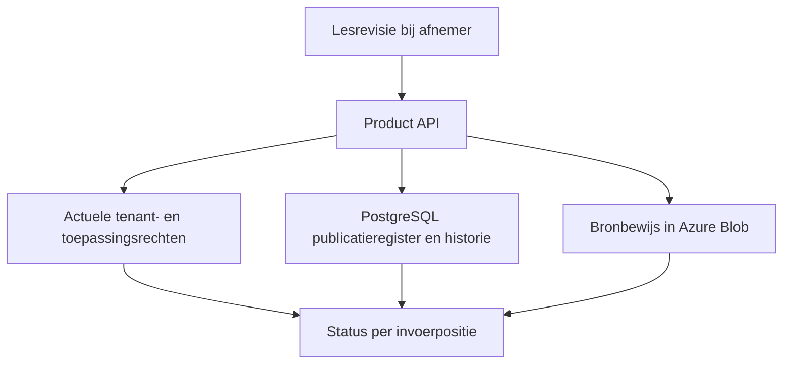

# Eerder gebruikte publicatiereferenties controleren

Refs #1143 · MET-137

Change class: B
Rewrite risk: none
Touches lifecycle invariants: no
Promise: Een bevoegde toepassing kan haar eerder gebruikte, exact geïdentificeerde publicatieobjecten op één peilmoment controleren.
Proof: De HTTP-proef met PostgreSQL 16 en synthetische bronbytes raakt na zeven dagen exact lessen A, B en C. De CI-verzameljob vereist de benoemde positieve en negatieve scenario’s.

## Samenstelling en eigenaarschap

De afnemer bezit de koppeling tussen les en referentie. De bestaande publicatiestore bezit activering, opvolging en intrekking. Eén read-only PostgreSQL-snapshot omvat register, leden, canonieke objecten en auditbewijs. De bestaande broncontrole verifieert actieve bronbytes. De bestaande projectie en documentautorisatie bepalen welke objecten zichtbaar zijn. Historische toetsing gebruikt de bij die release vastgelegde objecten en context. Een ontbrekende contextbinding blijft onbevestigd. Het toegangsbeheer levert een consistente lezing van rechten met beleidsversies. Na de batch toetst de API de credential en beleidsversies opnieuw. Bij wijziging probeert zij één keer opnieuw.

Het werk betreft uitsluitend individuele objectreferenties. Voorwaardenpakketten, beslisgrafen, activatie van een productieafnemer en live Azure-bewijs vallen onder afzonderlijke acceptatie. De bestaande schrijvers en opslaglocaties blijven gezaghebbend. Herstel gebruikt dezelfde registraties. Terugdraaien kan door het opt-in-recht in te trekken. De eerste productiegrant vereist een afzonderlijke vrijgave.

## Bewijs voor vrijgave

De bestaande OpenAPI-vergelijking bewaakt oude v1-clients. De vier bestaande shards draaien de scenario’s één keer. De verzameljob controleert commit, Python-versie en PostgreSQL-versie, en verlangt elk benoemd scenario inclusief de volgordes, race en storingsvarianten. Een proef verwijdert een variant uit het bewijsbestand en verwacht afkeuring. De integratiegids beschrijft de responscodes en verwerking door de afnemer.
