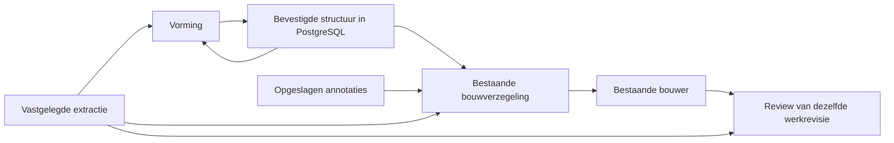

# #1152 — Eén bevestigde sectie-indeling

Class A. Rewrite risk: high. Slice 2 gebruikt de bronankers uit #1150.

## Besluiten van de projectlead

Op 25 november 2026 heeft de projectlead bevestigd dat Vorming, Bouwen en Review dezelfde documentversie en bevestigde sectie-indeling gebruiken. De bestaande bouw neemt die indeling één keer mee. Navigatie naar Review start geen bouw. De projectlead heeft deze implementatie opgedragen.

## Levenscyclus en gezag

| Aspect | Contract |
| --- | --- |
| Entiteit en overgang | Een open menselijke annotatiewerkrevisie met vastgelegde proza-extractie krijgt één bevestigde sectie-indeling. |
| Trigger en bevoegdheid | De bevoegde annotator bevestigt de volledige lijst in Vorming. De bestaande autorisatie en vergrendeling van de werkrevisie gelden. Gepubliceerde of reeds verzegelde versies zijn alleen leesbaar voor dit besluit. |
| Validatie | Bind aan werkrevisie, extractiehash en echte kopankers in bronvolgorde. Koptekst is een weergavetitel. Het kopniveau bepaalt de hiërarchie. |
| Duurzame toestand | Eén append-only record bevat de bevestigde lijst, basis en actor. Herhaalde bevestiging met identieke invoer schrijft niets. Gelijktijdig afwijkend werk krijgt een conflict. |
| Werkstroom | De bestaande bouw verzegelt de bevestigde structuur bij de bestaande annotaties. De projectie wijst passages op bronpositie toe en voegt de bevestigde sectie toe als documentmetadata. Review leest die sectie uit het bouwresultaat voor dezelfde versie. |
| Onveranderlijk | Extractie, bronbytes, bronankers, offsets, objectidentiteit, eerder bewijs, review- en publicatiebesluiten. De release en het actieve aanbod veranderen door deze overgang niet. |
| Fout en herstel | Verouderde basis, onbekende kop, ongeoorloofde actor of bestaande bouw weigeren vóór de schrijfactie. Een transactie omvat de hele bevestiging. Hervatten en bewijsreconstructie lezen de gelijke versie. |
| Oudere gegevens | Een oude werkrevisie met bestaand bouwresultaat houdt haar oude bouwbasis. Lege bevestigingsopslag stelt geen eerder besluit voor. |
| UI-resultaat | Na opslaan toont dezelfde bronwerkplek de bevestigde lijst en de bestaande annotatiebediening. De reviewgroep toont de bevestigde sectie van het gebouwde object. |

## Uitbreiding en terugdraaien

De native PostgreSQL-opslag, bronbinding, annotatieafsluiting, verzegeling, verwerking, bewijsreplay, reviewprojectie en volledige workflowbackup vormen de geraakte keten. Een correctie van al verzegelde koppen en herbouw van bestaand werk horen buiten deze slice. De protocolregel dat koppen uit de extractie komen blijft gelden voor bronbewijs. De bevestigde indeling gebruikt die kopankers en bewaart de menselijke correcties als werkstructuur.

De invoering is additief. Pas migratie 043 toe, verifieer de vereiste SELECT- en INSERT-rechten voor de runtime-rol en toets backup en herstel. Zet daarna de nieuwe ingang voor centrale kopbevestiging aan via `METIS_ANNOTATION_CONFIRMED_STRUCTURE=1`. Terugdraaien van de ingang laat gemaakte bevestigingen, hun koppeling aan verzegelingen en hun lezers beschikbaar. Een oude schrijver kan een bestaande werkstructuur niet stil bij verzegeling weggooien. Terugrollen naar een binary van vóór het leescontract is voor werk met bevestigde indeling geen ondersteunde route. Er is geen backfill, dual write, opschoning of mutatie van gepubliceerd werk.

## Ketenbewijs

Begin vanuit een exact voorbereide werkrevisie. Corrigeer twee koppen, waaronder gelijknamige koppen op verschillende bronankers. Bevestig, navigeer, annoteer, bouw eenmaal en open hetzelfde document in Review. Controleer bevestigde titels en sectiegroepering, ongewijzigde bronfragmenten en aantallen werkrevisies en bouwpogingen. Toets ook onbekende of verouderde ankers, onbevoegde bevestiging, conflict, identieke retries, een oude verzegeling en export/herstel. Een andere werkrevisie mag de bevestiging niet gebruiken.

## Compositie

