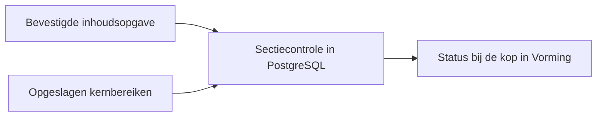

# #1154 — Dekking controleren in Vorming

Class B. Rewrite risk: none. Besluit tot uitvoering op 25 november 2026.

## Domeingrens en gedrag

De scope en de sectiecontrole horen bij één bevestigde inhoudsopgave op één werkrevisie. PostgreSQL is de eigenaar. De annotator kiest een selectie of de hele richtlijn. Zonder keuze geldt een selectie. Bij volledige dekking toont de klikbare inhoudsopgave per sectie of die op gemiste uitspraken is nagekeken. De bestaande editor kan iedere gevonden uitspraak vastleggen.

Elke sectie wordt geïdentificeerd door het exacte anker van de kop. Een sectie loopt tot de volgende kop, inclusief wanneer die een subkop is. Brontekst vóór de eerste kop krijgt een eigen ingang. De status berust op de laatst bevestigde verzameling opgeslagen kernbereiken van gereedstaande kennisannotaties in die sectie. Verwijderen, toevoegen of verplaatsen van een uitspraak maakt de geraakte bevestiging verouderd. Als de oorspronkelijke verzameling terugkomt, geldt hetzelfde controlebewijs opnieuw. Een wijziging in een andere sectie of alleen in een contextveld verandert die verzameling niet.

## Toestand en schrijfgrens

De scope en sectiebewijzen leven in één werkrecord met een buitenlandse sleutel naar de bevestigde structuur. De writer controleert de actuele bevoegdheid en vergrendelt de werkrevisie in dezelfde volgorde als de annotatieopslag. Hij vergelijkt het ingediende structuurbewijs en de sectiebasis met wat onder die lock actueel is. Verschillende secties kunnen achtereenvolgens worden bevestigd. Een verlopen basis of een bevestiging terwijl de scope op selectie staat, krijgt een conflict. Een identiek verzoek schrijft niets. Elke vastgelegde sectiebevestiging draagt actor, tijd en basis. Bij overschakelen op selectie worden sectiestatussen verborgen en blijven eerdere bewijzen beschikbaar.

Er is geen write naar annotaties, bronextractie, bouwverzegeling, review of publicatie. Een bestaande versie zonder dit werkrecord blijft leesbaar als selectie. Migratie 044 voegt de opslag toe. Bij uitrol worden de runtime-rechten SELECT, INSERT en UPDATE gecontroleerd. De browser toont de bediening met de bestaande functie-instelling voor bevestigde structuur. Backup en herstel bewaren het werkrecord bij dezelfde structuur. Een oudere backup krijgt een lege verzameling van de nieuwe tabel.

## Bewijs

Toets identieke kopnamen, voorwerk vóór de eerste kop, een gewijzigde annotatie en behoud van een bevestigde buursectie. Bewijs op PostgreSQL gelijktijdige bevestigingen, weigering van verouderde basis, herstart en herstel. Toets in Chromium navigatie, annoteren met open dekking en herladen bij desktop en mobiel. De beslissing over gevolgen voor afsluiten en publicatie volgt in slice 4.

## Compositie

