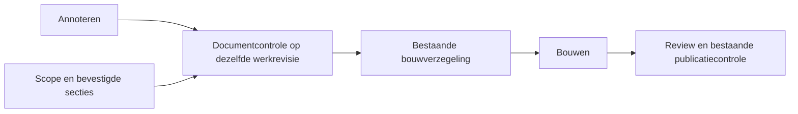

# #1156 — Annoteren afronden via Documentcontrole

Class A. Rewrite risk: high. Uitvoeringsbesluit 25 november 2026.

## Overgang en gezag

Dezelfde voorbereide menselijke werkrevisie gaat van Annoteren naar Documentcontrole door **Ik ben klaar met dit document**. De gebruiker slaat lopend werk eerst op. Onder de bestaande PostgreSQL-autorisatie en documentlock schrijft Metis een versiegebonden ronderekord. Een mislukte of gelijktijdig verouderde schrijfactie verandert niets. Bij **Verder annoteren** bewaart Metis de omgekeerde overgang. Een herhaling van dezelfde gewenste fase schrijft niets. De opgeslagen fase is terug te vinden na herstart. Secties die in Documentcontrole aangevuld worden, gebruiken de bestaande editor en actuele dekking.

**Afronden en bouwen** blijft de bestaande, afzonderlijke bouwopdracht. Bouw bekijkt de opgeslagen annotaties, hun bronbewijs en de gekozen scope. Bij volledige dekking controleert dezelfde inspectie de actuele sectievingerafdrukken. Een bron zonder koppen heeft één controleerbare sectie voor het hele document. De bestaande verzegeling verzamelt de gekozen scope en controlereferentie met dezelfde bronankers, generatie en objectrevisie. De bestaande writer herleest die basis onder lock. De native grens verwerpt een ontbrekende of vreemde ronde, met behoud van herstelbare historische rondes. De worker reconstrueert de controle uit de verzegelde invoer vóór kandidaatvorming. Review en publicatie blijven via hun bestaande autoriteiten lopen.

## Doorwerking en uitrol

De nieuwe, herkenbare bouwvariant is additief op het bestaande sealcontract. Alleen gevalideerde invoer vormt objecten. Gewone ongeannoteerde tekst blijft letterlijk beschikbaar in de bron. Voor nieuwe gecontroleerde builds wordt die tekst geen open bronrecord. Expliciet brongebruik en geselecteerde context worden behouden. De publicatiepoort controleert dezelfde gevormde kennis, reviewbinding en benodigd bronbewijs. Er ontstaat geen tweede publicatiebesluit of autoriteit.

Bij opening toont de nieuwe werkplek een compact controleblok en aanpaslinks, plus toegang tot een bestaande bouwpoging. Oude overzichtlinks openen de actuele fase zonder te schrijven. De oude bouwbasis blijft geldig voor bestaande al gebouwde documenten. De nieuwe route wordt ingeschakeld met `METIS_ANNOTATION_DOCUMENT_CHECK=1` naast `METIS_ANNOTATION_CONFIRMED_STRUCTURE=1`, nadat de gemigreerde schrijver en leesrollen zijn geverifieerd. Stop oudere schrijvers vóór activatie. Zet bij terugdraaien de nieuwe instroom uit en behoud de afhandeling van reeds vastgelegde rondes. Oudere backups krijgen een lege rondetabel. Controleer oude en nieuwe seals bij herstel; nooit opnieuw publiceren of werkrevisies omzetten om deze uitbreiding aan te zetten.

## Ketenbewijs en tegenproeven

- Beide scopes: opslaan, afsluiten zonder poging, openen na herstart, concrete controlepunten, één bouw, review en publicatiegereedheid met geldige bron.
- Volledige dekking: ontbrekende of verouderde sectiebevestiging stopt finalize. Bij selectie kunnen onbenutte bronbereiken blijven staan.
- Andere actor, oud formulier, directe finalize, tweede tab, herhaalde ontvangst, weggelaten ronde in native seal en ongeldig bronbewijs.
- Rollbacklezing van oude bewijzen, herstart en export/herstel van de versiegebonden ronde zonder publicatiemutatie.

## Besluiten

Op 25 november 2026 gaf de projectlead opdracht om slice 4 te implementeren. Het besluit omvat de afzonderlijke afsluitactie vóór Documentcontrole en het vervallen van de oude afsluitroute in de nieuwe werkplek. De bouw gebruikt de opgeslagen, actuele controle. De gevolgen van eventuele fouten zijn begrensd tot de opt-in werkrevisie. Een ontbrekende of verouderde controle houdt de betreffende bouw tegen. Stop de nieuwe instroom met de schakelaar als de verificatie afwijkt.

Verwijder de oude lezer pas zodra resterende legacy werkrevisies geen toegang via het losse overzicht meer nodig hebben. Behoud de bewijslezer en replay voor oudere verzegelingen.
