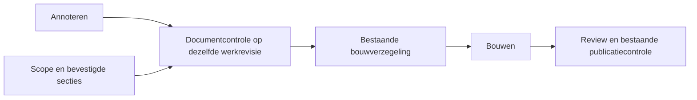

# #1156 — Annoteren afronden via Documentcontrole

Class A. Rewrite risk: high. Uitvoeringsbesluit 25 november 2026.

## Overgang en gezag

Dezelfde voorbereide menselijke werkrevisie gaat van Annoteren naar Documentcontrole door **Ik ben klaar met dit document**, onder Opgeslagen annotaties. De gebruiker slaat lopend werk eerst op. Onder de bestaande PostgreSQL-autorisatie en documentlock schrijft Metis een versiegebonden ronderekord. Een mislukte of gelijktijdig verouderde schrijfactie verandert niets. Documentcontrole opent op dezelfde pagina met focus op de kop. De bron blijft bewerkbaar terwijl de ronde in `checking` staat. Een herhaling van dezelfde gewenste fase schrijft niets. De opgeslagen fase is terug te vinden na herstart. Bij volledige dekking moeten alleen secties waarvan de vingerafdruk is gewijzigd opnieuw gecontroleerd worden.

**Afronden en bouwen** blijft de bestaande, afzonderlijke bouwopdracht. Bouw bekijkt de opgeslagen annotaties, hun bronbewijs en de gekozen scope. Bij volledige dekking controleert dezelfde inspectie de actuele sectievingerafdrukken. Een bron zonder koppen heeft één controleerbare sectie voor het hele document. De bestaande verzegeling verzamelt de gekozen scope en controlereferentie met dezelfde bronankers, generatie en objectrevisie. De bestaande writer herleest die basis onder lock. De native grens verwerpt een ontbrekende of vreemde ronde, met behoud van herstelbare historische rondes. De worker reconstrueert de controle uit de verzegelde invoer vóór kandidaatvorming. Review en publicatie blijven via hun bestaande autoriteiten lopen.

## Doorwerking en uitrol

De nieuwe, herkenbare bouwvariant is additief op het bestaande sealcontract. Alleen gevalideerde invoer vormt objecten. Gewone ongeannoteerde tekst blijft letterlijk beschikbaar in de bron. Voor nieuwe gecontroleerde builds wordt die tekst geen open bronrecord. Expliciet brongebruik en geselecteerde context worden behouden. De publicatiepoort controleert dezelfde gevormde kennis, reviewbinding en benodigd bronbewijs. Er ontstaat geen tweede publicatiebesluit of autoriteit.

Bij opening toont de werkplek de actuele fase. Oude overzichtlinks openen die fase zonder te schrijven. **Afronden en bouwen** is de enige bouwactie in Documentcontrole en opent na reservering het statusoverzicht voor die poging. Voor het later terugkijken van bouwopdrachten is **Bekijk status bouwopdrachten** op de kaart in Vorming de ingang. Eerdere bouwopdrachten en hun verzegelingen blijven leesbaar. De huidige console vereist de gemigreerde schrijver en schema 045. Stop oudere schrijvers vóór de uitrol. Bij terugval gebruikt de vorige ondersteunde console dezelfde database met `METIS_ANNOTATION_DOCUMENT_CHECK=1` en `METIS_ANNOTATION_CONFIRMED_STRUCTURE=1`. Laat die Azure-instellingen staan zolang die console het terugvaldoel is. Terugval naar een versie van vóór het leescontract van #1152 wordt niet ondersteund. Controleer oude en nieuwe verzegelingen bij herstel. Bronbestanden, werkrevisies en publicaties worden voor deze overgang niet omgezet.

Sinds #1169 opent **Aanpassen in de kaart** voor een benoemde reviewer de exacte annotatie. **Aanpassing opslaan** gebruikt de bestaande schrijver en brengt de focus naar Documentcontrole. Bij volledige dekking geldt dezelfde regel voor sectiebevestiging als voor de annotator. Een opgeslagen correctie blokkeert goedkeuring van de geraakte versie tot de bouw voor de opgeslagen correctie is geslaagd. Een mislukte bouw houdt de correctie, de blokkade en het auditspoor in stand. Ongeraakte objecten behouden hun ID, versie en oordeel. Een document dat vóór Documentcontrole is gebouwd, krijgt achteraf geen ronde of bevestigde structuur, omdat herstel de oude verzegelingen tegen die structuur toetst. Een correctie daarop bouwt via **Opnieuw bouwen** in Documentcontrole in de oorspronkelijke vorm, met dezelfde materialiser. Ook daar behouden ongeraakte objecten hun ID, versie en oordeel.

## Ketenbewijs en tegenproeven

- Beide scopes: opslaan, afsluiten zonder poging, openen na herstart, concrete controlepunten, één bouw, review en publicatiegereedheid met geldige bron.
- Volledige dekking: ontbrekende of verouderde sectiebevestiging stopt finalize. Bij selectie kunnen onbenutte bronbereiken blijven staan.
- Andere actor, oud formulier, directe finalize, tweede tab, herhaalde ontvangst, weggelaten ronde in native seal en ongeldig bronbewijs.
- Rollbacklezing van oude bewijzen, herstart en export/herstel van de versiegebonden ronde zonder publicatiemutatie.

## Besluiten

Op 25 november 2026 gaf de projectlead opdracht de afzonderlijke afrondactie door te voeren. De bouw gebruikt de opgeslagen, actuele Documentcontrole.

Voor #1170 bevestigde de projectlead op 26 november 2026 dat de productietelling `open_werkrevisies_oude_route` nul is. De telling gaat over open handmatige werkrevisies met een bestaande bouw of verzegeling en zonder documentronde. Deze bevestiging komt van de projectlead. De SQL-controle is lokaal op vier native PostgreSQL-scenario’s vergeleken.

De huidige console gebruikt Documentcontrole zonder functieschakelaars. De oude overzichtlink opent dezelfde werkplek en historische annotaties zijn daar leesbaar. De bouw per object en de overgang terug naar `annotating` zijn verwijderd. Eerder opgeslagen rondes en bewijsformaten blijven beschikbaar voor terugkijken, herstel en replay. Een al gereserveerde poging behoudt haar oorspronkelijke invoer en bewijs.
