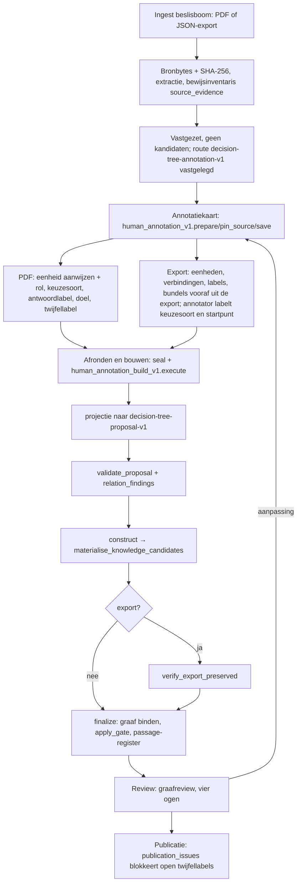

# Beslisboom via menselijke annotatie (vervangt het modelvoorstel van strategie C)

Issue: [#1191](https://github.com/WilliamGomes41/Metis-DS/issues/1191) · Linear MET-150 (`needs-triage`; `ready-for-agent` pas na GO William). Referentierevisie: main `147ee2d67f7e19322ba20061f1d7c512e968c8b8`.
**Status:** Expand gestart. De projectie van bronselecties is geïmplementeerd. De koppeling aan de annotatiekaart en de bouwstap staat open.
William heeft opdracht gegeven om Expand te starten en de vergelijking met de AI-route over te slaan. Het formele wijzigingsbesluit volgens Protocol §15 hoort bij de latere omschakeling.

```text
Change class: A
Promise: Een beslisboom wordt zonder AI-model gevormd: de annotator wijst in de bestaande annotatiekaart eenheden, rollen, keuzesoort, antwoordlabels, verbindingen en twijfellabels aan, en Metis bouwt daaruit met de bestaande voorstelvalidatie, constructie, graafbinding, review en publicatie dezelfde brongebonden beslisgraaf.
Proof: tests/test_decision_tree_annotation_route_v1.py (PDF en export van annotatie tot publicatie zonder geconfigureerd model, determinisme, fail-closed bij twijfellabels en exportafwijking, correctie vanuit dezelfde kaart) plus de verificatielijst in docs/change-contracts/1191-decision-tree-annotation-route-verification.md.
Touches lifecycle invariants: yes
Rewrite risk: high
Rewrite target: de voorstelbron van strategie C: decision_tree_route_v1.prepare met het modelvoorstel (llm_proposer, request_proposal, request_input, PROPOSER_PROMPT, EXPORT_PROMPT) en de binding console._decision_tree_proposer in pre_review_semantic_v1.bind_pre_review_semantic_processing.
Why local patching is insufficient: het modelvoorstel is de enige voorstelbron voor beslisbomen en wordt bij ingest synchroon aangeroepen; de annotatieroute weigert beslisbomen expliciet (human_annotation_v1.prepare: annotation_prose_required). Een tweede voorstelbron naast het model zou een verborgen tweede vormingspad zijn; de voorstelbron moet daarom worden vervangen, niet aangevuld.
Current authority/writer/reader map: zie §1.
Supported runtime topologies: één productiecompositie console_asgi.build_app met bind_pre_review_semantic_processing (PostgreSQL-only, D6b) en de bestaande annotatieworker (human_annotation_build_v1.execute).
Persisted-state impact: een PostgreSQL-migratie voor de sealcontroles is noodzakelijk (§4); annotatiesets, seals en buildbewijs krijgen voor klasse beslisboom een eigen payloadcontract binnen de bestaande tabellen (zie §4). Bestaande snapshots, objecten, grafen, reviews en releases blijven ongewijzigd.
Compatibility/migration plan: expand → contract (§3). Met het model gevormde beslisbomen blijven leesbaar, reviewbaar en verifieerbaar onder hun vastgelegde decision_tree_formation.model; geen backfill, geen stille hervorming.
Rollback/recovery plan: in fase 1 bestaat de modelroute nog en is rollback een softwareterugzetting zonder datamigratie. Na fase 2 is rollback een softwareterugzetting naar de laatste fase-1-commit; annotatiegevormde snapshots blijven daar leesbaar omdat het voorstelformaat en de constructie ongewijzigd zijn.
Cutover trigger: bewijs van de annotatieroute volgens §3, het §15-wijzigingsbesluit en de letterlijke GO van William voor fase 2.
Cleanup/decommission criteria: fase 2 verwijdert de modelvoorstelbron volledig (§5); een statische test bewaakt dat er geen modelaanroep voor beslisbomen overblijft.
Failure blast radius: een fout in de nieuwe route blokkeert alleen nieuwe beslisboomvorming (fail closed met zichtbare code); proza, bestaande beslisbomen, review en publicatie blijven beschikbaar.
Adversarial proof matrix: §7.
Lifecycle entity: kenniskandidaten en beslisgraaf van een beslisboom-snapshot vóór review; de bestaande WorkingRevision.
Lifecycle transition: bron vastgelegd → annotatieset vastgezet → afgerond en gebouwd (kandidaten + graaf) → review → publicatie; correctie in review loopt terug via dezelfde kaart naar een nieuwe objectversie.
Initial durable state: bevroren beslisboom-bronsnapshot (PDF of JSON-export) met vastgelegde extractie en zonder kandidaten.
Trigger: annotator rondt de annotatieset af (Afronden en bouwen); reviewer slaat een aanpassing op in dezelfde kaart.
Authorization: ongewijzigd: bestaande annotatie-autorisatie (source_selection_v1.authorize) en reviewerbenoeming op de snapshot.
Validation: decision_tree_proposal_v1.validate_proposal en relation_findings, decision_tree_construction_v1.construct via materialise_knowledge_candidates, decision_graph_v1-graafcontroles, verify_export_preserved voor exports, admission en passage-register; allemaal ongewijzigd.
Mutable entities: annotatieset en -entries van de snapshot zolang niet afgerond; de WorkingRevision van de snapshot.
Immutable entities: bronsnapshots, vastgelegde extractie, gepubliceerde releases, historische objecten en hun revisielijn (T11), met het model gevormde grafen.
Workflow state before: een beslisboom wordt bij ingest met een modelvoorstel gevormd of faalt met pre_review_llm_*.
Workflow state after: een beslisboom wordt na ingest alleen geëxtraheerd en vastgezet; vorming gebeurt uitsluitend via afgeronde annotatie.
Release state before: publicatieprotocol 4.3.x.
Release state after: publicatieprotocol 4.4.0 voor nieuwe releases; bestaande releases ongewijzigd.
Serving state before: publicatieregister.
Serving state after: publicatieregister, ongewijzigd.
Expected API result: Product API-antwoorden gelijk voor dezelfde gepubliceerde toestand.
Expected UI result: Vorming opent een beslisboom in de annotatiekaart met rollen, keuzesoort, verbindingen en twijfellabels; de melding "Open de beslisboom in Vorming" verdwijnt; Review opent dezelfde kaart voor aanpassingen.
Failure result: ongeldig of onvolledig annotatievoorstel faalt gesloten met de bestaande decision_*- of materialisation_*-code en laat bron en annotatiewerk intact; open twijfellabels blokkeren publicatie.
Restart result: een onderbroken bouw hervat via de bestaande annotatieworker (claimed delivery, seal, één bundelcommit); een herhaalde bouw met dezelfde seal geeft dezelfde proposal_hash en graafhash.
Recovery result: bron, annotatieset en eerder werk blijven intact; herstel via de bestaande retry van de annotatiebouw.
Legacy-data result: met het model gevormde beslisbomen blijven leesbaar, reviewbaar en verifieerbaar; na fase 2 wordt een openstaande modelpoging niet hervat maar gesloten met decision_tree_model_route_retired, waarna een opvolger met nieuwe werkrevisie de annotatieroute volgt.
Required black-box scenario: GIVEN een bevroren PDF-beslisboom zonder geconfigureerd model WHEN de annotator eenheden, rollen, labels en verbindingen aanwijst en afrondt THEN bestaan kandidaten en een gebonden graaf met dezelfde controles als nu, slaagt review en publicatie, levert een herhaalde bouw dezelfde hashes en is er geen modelaanroep gedaan; idem voor een JSON-export waarin alleen keuzesoort en startpunt worden gelabeld.
Explicit non-goals: een publiceerbare toestand "bron geeft hier geen vervolg" (twijfellabels blijven publicatie blokkeren); wijziging van voorstelformaat, constructie, graafcontroles, review-, vier-ogen- of publicatiecontracten; prozavorming; automatische controle op gemiste antwoorden in de bron (dat blijft graafreview).
```

## 0. Waarom deze wijziging

- **Bronvastheid zonder interpretatie door een model.** In Metis wijst een annotator aan en labelt hij; hij schrijft niet. Het voorstelformaat `decision-tree-proposal-v1` bevat al uitsluitend bronselecties, rollen, verbindingen, aangewezen labels, contextkoppelingen, bundels en onzekerheidscodes. `quoted_text` is een claim die de materialiser tegen de bron controleert. Een annotator kan dit voorstel dus volledig maken door aan te wijzen.
- **Eén werkwijze voor proza en beslisbomen.** De annotatiekaart, de afronding, de bouw en de correctie vanuit de kaart (#1064/#1156) bestaan al. Daar wordt niets van dubbel gebouwd.
- **Geen afhankelijkheid van een leverancier.** Nu faalt elke beslisboomvorming als het model ontbreekt of faalt (`pre_review_llm_decision_tree_proposer_unbound`). Exports vragen een modelaanroep, terwijl het model daar de structuur niet mag wijzigen.
- **Bekend risico van de huidige reviewvorm.** Een reviewer die een modelvoorstel beoordeelt, neemt fouten eerder over.

## 1. Huidige implementatie van de AI-route (authority/writer/reader map)

| Stap | Eigenaar nu | Rol in de AI-route |
| --- | --- | --- |
| Binding | `pre_review_semantic_v1.bind_pre_review_semantic_processing` → `console._decision_tree_proposer = llm_proposer(env, post_json=...)` | Bindt per console de modelvoorsteller |
| Routering | `configured_fragments_and_spec`: `class_ == "beslisboom" and kind in {"pdf","boom"}` → `decision_tree_route_v1.prepare(..., proposer=console._decision_tree_proposer)` | Enige ingang voor beslisboomvorming |
| Modelaanroep | `decision_tree_route_v1.llm_proposer` → `request_proposal` (strikt JSON-schema `proposal_schema()`, `PROPOSER_PROMPT`, voor exports `+ EXPORT_PROMPT`, `request_input` met export-id's) | Levert `(proposal, model)` |
| Voorstelcontrole | `decision_tree_proposal_v1.validate_proposal`, `relation_findings` | Gesloten vorm; relatiebewijs per verbinding |
| Constructie | `decision_tree_construction_v1.construct` → `materialise_knowledge_candidates` | Enige kandidaatmaker |
| Exportbehoud | `decision_tree_route_v1.verify_export_preserved`, `export_types`, `_export_enrichment` | Export is gezaghebbend; afwijking faalt gesloten |
| Vastlegging | `spec[SPEC_KEY]` met `route=decision-tree-source-bound-v1`, `model`, `proposal_hash`; `finalize` → `decision_tree_formation`, `decision_graph`, `apply_gate`, passage-register | Route- en modelprovenance op de envelope |
| Fouten | `pre_review_llm_decision_tree_proposer_unbound`, `pre_review_llm_model_required`, `pre_review_llm_proposal_rejected`, `processing_attempt_expired` | Poging gefaald, geen objecten |
| Annotatie | `human_annotation_v1.prepare`: `envelope['class'] == 'beslisboom'` → `annotation_prose_required`; UI: "Open de beslisboom in Vorming." | Sluit beslisbomen uit van annotatie |
| Exclusiviteit | `OperationsConsole._fragments_and_spec` en `source_selection_v1.reserve_selection`: `owns_source` → `annotation_source_owned` | Een snapshot met annotatieset wordt niet semantisch gevormd |
| Lezers | `decision_review_ui_v1`, `deterministic_review_repair_v1` (`has_recorded_route`), `operations_console_v1` (reextract/lezen), `decision_graph_v1.publication_issues`, `release_graph`, `read_active_graph`, `decision_tree_experiment_v1` | Lezen route en graaf; vormen niets |
| Tests | `test_decision_tree_proposal_route_v1.py`, `test_decision_tree_route_lifecycle_v1.py`, `test_semantic_only_formation_v1.py` (export- en terugvaltests), `tests/decision_tree_test_support.py`, `semantic_fixture_support.export_tree_proposal` | Fixturemodel als voorsteller |

Schrijvers van kandidaten blijven uitsluitend via `materialise_knowledge_candidates` lopen. Dat zijn ingest, retry/resume, `reextract_unpublished`, de annotatiebouw en reviewcorrectie.

## 2. De nieuwe route



**Wat de annotator doet. Alles is aanwijzen of een keuze uit een vaste lijst; er wordt niets getypt.**

| Handeling | Vastgelegd als (bestaand voorstelveld) |
| --- | --- |
| Stuk bron aanwijzen | `units[].spans` (+ `quoted_text` automatisch uit de span) |
| Rol kiezen: start, vraag, actie, uitkomst, context | `units[].role` (`ROLES`), `units[].entry` voor start |
| Keuzesoort bij een vraag: enkelvoudig of meervoudig | `units[].selection` (`SELECTIONS`) |
| Antwoordlabel aanwijzen, daarna het doelvak | `connections[]` met `kind=answer`, `label_span`, `from`, `to`, `evidence_ids` |
| Doorgaande pijl of paginaovergang | `connections[]` met `kind=continue` of `page_transition` |
| Contextkoppeling en resultaatbundel | `context_bindings[]`, `result_bundles[]` |
| Twijfellabel kiezen | `unresolved[]` met de bestaande codes, als labels: Rol onduidelijk (`role_ambiguous`), Route onduidelijk (`route_ambiguous`), Doel onbekend (`target_unknown`), Antwoordlabel onduidelijk (`label_ambiguous`), Richting onzeker (`direction_unverified`), Bewijs ontbreekt (`evidence_missing`) |

`evidence_ids` voor een verbinding komen uit de bestaande bewijsinventaris (`source_evidence`): de tekening (`graphic`) of het exportrecord (`export_edge`). De annotator wijst de pijl aan, en de kaart koppelt het bewijsitem dat bij die pijl hoort. Valt de aangewezen pijl niet samen met een bewijsitem, dan geeft `relation_findings` een bevinding. Dat is hetzelfde gedrag als nu.

**Export.** De structuur staat al in de export. De kaart vult daarom eenheden, verbindingen, letterlijke labels en bundels vooraf in vanuit de exportitems. De annotator labelt alleen wat de export niet zegt: de keuzesoort per vak (binnen `_EXPORT_KIND_MODES`) en het startpunt. `verify_export_preserved` blijft ongewijzigd het bewijs dat de export exact behouden is. De vooraf ingevulde structuur is bronbewijs en geen voorstel. Daarmee maakt dit geen tweede kandidaatmaker. Het herintroduceert wel een deterministische voorinvulling, en die vervalt in 4.3.0. Het §15-besluit moet dit expliciet opnemen (§6).

**Review.** De reviewer opent dezelfde annotatiekaart, op dezelfde manier als bij richtlijnen (#1064/#1156: Aanpassing opslaan, Afronden en bouwen). Een aanpassing levert een nieuwe objectversie op met de vorige in de versieregel. De review hoort bij die nieuwe versie (§6.4). Er komt geen apart correctiepad voor beslisbomen.

## 3. Gefaseerde uitvoering (expand → contract)

| Fase | Inhoud | Merge-voorwaarde |
| --- | --- | --- |
| 1. Expand | Annotatieroute voor `class=beslisboom` naast de modelroute. Nieuwe route-id `decision-tree-annotation-v1`, keuze vastgelegd op bronversie en poging (§5.4 kader punt 1). `human_annotation_v1.prepare` accepteert beslisbomen. Beslisboompayload in de bestaande annotatieopslag. Projectie `human_annotation_decision_tree_v1.proposal_from_entries` naar `decision-tree-proposal-v1`. Bouw via `construct`/`finalize`. Kaart-UI volgens Impeccable. Correctie vanuit de kaart. | Verificatielijst V01–V14 en V16–V18 VERIFIED; volledige suite groen; adversariële review van §7 |
| 2. Contract | Na het §15-besluit en GO: de modelvoorstelbron verwijderen (§5), protocol naar 4.4.0, `docs/LEGACY_ROUTES.md` en `config/legacy_processing_routes.json` bijwerken (nieuw L09), historische snapshots leesbaar laten. | V15 en V19–V20 VERIFIED; volledige suite groen; adversariële review |

Waarom gefaseerd: volgens `continuous-development.md` §2 en `lifecycle-vsa.md` §13A blijft de oude route terugzetbaar tot de nieuwe route bewezen is.

## 4. Opslag en identiteit

- **Migratie 046.** In migraties 036 en 037 sluiten de PostgreSQL-functies voor het vastleggen en controleren van een seal beslisbomen expliciet uit. Migratie 046 bindt de annotatieroute aan de documentklasse en vereist voor beslisbomen één gereed invoerrecord met contract `decision-tree-annotation-input-v1`. De bouwstap kan een seal alleen gebruiken zolang onder meer de generatie, extractie en documentcontext overeenkomen. De databasetest controleert de route, het manifest en het vervallen van de seal na een generatiewijziging.
- **Bestaande tabellen.** Het beslisboompayload komt in de bestaande `workflow.annotation_sets` en entries, met een eigen versie (`decision-tree-annotation-input-v1`). `human_annotation_v1._validate` krijgt een klassegebonden validator. De toestemming voor migratie 046 geldt voor ontwikkeling en lokale tests.
- **Geen nieuwe identiteit.** Kandidaatidentiteit en tekst komen uit `materialise_knowledge_candidates` (spans). Tijdelijke `ref`'s in het voorstel blijven tijdelijk, zoals nu.
- **Provenance.** `decision_tree_formation` legt `route=decision-tree-annotation-v1`, `proposal_contract`, `construction_contract`, `proposal_hash`, `actor` en `annotation_seal_id` vast, en `model: null`. Kwaliteit & werkproces telt per route.
- **Determinisme.** Bij dezelfde seal, dezelfde extractie en dezelfde inventaris zijn `proposal_hash` en graafhash identiek (V09).

## 5. Uitfasering van de AI-route (fase 2)

| Component | Status na fase 2 | Reden |
| --- | --- | --- |
| `decision_tree_route_v1.llm_proposer`, `request_proposal`, `request_input`, `PROPOSER_PROMPT`, `EXPORT_PROMPT` | **verwijderd** | Geen modelvoorstel meer voor beslisbomen |
| `console._decision_tree_proposer` en de binding in `bind_pre_review_semantic_processing` | **verwijderd** | Geen voorstellerbinding meer |
| Beslisboomtak in `configured_fragments_and_spec` die `prepare(..., proposer=...)` aanroept | **vervangen** door extractie, vastzetten en routevastlegging zonder kandidaten | Vorming alleen na annotatie |
| Foutcodes `pre_review_llm_decision_tree_proposer_unbound` en `pre_review_llm_model_required` voor beslisbomen | **vervallen** voor nieuwe beslisboomverwerking; leesbaar in historische pogingen | Geen modelafhankelijkheid |
| `annotation_prose_required` en de UI-tekst "Open de beslisboom in Vorming." | **verwijderd** | Beslisbomen horen bij annotatie |
| Fixturemodel in `decision_tree_test_support` en `export_tree_proposal` | **omgezet** naar annotatiefixtures | Tests bewijzen de nieuwe voorstelbron |
| `decision_tree_proposal_v1` (contract, `validate_proposal`, `relation_findings`, schema als formaatdefinitie) | **ongewijzigd** | Gezamenlijk voorstelformaat |
| `decision_tree_construction_v1`, `decision_graph_v1`, `verify_export_preserved`, `export_types`, `_export_enrichment`, `finalize` | **ongewijzigd** | Constructie, controles en exportbehoud |
| `has_recorded_route`, historische lezers, `decision_tree_experiment_v1` | **behouden** | Bestaande grafen leesbaar en verifieerbaar; experimenten reproduceerbaar |
| Openstaande poging met `route=decision-tree-source-bound-v1` | **fail closed** met `decision_tree_model_route_retired`; herstel via opvolger (Review → Nieuwe werkrevisie) | §5.4 kader punt 2: geen stille routewissel |

Registratie: `config/legacy_processing_routes.json` krijgt L09 (`LEGACY-REMOVED`, symbool `llm_proposer`/`request_proposal`, vervanging `decision-tree-annotation-v1`), en `docs/LEGACY_ROUTES.md` de bijbehorende regel.

## 6. Protocolwijziging (§15)

- **§5.2:** "Iedere nieuwe bronverwerking wordt semantisch gevormd" wordt beperkt tot proza. Beslisbomen worden gevormd via menselijke annotatie.
- **§5.4, rij C:** het voorstel komt van de annotator. Bij een export wordt de structuur deterministisch vooringevuld uit de exportitems en blijft die gezaghebbend. Standaardroute en enige toegelaten route wordt `decision-tree-annotation-v1`. "Alleen menselijke graafreview bevestigt de interpretatie" blijft staan.
- Wijzigingsregel 4.4.0 bovenaan. De vorige stand gaat als snapshot naar `docs/history/protocol-v4.3/`.

## 7. Adversariële bewijsmatrix

| Scenario | Verwacht | Bewijs |
| --- | --- | --- |
| Geen model geconfigureerd | Ingest, annotatie, bouw, review en publicatie slagen zonder modelaanroep | V01, V02 |
| Annotatie van een beslisboom, baseline | `annotation_prose_required`, treatment: annotatieset aangemaakt | V03 |
| Annotatievoorstel met woorden buiten de span, omgekeerde spans of een verzonnen blok | `materialisation_*`, fail closed | V05 |
| Verbinding zonder bewijs, of een label dat niet letterlijk in de bron staat | `decision_graph_edge_evidence_missing` / `decision_graph_label_not_literal` | V06 |
| Export: vooringevulde verbinding verwijderd, omgeleid, label gewijzigd of verbinding toegevoegd via de kaart | Kaart weigert, en anders `decision_export_*_not_preserved` | V07 |
| Twijfellabel open bij publicatie | Publicatie geweigerd | V08 |
| Twee keer bouwen met dezelfde seal | Identieke `proposal_hash` en graafhash | V09 |
| Gelijktijdig opslaan door twee annotatoren | Eén slaagt, de andere krijgt een CAS-conflict, er gaat niets verloren | V10 |
| Herstart midden in de bouw | Bouw hervat, één bundelcommit, geen dubbele objecten | V11 |
| Reviewer past aan in de kaart | Nieuwe objectversie, vorige in de versieregel, review gebonden aan de nieuwe versie | V12 |
| Review van eigen annotatie | De annotator telt mee na expliciete goedkeuring. Bij twee vereiste reviewers is ook goedkeuring door een andere reviewer nodig. | V13 |
| Snapshot met annotatieset en semantische vorming of selectie | `annotation_source_owned` | V14 |
| Openstaande modelpoging na fase 2 | `decision_tree_model_route_retired`, opvolger mogelijk | V15 |
| Historische, met het model gevormde boom | Leesbaar, reviewbaar en verifieerbaar, publicatiereplay ongewijzigd | V16 |
| Product API voor dezelfde gepubliceerde toestand | Byte-gelijk antwoord | V17 |
| Kandidaatmakers | Alleen `materialise_knowledge_candidates` | V18 |
| Modelroute na fase 2 | Geen verwijzing naar `llm_proposer` en dergelijke in `src/` | V19 |

## 8. Besluit over de vergelijking

William beoordeelt de kwaliteit van de huidige AI-route als onvoldoende en heeft besloten de vergelijkende proef over te slaan. De acceptatie van de annotatieroute berust op de verificatielijst voor PDF en export in §3.

## 9. Testaanpassingen en waarom geen invariant wordt verzwakt

| Test | Aanpassing | Reden |
| --- | --- | --- |
| `test_semantic_only_formation_v1::test_no_deterministic_formation_route_or_its_configuration_remains` | Beslisbomen uitzonderen. De test blijft bewaken dat er voor proza geen deterministische vorming bestaat. Er komt een nieuwe test bij die bewaakt dat er voor beslisbomen geen modelvoorstel is (fase 2). | De invariant "geen verborgen tweede vormingspad" blijft volledig. Alleen de voorstelbron voor beslisbomen verandert, en die blijft enkelvoudig. |
| `test_failing_or_missing_model_never_falls_back_for_exports`, `test_export_request_names_export_ids_while_pdf_request_and_recorded_evidence_stay_unchanged` | In fase 2 omzetten naar "export zonder model wordt vooringevuld en exact behouden". | Bewijst dezelfde exportinvariant zonder model. |
| `test_decision_tree_route_lifecycle_v1` (`_decision_tree_proposer`-tests) | In fase 2 omzetten naar annotatiefixtures. | Bewijst dezelfde levenscyclus met de nieuwe voorstelbron. |
| Exporttests voor gewijzigde of weggelaten verbindingen | Ongewijzigd behouden, met de kaart als bron van de mutatie. | Exportbehoud blijft fail closed. |

## 10. Besluiten over review en omschakeling

1. **Review van eigen werk (besloten).** De annotator mag de eigen graaf reviewen. Bij ingest wordt het vereiste aantal reviewers vastgelegd. Elke persoon telt eenmaal mee na een expliciete goedkeuring van de te reviewen versie.
2. **Openstaande modelpogingen bij de cutover:** sluiten met een opvolger (voorstel, §5) of laten afronden vóór fase 2.

## 11. Niet-geverifieerde risico's

- **Gemiste takken.** De graafcontrole eist minstens twee verschillende, letterlijke antwoordlabels per vraag. Een derde antwoord dat in de bron staat maar niet is aangewezen, ziet alleen de graafreview. Dat blijft zo: het staat bij de non-goals en is in de review een expliciet controlepunt.
- **Afbeelding zonder tekstlaag.** Een span vraagt om tekst uit de extractie. Een boom die alleen als afbeelding bestaat, krijgt dezelfde extractie als nu (Docling). De bruikbaarheid bij zulke bronnen blijft een open risico.
- **Kosten van annotatie.** De tijd per boom is onbekend. Bij grote bomen kan de kaart traag worden; de UI-bewijsvoering moet daarom grote fixtures bevatten.
