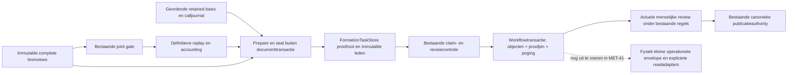
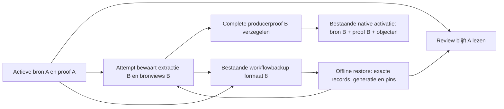

# MET-41: volledige bewijsset bij de bestaande activatie

Change class: A
Promise: Een nieuwe task-v1 semantische activatie pint atomair volledig en onveranderlijk geassembleerd vormingsbewijs; een stale of onvolledige bewijsset kan geen objectactivatie toestaan.
Proof: Native bestaande processing/reextract-ingang, complete manifest-/findingtegenproeven, echte rollback/concurrentie en zelfstandig procesherstart op beide ondersteunde PostgreSQL-composities.
Touches lifecycle invariants: yes
Rewrite risk: high
Rewrite target: Gedeelde input-/bewaargrens voor vormingsbewijs en operationele documentreads, met aansluiting op bestaande command-/publicatieowners.
Why local patching is insufficient: JSON-projectie of timeoutverhoging laat detoasting, globale documentcontrole, historische groei en incomplete proofbinding intact of verplaatst kosten naar writes/redirects.
Current authority/writer/reader map: TaskCheckpointWriter en bounded_formation leggen owner-callbasis/calls vast, seal_formation volgt definitieve replayaccounting; FormationTaskStore beheert roots/members en bestaande complete source-readrecords; beide documentstore-activatiepaden pinnen binnen bestaande workflowtransactie. Constructor-/metadata-/legacy-/triggerinventaris uit MET-40 en deze uitvoeringsanalyse blijft verplicht voor resterende operationele split.
Supported runtime topologies: Beide bestaande FastBadge CompleteWorkflow PostgreSQL-composities met lokale/Azure bronadapter en nieuwe processen/workers; geen nieuwe multi-host-/globale exactly-once-garantie.
Persisted-state impact: Nieuwe complete proof roots/members en nullable documentpin; bestaande inline replay/kwaliteit/extractie blijft in deze transitie behouden. Geen bron/object/release-identiteit wijzigen.
Compatibility/migration plan: Additief sealed-evidence-v1 voor nieuwe compatibele task-v1 semantische runs. Geen historische backfill. Oude prooftypes blijven legacy; tree en ongeregistreerde/legacy verwerking worden niet als nieuw semantisch bewijs gepromoveerd. Operationele-envelopecutover blijft apart vereist vóór afronding van MET-41.
Rollback/recovery plan: Native rollback van pin/objectset/attempt bij fout. Verzegelde maar ongeactiveerde set mag blijven bestaan. Oude binaries weigeren receipt-v3; geen ongeteste binaryrollback op nieuwe activaties, geen downmigration of gegevensverwijdering.
Cutover trigger: Deze transitie vervangt alleen nieuwe task-v1 activatiereceipt als migration029 aanwezig is; volledige operationele opslagcutover wordt niet gedaan of als gereed verklaard.
Cleanup/decommission criteria: Geen actieve volledige-envelopefallback, oude hydratatie of dubbele closurepolicy in overgezette route; audits/releasepins blijven leesbaar; vervangen calls/config/diagrammen bijgewerkt.
Failure blast radius: Betrokken revisie/proof kan expliciet onbeschikbaar zijn; geen ongeautoriseerde review, nieuwe release, verloren besluit of wijziging aan actieve voorganger.
Adversarial proof matrix: §11 en §13: missing/corrupt/membership, wrong source/contract, stale claim/revision/binding/policy/actor, alternatieve writers/legacy, rollback/restart, publicatierace en archiefgroei.
Lifecycle entity: Bestaande geregistreerde SourceSnapshot/WorkingRevision en complete immutable vormingsproof bij FormationTaskStore.
Lifecycle transition: Bestaande geautoriseerde task-v1 semantic-v2/v3 activatie met complete immutable bewijsset en objectset in dezelfde workflowcommit.
Initial durable state: Task-v1 document met broninput/bronviews en lopende geautoriseerde poging; objecten en een eventueel eerder actief bewijs blijven behouden.
Trigger: Bestaande ingest/reextract/resume nadat bestaande joint gate en definitieve replayaccounting klaar zijn.
Authorization: Bestaande producer/checkpoint/activatieguards; vóór een nieuwe pin ook live poging/claim/deadline, actuele rol/retirement/named-reviewer en exacte input/context/revisie opnieuw toetsen. Historische producerrechten verlenen geen recht op review of publicatie.
Validation: Bestaande joint gate zonder nieuwe materialisatie; exacte contract-/source-viewbinding, owner-calljournal, originele en onbekende bevindingen, resultaatversies, receipt en actuele activatiecapture.
Mutable entities: Alleen de bestaande object/envelope/attempttransitie en bijbehorende documentpin; huidige review/bindings worden niet vervangen.
Immutable entities: Bronbytes, verzegelde bewijsleden, beschermde historische objectinhoud en alle gepubliceerde releases/revisies volgens bestaande contracten.
Workflow state before: Bestaande processing/in_review/blocked/ready_for_publication-toestand; nooit uit bewijsomvang afleiden.
Workflow state after: Dezelfde domeinuitkomst bij representatieovergang; menselijke besluiten en publicatie bepalen hun bestaande volgende toestand, niet de migratie.
Release state before: Bestaande published/superseded/withdrawn release of geen release.
Release state after: Ongewijzigd door voorbereiding/migratie; alleen bestaande publicatie-/intrekkingsopdracht wijzigt release/serving.
Serving state before: Actieve/inactieve set uitsluitend uit publicatieregister.
Serving state after: Ongewijzigd door deze representatieovergang; geen automatische heractivatie na restart.
Expected API result: Bestaand commandresultaat of expliciete weigering; geen succesvolle pin/objectactivatie bij ontbrekend, gewijzigd of ongeautoriseerd bewijs.
Expected UI result: Bestaande Review-uitkomsten blijven gelijk; geen prestatie- of incidentherstelclaim door alleen deze prooftransitie.
Failure result: Geen halve pin, mutatie of verzonnen closure; behouden bestaande work state; canoniek gecommitte release houdt haar bestaande herstelpad.
Restart result: Gecommitte proof/review/bindings blijven herbruikbaar; geen stale activatie, stille herbouw of heropening van gepubliceerd werk.
Recovery result: Bestaande expliciete preparation/retry/reconcile met dezelfde bron-/revisie-/contractregels; geen reset of terugzetten van reviewwerk.
Legacy-data result: Expliciete voorbereiding met exacte pariteit en CAS; onvoorbereid, corrupt en incompatibel apart; gepubliceerd beleid niet herschrijven.
Required black-box scenario: Bestaande source-selection/reextract-ingang → geactiveerde complete proof met originele findings → echte worker-kill/nieuw proces en hergebruik committed bronviews → stale/ongeautoriseerde activatie geweigerd → fout na pin geeft volledige rollback; release/serving blijven ongewijzigd.
Explicit non-goals: Geen tweede kandidaatmaker, geen reconstructie van ontbrekend legacy-boomvoorstel, geen closurecache, geen migratie van gepubliceerde data, geen deployment. MET-41 blijft open tot operationele splitsing en overige variant-/groeiproeven klaar zijn.

## Gronding en ontwerpkeuze

Basis: main 1b80bfeb8b09bed97a5a7b38a7259252e637c6ef (tree e91404cd).
Opdracht: resterend MET-41 uitvoeren; dit is de eerstvolgende coherente
stateful transitie, geen verklaring dat geheel #950 klaar is.

De huidige final_validation wordt vóór definitieve replay/findingassemblage
vastgelegd. De nieuwe producerhook komt ná die assemblage en buiten elke
workflowtransactie. Zij vergelijkt tegen de eigenaargecapturede gate, broninput,
taakmanifest en definitieve accounted-checkpoint. De writer leidt membership
uit die capture af; een caller-trimmed lijst met opnieuw berekende hashes telt
niet als bewijs. pending_rejections blijft de bestaande findingregel.

Twee onderzochte vormen: één grote immutable proofblob (eenvoudig maar geen
member-omissiecontrole of scopepassende toegang) versus root met verzegelde,
geordende leden bij bestaande FormationTaskStore. Gekozen is root/members met
exacte immutable resultaatversies en DB-bescherming. Geen globale blobpool,
geen eigen proofmanager en geen nieuwe kandidaatautoriteit.

Voorbereiding captureert broninput/extractie, context/plan/resultset, originele
validatorreceipt en geordende checkpoints. Grote pure verificatie, serialisatie
en zelfstandige duurzame seal vinden buiten documentclaimlocks plaats. De
bestaande checkpointguard autoriseert de verwijzing opnieuw. Activatie vergelijkt
receipt/ref en de actuele capture opnieuw, en pint de complete root in dezelfde
transactie als objects/envelope/attempt. Kan de capture intussen veranderen,
dan wint de actuele toestand en blijft het oude bewijs ongeactiveerd.

De immutable proof bindt de exacte complete replay, alle pending bevindingen en
bronbasis, en bewaart kopieën van de resultaatversies. Een volgende correctie van
formation_task_results verandert een oude proof niet. Root/membermutaties en
truncatie worden in SQL geweigerd. Alleen bestaande volledige ongepubliceerde
documentverwijdering mag de cascade verwijderen; geen nieuwe GC.

## Capability- en uitrolgrens

Nieuwe geregistreerde task-v1 proza gebruikt het oorspronkelijke v1-, v2- of
v3-validatorcontract. Beslisbomen hebben hun eigen constructiegate en kunnen
historisch het oorspronkelijke voorstel missen: geen valse generieke proof.
Legacy/onvoorbereid, ontbrekende expliciete pin, corrupt en incompatibel blijven
onderscheiden. Geen GET-bouw of nieuw modelwerk als reparatie.

Dit bewijs vormt de voorwaarde voor de fysiek kleine operationele envelope.
Die laatste moet ook attempt-hydratatie, metadatawriters en triggers 008/020/
021/026/027 afdekken; inlinevelden simpel verwijderen zou incomplete() ten
onrechte False laten teruggeven. Daarom blijft die omschakeling expliciet open
zolang de complete calleradapters/native proeven nog ontbreken. #951 verandert
later de passagescope; geen patch aan de banner die de documentcontrole weglaat.

## Compositie van deze transitie

De proof is producerhistorie, geen uitkomst van huidige review of toestemming
voor publicatie. Canonieke publicatie blijft een afzonderlijke bestaande
transactie met haar bestaande herstelpad. Deze transitie wijzigt geen serving.
De bronbasis verwijst naar bestaande complete sealed source_read-records en hun
exacte extractieheader; prepare en read controleren die membership. Er wordt geen
nieuwe bronreconstructie gestart bij herstel. Resultaten worden als exacte
immutable versies binnen de proof bewaard, niet alleen als pointer naar de
wijzigbare actuele taakprojectie.

Het calljournal heeft een eigenaargecontroleerde beginbasis (actieve vorige
replay, retained resultaten en behouden taakfouten), gevolgd door elke werkelijk
uitgevoerde call in volgorde, inclusief niet-gestarte budgetranges. Grote
callrecords worden vóór de checkpointlock in bestaande immutable archiefopslag
bewaard; het korte checkpoint bindt hun referenties. De finale replay moet exact
dezelfde geordende calls bevatten. Zowel een getrimde replay als een identiek
getrimd accountingcheckpoint kunnen die onafhankelijke basis niet vervangen.
Een pure replay leest de daadwerkelijke retained ownerrecord, nooit een door de
preparecaller aangeboden envelope als volledigheidsoracle.

Receipt-v3 behoudt exacte receipt-, input/context/artifact-, bron-, configuratie-,
claim- en activatierevisiebinding. Een reeds gepind document kan de controle niet
omzeilen door de taskmarker of inputreferentie weg te laten. SQL weigert het
losmaken van een pin of een replay-/bronwijziging die niet bij de complete proof
hoort. Een budgetstop zonder activatie blijft opneembaar en hervatbaar.

De bestaande task-v1 projection verwijdert alleen afgeleide formation_progress;
het volledige oorspronkelijke record blijft in het archief/proof bewaard. De
activatiebinding hanteert die bestaande projectieregel, zonder bevindingen of
bronverplichtingen te verwijderen. Deze normalisatie is één gedeelde helper.

## Bewijsgrenzen die open blijven

De nieuwe prooftransitie is nog geen voltooiing van MET-41. Inline replay,
kwaliteit en broninhoud blijven in deze branch voor bestaande consumers staan.
De volledige operationele opslagovergang moet nog alle calleradapters, attempt-
hydratatie en triggers 008/020/021/026/027 omvatten. Daarom geldt hier ook geen
claim dat iedere metadatawrite of activatielock al onafhankelijk van inline
archiefomvang is: de compatibilityguard vergelijkt de bestaande representatie.
Nieuwe proofleden worden niet bij iedere metadatawrite herschreven.

Voor native task-v1 zijn de bestaande semantische contractvarianten expliciet
gebonden aan retained validatorinput en produceridentiteit. Legacy-import en
beslisboomadapters zijn nog niet geleverd. Historische beslisbomen kunnen hun
originele volledige voorstel missen; graph/hash wordt niet teruggeconstrueerd tot
een verzonnen origineel. Onvoorbereid blijft onvoorbereid en gepubliceerd werk
wordt niet in plaats omgezet. Bron-/review-/publicatiepariteit en rollout voor
bestaande documenten blijven de aparte acceptatie van MET-44.

## Actieve broncontext, voorbereiding en herstel

Een nieuwe extractie bij een al gepinde proof blijft attempt-owned: de bestaande
prepared_extraction_versions bewaart het exacte record, de poging bewaart
staged_extraction_hash en haar nieuwe review_source_ref. De operationele
prepared_source_extraction en Review-bronpin blijven op de actieve bewijsset
staan. Een nieuw gereserveerde retry/resume neemt de staged identiteit mee;
een workerherstart gebruikt het retained record onder zijn oorspronkelijke
extractorcontract. De producerbaseline voor CAS wordt niet door staging gewijzigd.

De complete proofcapture onderscheidt de voorbereide source_ref en de bestaande
active_source_ref. De bestaande activatietransactie vergelijkt beide opnieuw en
wisselt proofpin, bronpin, extractie en objecten samen. De bestaande onafhankelijke
bronvoorbereiding mag alleen dezelfde actieve bronroot herbevestigen; de card-
preparation die na de activatieguard loopt moet dezelfde proofgebonden root
opleveren. SQL weigert het los wijzigen van bronpin of extractieheader.

Gewone curation behoudt de immutable actieve proof, onafhankelijk van een nieuwe
mutable taakcontext en van inmiddels vervallen producerrechten. Nieuw producer-
werk noemt zijn activatiereferentie expliciet; ook hergebruik van dezelfde pin
vereist actuele lease/claim/accountcontrole. Een activatiereferentie zonder
objectset wordt op zowel orchestratie- als opslaggrens geweigerd.

De bestaande PostgresWorkflowRecoveryAdapter blijft de enige volledige workflow-
backup-/restore-eigenaar. Recoveryformaat 8 neemt alle formation-/attempt-/source-/
archive-records, reviewfacts en de exacte generatie-/pinwaarden mee in dezelfde
snapshot. Oude binaries weigeren dit formaat. Een oudere task-v1-backup zonder
retained formatierecords vereist expliciet re-export; ontbrekende records worden
niet uit huidige bron of modeluitvoer gereconstrueerd. Gewone oudere backups
zonder task-v1 blijven onder de bestaande legacy-upgrade leesbaar.

Herstel is uitsluitend de bestaande offline import naar een lege database, onder
dezelfde exclusieve transactielocks. Immutable roots worden via hun normale
sealguards hersteld, daarna volgen de actieve pins en exacte generatieallocators.
De bestaande proofreader controleert de volledige retained set opnieuw; ontbrekende
leden of een ongeldige bronbasis rollen de hele import terug. Deferred constraints
worden gevalideerd vóór de bestaande identitytrigger weer wordt ingeschakeld.
De bronbytes vallen ongewijzigd onder de bestaande Blob-/freeze-herstelgrens.

Afzonderlijke adversarial reviews door een andere agent met hetzelfde model
vonden de te vroege bronpin, het historische-rechtenpad en de bindings-only
omweg. Deze zijn in de integratie hersteld; dit is geen onafhankelijke
cross-model consensus. Native tegenproeven omvatten ook een backup met actieve A
plus staged B vóór validatorinput, restore, nieuwe resume en activatie van B.
Een mutatieproef die de onafhankelijke callmembershipcontrole uitschakelde liet
beide omissieproeven terecht falen; productbestanden bleven daarbij ongewijzigd.
