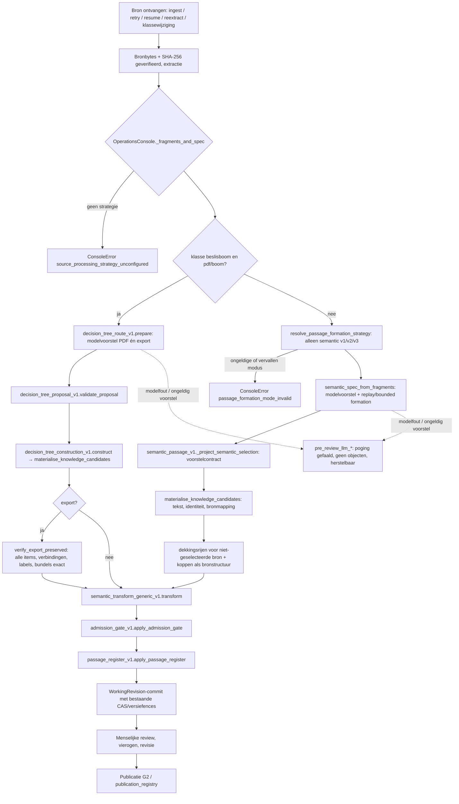

# Eén semantische vormingsroute voor alle kennisobjecten (Protocol 4.3.0)

```text
Change class: A
Promise: iedere nieuwe bronverwerking (HTML, PDF, PDF-beslisboom, gestructureerde export) vormt kenniskandidaten uitsluitend via een brongebonden AI-voorstel en materialise_knowledge_candidates; er bestaat geen deterministische vormingsroute, impliciete terugval of rollbackmodus meer, en alle validatie-, admission-, review- en publicatiecontracten blijven ongewijzigd actief.
Proof: tests/test_semantic_only_formation_v1.py (exportbehoud, bronvertrouwen, geen terugval, geen achtergebleven route), bijgewerkte policy-/protocoltests en de volledige regressiesuite inclusief PostgreSQL.
Touches lifecycle invariants: yes (restart/recovery van verwerking; publicatieprotocolversie 4.3.0 voor nieuwe releases)
Rewrite risk: high
```

Besluit William 2026-10-22 (opdracht "Eén semantische vormingsroute voor alle kennisobjecten in Metis"), uitgevoerd via Protocol §15 naar het precedent van 4.2.0 (`eac30ca`). Referentierevisie: main `fe0ccf81bf482627bcafe5fa077a04625310e272`.

## 1. Rewrite-risk-mitigatie

| Veld | Invulling |
| --- | --- |
| Rewrite target | Kandidaatvorming vóór review: `OperationsConsole._fragments_and_spec` en de daaraan gekoppelde strategie. |
| Why local patching is insufficient | De deterministische route was zowel standaard (console zonder strategie) als expliciete rollback (`deterministic-v1`), als exportvoorstel, als klassewijzigingspad en als vergelijkingsbaseline aanwezig; één tak verwijderen liet de andere uitvoerbaar. |
| Current authority/writer/reader map | Enige kandidaatmaker: `knowledge_materialisation_v1.materialise_knowledge_candidates` (ongewijzigd). Writers van kandidaten: ingest, `reextract_unpublished`/retry/resume, klassewijziging, reviewcorrectie (`correct_object`, `accept_source_continuation`) — allemaal via de materialiser. Readers: transform, admission, passage register, review, publicatie, serving (ongewijzigd). |
| Supported runtime topologies | Eén productiecompositie: `console_asgi.build_app` → `bind_pre_review_semantic_processing` (PostgreSQL-only, D6b). |
| Persisted-state impact | Geen schema, geen migratie, geen backfill. Bestaande snapshots, objecten, reviews, releases en replays blijven ongewijzigd. `PASSAGE_FORMATION_POLICY_VERSION` blijft `v1.0.0` (replay-identiteit), kopprovenance blijft byte-gelijk. |
| Compatibility/migration plan | Historische deterministisch gevormde objecten en met `deterministic-export-v1` gevormde bomen blijven leesbaar en verifieerbaar; er is geen stille rematerialisatie. |
| Rollback/recovery plan | Rollback = gecontroleerde softwareterugzetting naar `fe0ccf8`. Nieuwe `-sem-`kandidaten blijven leesbaar voor die versie (zelfde contracten). Een mislukte vorming laat bron en eerder werk intact; herstel via bestaande retry/`reextract_unpublished`. |
| Cutover trigger | Merge van deze wijziging (door de eigenaar besloten; geen omschakelvlag). |
| Cleanup/decommission criteria | In dezelfde wijziging uitgevoerd (zie §3); geen tijdelijke dubbele route. |
| Failure blast radius | Zonder geconfigureerd model faalt nieuwe verwerking gesloten (ook exports). Lezen, review en publicatie van bestaand werk blijven beschikbaar. |
| Adversarial proof matrix | §6. |

Bewuste afwijking van `docs/agents/continuous-development.md` en `docs/METIS_SOURCE_BOUND_IMPLEMENTATION_PLAN.md` §8: big-bang-vervanging zonder staged coexistence, zonder rollbackvenster van twee releases en vóór G4, op expliciete opdracht van de eigenaar ("geen verborgen tweede vormingspad"; rollback via softwareterugzetting). G4 (inhoudelijke acceptatie) is daarmee **niet** aangetoond; zie §7.

## 2. De enige uitvoerbare kandidaatvormingsroute



## 3. Verwijderde en behouden componenten

| Component | Status | Reden |
| --- | --- | --- |
| `OperationsConsole._fragments_and_spec` impliciete terugval | **verwijderd** | Console zonder strategie faalt expliciet (`source_processing_strategy_unconfigured`). |
| `OperationsConsole._deterministic_fragments_and_spec` | **verwijderd** | Concurrerende vormingsroute. |
| `operations_console_v1._spec_from_fragments` | **verwijderd** | Deterministische kandidaatvorming (L01). |
| Directe prozaconversie van exports bij klassewijziging (`_reextract_objects_for_klasse`) | **verwijderd** | Liep buiten de strategie om (L08); nu via `_fragments_and_spec`. |
| `context_aware_split_v1.split_context_aware_units` en de afwijsheuristiek | **verwijderd** | Deterministische passagevorming. |
| `atomic_split_v1` (incl. `proposed_relations_for_units`) | **verwijderd** | Alleen gebruikt door de verwijderde route. |
| `passage_formation_policy_v1`: `deterministic-v1`, `STRATEGY_DETERMINISTIC`, rollback- en `kind=boom`-vertakking | **verwijderd** | L04; vervallen modus is een configuratiefout. |
| `pre_review_semantic_v1.configured_fragments_and_spec` deterministische tak | **verwijderd** | Exports buiten de klasse beslisboom gaan nu semantisch. |
| `decision_tree_route_v1.export_proposal`, `EXPORT_MODEL` | **verwijderd** | Exports krijgen een modelvoorstel. |
| Deterministische arm routevergelijking (`execute_arm`, `new_comparison`, `freeze`, create/freeze-routes) | **verwijderd** | L06; nieuwe vergelijkingen geweigerd (`comparison_route_retired`). |
| Baseline in `audit_semantic_safety_v1` | **verwijderd** | Voerde de oude splitter uit; suite-metadata `evaluated_baseline_commit` blijft. |
| Deterministische UI-modus in `operations_console_app` | **verwijderd** | Ontbrekende modus toont "Configuratiefout". |
| `context_aware_split_v1.heading_structure_units` | **nieuw/behouden** | Koppen zijn extractiestructuur; byte-gelijk aan de oude kopprojectie (23 koppen op alle HTML-fixtures vergeleken). Geen inhoudelijke beslissing, geen kandidaat. |
| `decision_tree_route_v1.verify_export_preserved`, `request_input`, `export_types`, `EXPORT_PROMPT` | **nieuw** | Bewijs dat expliciete exportroutes volledig behouden blijven; PDF-prompt ongewijzigd. |
| `knowledge_materialisation_v1` | **ongewijzigd** | Enige kandidaatmaker. |
| `semantic_transform_generic_v1`, `admission_gate_v1`, `source_bound_fields_v2/v3`, `source_reconstruction_v1`, `passage_register_v1`, schema's | **ongewijzigd** | Harde controles. |
| `decision_tree_proposal_v1`, `decision_tree_construction_v1`, `decision_graph_v1.source_evidence` | **ongewijzigd** | Voorstelcontract, constructie en vastgelegd bewijsinventaris (byte-gelijk). |
| `_read_source_fragments` historische adapters, `decision_unit_construction_v1` legacy-markers | **behouden** | Nodig om bestaande snapshots te lezen/verifiëren; vormen niets nieuws. |
| `deterministic_review_repair_v1`, `correct_object`, `accept_source_continuation` | **behouden** | Menselijke review/revisie na review; via materialiser of reviewcontract. |
| Routevergelijking lezen/beoordelen/analyseren/sluiten/annuleren | **behouden** | Vastgelegde experimenten blijven leesbaar. |
| `PASSAGE_FORMATION_POLICY_VERSION` `v1.0.0`, kopprovenance `deterministic_heading_structure` | **behouden** | Replay-identiteit en canonieke kophashes mogen niet stil veranderen. |

## 4. Invarianten en handhavingspunt

| Invariant | Handhavingspunt |
| --- | --- |
| Eén kandidaatmaker | `knowledge_materialisation_v1.materialise_knowledge_candidates`; statische test in `test_semantic_only_formation_v1.py` en `test_t7_creator_cut.py` |
| Tekst alleen uit exacte bronspans, geen toevoeging/parafrase | `resolve_source_selection` (`materialisation_text_mismatch`, `_span_invalid`, `_unknown_block`, `_source_mapping_invalid`) |
| Volgorde behouden | `resolve_source_selection` (`materialisation_span_order_invalid`) |
| Identiteit niet door AI | `_candidate_identity` (spans, geen selectorveld) |
| Voorstelcontract proza | `semantic_passage_v1._project_semantic_selection`, `source_bound_fields_v2/v3`, `validate_provider_proposal` |
| Voorstelcontract beslisboom | `decision_tree_proposal_v1.validate_proposal`, `relation_findings` |
| Expliciete exportroutes autoritatief | `decision_tree_route_v1.verify_export_preserved` (nieuw, fail-closed) |
| Negaties/voorwaarden niet verloren | exacte reconstructie + dekkingsrijen (`semantic_coverage_units`, `ordered_source_projection`), `recommendation_coverage_v1`, admission |
| Resterende broninhoud zichtbaar | `passage_register_v1.apply_passage_register`, dekkingsrijen, `pending_rejections` (v3) |
| Admission/schema | `semantic_transform_generic_v1.transform`, `admission_gate_v1.apply_admission_gate`, `candidate_eligibility_v1` |
| Bronintegriteit | `_verified_source_bytes` (SHA-256), `source_lineage_resolves`, `validate_materialised_candidate` |
| Geen terugval | `_fragments_and_spec` (`source_processing_strategy_unconfigured`), `resolve_passage_formation_strategy` (`passage_formation_mode_invalid`), `pre_review_llm_*`-fouten |
| Retry/resume/versiefences | `processing_retry_v1.reserve/assert_active`, `_execute_source_attempt` (`processing_command_conflict`, `processing_configuration_changed`), `assert_resume_configuration`, `semantic_replay_v1.exact_replay_lookup` |
| Review, vierogen, publicatie | bestaande review-/vierogen-/G2-contracten, `consider_publish`, `publication_registry` (ongewijzigd) |
| Provenance | `semantic_passage` (`formation_mode`, `model`, `source_blocks_hash`, `proposal_hash`), replayrecord, `decision_tree_formation` |

## 5. Bevestiging

Na deze wijziging bestaat er precies één uitvoerbare kandidaatvormingsroute vóór review: een brongebonden AI-voorstel (proza of beslisboom) dat door `materialise_knowledge_candidates` wordt gematerialiseerd. Er is geen tweede vormingsroute, geen impliciete terugval, geen rollbackmodus en geen compatibiliteitswrapper. `test_no_deterministic_formation_route_or_its_configuration_remains` bewaakt dit statisch.

## 6. Adversariële bewijsmatrix

| Scenario | Bewijs |
| --- | --- |
| Console zonder strategie | `test_unconfigured_runtime_fails_explicitly_and_a_configured_runtime_forms_semantically` |
| `deterministic-v1` geconfigureerd | `test_runtime_policy_is_instance_bound_and_has_no_rollback_mode`, policy- en protocoltests |
| Model faalt / ontbreekt (export) | `test_failing_or_missing_model_never_falls_back_for_exports`; proza: bestaande fail-closed-tests |
| Export: verbinding weggelaten, toegevoegd, omgeleid, label gewijzigd, als onzeker gemarkeerd, zonder bewijs; eenheid ingekort; bundel weg | `test_export_proposal_that_changes_the_explicit_graph_fails_closed` |
| Woorden toegevoegd, spans omgekeerd, verzonnen blok | `test_model_cannot_add_words_reorder_spans_or_fabricate_a_block` |
| Export buiten klasse beslisboom | `test_export_outside_the_decision_tree_class_is_formed_semantically` |
| Vastgelegd bewijs niet gewijzigd; PDF-verzoek gelijk | `test_export_request_names_export_ids_while_pdf_request_and_recorded_evidence_stay_unchanged` |
| Historische vergelijking / route | `test_route_comparison_v1.py`, `test_route_comparison_http_v1.py` |
| Restart/retry/concurrency | bestaande suites (`test_source_resume_acceptance`, `test_bounded_processing_lifecycle`, `test_processing_retry_postgres`, `test_workflow_postgres_concurrency`) |

## 7. Klassewijziging tussen beslisboom en ander documenttype (besloten: optie 1)

Gevonden conflict: een kennisrevisie wordt nooit in-place gewijzigd (T11, `revision_workflow.validate_revision_write`), terwijl semantische hervorming van dezelfde bron dezelfde span-afgeleide `-sem-`identiteiten met andere inhoud oplevert. Het in-place herextractiepad van "Klasse wijzigen" kon daardoor niet meer slagen.

Besluit William 2026-10-22 (optie 1): een klassewijziging van of naar een beslisboom verloopt altijd via de bestaande opvolger (`create_review_successor(..., class_=...)`, UI: Review → Nieuwe werkrevisie). `promote_class` weigert zo'n wijziging met `decision_graph_class_change_requires_successor` (met beslisgraaf) of `knowledge_class_change_requires_successor`, met Nederlandse uitleg in de console. Verwijderd: `_reextract_objects_for_klasse`, `_class_change_manifest`, `_archive_prior_objects` (schrijver), de `reextract`-vlag en `cross_model_direct_change_blocked`. Behouden: `prior_object_audit_history` om eerder gearchiveerde objecten te blijven lezen. De opvolger krijgt een eigen snapshot met eigen identiteiten; ouder, objecten, revisie en bron blijven ongewijzigd (`test_cross_model_class_change_is_a_successor_and_keeps_prior_work`). T11 en het identiteitscontract zijn niet gewijzigd.

## 8. Niet-geverifieerde risico's

- **G4 niet aangetoond:** inhoudelijke kwaliteit van semantische vorming per bronsegment is niet gemeten op een bevroren corpus; de deterministische vergelijkingsarm bestaat niet meer.
- **Extra modelafhankelijkheid voor exports:** exports vragen nu een modelaanroep (kosten, latentie, beschikbaarheid). Een model dat de export niet exact reproduceert, blokkeert de export (gesloten) in plaats van een deterministisch resultaat te geven; echte provideruitvoer op productie-exports is niet getest.
- **Kwaliteit van kopprojectie in PDF's:** byte-gelijkheid is aangetoond op HTML-fixtures; er zijn geen PDF-fixtures in de repository. De codepaden zijn voor koppen gelijk (alleen chrome/stempel/nummer/tijdstempel/leeg gefilterd).
- **Configuratie in Azure:** een deployment met `METIS_PASSAGE_FORMATION_MODE=deterministic-v1` faalt na deze wijziging bij nieuwe verwerking; controleer de omgevingsinstelling vóór deploy.

## 9. Testaanpassingen en waarom geen invariant is verzwakt

| Categorie | Aanpassing | Reden |
| --- | --- | --- |
| Testharnas | `processing_binder=lambda console: None` → `bind_fixture_selections` waar een test zelf niet bindt; `install_fragment_proposer` installeert ook de fixturestrategie; `restart_production` hergebruikt de binder van de oorspronkelijke console; conftest laat een expliciete latere binding de fixturebinding vervangen. | Die consoles kregen stilzwijgend de deterministische terugval. Het fixturemodel selecteert letterlijke bronblokken via het echte voorstelcontract en de echte materialiser. |
| Fixturemodel | `bind_fixture_selections(..., relations=...)`; `export_tree_proposal` (export getrouw uit de verzoekinvoer). | Relaties en exportverbindingen komen nu uit een (nep)modelvoorstel in plaats van uit de verwijderde heuristiek. |
| Verwijderde route | Tests van `split_context_aware_units`, `atomic_split_v1`, `deterministic-v1`, `_spec_from_fragments`, `export_proposal`, de deterministische vergelijkingsarm en c3-`non_llm` verwijderd of omgezet. | Testten uitsluitend het verwijderde pad. Eén kandidaatmaker, bronvertrouwen, T7-onderscheid (historische deterministische rijen worden nooit kandidaat) en kopprojectie blijven getest. |
| v2.16–v2.21 | Asserties over "Eventueel …" aan de vorige zin plakken, ontdubbeling en zinsplitsing verwijderd; "geen stempel/lijstnummer/tijdstempel/chrome als werk" beperkt tot `content_reviewable`/`is_inhoudelijk_candidate`. | Splitsheuristiek is een voorstelmethode (`docs/atomic-object-boundaries.md`), geen objectcontract. Het werkelijke invariant wordt door admission gehandhaafd: zulke voorstellen worden `blocked` en nooit reviewwerk. |
| Gebonden runtime | Pogingenlijst relatief aan de begintoestand; mislukte poging zichtbaar in envelope; Blob-fout vergelijkt alles behalve `processing_attempts`. | Productie is altijd gebonden en registreert pogingen; het oude ongebonden pad bestond alleen in tests. Werk en review blijven gelijk. |
| T11 | Corruptie-setup via `install_fixture_history`; richtlijn-klassewijziging verwacht `knowledge_class_change_requires_successor`. | Bestaande opslagregel weigert in-place wijziging van kennisrevisies; de bestaande sanctiehelper modelleert opgeslagen corruptie. |
| Goldens | `CONTINENTIE_FIXTURE_HASHES` en characterization-goldens opnieuw vastgelegd (`--record-characterization`); hash-test bewijst daarnaast byte-gelijke herverwerking. | Alleen ondoorzichtige revisietokens, objecthashes en de twee verwijderde `/freeze`-routes verschillen; de gerenderde reviewpagina's zijn verder identiek. |
| Protocol | Governance-tests naar 4.3.0, nieuwe test op bevroren 4.2-snapshot. | §15-procedure. |

## 10. Testresultaten

- Volledige suite met PostgreSQL 16 (gestart via `scripts/test_postgres.sh` door `tests/conftest.py`), 4 workers: 5552 geslaagd, 3 xfailed (B23 fail-first), 29 overgeslagen, 4 gefaald.
  - 3 × het conflict uit §7; opgelost met optie 1 (zie §7), deze tests zijn nu groen of vervangen.
  - 1 × `tests/test_security_sandbox.py::test_tested_code_cannot_overwrite_control_files`: faalt ook op `fe0ccf8` in deze container (root negeert alleen-lezen rechten); niet gerelateerd.
- `python scripts/check_architecture_boundaries.py`: PASS.
- Byte-gelijkheid kopprojectie oud/nieuw: 23 koppen over alle HTML-fixtures gelijk.

