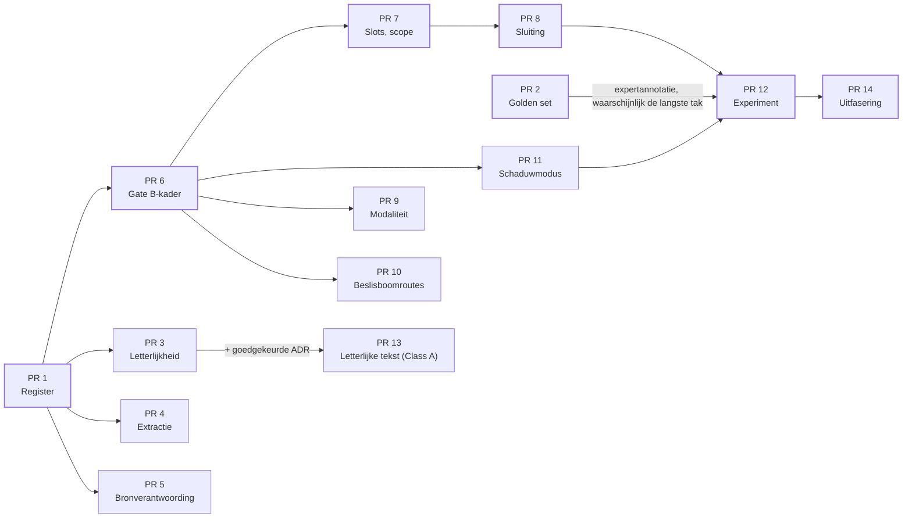

# Metis-DS — Implementatieprogramma GNC-gates

Status: ontwerpvoorstel · 20 oktober 2026 · gebaseerd op commit `c5b48f7`

## Doel en uitgangspunten

Dit programma implementeert GNC v1.2 (Gate A universeel, Gate B per documenttype) in veertien PR's, inclusief de zes aanscherpingen uit de second opinion en de verwijder- en uitfaseringslijst (PR 13 en 14). Iedere PR heeft een eigen pagina in deze map, met de verplichte issue-header uit `docs/agents/continuous-development.md`.

Vier regels gelden voor alle PR's:

- **Eén kandidaatmaker.** `materialise_knowledge_candidates()` blijft de enige; geen PR voegt een schrijver, status of opslag toe.
- **Gates leveren bevindingen, geen status.** Uitkomsten `PASS`, `BLOCK` en `UNRESOLVED` reizen als `reason_codes` door de bestaande `apply_admission_gate`.
- **Eerst meten, dan blokkeren.** Elke nieuwe regel draait eerst in schaduwmodus; een `BLOCK` gaat pas aan na een gemeten baseline.
- **Geen stille herinterpretatie.** Bestaande reviews, canonieke hashes en publicaties blijven onaangeroerd; elke wijziging daarvan is een apart Class A-besluit.

## PR-pagina's

| PR | Titel | Fase | Hangt af van | Class / risico |
| --- | --- | --- | --- | --- |
| [1](pr-01-regelregister.md) | Regelregister en grensbewaking | A | — | B / none |
| [2](pr-02-golden-set-v2.md) | Golden set v2: context, voorwaarden, routes | A | — | B / none |
| [3](pr-03-letterlijkheid-a02.md) | A02 letterlijkheidsmeting | B | 1 | B / none |
| [4](pr-04-extractie-a13.md) | A13 extractieverificatie | B | 1 | B / none |
| [5](pr-05-bronverantwoording-a05-a06.md) | A05/A06 bronverantwoording en signaalwoorden | B | 1 | B / none |
| [6](pr-06-gate-b-kader.md) | Gate B-kader, ernstmatrix en doorgifte | C | 1 | B / none |
| [7](pr-07-slots-en-scope.md) | Richtlijn: slotschema en scope-overerving | C | 6 | B / none |
| [8](pr-08-tweerichtingssluiting.md) | Richtlijn: tweerichtingssluiting voorwaarden en uitzonderingen | C | 7 | B / none |
| [9](pr-09-modaliteit-op-grenzen.md) | Modaliteit en ontkenning op spangrenzen | C | 6 | B / none |
| [10](pr-10-beslisboomroutes.md) | Beslisboom: routeverzameling vergelijken | D | 6 | B / none (herhaling: open besluit) |
| [11](pr-11-schaduwmodus.md) | Schaduwmodus over bestaande objecten | E | 6 | B / none |
| [12](pr-12-experiment-a-d.md) | Experimentharnas varianten A–D | E | 2, 8, 11 | B / none |
| [13](pr-13-letterlijke-canonieke-tekst.md) | Letterlijke canonieke tekst voor nieuwe kandidaten | F | 3 + ADR | A / high |
| [14](pr-14-uitfasering-en-done.md) | Uitfasering legacy-routes L01–L08 en topologie-diff | F | per route 4, 6, 7 of 12 | B / none per route |

## Bevindingen uit de code

Veel van Gate A en B bestaat al; het werk is samenbrengen en meten, niet herbouwen. Zes bevindingen sturen het plan:

| Bevinding | Waar | Gevolg voor het plan |
| --- | --- | --- |
| Canonieke tekst wordt genormaliseerd: spans worden met spaties samengevoegd en door `normalize_visible_prose` gehaald | `knowledge_materialisation_v1.resolve_source_selection` (r. 189) | Strijdig met I2/A02. De tekst zit in `compute_canonical_object_hash`, dus wijzigen breekt bestaande reviews. PR 3 meet en rapporteert; PR 13 is het aparte Class A-besluit. |
| Kandidaatidentiteit hangt aan spans, niet aan tekst | `_candidate_identity` | Gunstig: een latere tekstcorrectie verandert `object_id` niet, wel de reviewhash. |
| `excluded_with_reason` ontstaat alleen via menselijke review (`geen_kenniseenheid`); machineblokkades gaan terug naar `not_yet_assessed` | `passage_register_v1._initial_status` | De zorg over AI-uitsluitingen is al afgedekt. PR 5 legt dat vast in een test en voegt signaalwoorden toe. |
| Aanbevelingsinventaris is deterministisch en zegt zelf `detection_completeness: not_proven` | `recommendation_coverage_v1.inventory` | Goede basis voor R01; recall blijft afhankelijk van de golden set (PR 2). |
| Relatietypen `applies_if`, `except_if`, `explains`, `supported_by` bestaan al | `knowledge_relations_v1` | De tweerichtingssluiting (PR 8) bouwt hierop, zonder nieuw relatietype. |
| Cycli in beslisbomen worden altijd `decision_graph_cycle_unresolved` | `decision_graph_v1.graph_issues` | Legitieme herhaling is nu onuitdrukbaar. Een nieuw randtype raakt het grafcontract en is daarom een open besluit (PR 10). |

De golden-setinfrastructuur bestaat (`data/golden`, `src/evaluation/validate_golden_set.py`), maar annoteert nog geen context, voorwaarden of beslisboomroutes.

## Domain-first classificatie

Alle gateregels zijn stateless berekeningen; de kernel blijft de enige eigenaar van duurzame toestand. Daarmee zijn PR 1 t/m 12 en 14 Class B met `Rewrite risk: none`; alleen PR 13 (letterlijke canonieke tekst) is Class A met `Rewrite risk: high`, omdat kandidaattekst in de reviewhash zit.

| Gedrag | Stateless of stateful | Eigenaar | Gevolg |
| --- | --- | --- | --- |
| Gateregels evalueren (A01–A13, R/D/E/C/X, P/N/O/G) | Stateless: invoer is kandidaat + fragmenten, uitvoer is een lijst bevindingen | Nieuwe pure functies, aangeroepen vanuit bestaande eigenaren | Geen lifecycle, geen opslag |
| Bevindingen vastleggen op een object | Stateful | Bestaande `apply_admission_gate` en workflowtransactie | Bevinding = `reason_code` in de bestaande admissionrecord; geen nieuw veld met eigen status |
| Passageregister bijwerken | Stateful | `passage_register_v1.apply_passage_register` | Ongewijzigd; gates lezen het register alleen |
| Kandidaat vormen | Stateful | `materialise_knowledge_candidates` | Ongewijzigd (behalve PR 13, na besluit) |
| Schaduwrapport en experiment | Stateless, offline | CLI-script, schrijft alleen naar `output/` | Geen productieroute, geen terugschrijving |

**Harde invarianten van het programma.**

1. Geen nieuwe schrijver van kandidaattekst, identiteit, registerstatus of reviewstatus. Afdwinging: `scripts/check_architecture_boundaries.py` uitgebreid met de nieuwe modules (PR 1) en een topologietest per PR.
2. Een gate kan alleen strenger maken: een `BLOCK` of `UNRESOLVED` wordt nooit stil `allowed`. Afdwinging: eigenschapstest in PR 6.
3. Bestaande `canonical_object_hash` van opgeslagen objecten verandert niet. Afdwinging: regressietest over de fixtures in `data/fixtures` in elke PR.
4. Een onbekend documenttype krijgt geen Gate B-contract en geen stille terugval. Afdwinging: PR 6.

**Idempotentie en concurrency.** Regels zijn pure functies over een gepinde invoer: twee keer draaien geeft dezelfde bevindingen. Schrijven loopt via de bestaande transactie en optimistische versiecontrole, dus er ontstaat geen nieuw concurrencyrisico.

## Kritiek pad

Kritiek pad (voorlopig): PR 1 → PR 6 → PR 7 → PR 8 → PR 12 → PR 14, met PR 2 als parallelle tak die waarschijnlijk het langst duurt omdat expertannotatie mensen vraagt. **Eerste blokkade: PR 1. Volgende actie: PR 1 bouwen én annotatoren voor PR 2 vastleggen.**

### Ruwe schatting

Schatting op basis van de omvang van de code, niet gemeten; herzien na PR 1 en zodra de annotatoruren bekend zijn.

| Blok | PR's | Werkdagen |
| --- | --- | --- |
| Basis | 1 | 1–2 |
| Golden set (tooling) | 2 | 3–4, plus annotatie |
| Gate A | 3, 4, 5 | 7–10 |
| Gate B richtlijn | 6, 7, 8, 9 | 9–13 |
| Gate B beslisboom | 10 | 3–4 |
| Schaduw en experiment | 11, 12 | 5–8 |
| Letterlijke tekst (Class A) | 13 | 5–8, plus ADR en review |
| Uitfasering | 14 | 6–10 |

Totaal ongeveer 40–55 werkdagen bouwwerk; in kalendertijd 8–12 weken, bepaald door expertannotatie (2–4 weken) en open besluiten in PR 8 en PR 13.

## Definition of Done van het programma

Een Gate A/B-wijziging is niet voltooid zolang vervangen productiecode nog aanroepbaar is, een alternatieve autoritatieve schrijfroute bestaat, of een tijdelijke implementatie zonder uitfaseringsbesluit achterblijft. Noodzakelijke compatibiliteitscode wordt aantoonbaar read-only en onbereikbaar voor nieuwe formatie. Het eindresultaat heeft minder actieve topologie dan de baseline; de afsluitcontrole staat in [PR 14](pr-14-uitfasering-en-done.md).

**GO-scope:** dit document geeft GO om te onderzoeken en PR 1 en PR 2 te starten. Een `BLOCK`-regel aanzetten vraagt per regel een eigen GO op basis van schaduwcijfers (PR 11).
