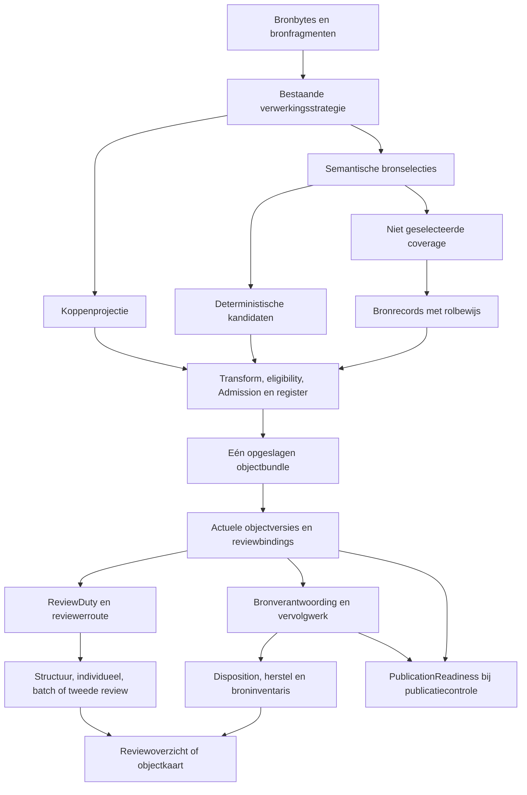

# Hoe bronmateriaal in de reviewrij komt

Change class: C

Rewrite risk: none

Peildatum: 17 oktober 2026. Onderzochte basis: [`e5573878a5bed4a885c6896f88fcb515f964a9d7`](https://github.com/WilliamGomes41/Metis-DS/commit/e5573878a5bed4a885c6896f88fcb515f964a9d7), de opgehaalde en tegen de remote gecontroleerde tip van `main` bij aanvang. Branch: `research/reviewrij-soorten`.

Alle verwijzingen `bestand:regel` gelden voor deze basis, behalve waar expliciet een andere branch/revisie staat. GitHub-statussen zijn afzonderlijk op de peildatum gelezen. Dit is een beschrijving van bestaande code, geen gedragswijziging of productieaudit. Alleen dit rapport wordt toegevoegd. Geen live Metis-, model-, Azure- of databaseaanroep; geen bronexport, secrets of persoonsgegevens opgenomen.

**Conclusie:** er is al een scheiding tussen structuurcontrole, inhoudelijke kennisbeoordeling en bronafhandeling. Een tweede queuebouwer of nieuwe classificatie-authority zou bestaand werk dupliceren. `coverage_remainder` is een herkomstkenmerk en geen extra kennisobjecttype. Niet alle bewaarde passages openen een inhoudelijke ReviewDuty. De huidige UI heeft bovendien al afzonderlijke lijsten en groepering voor bronregels. Bewijs: `src/knowledge_path_v1.py:115–134`, `src/source_containers_v1.py:245–257`, `src/operations_console_app.py:2702–2878`.

## 1. Welke soorten bestaan er en waar wordt de soort bepaald?

Er bestaat geen enkel veld dat alle in de vraag genoemde soorten als onderling uitsluitende enum opslaat. Vier assen lopen naast elkaar:

- **Objecttype:** `object_type`, `proposed_object_type`, `confirmed_object_type`. De effectieve reviewclassificatie neemt bevestigd type vóór opgeslagen type vóór voorgesteld type; `unclassified` geldt niet als beslissend opgeslagen type. Gesloten richtlijntypen: heading, definition, explanation, condition, exception, recommendation. Document is container; unclassified is de standaard. Bewijs: `src/object_taxonomy_v1.py:14–24`, `src/review_duty_v1.py:34–41`.
- **Herkomst:** `metadata.semantic_passage.selection_origin`, onder meer `proposal_selected` en `coverage_remainder`. Een remainder bevat niet-geselecteerde broncoverage; een kop kan als structurele projectie herkenbaar zijn. Bewijs: `src/semantic_passage_v1.py:149–225`, `src/knowledge_path_v1.py:53–72`.
- **Bronrol:** `metadata.source_accountability`, met gesloten voorgestelde rollen metadata, structure en unresolved en bijbehorende redenen. `is_source_record` kijkt naar aanwezigheid van dit bewijs én coverage-origin; beschadigd bewijs blijft als bronwerk herkenbaar. V1/V2-beleid verschilt. Bewijs: `src/source_accountability_v1.py:11–18,55–87`, `src/source_containers_v1.py:188–218`.
- **Taak en afhandeling:** afgeleide `ReviewDuty.stage/lane`, actorafhankelijke `canonical_task`, bronprojectie `human_action`, passage-registerstatus en governance-reviewstatus. Dat zijn geen nieuwe objectsoorten. Bewijs: `src/review_duty_v1.py:265–301,369–409`, `src/publication_readiness_v1.py:83–108`, `src/passage_register_v1.py:24–38`.

### Soort → herkomst → bewijs → actie

| Soort/weergave | Herkomst en onderscheid | Bestand:regel | Beslissing/actie |
| --- | --- | --- | --- |
| Kop / structuur | Deterministische kopprojectie; effectieve heading-classificatie; fast lane én structurele projectie | `src/pre_review_semantic_v1.py:495–505,936–942`; `src/operations_console_v1.py:360–398`; `src/operations_console_app.py:2480–2489` | Koppen als structuur bevestigen via `task=structure` en de aparte heading-batchcommand. Geen inhoudelijke goedkeuring |
| Kandidaat-kennisobject | Semantische selectie; deterministische materialisatie maakt identiteit, tekst en mapping. Inhoudelijk beoordeelbaar vereist proposal-origin, exacte spans en allowed Admission | `src/pre_review_semantic_v1.py:445–460`; `src/knowledge_path_v1.py:115–134` | Type/inhoud/bron en eventuele sterkte, richting en relaties beoordelen; individuele of toegestane batchreview; eventueel tweede onafhankelijke review |
| Geselecteerd maar geblokkeerd voorstel | Proposal-origin blijft behouden; Admission blocked opent geen gewone inhoudelijke ReviewDuty | `src/review_duty_v1.py:109–142`; `src/source_containers_v1.py:169–185` | `repair`: bron/verwerking herstellen. Goedkeuren wordt geweigerd |
| Bronpassage met source-accountability | Coverage-origin plus bronbewijs; metadata/structuur/onbesliste inhoud zijn bronrollen, geen kennisclassificaties | `src/source_accountability_v1.py:55–87`; `src/source_containers_v1.py:135–160,188–218` | Gebruik bepalen, label/context aan exacte doelen koppelen, gemotiveerd uitsluiten of resetten; bij ongeldig bewijs herstel |
| `coverage_remainder` | Deterministisch complement van geselecteerde bronbereiken, opgesplitst op expliciete rol-/contextgrenzen. Nieuwe remainders krijgen source-accountability mee | `src/semantic_passage_v1.py:149–225` | Via bronprojectie disposition/repair, of documentinformatie/context zonder eigen inhoudelijke review. Oude remainder zonder bronbewijs kan als legacy restpassage in de algemene inventaris staan |
| Deterministische/legacy resttekst | Unclassified of typevoorstel zonder valide semantische kandidaatselectie; geen inhoudelijke candidate-eligibility | `src/candidate_eligibility_v1.py:65–105`; `src/source_containers_v1.py:163–185` | Blijft bereikbaar als bronafhandeling of herstel; geen automatische kennisgoedkeuring |
| Beslisboomonderdelen | Afzonderlijk reviewpad: path is structuur; node/outcome inhoud. Geen Smetten-richtlijntypen | `src/operations_console_v1.py:371–398,455–456`; `src/review_duty_v1.py:112–118,215–239` | Paden controleren, knopen/uitkomsten beoordelen; eventueel beslisroutes als geheel controleren (`src/review_workboard_v1.py:363–376`) |
| Afgehandeld/vervangen | Statussen approved/rejected/superseded en bestaande disposition bepalen historie; geen nieuwe itemsoort | `src/review_disposition_v1.py:13–17,54–113`; `src/operations_console_app.py:3112–3126` | Besluiten/historie bekijken; current-versie blijft afzonderlijk van alle historische versies |
| Document | Container van de objectbundle | `src/source_containers_v1.py:131–134`; `src/operations_console_app.py:2743–2745` | Document kiezen; geen passagekaart |

`partition()['knowledge']` is een toegangsgroepering van alle niet-bron/niet-structuurregels, **geen bewijs dat ieder element inhoudelijk beoordeelbaar is**. Daarvoor blijft `content_reviewable` nodig (`src/source_containers_v1.py:245–257`, `src/knowledge_path_v1.py:115–134`). Koppen kunnen in broncoverage zijn verwerkt zonder een afzonderlijk heading-object te vormen; de concrete B23-fixture in §7 laat dat zien.

## 2. Welke route bouwt de rij en waar zitten de vangnetten?

### Stroom van bron naar rij



Diagram verwijst naar het semantische richtlijnpad; deterministische en beslisboompaden houden hun eigen verwerking. Geen GET-review maakt nieuwe kandidaten aan.

1. **Vullen/opslag:** de geïnstalleerde strategie levert fragmenten/spec; semantische verwerking gebruikt `semantic_spec_from_fragments`. Selectie en remainder-vorming lopen via `_project_semantic_selection`; `_materialised_content` roept uitsluitend de bestaande candidate creator aan. Koppen worden terug in bronvolgorde geplaatst. Daarna transform → Admission/eligibility → passage register → bestaande bundlecommit. Bewijs: `src/pre_review_semantic_v1.py:445–460,495–541,936–950,1169–1190`; `src/operations_console_v1.py:2026–2078`. Herextractie past dezelfde gate/register toe: `src/operations_console_v1.py:2532–2539`.
2. **Lezen:** `snapshot_objects` selecteert actuele revisies, niet alleen toegelaten kandidaten. `include_blocked=True` betekent hier alle opgeslagen versies laden; de parameternaam is dus geen betrouwbare beschrijving van een admissionfilter. Native PostgreSQL heeft een override voor objecten plus revisie. Bewijs: `src/operations_console_v1.py:2997–3012`; `src/workflows/workflow_documents_cutover_v1.py:450–464`.
3. **Actieve HTTP-route:** `console_asgi.build_app` maakt eerst de console-app en installeert daarna het workboard. De installer verwijdert de oorspronkelijke GET `/review` en vervangt deze. Zonder object/taak opent het workboard; met taak/object gaat de route naar `_render_review_room`. Bewijs: `src/console_asgi.py:344–353`; `src/review_workboard_v1.py:796–853`. De oorspronkelijke route op `src/operations_console_app.py:5256–5268` is dus niet de volledige actieve route.
4. **Documentniveau:** `review_workboard_items` gebruikt waar beschikbaar native summaries; anders bestaande objectprojecties. `review_work_item` verzamelt koppen, gewone review, batches, source closure en bronvervolgwerk. Bewijs: `src/review_workboard_v1.py:249–353,382–404`. Dashboardrendering: `src/review_workboard_v1.py:698–765`.
5. **Rijniveau:** `_render_review_room` laadt actuele objecten en revisie en roept `_render_review_index` aan. Deze selecteert de bestaande taken via `_review_route_objects`, `review_followup_queues` en batchhelpers. `inventory`, `disposition`, `waiting` en `repair` gebruiken `_review_inventory`. Bewijs: `src/operations_console_app.py:3503–3546,3061–3109,3128–3188`.
6. **Kaartniveau:** objectkeuze leidt eerst naar de broncontextkaart indien van toepassing, anders tweede-reviewkaart of gewone reviewkaart. Bewijs: `src/operations_console_app.py:3548–3635,3424–3443`.

### De twee aangewezen regelnummers

- **`passage_register_v1.py:149` is op deze main geen algemene vangnetregel.** Het is `text = _text_of(obj)` binnen de heading-tak. Een kop die bij gebruikte contextkoppen past krijgt used_as_context; anders not_yet_assessed. De algemene laatste fallback staat op **153**. Nog eerder blijven source-records en geblokkeerde Admission not_yet_assessed (120–132). `apply_passage_register` stempelt dit tijdens ingest; het schrijft geen afzonderlijke reviewqueue. Bewijs: `src/passage_register_v1.py:115–153,156–197`; aanroep `src/operations_console_v1.py:2037`.
- **`publication_readiness_v1.py:69` is op deze main de parameter `fragments=None`.** `source_passage_closure` (64–80) delegeert naar de centrale T10-projectie `source_accountability` en `source_closure`. Het is geen tweede queuebouwer. Het workboard gebruikt deze closure plus dezelfde projectie voor follow-ups (disposition/repair). De daadwerkelijke publicatiegereedheidscontrole gebruikt dat ook en voegt `source_passage_review_incomplete` toe zolang closure open is. Bewijs: `src/publication_readiness_v1.py:64–108,208–258`; `src/review_workboard_v1.py:302–307`.

Daarmee zijn twee uitspraken te onderscheiden: het register bewaart nog-onafgehandeld bronwerk; de huidige bronprojectie bepaalt welk menselijk vervolgwerk zichtbaar wordt. Niet iedere not_yet_assessed-regel wordt dus een gewone kennisbeoordeling. V2-documentinformatie en gekoppelde context hebben expliciet afzonderlijke behandeling (`src/source_containers_v1.py:188–218`).

## 3. Waarom hebben koppen een apart overzicht en wat is herbruikbaar?

De **gecodeerde reden** is structuurcontrole: koppen plaatsen passages in het document en geven geen inhoudelijke kennisgoedkeuring. De UI zegt dit expliciet (`src/operations_console_app.py:1831–1842`); de backend noemt de heading-command dezelfde scheiding (`src/operations_console_v1.py:4279–4283`). Intenties buiten dit contract zijn niet onderzocht.

`/review?document=<id>&task=structure` selecteert open structurele fast-lane-objecten en rendert een lijst met checkboxes. De POST-route `/review/headings/batch-confirm` gebruikt `batch_confirm_headings`. Deze controleert alle gekozen objecten en roept `review_object` aan met het structurele domein. Een gewone approve op een kop zonder deze command wordt geweigerd (`structure_confirmation_command_required`). Bewijs: `src/operations_console_app.py:2480–2489,3149–3166,5765–5814`; `src/operations_console_v1.py:3618–3625,4270–4342`. Het geïnstalleerde workboard omwikkelt de POST voor vervolg-navigatie (`src/review_workboard_v1.py:870–905`).

**Herbruikbaar:** taakselectie, links, lijstregels, bronpadgroepering, versieconflictafhandeling en de bestaande domeinprojecties. **De heading-batchcommand zelf is niet generiek:** andere objecten falen op fast-lane/structuurcontrole. Voor definities/toelichtingen bestaat al een andere batchcommand; voor bronmetadata een afzonderlijke uitsluitingscommand. Een nieuw soortoverzicht kan bestaande projecties presenteren, maar mag geen extra approval-route uit de heading-command maken.

## 4. Bestaande filters, groepen, sortering en compatibiliteit

| Laag | Wat bestaat al? | Bestand:regel |
| --- | --- | --- |
| Taken/query | `task=structure/contextual/batch/second_review/repair/history/disposition/inventory/waiting`; oude aliases headings/individual/together/control/decisions/closure normaliseren naar de huidige taken | `src/operations_console_app.py:140–167` |
| Backendroutering | Bevestigd type heeft voorrang; duty-lane hangt ook af van reviewfase, risico, relaties, uncertainty, Admission en bronpad. Tweede review gaat afzonderlijk; actor bepaalt handelbaarheid/wachten | `src/review_duty_v1.py:34–41,215–260,369–409` |
| Selectie/sortering | `_review_route_objects` filtert per canonical task en sorteert stabiel met `review_priority_rank` | `src/operations_console_app.py:2471–2520` |
| Prioriteit | Bronsecties: focus vóór regular vóór secondary; samenvattingen krijgen secondary. Geen inhoudelijke uitsluiting | `src/object_taxonomy_v1.py:45–54,282–300` |
| Presentatie per bronpad | `_review_section_groups`: volledige section-path-tuple als sleutel; gelijke eindkoppen in verschillende paden blijven apart | `src/operations_console_app.py:1768–1819`; tests `tests/test_review_section_presentation.py:11–47` |
| Batch per soort | Definities/toelichtingen: groeperen op bronpad én effectief type; maximaal 20 per batch. Niet alle objecten van die typen zijn batchgeschikt | `src/proportionate_review_v1.py:35–36,51–104,132–157`; `src/review_duty_v1.py:241–260` |
| Broninventaris | Splitsing kennis/historieregels versus bronverantwoording. V2-bronregels per `(gebruikscategorie, bronsectie)`: documentinformatie, linked context, unresolved, invalid evidence, reviewed | `src/operations_console_app.py:2736–2786,2843–2878` |
| Legacy-broninventaris | V1 proposed metadata/structure zonder bevestigde bronrol heeft een eigen selecteerbare uitsluitingsgroep; andere resttekst apart. Deze tak is nog actief, geen dode mock | `src/operations_console_app.py:2787–2808,2851–2865` |
| Documentfilters | Toegewezen reviewer, `work=mine/all`, family/theme, tekstzoekvraag en paginering op documentniveau; geen algemene objecttype-dropdown in deze route | `src/review_workboard_v1.py:823–852,627–641` |
| Native query | Selecteert toegewezen documenten, sluit pre_review_blocked uit. Objecten/bindings worden gebundeld geladen; domeinprojecties berekenen het taakwerk. Geen SQL-filter voor alle gevraagde itemsoorten | `src/workflows/workflow_badge_counts_postgres_v1.py:310–327,399–448` |

De `normal_review_enabled`-parameter en `isinstance(..., ProportionateReviewConsole)` zijn capability-/compatibiliteitspaden; de gevonden code toont geen afzonderlijke featureflag voor een algemeen soortfilter (`src/operations_console_app.py:3061–3109,3524–3542`). Bindings ontbreken alleen op compatibiliteitspaden; productie exposeert de bindings-store (`src/proportionate_review_v1.py:39–48`). Er is in deze onderzochte routes geen half-afgeschakelde algemene soortselector aangetroffen. Dat is een begrensde zoekuitkomst, geen claim over iedere historische branch.

## 5. Overlap met PR's, branches, issues en roadmap

### Open werk op de peildatum

De repositoryzoekopdracht `is:open` voor PR's leverde twee PR's op. Hun metadata en relevante bron/diff zijn gelezen; geen PR is aangepast.

| Werk | Vastgestelde status en overlap | Bron/bewijs |
| --- | --- | --- |
| [PR #634](https://github.com/WilliamGomes41/Metis-DS/pull/634), `anvil/a3-3-superseded` | Open draft; head `ed47f60506a8ea72296a63e1d7d4c10d9c082fc0`. Nieuwe contractpoging kan huidige kandidaten superseded markeren; raakt actuele-versiekeuze, zichtbare historie en publicatieblockers. Geen soortfilter of nieuwe reviewlijst | Op die PR-head: `src/candidate_supersession_v1.py:23–63`; `src/operations_console_v1.py:2547–2557`. Niet aanwezig als gemergde functionaliteit op onderzochte main |
| [#655](https://github.com/WilliamGomes41/Metis-DS/issues/655), [#656](https://github.com/WilliamGomes41/Metis-DS/issues/656) | Beide open; vervolg #634: herkenning ingetrokken approvals, targetversie/evidence-remapping, restart/recovery. Relevant voor tellingen/historie, geen UI-groepering | Issuebeschrijvingen; bestaande remap-owner `src/revision_workflow.py:309–325` |
| [PR #667](https://github.com/WilliamGomes41/Metis-DS/pull/667), `forge/r2-remirror-under-lock` | Open, geen draft; head `6a3fb52c07505fd695c66f53a13b013a672ca8b1`. Reviewrollback/remirror onder lock; raakt duurzame reviewbesluiten, geen nieuw soortoverzicht | PR-body/diff; huidige authority `src/workflows/workflow_review_cutover_v1.py:92–109`. Gelinkt open vervolgwerk #665/#668/#669 raakt dezelfde mutatiegrens |
| [#335](https://github.com/WilliamGomes41/Metis-DS/issues/335), `refactor/review-package` | Issue open; remote branch `73fc475a19f1ce1f5ed4670b4ed84c94302e6306` bestaat, geen gekoppelde open PR gevonden. Pakketverplaatsing/importaanpassingen; branch loopt achter huidige routecontracten. Branchbestaan bewijst geen lopende functionele uitbreiding | Branch: `src/review/review_workboard_v1.py:1–6`, `src/operations_console_app.py:1744–1763`; `ROADMAP.md:12–23` |
| `test/characterize-ingest-and-review-room` | Remote branch `7df6802e12fe9270a475a52d1fb736532503e104`; uitsluitend tests. Rapport noemt dezelfde main-basis en 27 renderer-goldens plus ingestcases. Herbruikbare gedragsbaseline vóór eventuele refactor; resultaten hier gelezen, niet opnieuw uitgevoerd | Op die branch `tests/characterization/REPORT.md:1–40`. Deze tests staan nog niet op onderzochte main |
| [#515](https://github.com/WilliamGomes41/Metis-DS/issues/515) | Open: Smetten-tabelregels als context bij ouderaanbeveling bewaren; kan de samenstelling van kandidaten en bronwerk veranderen | `ROADMAP.md:45–46`; issuebeschrijving |
| [#530](https://github.com/WilliamGomes41/Metis-DS/issues/530) | Open: echte bronselectie/context accepteren; omvat ontbrekend inhoudelijk bewijs. Geen bewijs van huidige live-aantallen | `ROADMAP.md:41–47` |
| [#558 / A08](https://github.com/WilliamGomes41/Metis-DS/issues/558) | Open acceptatieregistratie rond review completion. Bestaande T9/T10/readiness blijven leidend | `docs/audit/README.md:5–17`; `src/publication_readiness_v1.py:202–258` |

### Al gebouwd; niet nogmaals bouwen

- [PR #396](https://github.com/WilliamGomes41/Metis-DS/pull/396) is gemergd (25 september): D5.3B-routering en tweede-reviewinteractie. Huidige code: `src/review_duty_v1.py:369–409`, `src/operations_console_app.py:2471–2520`.
- [PR #406](https://github.com/WilliamGomes41/Metis-DS/pull/406) is gemergd (26 september): aantallen en bereikbaarheid van open bronwerk. Remote `fix/review-queue-coverage` bestaat nog; dat is geen bewijs van een nieuwe open feature. Huidige inventory/follow-ups: `src/operations_console_app.py:2702–2878`, `src/publication_readiness_v1.py:83–108`.
- [PR #145](https://github.com/WilliamGomes41/Metis-DS/pull/145) is gemergd (9 september): sectiepresentatie en batchscanbaarheid. Remote `feat/review-section-presentation` bestaat nog. Huidige groepering: `src/operations_console_app.py:1768–1819`, `src/proportionate_review_v1.py:140–157`.
- [#548](https://github.com/WilliamGomes41/Metis-DS/issues/548) en [#611](https://github.com/WilliamGomes41/Metis-DS/issues/611) zijn gesloten: bronreconstructie/herhashen begrensd hergebruiken. Bestaande render-scope: `src/operations_console_app.py:3446–3448`; bewijscontract `docs/change-contracts/review-render-source-reuse.md:1–25`. Gesloten codewerk bewijst geen productieprestatie (`ROADMAP.md:65–67`).

### Expliciet gevraagde verwijzingen die niet zijn vastgesteld

- **`diag/smetten-coverage-remainder`: OPENVRAAG-B1.** Niet aangetroffen na remote fetch/prune, exacte `ls-remote` op `refs/heads/diag/*`, branchzoekopdracht en PR-zoekopdracht op die headnaam. De branch kan verwijderd, anders genoemd of elders aanwezig zijn; dat is niet vastgesteld. Geen diff of Smetten-telling aan deze naam toegeschreven.
- **N4 (N+1-lijst): OPENVRAAG-N4.** Geen traceerbaar N4-ticket gevonden in de huidige repository/roadmap of gerichte GitHub-zoekopdrachten. Het eerder beschikbare architectuurrapport leverde op de exacte termen evenmin een match. Er wordt geen issue-ID bij verzonnen. Wel is de huidige technische overlap concreet: objecten en bindings worden gebundeld geladen, maar `review_work_item` leest bronfragmenten per document en de taakrenderer leest op meerdere plaatsen bindings/fragmenten. Bewijs: `src/workflows/workflow_badge_counts_postgres_v1.py:430–445`; `src/review_workboard_v1.py:277`; `src/operations_console_app.py:3532–3545,3559–3582`. Of dit precies het bedoelde N4 is en wat het huidige aantal I/O-aanroepen is, blijft onbewezen; de bronreconstructiescope is geen algemeen querycache-bewijs.
- **Geplande functionele refactor van `_render_review_room`: OPENVRAAG-R1.** De functie staat nog op `src/operations_console_app.py:3448–3649`; de bestaande wrapper staat op 3446. De gevonden packagebranch #335 en characterizationbranch raken het werkgebied, maar bewijzen geen toegekende functionele refactoropdracht voor dit bereik. Geen aparte open PR gevonden die dit uitvoert. Karakterisering vóór verplaatsing/wijziging is al voorbereid; bouw die baseline niet opnieuw.

Actuele roadmap: R4.1 pakketorganisatie, R4.2 T9–T12 en lifecyclebewijs, R4.3 bronselectie/context en #515/#530; een brede console-rewrite vereist aantoonbare behoefte (`ROADMAP.md:12–48,69–76`). Historische V2-output is geen actuele runtimeconfiguratie (`ROADMAP.md:18–19`).

## 6. Moet een reviewer overal hetzelfde beslissen?

**Nee.** De gewone reviewkaart deelt knoppen, maar de backend onderscheidt de domeinen structure, content, source_disposition, technical_repair en decision_tree. `src/operations_console_v1.py:3618–3643,4077` is daarvoor beslissend bewijs.

| Domein/soort | Menselijke beslissing | Acties/statusverschil en bewijs |
| --- | --- | --- |
| Kop | Is dit de juiste documentstructuur? | Aparte heading-batch; structure-binding. Niet als inhoud goedgekeurd: `src/operations_console_v1.py:3618–3625,4270–4342` |
| Kennisvoorstel | Kloppen betekenis, type, bron, toepasselijke velden en relaties? | Eindoordeel goedkeuren/correctie/afwijzen/later vertaalt naar approve/revise/reject/later. Goedkeuren vereist actuele duty; blocked mag niet. `src/review_cockpit_v1.py:35–53`; `src/operations_console_v1.py:3632–3643,3682–3685`; UI `src/operations_console_app.py:3398–3415` |
| Normaalrisico definition/explanation | Iedere geselecteerde passage gecontroleerd en zelfstandig goed? | Bestaande batch over hetzelfde type/bronpad, maximaal 20; geen generieke bulkgoedkeuring. `src/proportionate_review_v1.py:35–36,237–291` |
| Tweede review | Onafhankelijk exact dezelfde versie/hash beoordelen | Actuele bindings en policy bepalen wie kan handelen. Aparte second-reviewcommand; al-goedkeurder kan moeten wachten. `src/review_duty_v1.py:44–82,162–178,369–409`; `src/operations_console_app.py:3597–3622,5850–5851` |
| Bronrecord/remainder | Wat is de functie van deze tekst? | Label/context koppelen, uitsluiten met reden, reset. Source-record kan niet via gewone approve of typewijziging kennis worden. Rollen label/context/excluded schrijven op de bron governance rejected; reset needs_review. Dat technische rejected betekent hier niet dat de tekst is weggegooid. `src/source_context_review_v1.py:256–271,317–327`; `src/operations_console_v1.py:3626–3629` |
| Gekoppelde context | Voor welke exacte doelversies geldt de bron? | Contextbesluit keurt doelkennis niet goed. Wijziging zet betrokken doelen opnieuw needs_review; closure wacht zo nodig op doelreview. `src/source_context_review_v1.py:332–359`; `src/source_containers_v1.py:146–160,213–218` |
| Metadata/structuur als bronrecord | Is gemotiveerde bronuitsluiting juist? | V1 heeft selecteerbare batchuitsluiting; V2 kan uitsluitend nauwe volledige metadata-/navigatieregels automatisch verantwoorden. Niet automatisch op basis van hoofdstuk of modelrol. `src/source_context_review_v1.py:31–38,90–108`; `src/source_containers_v1.py:17–30,206–218` |
| Ongeldig bronbewijs/blocked voorstel | Welk bron-/verwerkingsprobleem moet worden hersteld? | Repair is geen gewone inhoudelijke goedkeuring. Ongeldig bronbewijs toont een herstelpanel; approve zonder content-duty faalt. `src/operations_console_app.py:2894–2898,3427–3428`; `src/operations_console_v1.py:3630–3640` |
| Historie | Welk bestaand besluit en welke versie is vastgelegd? | Read-only geschiedenis in plaats van nieuwe beoordelingsplicht: `src/operations_console_app.py:3503–3510,3551–3557,3112–3126` |

Het passage register kent selected_as_candidate, used_as_context, linked_as_support, excluded_with_reason en not_yet_assessed. Dit is iets anders dan approved/rejected/superseded in governance; `selected_as_candidate` wordt pas definitief met een eindbesluit. Bewijs: `src/passage_register_v1.py:24–38`; `src/review_disposition_v1.py:64–113`.

## 7. Hoeveel Smetten-items per soort zijn uit tests/fixtures bewijsbaar?

**Een volledige documenttelling is niet vastgesteld (OPENVRAAG-S1).** De versiebeheerde fixtures bevatten geen volledige actuele bundle plus bronfragmenten, configuratie, bindings en reviewtoestand van één Smetten-run. De telling is afhankelijk van die inputs. Geen live gegevens opgehaald om dit aan te vullen.

### Direct getelde fixture-inhoud

| Fixture | Koppen in volledige rij | Voorstellen | Coverage/bronpassages | Bewijsgrens |
| --- | ---: | ---: | ---: | --- |
| `tests/fixtures/smetten_source_accountability_reference_draft.json` | Onbekend | 1 vermelding met original-origin proposal_selected | 5 vermeldingen met original-origin coverage_remainder | Zes gekozen regressievoorbeelden, geen canonical bundle; scope zegt expliciet niet exhaustief. Zie regels 2–7,21,38,57,76,95,114 |
| `tests/fixtures/smetten-reference.json` | Onbekend | 19 menselijke referentieaanbevelingen, **geen geobserveerde model-/reviewyield** | Onbekend | Vijf modules; counts 768–776. Testcontract maakt dezelfde grens: `tests/test_b23_richtlijn_vormingscontract_failfirst.py:1–18,190–196` |
| `tests/fixtures/smetten_offset_failure.json` | Onbekend | Eén foutreproductie-input | Geen documentbrede telling | Alleen fragment/requestblock/raw object; geen complete reviewrij |
| `tests/fixtures/forensic/smetten_background_v3.json` | Onbekend | Minimale forensische reproductie | Geen documentbrede telling | Bestand noemt zelf dat het niet de historische productie-ZIP is: regels 2–6 |

De zes draftvoorbeelden bevatten twee metadata-vragen en vier inhoudelijke onderzoeksvragen; die vragen zijn **geen toegekende definitieve objecttypen**. Reproduceerbare telling, zonder productcode uit te voeren:

```python
import json
from collections import Counter
from pathlib import Path

p = Path('tests/fixtures/smetten_source_accountability_reference_draft.json')
rows = json.loads(p.read_text())['entries']
print(len(rows))  # 6
print(Counter(r['original_selection_origin'] for r in rows))
# coverage_remainder: 5; proposal_selected: 1
ref = json.loads(Path('tests/fixtures/smetten-reference.json').read_text())
print(sum(len(m['recs']) for m in ref['modules']))  # 19
```

### Uitgevoerde verwerking van het bestaande B23-fragment

Daarnaast is op ongewijzigde main het **zes-fragmentenvoorbeeld** `module1()` uitgevoerd via de bestaande `form()`-helper en vervolgens `apply_passage_register`. De helper vervangt de provider door `_maximal_provider`, die adversarieel ieder aangeboden blok als aanbeveling selecteert; dit is geen echte modelrun. Bewijs van inputs en keten: `tests/test_b23_richtlijn_vormingscontract_failfirst.py:62–90,125–140`.

| Uitkomst op dit fragment | semantic-source-bound-v3 | deterministic-v1 |
| --- | ---: | ---: |
| Documentcontainer | 1 | 1 |
| Canonieke regels met object_type heading / open structure-taak | 0 / 0 | 0 / 0 |
| Niet-documentregels totaal | 6 | 7 |
| Proposal-selected, voorgesteld recommendation | 4 | 0 |
| Daarvan Admission allowed / blocked | 1 / 3 | 0 / 0 |
| Coverage_remainder én bronrecord | 2 | 0 |
| Andere niet-documentregels zonder semantische origin | 0 | 7 |
| `content_reviewable` | 1 | 0 |
| Bronvervolgwerk disposition / repair | 2 / 3 | 7 / 0 |

Alle niet-documentregels hebben hier opgeslagen object_type unclassified. De vier V3-voorstellen hebben daarnaast proposed_object_type recommendation. De fixture noemt een invoerfragment heading, maar de huidige productclassificatie produceert in deze proef geen apart heading-object. Dat is een gemeten uitkomst van dit kleine voorbeeld, geen telling van de koppen in de echte PDF.

De getallen zijn niet op te tellen over de rijen van deze tabel: proposal-origin, Admission, content-reviewable en human_action zijn verschillende doorsneden. Gebruikte projectoren: `src/knowledge_path_v1.py:115–134`, `src/source_accountability_v1.py:83–87`, `src/operations_console_app.py:2471–2520`, `src/publication_readiness_v1.py:83–108`.

De fragmentproef is te reproduceren vanuit de repo met Python plus de bestaande testdependencies; gebruik een lege externe configuratie en blokkeer netwerk zoals bij deze uitvoering:

```python
import runpy, socket, sys
from collections import Counter

def offline(event, args):
    if event == 'socket.getaddrinfo' or (
        event == 'socket.connect'
        and args[0].family in (socket.AF_INET, socket.AF_INET6)
    ):
        raise RuntimeError('offline onderzoek: netwerk geblokkeerd')

sys.addaudithook(offline)
f = runpy.run_path('tests/test_b23_richtlijn_vormingscontract_failfirst.py')
from src.passage_register_v1 import apply_passage_register
from src.knowledge_path_v1 import content_reviewable
from src.publication_readiness_v1 import review_followup_queues

for mode in f['MODES']:
    fragments = f['module1']()
    _, rows = f['form'](mode, fragments)
    rows = apply_passage_register(rows)
    passages = [r for r in rows if r['object_type'] != 'document']
    print(mode, len(passages), Counter(
        r['metadata'].get('semantic_passage', {}).get('selection_origin', 'absent')
        for r in passages))
    print('content_reviewable', sum(map(content_reviewable, passages)))
    print({k: len(v) for k, v in review_followup_queues(
        rows, review_path='richtlijn', bindings=[], fragments=fragments).items()})
```

### Bestaande documentbrede rapportage is geen nieuwe fixturemeting

Er staan twee **eerder vastgelegde** Smetten-bewijsbestanden in docs, met verschillende run-/verwerkingsgrenzen:

- `docs/change-contracts/source-containers-smetten-proof.json:10–33`: 14 kennisvoorstellen (13 recommendation, 1 definition), 639 bronrecords (117 documentinformatie, 7 linked context, 515 unresolved), Admission 13 allowed/1 blocked. De onderliggende diagnostic wordt extern als reproduceerinput genoemd in `docs/change-contracts/source-containers-review.md:26–36`.
- `docs/acceptance/smetten_recorded_formation_replay.json:2–28`: andere replay: 1.014 bronfragmenten, 17 voorstellen, 639 bronrecords, incomplete formation. Dit bewijst juist dat aantallen zonder runidentiteit niet uitwisselbaar zijn.

Deze docs-getallen beantwoorden de vraag naar een **op actuele main uit tests/fixtures getelde volledige rij niet**. Zij zijn hier uitsluitend context; niet opnieuw uitgevoerd en niet naar de verdwenen diag-branch herleid. Koppenaantal, actuele open taken en volledige per-soorttelling blijven OPENVRAAG-S1.

## Herbruikbare bouwstenen en grens voor vervolgwerk

1. **`source_containers_v1.partition/source_accountability/source_closure`:** bestaande kennis/bron/structuurscheiding en brongebruik; hergebruik de projectie in plaats van een tweede soort-/closure-regelboom (`src/source_containers_v1.py:42–57,222–257`).
2. **`content_reviewable` en `review_duty_for/reviewer_route_for`:** bepaal inhoudelijke toelating en werk per reviewer; classificeer niet uitsluitend op object_type of tekst (`src/knowledge_path_v1.py:115–134`; `src/review_duty_v1.py:265–301,369–409`).
3. **`review_followup_queues`:** bestaande disposition- en repairlijsten over dezelfde bronprojectie (`src/publication_readiness_v1.py:83–108`).
4. **`_review_inventory` en `_review_section_groups`:** bestaande broncategorieën, bronpadgroepen, links en ontsluiting van alle passages (`src/operations_console_app.py:1768–1819,2702–2878`).
5. **Bestaande batchcommands:** headings, normaalrisicokennis en bronmetadata hebben elk hun eigen contract. Hergebruik de passende command; presenteer andere soorten niet als heading (`src/operations_console_v1.py:4270–4342`; `src/proportionate_review_v1.py:237–291`; `src/source_context_review_v1.py:31–38`).
6. **Actuele revisies, exacte bindings, historie:** huidige selectie en audit bepalen wat openstaat; geen extra queue-opslag of dubbele status (`src/operations_console_v1.py:2997–3012`; `src/review_duty_v1.py:44–82`; `src/operations_console_app.py:3503–3515`).
7. **Gedragsbaseline:** bestaande sectie-/bron-/T9/T10-tests en de nog niet gemergde characterizationbranch kunnen een gerichte presentatieverandering begrenzen. Ze zijn geen volledige Smetten-goldset.

Een ontbrekende algemene soortselector is dus hoogstens een presentatie-uitbreiding over bestaande projecties. Of een extra selector nuttiger is dan de bestaande taken en broncategorieën is een productbeslissing; in dit onderzoek is geen nieuwe UX ontworpen.

## Uitgevoerd bewijs en verificatiegrenzen

- `main` bij start remote geverifieerd, geïsoleerde worktree vanaf die SHA. Productcode gedurende het onderzoek ongewijzigd.
- Eén statische coveragepass over de genoemde keten en één gerichte sluitingspass over de twee regelnummers, actieve routevervanging, branchstatus en fixturegrenzen. Geen algemene bughunt.
- Gerichte bestaande tests: **131 geslaagd, 2 overgeslagen**, 9,56 s. Bestanden: `test_review_section_presentation.py`, `test_review_priority_section_tiers.py`, `test_review_passage_coverage_v1.py`, `test_t9_review_knowledge_authority.py`, `test_t10_source_accountability_authority.py`, `test_source_containers_v1.py`; daarnaast de B23-reference-sanity en zeven literalcontroles. De twee skips vereisen native PostgreSQL. Geen native databasebewijs geclaimd.
- Tests en B23-fragmenttelling draaiden met lege geërfde configuratie, vaste testprovider waar nodig en een Python-auditguard die DNS en IPv4/IPv6-connecties weigert. **Nul netwerkpogingen** in de testrun. Geen nieuwe tests, goldens of fixtures toegevoegd.
- Documentcontrole: alle 133 gecontroleerde main-bestandsverwijzingen bestaan en vallen binnen de bestandslengte; de expliciete branchverwijzingen zijn apart gelezen. Repository-preflight en architectuurgrenzen slagen. Git-whitespacecontrole en begrenzing van de diff tot het rapport zijn onderdeel van de eindcontrole.
- **Release-control-preflight: BLOCKED** voor uitsluitend `docs/onderzoek/reviewrij-soorten.md`: scope/belofte, slop en releasebewijs vereisen markers in gewijzigde testbestanden. De scanner accepteert deze rapportwijziging zonder gewijzigde tests niet (`scripts/release_control_preflight.py:238–275,291–307`). Geen extra tests of beleidswijziging toegevoegd om de alleen-lezenrapportage door die controle te laten komen. Dit is geen producttestfout en geen release-/mergeadvies; de gevraagde rapportbranch wordt zonder PR geleverd.
- Geen server/deploy gestart, geen application import van de live composition root, geen publicatie, mutatieproef of productieaantallen. GitHub-toegang uitsluitend voor bron-/werkstatus en de expliciet gevraagde rapportbranch.

## Geprobeerd en mislukt

1. **2026-10-17 — Enkele GitHub-connectoropdrachten met verkeerde parameternaam.** Schemafout vóór uitvoering. Gecorrigeerd; alleen-lezen statusopdrachten daarna geslaagd. `gh` is niet geïnstalleerd in deze omgeving; de beschikbare GitHub-koppeling gebruikt. Geen permissie-, auth- of inhoudsfout als productfout gerapporteerd.
2. **2026-10-17 — Exacte diag-branch en N4 terugvinden.** Remote-/PR-/repozoekopdrachten leverden geen herleidbare branch of N4-registratie op. Exacte zoekactie in het beschikbare architectuurrapport en aanvullende bestandszoekactie leverden geen passende onderbouwing. Dit blijft OPENVRAAG, niet ingevuld met een vermoedelijk ticket.
3. **2026-10-17 — Library-find met niet-ondersteunde regexparameter.** Schemacontrole weigerde de vraag; herhaald met toegestane exacte patronen. Geen passende N4-/render-refactorverwijzing gevonden.
4. **2026-10-17 — Standaard- en primaire Python-runtime voor pytest.** Beide misten pytest. Bestaande lokale Metis-testvenv gebruikt, zonder dependency-installatie of netwerk. De uiteindelijke gerichte run is groen.
5. **2026-10-17 — Volledige Smetten-telling uit versiebeheerde fixtures reconstrueren.** Benodigde complete runbundle/diagnostic ontbreekt. Alleen voorbeeldtelling en bestaande fragmentproef uitgevoerd; docs-samenvattingen niet als nieuw gemeten fixture-uitvoer gepresenteerd.
6. **2026-10-17 — Eindcontroles op de documentdiff.** Eerste whitespacecheck meldde twee Markdown-hard-breakspaties; verwijderd, eindcheck groen. Release-control-preflight blijft BLOCKED wegens ontbrekende gewijzigde testmarkers voor de drie algemene categorieën; bestaande groen uitgevoerde tests tellen voor die scanner niet mee als zij niet in de diff staan. Scope niet verbreed.
7. **2026-10-17 — Rechtstreekse Git-push.** De lokale Git-transportconfiguratie kon geen HTTPS-gebruikerscredential lezen. Geen credential opgezocht of gewijzigd; voor dezelfde rapportbranch de bestaande aangemelde GitHub-koppeling gebruikt. Basis en uiteindelijke bestandsinhoud worden afzonderlijk gecontroleerd.

## OPENVRAAG-lijst

| ID | Wat is niet aangetoond? | Kleinste ontbrekende input/bewijs |
| --- | --- | --- |
| OPENVRAAG-B1 | Bestaan, inhoud en status van `diag/smetten-coverage-remainder` | Herleidbare remote ref/commit of PR; een branchnaam alleen volstaat niet |
| OPENVRAAG-N4 | Welke concrete N4-registratie wordt bedoeld en welke huidige I/O-keten valt eronder? | Ticket/rapportpassage met revisie; daarna afgebakende offline call-countmeting. Geen koppeling geraden |
| OPENVRAAG-R1 | Een expliciet gepland/toegewezen functioneel refactorcontract voor `_render_review_room:3448–3649` | Issue/branch/ontwerp met scope. Packageverplaatsing en characterization zijn afzonderlijk vastgesteld |
| OPENVRAAG-S1 | Volledige actuele Smetten-aantallen per kop/kandidaat/bronrol/remainder/taak | Eén gesaneerde, bevroren testfixture met bronfragmenten, volledige huidige objectbundle, formationconfig/replay en bindings. Geen live-aanroep nodig |
| OPENVRAAG-P1 | Native PostgreSQL-/concurrentiegedrag en live prestaties van deze keten | Buiten deze opdracht; twee native tests overgeslagen. Dit rapport doet daarover geen nieuwe uitspraak |

Onderzoek afgerond binnen deze grens: de bestaande codepaden en herbruikbare onderdelen zijn vastgelegd; ontbrekend bronbewijs blijft expliciet open. Alleen dit document is voor commit/push bestemd, zonder PR.
