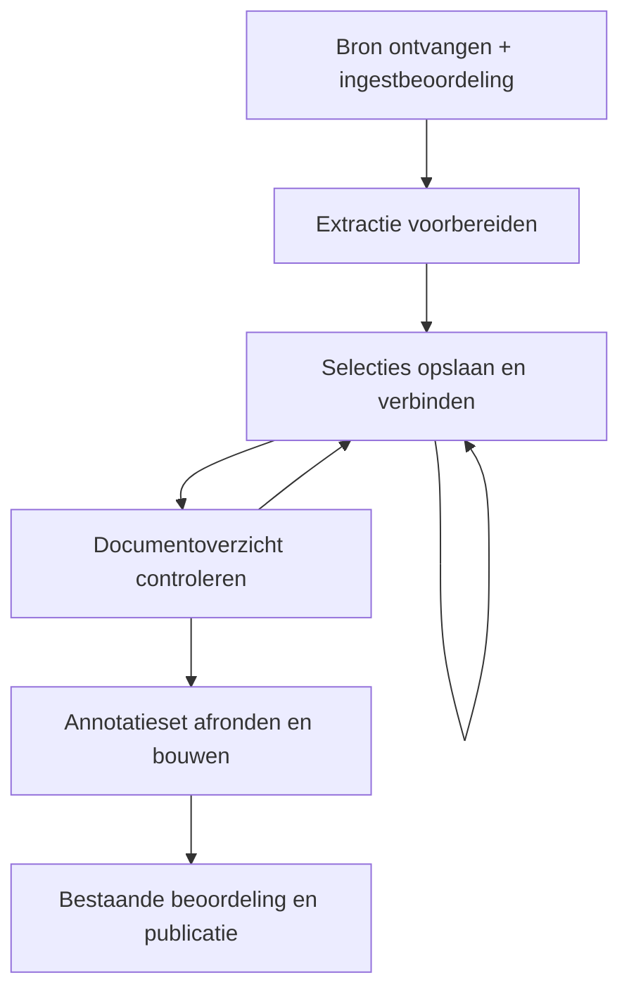

# Menselijke annotatie vóór objectvorming

Status: ontwerpvoorstel bij #1013 / MET-57 en HA-1 #1014 / MET-58, 7 november 2026. Geen productimplementatie, migratie of deployment. Inspectiebasis: `c26b01d033acd9411f30d4dcbc196edf2186b22b`; remote main opnieuw gecontroleerd. Productie-inventaris niet uitgevoerd.

## 1. Probleem en vaste keuzes

De eerste inhoudelijke afbakening verschuift van AI naar de researcher. Die wijst in de bron aan welke uitspraak wordt vastgelegd, wat voor uitspraak dit is en welke context, uitzonderingen en onderbouwing erbij horen. Metis bouwt uit deze aanwijzingen deterministisch kandidaten. De gekozen beoordeling en bestaande publicatieketen blijven bestaan.

Vastgelegd door William:

- De bij ingest gekozen beoordelingsconfiguratie blijft gelden: personen, verplichte/optionele deelname en vereiste aantallen. Annotator zijn verleent geen reviewerrecht.
- De researcher wijst vooral aan en kiest labels; geen overtypen of vrij herschrijven van broninhoud.
- Selectie opslaan kan herhaald worden voor volgende objecten. ‘Klaar met dit document’ opent eerst een totaaloverzicht. ‘Afronden en opbouwen’ vormt vervolgens kandidaten.
- Geen permanent tweede vormingspad, verborgen AI-fallback of dode uitvoeringscode na oplevering.

Architectuurkeuze in dit voorstel: een annotatieset binnen de bestaande WorkingRevision; kandidaten ontstaan pas na expliciete afronding. De keuze voor deze vorm is onderbouwd in §4, maar is nog geen gerealiseerd gedrag.

De eerste uitvoerbare slice betreft richtlijnproza. De uiteindelijke verwijdering betreft het vervangen prozapad voor alle bronnen die nu via dezelfde generieke prozavorming lopen. Een PDF-beslisboom heeft afzonderlijke graafsemantiek en valt niet stil onder deze conversie. Zolang ondersteunde prozaklassen nog de oude route nodig hebben, is de einddecommission niet gereed. Geen generieke ‘manual/AI’-keuzeschakelaar als eindproduct.

## 2. Wat de gebruiker doet

### Vooraf: een concrete selectietaak

In de bestaande werkopdracht worden doel, beoogde gebruiker en gebruik, bronversie, bronbereik en selectiecriteria vastgelegd. Dit zijn taakgegevens, geen tweede reviewbeleid. Bronbereik bestaat uit aangewezen secties/pagina's; doel kan uit een beheerde opdracht worden gekozen. Alleen een ontbrekende toelichting vraagt korte tekst. Een researcher mag niet hoeven raden waarvoor hij selecteert.

Een beperkte opdracht mag nooit als complete verwerking van de hele richtlijn worden gepresenteerd. Buiten-scope tekst blijft zichtbaar en herkenbaar. Een uitsluiting uit deze taak is geen uitspraak dat de tekst geen professionele kennis bevat.

**Publicatiegrens:** de bestaande bronafsluiting blijft gelden voor de hele bron waarop zij nu betrekking heeft. ‘Buiten deze selectietaak’ introduceert geen nieuwe vrijstelling. Alleen een bestaande geldige disposition kan een bronverplichting afhandelen. Andere taken mogen hun werk voortzetten, maar onafgehandelde restscope blijft waar vereist publicatie blokkeren. Voor de eerste volledige proef omvat de opdracht daarom de gehele bron. Selectieve bronpublicatie zou een afzonderlijke wijziging van het domeincontract vragen en is hier niet ontworpen.

### Annoteren

1. Bron en geëxtraheerde tekst openen; relevante koppen, labels, lijsten en tabellen blijven beschikbaar.
2. Markeer de kernuitspraak. Eén markeeractie omvat in de eerste editor één aaneengesloten bereik binnen een stabiel bronblok; wijs een volgend bereik apart aan en voeg het aan dezelfde annotatie-entry toe. Meerdere bereiken kunnen samen één uitspraak dragen, ook als ze in verschillende alinea’s staan. Eén inhoudelijke claim blijft de maatstaf, niet één alinea.
3. Type aanklikken uit de werkelijke huidige taxonomy; geen nieuwe objecttypen introduceren omdat het voorbeeld die noemt.
4. Bijbehorende passages markeren en verbinden als context/voorwaarde/uitzondering/toelichting/onderbouwing. Eén passage mag bij meerdere uitspraken horen; geen kopieën door de gebruiker laten maken.
5. Waar huidige veldcontroles extra aanwijzingen nodig hebben, alleen de relevante vervolgmarkering vragen, bijvoorbeeld ‘wijs de aanbevolen handeling aan’. Geen verborgen AI-invulling of stilzwijgende versoepeling van Admission.
6. ‘Selectie opslaan’, ‘Nog onvolledig’ of ‘Twijfel’ kiezen. Begin daarna de volgende selectie of open een eerdere.

**Selectie over alinea’s:** de grens van één markeergebaar is een bedieningskeuze van de eerste editor, geen domeinregel dat een kennisobject binnen één alinea past. Een `SourceRange` verwijst naar één gepind bronblok en een exact begin/einde daarin. Een annotatie-entry bevat geordende kernbereiken en nul of meer rolgebonden context-/bewijsbereiken of verwijzingen. Bij tekst in een andere alinea kiest de researcher ‘nog een bereik’ of de passende rol op dezelfde kaart; een extra alinea maakt geen tweede kennisobject noodzakelijk. Dezelfde bronpassage kan met een expliciete rol aan meerdere uitspraken zijn gekoppeld. Het systeem bewaart de bronvolgorde en de afzonderlijke vindplaatsen; het voegt passages niet stil samen tot een nieuwe, inhoudelijk herschreven zin. Wanneer twee beweringen afzonderlijk beoordeeld of herzien kunnen worden, maakt de researcher twee annotaties. Een onderbouwende of toelichtende passage wordt door koppeling niet automatisch een zelfstandig kennisobject en de reviewer beoordeelt de betekenis en draagkracht van de koppeling.

‘Bronblok’ is een identiteit van de gepinde extractie, geen aanname dat een PDF-alinea altijd goed is herkend. Als één zin door extractie over blokken is verdeeld, kan zij met twee exacte bereiken worden aangewezen; de viewer toont de grens en laat de researcher de samenhang controleren. Selectie mag niet ongemerkt over koppen, lijsten of tabelcellen heen doorlopen. Als de extractie zelf onjuist is, herstel de representatie via een expliciete opvolgversie en herankering. De server valideert elk bereik, bronidentiteit en rol; de browser mag geen canonieke tekst of veldbetekenis verzinnen. Toegankelijke bediening moet dezelfde afzonderlijke bereiken kunnen aanwijzen zonder uitsluitend een precieze muisdrag te vereisen.

‘Geen passage gevonden’ en ‘niet van toepassing’ zijn verschillende feiten. De eerste is onzekerheid; de tweede is een expliciete keuze die alleen op de juiste plek en door de bevoegde actor de bestaande bewijsverplichting kan afhandelen. Annoteren sluit die verplichting niet automatisch.

Voor technische preview mag dezelfde bronresolver tekst tonen en structurele fouten melden. Preview creëert geen object-ID, kandidaat, reviewbesluit of eigen opgeslagen bronwaarheid.

### Bronankers en betekenisrelaties — lessen uit W3C Web Annotation

Het [W3C Web Annotation Data Model](https://www.w3.org/TR/annotation-model/) is hier een **ontwerpbron voor bronverwijzingen en uitwisseling**, niet de nieuwe opslag-, workflow- of KO-autoriteit. Metis houdt de annotatie-entry binnen de bestaande WorkingRevision, de enige materialiser en de ingest-reviewketen. Een W3C-compatible export of JSON-LD-conformiteit wordt pas geclaimd na afzonderlijke mapping- en conformanceproeven; de eerste productroute hoeft geen JSON-LD in de database te bewaren.

| W3C-begrip | Metis-projectie, als uitwisseling nodig is | Grens |
|---|---|---|
| `Annotation` met `body` en `target` | De vastgelegde relatie tussen een Metis-annotatie-entry en haar bronpassage(s) | Een Metis-KO is niet zonder meer een W3C Annotation |
| `SpecificResource` en `selector` | Een exact gemarkeerd segment uit één bronrepresentatie | Interne snapshot-/blok-ID's vragen een stabiele, toegangsgecontroleerde URI-mapping voor export |
| `TextPositionSelector` | Begin/einde in dezelfde genormaliseerde tekst | Positie zonder gepinde representatie is kwetsbaar; intern blijft hash + blok-ID leidend |
| `TextQuoteSelector` | Exacte tekst en begrensde prefix/suffix als extra controlegetuige waar toegestaan | Herhaalde quote is geen uniek anker; licentie kan tekstexport beperken |
| `State` | Bedoelde versie van de bronrepresentatie | Metis' snapshot-/extractiehash en revisiecontrole zijn lokale contracten, geen standaard-W3C-hashveld |
| `motivation`/`purpose` en auteur/tijd | Herkomst van een markering en algemeen annotatiedoel | Klinische rollen, reviewerbesluiten en gebruiksrechten vragen eigen gecontroleerde domeinvelden en guards |

De export mag alleen de inhoud en rechten tonen die de huidige toegang toestaat. De mapping is een **projectie van bestaande autoriteit** en mag geen nieuwe manier worden om een annotatie, reviewbesluit of kandidaat te schrijven.

**Logische gegevensvorm (fysieke tabellen en migratie volgen in HA-2):**

| Concept | Vast te leggen | Betekenis |
|---|---|---|
| `SourceAnchor` | SourceSnapshot-ID/hash, extractieversie/hash, stabiele bronblok-ID, begin inclusief/einde exclusief, offsetsysteem/normalisatieversie, optioneel gecontroleerd tekstgetuige | Verwijst naar precies één segment van precies één bronrepresentatie; nooit naar de laatst beschikbare bron |
| `AnnotationEntry` | Stabiele annotation-ID, entryrevisie, geordende kernankers, gekozen bestaand type, concept/gereed/twijfel, actor en command-ID | Een voorgestelde inhoudelijke eenheid; geen kandidaatobject of reviewerbesluit |
| `RoleLink` | Annotation-ID/revisie, bronanker of bestaande ankerreferentie, rol, volgorde, waar nodig functie en `required_for_meaning` | Verbindt context of bewijs met deze uitspraak; dezelfde passage kan elders een andere rol hebben |
| `AnnotationSet` | WorkingRevision, opdracht/scope, setgeneratie, bron-/extractie-identiteit, geordende entries | De enige bewerkbare invoerset vóór seal; na seal immutable invoerbewijs |

De rollen komen uit het Metis-domeincontract, niet automatisch uit W3C's algemene `motivation` of `purpose`. Kern, doelgroep, voorwaarde, uitzondering, toelichting en onderbouwing blijven per **relatie** onderscheiden. Een essentiële voorwaarde of uitzondering krijgt `required_for_meaning` en moet in elke kandidaat-, review- en hergebruikweergave bij de claim beschikbaar blijven. Dit beslist nog niet of #986 haar fysiek in hetzelfde KO of als gekoppeld object opslaat. Een onderbouwende bronpassage is zonder eigen inhoudelijk besluit geen zelfstandig KO. De functie van onderbouwing (bijvoorbeeld onderzoeksbevinding, afweging of verklaring) is een gecontroleerde keuze waarvoor #986 en de bestaande bewijsvelden de definitieve waarden bepalen; geen vrije tekst of nieuwe objecttaxonomie door dit document.

**Waarom een platte lijst niet volstaat:** in het normatieve W3C-basismodel met meerdere targets geldt de body voor elk target afzonderlijk. Dat drukt niet uit dat twee kernbereiken **samen** één claim vormen of dat een uitzondering alleen de eerste claim begrenst. De W3C-bijlage bespreekt `Composite` en `List` voor samenhang/volgorde, maar is expliciet niet-normatief en noemt de bediening moeilijk. Metis bewaart daarom intern een geordende kerngroep én afzonderlijke getypeerde relaties met eigen eigenaar; een eventuele export gebruikt een gedocumenteerde Metis-extensie of aparte annotaties en mag samenhang niet reduceren tot een gewone `target`-array. Een W3C `RangeSelector` kan over interne grenzen lopen; dat is geen verplichting om één muisdrag over alinea's te ondersteunen. Eén markeeractie per gepind bronblok blijft de eerste bediening; meerdere ankers vormen samen de invoer.

**Resolver bij opslaan, heropenen en bouwen:**

1. Valideer actuele actor/rechten, WorkingRevision en verwachte entry-/setrevisie. Lees alleen de gepinde SourceSnapshot en extractieversie. De browser stuurt referenties en een door hem getoonde selectie; de server bepaalt de tekst uit de bron.
2. Controleer dat blok en bereik bestaan, begin < einde, grenzen niet midden in een grapheme vallen en de opgegeven offsets overeenkomen met het vastgelegde normalisatiecontract. W3C TextPositionSelector telt Unicode-codepoints in genormaliseerde logische tekst; JavaScript DOM-offsets tellen UTF-16-code-units. Converteer expliciet en test onder meer emoji, samengestelde tekens en rechts-naar-links-tekst.
3. Vergelijk de door de UI getoonde exacte tekst en, waar toegestaan, een begrensde prefix/suffix met het door de server berekende segment. De quote is controlegetuige, niet de bronautoriteit. Een `TextQuoteSelector` kan bij herhaalde tekst meerdere matches opleveren. Twee identieke passages op verschillende geldige posities mogen elk worden geselecteerd: de gepinde blok-ID en positie maken de gekozen vindplaats expliciet. Als die positie niet meer klopt, mag Metis niet op basis van de quote één van de matches kiezen; dan volgt een gerichte mismatch- of herankeringsbevinding zonder stille fuzzy match.
4. Bij gewijzigde bron of extractie: bestaande annotaties blijven naar hun oude representatie verwijzen. Toon zo nodig een voorstel voor herankering in een expliciete opvolgversie met oude/nieuwe tekst en structuur naast elkaar; pas het pas na menselijke bevestiging en nieuwe entry-/setgeneratie toe. Geen automatische verplaatsing van een voorwaarde, uitzondering of bewijs.
5. Een save commit ankers, rolrelaties, entryrevisie, setgeneratie, audit en idempotent commandresultaat atomair via de bestaande workflowautoriteit. Voor een concept mag de inhoud nog incompleet zijn, maar elke aanwezige bronverwijzing moet valide zijn. `Selectie gereed`, seal en bouw controleren vervolgens de actuele relatie- en scopeverplichtingen.

De W3C-`State` maakt duidelijk *welke representatie* bedoeld is; Metis' immutable snapshot-/extractiehash en eigen CAS zijn hiervoor de sterkere lokale garantie. De standaard regelt geen inhoudelijke juistheid, één-claim-afbakening, reviewerbevoegdheid, publicatie of herstarttransacties. Een technisch correct anker bewijst dus alleen brongetrouwheid van die markering, geen betekenisgetrouwheid van de gevormde claim.

**Bediening en rechten:** na markeren toont de kaart de exacte passage en vraagt één relevante rolkeuze; ‘nog een kernbereik’ of een rolknop voegt een andere alinea toe. Toon elk anker bij zijn bronkop en versie, met ‘open in bron’, verwijderen/herkoppelen en directe controle van de complete uitspraak vóór gereed. Waarschuw bij identieke tekst op meerdere plaatsen, twee mogelijk zelfstandige claims, ontbrekende essentiële context en onbevestigde herankering; de researcher beslist, Metis verzint geen betekenis. Toets toetsenbord-/touchbediening en selectie zonder precieze drag. W3C noemt dat gekopieerde quotes rechtenrisico's kunnen hebben: houd volledige brontekst binnen de bestaande toegangsgrens, beperk tekstgetuigen/export volgens de bij ingest vastgelegde gebruiksrechten en verwar een `rights`-verwijzing in metadata niet met juridische toestemming.

### Pauzeren, concept bewaren en hervatten — aanvulling 7 november 2026

Deze route hoeft niet in één browsersessie te worden afgerond. ‘Opslaan en later doorgaan’ is een eigen handeling en is niet hetzelfde als ‘Klaar met dit document’ of ‘Afronden en opbouwen’.

- **Automatisch concept bewaren:** tijdens het aanwijzen worden onvolledige kernselecties, gekozen labels, context-/bewijsverbindingen en twijfels als concept van dezelfde annotatie-entry duurzaam opgeslagen. Onvolledige invoer mag als concept bestaan; bron-/extractie-identiteit en verwijzingen worden wel gevalideerd. Geen tweede conceptstore, kandidaatmaker of browser-only authority.
- **Zichtbare opslagstatus:** toon ‘Niet opgeslagen’, ‘Opslaan…’, ‘Concept opgeslagen’ met bevestigde opslagtijd, of ‘Opslaan mislukt’. ‘Opgeslagen’ verschijnt uitsluitend na servercommit voor precies de getoonde entryrevisie. Geen belofte dat een nog onbevestigde laatste aanwijzing bij abrupt sluiten/netwerkverlies bewaard is.
- **Expliciet pauzeren:** ‘Opslaan en later doorgaan’ verstuurt nog open wijzigingen en wacht op bevestiging vóór de app weg navigeert. Bij fout blijft de editor met het niet-opgeslagen werk zichtbaar en kan de gebruiker opnieuw proberen. Een sluit-/navigatiewaarschuwing is aanvullend; een unload-request is geen duurzaam opslagbewijs.
- **Concept versus selectie gereed:** ‘Selectie opslaan’ verklaart de selectie gereed voor het documentoverzicht, na de vereiste invoercontrole. Dezelfde entry krijgt een nieuwe revisie; er wordt geen tweede kopie aangemaakt. Een automatisch concept is geen afgeronde selectie, reviewbesluit of goedkeuring.
- **Hervatten:** na opnieuw inloggen/dezelfde werkversie openen toont Metis opgeslagen selecties én onafgemaakte concepten, plus open werk. Een hervatlink brengt de gebruiker naar het laatst geopende brondeel/concept waar mogelijk. Die navigatievoorkeur is per gebruiker afgeleide UI-informatie, geen domeinstatus of bewijs dat een brondeel is gecontroleerd.
- **Documentafronding:** het overzicht onderscheidt gereed en concept. Open concepten moeten expliciet worden afgemaakt of teruggenomen voordat de betrokken annotatieset kan worden verzegeld. Automatische opslag rondt nooit een selectie, document, review of publicatie af.
- **Na afronden/bouwen:** de bestaande duurzame seal en bouwopdracht blijven bestaan bij afmelden of browserafsluiting. Later openen leest diezelfde opdracht; geen dubbele bouw. Bij beoordeling blijven alleen daadwerkelijk opgeslagen oordelen behouden volgens de ingestkeuze.
- **Races en rechten:** iedere autosave heeft command-ID, entryrevisie en bron-/extractie-identiteit. Een late autosave mag een nieuwere expliciete opslag, verwijdering, seal of gewijzigde rechten niet overschrijven. Bestaande CAS/transactie en actuele autorisatie zijn leidend. Meerdere tabs/apparaten geven bij stale invoer een zichtbaar conflict in plaats van last-write-wins.
- **Gebundelde writes:** sla wijzigingen na een korte geconfigureerde rust of betekenisvolle selectiehandeling op, niet iedere muisbeweging. Werk de huidige entry gericht bij. Geen lange locks tijdens lezen/aanwijzen en geen complete-documentwrite voor een concept.
- **Nieuwe bron/extractie:** een oud concept wordt niet stil op nieuwe offsets toegepast; toon de mismatch en gebruik de bestaande expliciete opvolger-/herstelroute.

Vereiste proeven: onvolledig concept opslaan → procesherstart/nieuwe sessie → exact hervatten; server/netwerkfout geeft geen ‘opgeslagen’; expliciet pauzeren wacht op commit; late autosave tegenover selectie-afronding/seal geeft conflict; twee tabs kunnen elkaars nieuwere werk niet stil overschrijven; open concept blokkeert verzegelen; herhaald openen van een bouwreceipt start geen tweede job. Echte native opslag-/browserproeven zijn nog uit te voeren; de bestaande TLA-statechart bewijst deze autosave-details niet.

### Document afronden

‘Klaar met dit document’ is een leeshandeling: toon het overzicht van de actuele opgeslagen annotatieset, niet van browserformulierwaarden. Toon uitspraken en labels, verbonden passages, twijfels, open vereiste aanwijzingen, bronbereik en de afhandeling daarvan. De researcher kan alles nog aanpassen.

‘Afronden en opbouwen’ is de beslissende command. De server controleert dat precies het getoonde overzicht nog actueel is, verzegelt de annotatieset en reserveert atomair de bouwopdracht. Een document met open inhoudelijke of bronverplichtingen wordt niet stil volledig verklaard. De interface verwijst gericht terug naar de open selectie of sectie.

Een bron zonder geschikte kennisobjecten kan als uitkomst bestaan, mits de volledige afgesproken scope expliciet is verantwoord. Dat resultaat geeft geen publicatierecht aan lege of verzonnen kennisobjecten; de bestaande publicatievoorwaarden blijven leidend.

### Bouwen, beoordelen en publiceren

De enige materialiser reconstrueert tekst en bronmapping. Labels, veldbewijs en relaties komen uitsluitend uit vastgelegde aanwijzingen en bestaande zuivere controles. Daarna volgen transformatie, Admission, passageregister en bestaande reviewwerkplek. Een inhoudelijk twijfelgeval blijft reviewwerk of open annotatiewerk volgens zijn werkelijke oorzaak; geen automatische goedkeuring.

De gekozen reviewers zien de werkelijk opgebouwde eindversies met context en bewijs. Alleen zij leggen de vereiste oordelen vast. Als dezelfde persoon ook annotator én aangewezen reviewer is, mag navigatie eenvoudig zijn; de twee handelingen blijven expliciet onderscheiden. Geen goedkeuring uit ‘Selectie opslaan’ of ‘Document klaar’ afleiden.

Na de vereiste beoordeling en technische controles is het werk publicatiegereed. Publiceren blijft een aparte geautoriseerde handeling. Bestaande regels voor objectlidmaatschap en bron-/relatieafsluiting bepalen wat gepubliceerd kan worden; dit ontwerp voert geen nieuw alles-of-niets-publicatiebeleid in.

## 3. Levenscyclus

Geen nieuwe documentstatus naast de bestaande workflowstatussen. Annotatievoortgang is ondergeschikte informatie binnen WorkingRevision; ze is geen review- of servingstatus.



| Gebeurtenis | Duurzaam resultaat | Workflow en gevolg |
|---|---|---|
| Ontvangst | Onveranderlijke SourceSnapshot, bestaande lineage, WorkingRevision en ingestbeoordeling | `processing`; eerdere actieve release blijft intact |
| Extractie geaccepteerd | Geverifieerde extractieversie met bron- en representatie-identiteit | Nog `processing`; annoteren wordt mogelijk |
| Selectie opslaan/wijzigen | Versie van één annotatie plus setgeneratie en audit | `processing`; geen kandidaat of oordeel |
| Klaar met document | Alleen actueel overzicht lezen | Geen statusovergang of goedkeuring |
| Afronden en opbouwen | Immutable setlidmaatschap/seal plus één duurzame bouwopdracht | `processing`; exact deze invoer wordt gebouwd |
| Bouw mislukt | Foutbevinding en hervatbare opdracht; annotaties behouden | Geen gedeeltelijke nieuwe kandidaatset activeren |
| Bouw geactiveerd | Kandidaten en vormingsbewijs atomair aan dezelfde seal gebonden | Bestaande afleiding bepaalt `in_review` of werkelijke technische blokkade |
| Reviewer corrigeert/selectie wordt aangepast | Nieuwe annotatiegeneratie; gerichte objectrevisies na herbouw | Geraakte huidige oordelen vervallen; geen stil behoud bij gewijzigde betekenis |
| Alle verplichtingen voldaan | Bestaande evaluatie berekent gereedheid | `ready_for_publication` volgens bestaande gates |
| Publicatie | Immutable release en actueel servinglidmaatschap via registry | Bestaande sluiting; geen mutatie van gepubliceerd werk |
| Nieuwe bron/policycontext | Nieuwe snapshot/werkrevisie volgens bestaande lineage | Actieve voorganger blijft werken tot expliciete opvolging/intrekking |
| Intrekking | Audit + inactive serving volgens registry | Herstart activeert niets opnieuw |

Een seal is onveranderlijk invoerbewijs. Aanpassen na seal maakt een opvolgende annotatiegeneratie, geen wijziging van die seal. Het openen van een editor op zichzelf muteert niets. Een gecommitteerde inhoudelijke wijziging maakt oude bouwopdrachten ongeldig voor activatie. Zodra de wijziging bestaand kandidaatwerk raakt, blijft dat werk niet stil gereed voor goedkeuring/publicatie: de gerichte invalidatie wordt in dezelfde bestaande workflowtransactie vastgelegd.

Bij correctie wordt de bestaande selectie-editor gebruikt. Alleen de ene materialiser herbouwt tekst/mapping; bestaande `correct_object`-/revisiecontracten blijven eigenaar van revisies, hashes, relaties en herreview. Een volledige herbouw mag ongewijzigde objecten en oordelen niet blind vervangen. Eerste kandidaatidentiteit komt van de materialiser; een bestaande selectie wijzigen volgt expliciet bestaande objectrevisie. Split/merge is een afzonderlijk expliciet revisiebesluit, geen fuzzy identiteitsmatching.

### Voorkom herstelwerk in de annotatie; corrigeer de oorspronkelijke selectie

De annotatiepagina is de hoofdwerkplek voor de volledige betekenis: kernuitspraak, doelgroep, modaliteit, voorwaarden, uitzonderingen, toelichting, bronbewijs en eventuele relaties. Toon de relevante bron vlak naast de actuele selectie. Vraag alleen velden die bij het gekozen type vereist zijn. Laat de researcher vóór ‘Selectie gereed’ de exacte spans en verbindingen bekijken; voer dan de bestaande zuivere bron-/veld-/Admission-controles waar mogelijk als preview uit. Preview maakt geen kandidaat of reviewbesluit en mag geen toekomstig inhoudelijk oordeel simuleren. De documentafronding toont alleen nog open echte vragen en een overzicht van alle gereed gemelde selecties. Het doel is minder herstel achteraf, niet de onbewezen garantie dat herstel nooit nodig is.

Als review toch een gemiste doelgroep, voorwaarde of verkeerde selectie ontdekt, opent ‘Bronselectie corrigeren’ de **oorspronkelijke annotation-ID en de gepinde bronversie** in dezelfde annotatiepagina, met de actuele kandidaatversie en haar koppelingen ter vergelijking. De reviewer beschrijft of markeert wat moet worden gecorrigeerd, maar het formulier schrijft niet rechtstreeks in de kandidaattekst of in de immutable SourceSnapshot. Een bevoegde actor wijzigt de bestaande annotatie-entry; pas de bevestigde correctie schept een volgende annotatiegeneratie en, via de enige materialiser en de bestaande correctietransactie, een volgende versie van het betrokken kennisobject met dezelfde identiteit waar die inhoudelijk blijft gelden. De oude objectversie en het eerdere bronbewijs blijven als historie beschikbaar. Geraakte oordelen vervallen of moeten opnieuw worden bevestigd volgens de bestaande hash-/afhankelijkheidsregels; ongeraakte oordelen worden niet blind gewist. Review volgens ingest blijft verplicht voor de nieuwe versie.

‘Origineel bronobject’ heeft twee mogelijke betekenissen: (a) een automatisch gevormde restpassage of kandidaat uit de oude route; die is niet de bronautoriteit en zijn bewerkbare herstelpagina verdwijnt na cutover; (b) het echte aangeleverde document, de SourceSnapshot; die blijft immutable en wordt naast de selectie geopend. Als de **bronbytes of extractie zelf** fout zijn, volstaat een objectcorrectie niet: maak een expliciete opvolgende bron-/extractieversie met herankering en controle. Een gepubliceerde versie wordt nooit in-place veranderd; gebruik de bestaande opvolger- en intrekkingsregels.

Vereiste vooraf-proef: markeer een aanbeveling met doelgroep elders, uitzondering in een andere sectie en gedeelde toelichting; de annotatiepagina toont ze alle vóór seal, wijst een werkelijk verplicht ontbrekend veld aan, en bewaart elke koppeling exact. Vereiste herstel-proef: open dezelfde annotation-ID vanuit review, pas een bronspan aan, verifieer nieuwe entry- en objectversie, exact geraakte oordelen, historie en unchanged serving tot afzonderlijke bevoegd gepubliceerde opvolger.


## 4. Twee werkelijk verschillende ontwerpen

Twee afzonderlijke agents hebben op dezelfde codebasis alternatief A en B onderzocht. Dit is een vergelijking van ontwerpen, geen onafhankelijke productacceptatie of garantie.

| Criterium | A: annotaties eerst, bouwen na seal | B: iedere selectie direct een kandidaat |
|---|---|---|
| Aansluiting gebruikersvolgorde | Direct: eerst aanwijzen, overzicht, daarna bouwen | Verandert de betekenis: kandidaten bestaan al vóór overzicht |
| Eigendom | WorkingRevision bezit annotaties als invoer; kandidaatset pas na activatie | WorkingRevision-objectset is meteen bewerkbare waarheid |
| Wijzigingen tijdens selecteren | Kleine annotatie-updates | Objectrevisies, Admission en relatieonderhoud tijdens nog onvolledig werk |
| Identiteit | Tijdelijke annotation-ID los van kandidaat-ID | Spanaanpassing botst eerder met span-gebaseerde ID versus bestaande revisie-identiteit |
| Feedback | Preview van bron/structuur; echte Admission na afronden | Echte kandidaat en Admission direct zichtbaar |
| Huidige integratiekosten | Nieuwe rijgerichte annotatiegegevens en menselijk activatiebewijs nodig | Meer hergebruik objectbewerking, maar huidige zware correctieroute raakt iedere selectiewijziging |

Selectie: **A**. We accepteren nieuwe expliciete invoergegevens in ruil voor minder vroegtijdige objectmutaties en de gevraagde gebruikersvolgorde. B is afgewezen omdat direct duurzaam conceptobjectbeheer geen vastgelegde behoefte is. De bestaande #729-correctiekosten maken B bovendien geen vanzelfsprekend eenvoudiger alternatief. Deze kosten zijn een bestaand risico, geen in deze sessie opnieuw gemeten prestatieclaim.

Geen tweede bewerkbare waarheid: vóór bouwen zijn annotaties de selectiekeuzes; na bouwen bezit de bestaande kandidaat-/reviewketen de objectversies en oordelen. De seal verbindt beide. Afgeleide velden niet apart editable maken. Selectiewijzigingen lopen terug via annotatie; reviewerbesluiten blijven reviewbesluiten.

## 5. Gebruik door aanroepers — voorgestelde interfaces

Onderstaande namen en typen zijn ontwerp, geen bestaande functies. Nieuwe domeinoperaties worden achter de bestaande console/workflowgrens geplaatst; HTTP-handlers coördineren geen eigen SQL of publicatiestatus.

```python
# 1. Opslaan per selectie: browser stuurt referenties, geen canonieke proza.
save_annotation(
    actor, command_id, set_ref, annotation_id,
    expected_entry_revision, selection, expected_set_generation,
) -> SavedAnnotation

# 2. Klaar met document: gepagineerde read + actuele overzichtidentiteit.
annotation_overview(actor, set_ref, cursor=None) -> AnnotationOverview

# 3. Het gecontroleerde overzicht afronden: seal en opdracht in één transactie.
seal_and_build(
    actor, command_id, expected_set_generation,
    overview_hash, expected_objects_revision,
) -> BuildReceipt

# 4. Bestaand ongepubliceerd werk gericht corrigeren.
revise_annotation(
    actor, command_id, annotation_ref, expected_objects_revision, changes,
) -> RevisedAnnotation
```

Dezelfde command-ID met dezelfde payload levert hetzelfde opgeslagen resultaat. Een andere payload met dezelfde ID conflicteert. Een verouderd overzicht, andere bronrepresentatie, ontbrekende rechten, onbekend bereik of gepubliceerde werkrevisie wordt geweigerd zonder gedeeltelijke writes. UI toont deze bevinding bij de selectie; geen succesvol bonnetje vóór commit.

Het `selection`-argument bevat bronankers plus rolrelaties, niet de nieuwe kandidaattekst. Een anker verwijst naar snapshot, extractie, blok en halfopen `[start,end)` in de genormaliseerde logische tekst. De server berekent de exacte tekst, toetst een eventuele quote/prefix/suffix als getuige en geeft een afzonderlijke `anchor_mismatch`, `anchor_ambiguous`, `representation_stale` of `selection_invalid`-bevinding terug zonder gedeeltelijke writes. Dit zijn voorgestelde contractcodes; implementeer ze pas na aansluiting op de bestaande foutcodetaxonomie. De response bevat gecommitteerde entry-/setrevisie en een bronprojectie voor directe UI-feedback. JSON-LD-export is een afgeleide representatie, geen tweede write-API.

Browserselectie en backendoffsets moeten hetzelfde expliciete normalisatie-/codepointcontract gebruiken: JavaScript UTF-16-offsets mogen niet onbehandeld als Python-codepointoffsets worden geïnterpreteerd. Server-resolutie op de gepinde bloktekst is leidend; Unicode, herhaalde identieke tekst, tabellen en lijsten krijgen negatieve bewijsgevallen.

## 6. Datavorm en eigenaarschap vóór logica

| Gegeven | Vorm / identiteit | Eén eigenaar en levensduur |
|---|---|---|
| Bron | Bestaande SourceSnapshot + SHA-256 | Immutable source store; blijvend |
| Extractie | Bestaand `prepared_extraction_versions`-record/hash + source views | Workflowopslag; exact gepinde representatie, niet modelconfig |
| Selectietaak | Doel/gebruik, scope-bereiken, selectiecriteria, opdrachtversie | Binnen WorkingRevision; wijziging maakt eerder overzicht/seal niet actueel |
| Annotatieset | WorkingRevision-ID, bron-/extractiehash, contractversie, generatie | Bestaande PostgreSQL-workflowautoriteit |
| Bronanker | Waarde: snapshot/extractie, blok, halfopen codepointbereik, normalisatieversie en beperkte controlegetuige waar toegestaan | In de annotatieautoriteit; verwijst uitsluitend naar immutable gepinde bron/extractie; geen eigen kandidaatstatus |
| Annotatie | Stabiele annotation-ID, eigen revisie, geordende kernankers, type, concept/gereed/twijfel | Rijgerichte gegevens binnen diezelfde autoriteit; geen kandidaat-ID; meerdere alinea’s per annotatie toegestaan |
| Rolrelatie | Annotation-ID/revisie, anker of herbruikbare ankerref, rol, volgorde, eventueel functie en betekenisverplichting | Schrijfeigendom van annotatie-entry; dezelfde passage kan per uitspraak anders worden gebruikt, zonder tweede bronwaarheid |
| Afrondingsbewijs | Scope-afhandeling, geordende leden met hashes, actor, tijd, sealhash | Immutable invoerbewijs; nieuwe generatie bij wijziging |
| Bouwopdracht | Command-ID, sealhash, verwachte objectrevisie, contractversie, claim | Bestaande duurzame opdracht-/dispatchautoriteit |
| Kandidaat/revisie | Bestaande materialiser-ID, tekst, mapping, content hash | Bestaande object-/revisieopslag |
| Invoer-uitvoerkoppeling | Exacte annotation-ID + revisie → object-ID + versie + content hash, met seal-/build-ID | Immutable onderdeel van hetzelfde vormingsbewijs; afgeleid uit werkelijk opgebouwde/gecommitteerde objecten, geen tweede ID-generator |
| Oordeel | Bestaande exacte reviewbinding + ingestpolicy | Bestaande reviewautoriteit, nooit annotatieopslag |
| Publicatie en serving | Bestaande release/objectlidmaatschap + registry | Canonieke publicatie en één servingregistry |

Bronanker en rolrelatie zijn logische typen, geen opdracht voor aparte tabellen, stores of publieke URI's. Bewaar per relatie de functionele rol en de benodigde samenhang; kopieer bij hergebruik geen brontekst als nieuwe bronautoriteit. W3C-serialisatie wordt alleen uit dezelfde gegevens afgeleid, waar de gebruiksrechten export toelaten. Benodigde nieuwe productdata zijn annotatie-invoer; geen nieuwe database/service/algemene job-engine. Voorstel: kleine header per set, rijgerichte entries met versiehistorie, immutable sealleden en bestaande commandresultaten. Concrete tabelnamen en migratienummer bepalen bij de opslagslice; ze zijn niet reeds geïmplementeerd. Een groeiende lijst annotaties als JSON in de operationele document-envelope is afgewezen: iedere selectie zou documentbrede serialisatie en write-amplification veroorzaken.

De invoer-uitvoerkoppeling is noodzakelijk: bij eerste bouw bepaalt alleen de materialiser de object-ID; bij correctie behoudt de bestaande revisieoperatie de toepasselijke object-ID en legt de nieuwe versie vast. Relaties tussen annotaties worden pas naar echte object-ID's/versies vertaald nadat de materialiser alle betreffende eindpunten heeft opgeleverd. Geen vooraf geraden object-ID's of tekstmatching. De koppeling en de bestaande relatiegraaf bepalen de geraakte afhankelijkheden voor herreview, inclusief gedeelde context en onderbouwing.

Terugnemen vóór eerste bouw verwijdert de selectie alleen uit de actuele set; versie/audit blijven bewaard. Terugnemen na bouw, split en merge vereisen expliciete vervanging plus bronverantwoording en afhandeling van verwijzende relaties en actuele oordelen. Een selectie met gepubliceerd werk mag zo niet worden teruggenomen: bestaande opvolger-/intrekkingsregels zijn dan leidend. Geen orphan relaties of stille verwijdering uit een gepubliceerde set.

### Veldeigendom bij annotatie en review

| Gegeven/handeling | Schrijfeigenaar | Regel |
|---|---|---|
| Kernspans en bronselectie | Annotatiecommand, daarna materialiser | Elke andere pre-review prozaselectieschrijver verdwijnt |
| Kandidaattekst, ID en bronmapping | Enige materialiser; bestaande revisieoperatie bezit correctie-identiteit | Geen directe vrije tekstpatch of tweede reconstructie |
| Type-/context-/bewijsvoorstel | Annotatie-entry en versioned seal | Dit is invoer, geen bevestigd reviewerbesluit |
| Bevestigd type, modaliteit/sterkte, relaties en bewijskeuze | Bestaande bevoegde reviewcommands | Geen reverse-sync naar historische annotaties; voorstel en bevestiging zijn verschillende feiten |
| Nieuwe bronselectie nodig tijdens review | Dezelfde annotatie-editor + bestaande correctiecommand als één geautoriseerde workflowmutatie | Nieuwe invoer-uitvoerkoppeling en invalidatie betrokken oordelen atomair; geen alternatieve broneditor |
| Goedkeuren/afwijzen | Bestaande reviewcommand/KO-transities | Alleen exacte huidige objectversie en ingestpolicy |

De actuele reviewweergave leest bevestigde waarden uit object/reviewauthority en toont oorspronkelijke annotatiekeuzes alleen als voorstel of herkomst. Een herbouw mag een bevestigde classificatie of relatie niet uit een oude annotatie terugzetten. Bron-/betekeniswijzigingen laten betrokken bevestigingen opnieuw beoordelen volgens bestaande regels. Alle huidige context-, type-, relatie-, sterkte-, continuation- en mergewriters worden bij implementatie aan deze eigendomskaart getoetst; een gedeeld scherm alleen bewijst geen gesloten mutatiegrens.

Dominante paden: bronvenster per sectie lezen; één selectie opslaan; gerelateerde passages ophalen; gepagineerd overzicht; éénmalig volledige set controleren/verzegelen; bouwen; gerichte correctie. Geen gemeten annotatievolumes beschikbaar. Gebruik bestaande snapshot-/working-revision-indexen en gerichte primaire sleutels; geen nieuwe cache op basis van een verzonnen benchmark. Een korte setgeneratie-CAS kan concurrerende annotatoren laten conflicteren; geen locks zolang de gebruiker leest. Verruimen naar fijnere merge alleen bij een echte multi-annotatorbehoefte.

Scope-afhandeling sluit aan op het bestaande passageregister/bronverantwoording. Geen tweede handmatig gesynchroniseerde coverage-lijst. Voor kandidaatvorming verwijst de afhandeling naar bronbereiken/annotation-ID's; na materialisatie wordt zij naar het bestaande register geprojecteerd en door de bestaande afsluitcontrole gevalideerd. Secties kunnen in groepen worden afgedaan: geen klikplicht per niet-geselecteerde zin. Twijfel/open werk kan niet door ‘document klaar’ verdwijnen.

## 7. Bestaande code: behouden, wijzigen, verwijderen

| Eigenaar / ingang | Waarneming op de inspectiebasis | Vereiste verandering |
|---|---|---|
| `operations_console_v1.receive_source`, ingest en `operational_document_inputs_v1` | Ontvangst kan al vóór vorming plaatsvinden; ingest bevat beoordeling | Hergebruiken; start bronvoorbereiding/annotatie, niet impliciet AI-selectie |
| `source_preparation_context_v1.extraction_record/stored_extraction`, Docling-contract/worker | Bron-/extractie-identiteit bestaat onafhankelijk van modelpolicy | Hergebruiken; extractie zichtbaar en duurzaam vóór annotatie maken |
| `prepared_source_views_v1` | Bronviews bestaan, maar filters komen uit `pre_review_semantic_v1` | Zuivere bronfilters naar bronowner verplaatsen; annotator volledige relevante bron tonen |
| `knowledge_materialisation_v1` | Enige maker van tekst, mapping en kandidaat-ID; nu `proposal_selected` vereist | Behouden als enige creator; expliciete menselijke selectieherkomst en contractversie toevoegen, geen fake-modelvoorstel |
| `semantic_passage_v1` | Bronreconstructie, spans, veldbewijs en relaties naast modelvoorstelvalidatie | Zuivere selectie-/bronvalidatie behouden/consolideren; model-only prozaprotocol na cutover verwijderen |
| `source_bound_fields_v2/v3`, Admission, recommendation semantics | Strikte brongebonden veld-/contextcontroles | Hergebruiken; aanwijswerk moet echt toereikend zijn. Geen missing-data met AI invullen |
| `FormationTaskStore.retain_input/assert_activation` en `formation_evidence_v1` | Sterk verbonden met semantic identity, replay, modelresultaten | Eén bestaande activatiegrens uitbreiden met versioned human sealbewijs; geen alternatieve bundle-writer of bypass |
| `db/migrations/029_formation_evidence.sql` | Root verlangt modelcontext-FK en replay-gerelateerde bewijsrollen | Nieuwe additieve migratie/schema-variant voor human proof; historische rows en regels blijven verifieerbaar |
| `source_processing_dispatch_v1`, worker handover/attempts | Duurzame claim, wake, deadlines en restart bestaan; uitvoering roept AI-selectie aan | Mechaniek hergebruiken voor extractie/bouwen; proza model-resume/budgetlogica vervangen |
| `source_selection_ui_v1` | Vormingswerkplek met start/hervat/probleem-/herstelroutes | Eén annotatiewerkplek + overzicht; oude equivalente authoringformulieren/POST-handlers weg of read-only redirects |
| `deterministic_review_repair_v1`, `correct_object`, `accept_source_continuation` | Bestaande bronunitselectie, revisie en herstel | Zelfde selector/materialiser en bestaande correctietransactie; geen concurrerende bronselectie-editor |
| `review_policy_v1`, `ko_transitions_v1`, review command/transaction | Exact oordeel en ingestdeelnemers bestaan | Behouden. Annotatie maakt niemand bevoegd en vervangt geen oordeel |
| Publication/readiness/registry, API en MCP | Bestaande vrijgave/servingautoriteit | Behouden; menselijke vorming moet bewijs en broncontext correct laten doorlopen |

### Eén bewijsautoriteit, meerdere historische bewijsformaten

De huidige formation-evidence-root verlangt een `context_id` dat naar modelvorming verwijst. Een human seal past daar niet zonder schema-/contractwijziging in. Ontwerp één versioned activatiebewijs binnen dezelfde owner: nieuwe menselijke records verwijzen naar de exacte seal, bron en extractie, oude modelrecords behouden hun context/replaybewijs. DB-checks/FK's moeten de geldige variant afdwingen; `model_id='human'`, nep-replay en weggevallen bewijsverplichting zijn verboden oplossingen.

Nieuwe annotatiegegevens zijn geen tweede vormingsauthority: zij zijn invoer binnen dezelfde WorkingRevision. Alleen de bestaande activatie-operatie kan een kandidaatset geldig maken. Historische bewijslezers mogen geen provider aanroepen, iets opnieuw vormen of een nieuwe menselijke beslissing afleiden.

### Verplichte verwijderlijst voor het vervangen prozapad

1. Automatische AI-prozavorming uit `pre_review_semantic_v1.bind_pre_review_semantic_processing/configured_fragments_and_spec/semantic_spec_from_fragments` en de koppeling in `console_asgi` vervangen. Geen modelvereiste voor nieuwe prozavorming.
2. Prozaprompts, proposal-schema-/provideruitvoering, `bounded_formation` en `recoverable_formation`-executie verwijderen voor zover geen andere ondersteunde eigenaar ze gebruikt. Bronvalidatie daaruit eerst bij bestaande bron-/selectieowner onderbrengen.
3. Modelgestuurde proza retry/resume, replay-uitvoering, budgetvervolg en herstel via `source_selection_v1`, `processing_retry_v1`, checkpoints en `reextract_unpublished` omzetten naar extractie/annotatie/bouwen. Klassewijziging en nieuwe werkrevisie mogen niet alsnog de oude prozacreatie starten.
4. Moduskeuzes, proza modelconfigvereisten, oude ‘AI-selectie starten’-knoppen, polling-/diagnostieklabels en oude duplicate POST-werkplekken verwijderen. Geen `manual` naast een verborgen actieve `semantic`-modus laten bestaan.
5. Product-ingangen voor proza model-experimenten inventariseren en executable launch vervangen/verwijderen: `settings/route_comparison_app_v1.execute_arm`, `semantic_safety_app_v1`, `audit_semantic_safety_v1`, app-handlers en forensische heruitvoering. Historisch bewijs blijft read-only. Vergelijkingsonderzoek gebruikt bevroren resultaten of een geïsoleerde oude checkout buiten productruntime; geen tweede productroute voor een benchmark behouden.
6. Nieuwe vormingsbewijzen neutraliseren ten opzichte van modelherkomst; nieuwe human records krijgen geen `proposal_selected`-maskering. Bestaande waarden blijven alleen historisch interpreteerbaar of voor werkelijk andere producers zoals beslisbomen.
7. Tests die het oude AI-verplichte prozagedrag eisen vervangen door bewijs voor human-only prozavorming, bronbinding, weigeringen en herstel. Nieuwe route mag geen testverslapping of verwijdering van nog relevante invarianten betekenen.
8. Docs, imports, requirements, environment/config, smoke/healthchecks en compositiediagrammen bijwerken. Een grep-lijst is startinventaris, geen bewijs dat alle callers gevonden zijn.

Niet blind bestanden verwijderen: `decision_tree_route_v1` importeert providerhelpers uit `pre_review_semantic_v1`; die helpers moeten eerst bij hun werkelijke resterende eigenaar komen. `semantic_replay_v1.stable_json_hash` wordt breed gebruikt: hashfunctionaliteit consolideren bij de bestaande integriteitsowner vóór replay-executie verdwijnt. Dat maakt een oude modulenaam niet tot een vrijstelling om de oude uitvoeringsroute te bewaren.

Bij helperconsolidatie moet dezelfde invoer exact dezelfde historische hashbytes behouden. Een gelijknamige bestaande hashfunctie is geen bewijs van equivalente serialisatie; expliciete equivalentieproeven vóór calleromzetting, geen historische hashes herberekenen onder nieuwe regels.

Decommission is pas voltooid wanneer nieuwe proza-invoer, herextractie, retry/resume, klassewijziging, reviewcorrectie, start/herstart en directe interne aanroep dezelfde menselijke selectie-/bouwgrens gebruiken of een expliciete ongeldige actie weigeren. Alleen een menu verbergen is onvoldoende.

## 8. Transacties, herstel en concurrerende acties

- Opslaan: autoriseren, gepinde bron/representatie, normalisatie en alle aanwezige ankers/rolrelaties server-side valideren; entryrevisie en setgeneratie controleren; entryversie, setgeneratie, audit en commandresultaat atomair in bestaande workflowtransactie. Ambigue/mismatched bronverwijzing faalt gesloten met gerichte herstelbevinding. Geen heel document herschrijven voor één highlight.
- Afsluiten: korte lock op de bestaande document-/WorkingRevision-grens; overzicht/setgeneratie/objectrevisie controleren; seal en duurzame opdracht samen vastleggen. Geen lock tijdens gebruikerscontrole.
- Voorbereiden/bouwen: buiten gedeelde lock en lange SQL-transactie. Exacte seal en extractie worden geverifieerd; kandidaatvorming via één materialiser. Voor eerste activatie geen zichtbare half opgebouwde kandidaatset.
- Activeren: opnieuw actuele rechten, claim, bron-/extractiehash, seal, setgeneratie en verwachte objectrevisie controleren. Kandidaten, bewijsverwijzing, register, relationele mapping en commandresultaat atomair via bestaande workflowwriter. Een oudere builder kan een nieuwere annotatiegeneratie nooit overschrijven.
- Bij procescrash vóór commit kan voorbereiding worden herhaald; na sealcommit wordt dezelfde opdracht hervat. Geen exactly-once-berekening beloven. Geen nieuwe curatorbesluiten in restart/reconciliation.
- Een beschadigde of ontbrekende gepinde extractie/seal geeft een gerichte herstelbare fout; nooit stil opnieuw extraheren en oude offsets toepassen.
- Externe bron-/artefactopslag is niet één SQL-transactie: schrijf immutable artefacten vóór de pointercommit, verifieer hash en bestaan. Onbereikbare artefacten blokkeren; ongekoppelde bytes worden alleen volgens bestaand bewaarbeleid opgeruimd.
- Publicatie en annotatiecorrectie gebruiken dezelfde bestaande versie-/transactiegrens. Publicatie kan niet tegelijk op oude goedkeuring slagen terwijl een betekeniswijziging commit.

## 9. Implementatievolgorde en eindige overgang

Geen big-bang-uitwisseling en geen permanente parallelle runtime. Tijdelijke coexistence dient uitsluitend gecontroleerde migratie/rollback, heeft één eigenaar per werkrevisie en eindigt vóór projectsluiting. Geen keuze in de productinterface tussen twee prozavormers.

| Slice | Gebruikersbelofte en concreet bouwwerk | Verwijder-/bewijsvoorwaarde |
|---|---|---|
| HA-1: contract | Opdracht/scope, bronanker- en normalisatiecontract, rolrelaties/essentiële context, vereiste aanwijzingen, seal en overgangsregels vastleggen; dit document is het ontwerp | Huidige AI-verplichtingsbesluit expliciet vervangen vóór gedragscutover; W3C is ontwerpbron, geen vervangende autoriteit |
| HA-2a: bron en opslag | Eén richtlijn ontvangen, gepinde extractie bekijken, bronankers en rolrelaties per entry opslaan, exact heropenen en hervatten | Codepoints/normalisatie, dubbele tekst, mismatch, rechten en huidige CAS native bewijzen; nog geen productiecutover |
| HA-2b: document tot kandidaten | Meerdere kernbereiken en rolrelaties, expliciete samenhang, overzicht, seal + job, deterministisch bouwen en bestaande Admission | Essentiële context reist mee; human activatiebewijs/versioned schema, geen provider nodig; volledige verticale proef |
| HA-3: beoordeling/correctie | Exact de ingestkeuze uitvoeren; broncorrectie via dezelfde selectie-editor en revisieowner | Geen dubbele auteurspaden; bestaande hash-/review-/publicatieguards aantoonbaar behouden |
| HA-4a: praktijk/cutover | Zelfde corpus, fouten en totale arbeid meten; productiegeschikte opvolgversie gecontroleerd activeren | Geen winst claimen uit fixtures; code-SHA, config, echte gebruikers- en opslagproeven |
| HA-4b: contract/removal | Alle vervangen proza-ingangen en configuraties verwijderen, historische evidence read-only | Oude proza-executie niet bereikbaar/importeerbaar waar vervangen; dependency- en directe-bypassproeven; cleanupregister op nul |

Veilig schrappen vóór nieuwbouw mag alleen voor aantoonbaar ongebruikte code binnen deze scope. De huidige AI-prozavorming is actief en dus niet vooraf ‘dode code’. Eerst gedeelde helpers veilig losmaken waar nodig, dan noodzakelijke annotatie-/bewijsstructuur, dan verticale functie, dan cutover en definitieve subtractie. Geen generieke nieuwe scaffolding.

Voor cutover een read-only operatorinventaris: actieve prozapogingen, nog niet gevormde bronnen, ongepubliceerde kandidaatsets met oordelen, publicaties en historische bewijsformaten. Dit ontwerp claimt geen nulmeting.

Overgangsvoorstel:

- Nieuwe proza-werkrevisies na cutover gebruiken uitsluitend menselijke annotatie.
- Reeds opgebouwde ongepubliceerde AI-kandidaten blijven volgens de bestaande ingestkeuze reviewbaar; alleen hun historische vormingsbewijs lezen. Geen oude provider/replay nodig om ze goed te keuren.
- Voor nog niet gevormd of onderbroken AI-prozawerk: werk behouden en zichtbaar maken; geen auto-resume onder nieuwe code. Na expliciete takeover bron/bruikbare extractie hergebruiken, oude selecties hoogstens als ongeaccordeerde historische suggesties tonen; researcher moet ze expliciet overnemen. Geen kandidaatmaker via import.
- Gepubliceerde releases blijven immutable en serving blijft registrygedreven; geen backfill/herhash.
- Correcties op oude ongepubliceerde kandidaten gebruiken voortaan dezelfde selector en bestaande revisiesemantiek; lineage/annotatiekoppeling wordt expliciet bij die correctie gemaakt.

Deze overgang wordt vóór uitvoering op echte inventaris en bestaande constraints getoetst en in het change contract vastgezet. Geen destructieve datamigratie in deze ontwerpregistratie.

Rollback vóór definitieve contractfase gebruikt het vastgelegde software-/databasecompatibiliteitspunt. Oudere software mag niet publiceren wanneer ze nieuw human activatiebewijs niet kan begrijpen. De veilige terugval is writes/publicatie voor betrokken nieuwe werkrevisies blokkeren en bestaande serving laten staan; geen oude AI-route heimelijk opnieuw activeren. Na acceptatie verwijdert de contractrelease de oude proza-executie. Back-up en schema-compatibiliteit worden vooraf beproefd; geen data verwijderen om code op te ruimen.

## 10. Acceptatie: wat daadwerkelijk bewezen moet worden

1. **Zonder proza-providerconfig:** upload → extractie → twee gekoppelde selecties → herstart → overzicht → seal → bouw → ingestbeoordeling → publicatie → API/MCP. Geen modelcall in het prozapad.
2. **Brongetrouw:** verkeerde snapshot/extractie, ongeldige offsets, herhaalde tekst op andere locatie, Unicode-codepoint versus UTF-16, graphemegrens, normalisatie, lijst zonder items en tabel zonder kopcontext worden geweigerd of expliciet onbeslist; geen verzonnen tekst. Test één claim met kernbereiken in twee alinea’s, een voorwaarde elders, een gedeeld bewijsbereik voor twee claims en een door extractie gesplitste zin. De opslag houdt bereik, rol en volgorde afzonderlijk; een drag over blokken wordt niet stil tot één bereik gemaakt. Exacte positie + quotegetuige worden op de gepinde representatie vergeleken; twee identieke passages met verschillende geldige posities zijn afzonderlijk selecteerbaar, maar een ongeldige positie wordt niet via een quote-only match stil gerepareerd.
3. **Betekenisbehoud:** drie echte aanbevelingen en vervolgens representatief corpus met doelgroep, negatie, modaliteit, voorwaarden elders, gedeelde uitzondering en onderbouwing. Test dat een vlakke multi-target-export geen gezamenlijke kerngroep of rolrelaties als onafhankelijke targets laat lijken; essentiële voorwaarden en uitzonderingen komen in kandidaat, review en hergebruikweergave mee. Onafhankelijke referentie; niet alleen de annotator beoordeelt eigen werk.
4. **Ingestbeoordeling:** bestaande opties en deelnemers exact behouden, inclusief verplichte extra reviewer. Researcher zonder reviewerrol kan geen oordeel schrijven; ‘klaar’ en annoteren geven geen vrijgave.
5. **Volledigheid:** ongemarkeerde sectie, open twijfel en scopewijziging zijn zichtbaar; onvolledige scope kan niet als volledig afgehandeld slagen. Buiten-scope is geen generieke niet-kennisclassificatie.
6. **Native PostgreSQL:** duplicate command met gelijk/anders payload, twee gelijktijdige editors, stale overview, crash na seal vóór workerclaim, fout tijdens activatie, herstart na activatie en correctie versus publicatie. Geen mocks/PG-skips als vervangend bewijs.
7. **Lifecycle:** publiceren v1 → herstart → policy-/bronopvolger met open v2 terwijl v1 actief blijft → beoordelen v2 → atomisch opvolgen → herstart → intrekken → herstart; geen heractivering of historische mutatie.
8. **Gerichte correctie:** alleen werkelijk geraakte objecten/afhankelijkheden worden herzien; ongewijzigde exacte oordelen blijven slechts behouden via bestaande hashregels. Split/merge en terugnemen krijgen expliciete lineage.
9. **Geen tweede pad:** HTTP, CLI, interne strategy, retry/resume, klassewijziging, settings-experimenten en startup kunnen geen oude prozacreatie starten. Verwijderde functies hebben geen callers; gedeelde helperverplaatsing behoudt overige ondersteunde klassen. Directe-bypassproef naast statische scan.
10. **Praktijk en last:** annotatie-, beoordelings- en correctietijd plus fouten na afronding apart rapporteren; geen succesclaim uit minder correcties alleen. Vergelijk één drag per bronblok en toevoegen uit andere alinea’s met een echte researcher-taak; meet verloren context en extra handelingen. Bewijs toetsenbord-/touchselectie, ‘open in bron’, zichtbare versie en herstel bij dubbelzinnige match. Bronviewer, losse save en overzicht meten zonder documentbrede serialisatie per entry.
11. **Rechten en uitwisseling:** exporteer geen volledige gelicentieerde bronquote zonder toepasselijke gebruiksrechten; W3C-`rights`-metadata alleen is geen toestemming. Als interoperabele W3C-projectie wordt gebouwd, toets normatieve selector-/state-/motivationvelden en de Metis-uitbreiding voor samenhang/rol tegen de W3C-specificatie; claim tot die tijd geen conformance.

## 11. Levenscycluscontract voor de eerste volledige bouwslice

Change class: A
Promise: Een researcher kan één richtlijnbron duurzaam annoteren, het actuele overzicht afronden en uitsluitend via de bestaande materialiser en activatieautoriteit kandidaten aanbieden aan exact de ingestbeoordeling.
Proof: Native upload → annoteren → restart → seal/job → materialisatie/Admission → ingestbeoordeling → publicatie/serving, met stale/duplicate/rollback/bypass-tegenproeven.
Touches lifecycle invariants: yes
Rewrite risk: high

Lifecycle entity: bestaande WorkingRevision met gepinde SourceSnapshot/extractie, annotatieset en kandidaatset.
Lifecycle transition: open annotatie → verzegelde invoer en gereserveerde build → atomair geactiveerde reviewbare kandidaatset.
Initial durable state: ontvangen immutable bron en WorkingRevision met ingestbeoordeling, geverifieerde extractie en opgeslagen selecties; nog geen nieuwe kandidaatset.
Trigger: bevoegde researcher bevestigt het actuele documentoverzicht met ‘Afronden en opbouwen’.
Authorization: actuele researcherrechten voor annotatie/bouwen; bestaande reviewers/publicatierechten blijven afzonderlijk.
Validation: bron/extractiehash, blok-ID, Unicode-codepointbereik en normalisatie, quotegetuige/ambiguïteit, rolrelaties en essentiële context, scope-afhandeling, selection contract, closure, overview/sealhash, claim en verwachte annotatie-/objectrevisies.
Mutable entities: annotatiegeneraties/entries, command/job, gerichte werkobjecten, register en nieuwe vormingsbewijsverwijzing via bestaande workflowwriter.
Immutable entities: bronbytes, verzegelde invoer, historische entry-/objectversies en reviewbesluiten, gepubliceerde releases.
Workflow state before: processing.
Workflow state after: processing tot succesvolle activatie; daarna bestaande afleiding in_review of werkelijke blocked, later bestaande gereedheid.
Release state before: geen nieuwe release; eventuele voorganger blijft published/active.
Release state after: ongewijzigd door bouwen; bestaande publicatiehandeling maakt pas een release.
Serving state before: bestaande registry-uitkomst.
Serving state after: identiek tot afzonderlijke publicatie/supersession/intrekking.
Expected API result: duurzame buildreceipt met command/sealidentiteit; gerichte invalid/conflictbevindingen zonder half succes.
Expected UI result: opgeslagen selecties, actueel overzicht, zichtbare bouwvoortgang of fout, vervolgens bestaande gekozen reviewtaak.
Failure result: annotaties behouden; oude kandidaatset/serving niet gedeeltelijk vervangen; actuele blokkade zichtbaar en gericht herstelbaar.
Restart result: exact dezelfde annotaties, seal, command en geactiveerde objectset; job hervat zonder nieuw inhoudelijk besluit.
Recovery result: bestaande duurzame claim/CAS hergebruiken; nieuwe generatie verslaat oudere build; geen automatische herextractie of AI-fallback.
Legacy-data result: historische releases unchanged; bestaande werkobjecten blijven reviewbaar; onderbroken AI-proza alleen via expliciete human takeover, geen auto-resume.
Required black-box scenario: acceptatiegevallen 1, 4, 6 en 7 op de ondersteunde native PostgreSQL/publicatieopslag.
Explicit non-goals: nieuwe reviewerpolicy, automatische goedkeuring, autonome AI-selectie, nieuwe servingauthority, klinische herschrijving, bulkdataverwijdering, vervanging beslisboomgraaf.

Rewrite target: verplichte AI-prozaselectie, bijbehorende activatiebewijsstructuur en onderbreek-/hervatroute.
Why local patching is insufficient: een annotatieformulier alleen laat modelvereiste, bewijs-FK's, replay-activatie en interne retry/klassewijzigingsingangen intact.
Current authority/writer/reader map: source store → receive/ingest → extraction record/source views → annotatie binnen workflow.documents/WorkingRevision → seal/job → materialiser → transform/Admission/register → bestaande workflow bundle en FormationEvidence activation → review command/ko_transitions/bindings → canonical publication/registry → API/MCP; alle strategy/retry/reextract/class-change/repair/settings/startup-callers onder §7/§9 verplicht mee inventariseren.
Supported runtime topologies: huidige console-compositie met native PostgreSQL workflow/canonieke publicatie en bestaande immutable source-/Azure-opslag; geen file-storeproef als native bewijs. Concrete productiecompositie en actuele MRO bij implementatiestart opnieuw controleren.
Persisted-state impact: additieve rijgerichte annotatie-/sealgegevens en versioned human activatiebewijs binnen bestaande database; geen rewriting historische bron/object/review/releasehashes.
Compatibility/migration plan: uitbreiden, gecontroleerde takeover/cutover per werkrevisie, historische bewijslezers behouden, oude prozacreatie definitief verwijderen; exacte operatorinventaris vóór cutover.
Rollback/recovery plan: getest compatibiliteitspunt en backup; nieuw human werk niet door onbegrijpende oude writer laten verwerken; writes zo nodig blokkeren, bestaande serving behouden; forward fix zonder oude prozafallback.
Cutover trigger: volledige technische/lifecycleproef, inhoudelijke/goedgekeurde gebruikersacceptatie en expliciet releasebesluit volgens bestaande projectregels; geen cutover door dit document.
Cleanup/decommission criteria: alle vervangen proza-ingangen, prompts, configs, UI/POST-paden en retries weg; historische data read-only; caller-/import-/runtime-bypassbewijs op dezelfde head; open cleanupitems nul voor deze scope.
Failure blast radius: betrokken ongepubliceerde WorkingRevision; reeds actieve releases blijven intact. Shared helper-/schemawijziging kan andere klassen raken en vereist regressiebewijs.
Adversarial proof matrix: §10; afzonderlijke reviewpass op alternatieve writers/readers, MRO/topologie, stale/partial migration, concurrentie, restart en rollback vóór merge.

## 12. Wat nog niet bewezen of besloten is

- Geen gemeten verbetering in inhoudelijke fouten of totale arbeid. Dat blijft HA-4.
- De werkelijke annotatielast voor verplichte v3-velden vraagt een proef met echte researchers; vijf globale markeervragen kunnen onvoldoende zijn. Eén markeeractie per bronblok is een eerste bedieningskeuze, geen definitieve inhoudelijke beperking; toets haar op PDF's met gebroken alinea's en bij toetsenbord/touch.
- De scope-/selectieopdracht en het corpus moeten inhoudelijk worden vastgesteld; dit ontwerp legt geen verpleegkundige bronkeuzes vast.
- Exacte schema-/commandmigratie, rechtenmatrix voor brontekstgetuigen/export, normalisatieconventie per extractie en de productieinventaris zijn implementatievoorbereiding; dit document is geen geteste SQL-migratie of W3C-conformiteitsclaim.
- Bestaande #986/#995/#942/#729/#952/#953/#1012 blijven eigenaar van hun werk; raakvlakken worden per slice gekoppeld, niet opnieuw gebouwd of stil gesloten.

## 13. Bewijs en voortgang

- Ground: actuele main opgehaald; bovenstaande symbolen, `db/migrations/008`, `023`, `029`, bestaande reviewpolicy/transities en lifecycle-contract gelezen.
- Sketch: twee afzonderlijke agents maakten A en B; deze synthese kiest A. Geen claim van onafhankelijke inhoudelijke acceptatie.
- Agree: vaste gebruikerskeuzes verwerkt. Geen nieuwe bevestigingsvraag voor dit ontwerp; nog open inhoudelijke/schema-keuzes zijn expliciet genoteerd.
- Implement: alleen dit ontwerpdocument en projectplanning; geen productcode, database, ingestconfiguratie, reviewbeleid of productie gewijzigd.
- Scrap: concrete verwijderlijst en eindige cutover beschreven; nog niets uit de productcode verwijderd.
- Eerder in deze sessie: synthetische bouwerproef zonder modelcall gaf exacte verwachte tekst en bronmapping; `human_selected` werd terecht door het huidige contract geweigerd. Geen volledige runtime- of inhoudelijke acceptatie.
- In deze ontwerpfase geen producttests/native PostgreSQL-/browser-/providerproeven uitgevoerd. Referenties naar bestaande tests zijn te hergebruiken bewijssurfaces, geen nieuwe geslaagde runs. De W3C-lezing scherpt bronankers, rolrelaties en exportsemantiek aan; zij bewijst geen Metis-bron- of betekenisbetrouwbaarheid.
- Een afzonderlijke adversariële ontwerplezing leverde drie aangescherpte grenzen op: taakscope geeft geen publicatievrijstelling; annotatie→objectversie krijgt een expliciete immutable koppeling; reviewerbevestigingen hebben eigen veldeigendom zonder reverse-sync. Dit is ontwerpreview, geen bewijs van geïmplementeerde handhaving.

Belangrijkste referenties: `AGENTS.md`, `docs/agents/lifecycle-vsa.md`, `docs/agents/continuous-development.md`, `docs/agents/abstraction-boundaries.md`, `docs/change-contracts/semantic-only-formation.md`, `docs/SOURCE_CONTEXT_REVIEW_CONTRACT.md`; code-eigenaars in §7. GitHub #1013–#1017 / Linear MET-57–MET-61 bevatten projectscope en uitvoeringstaken.
