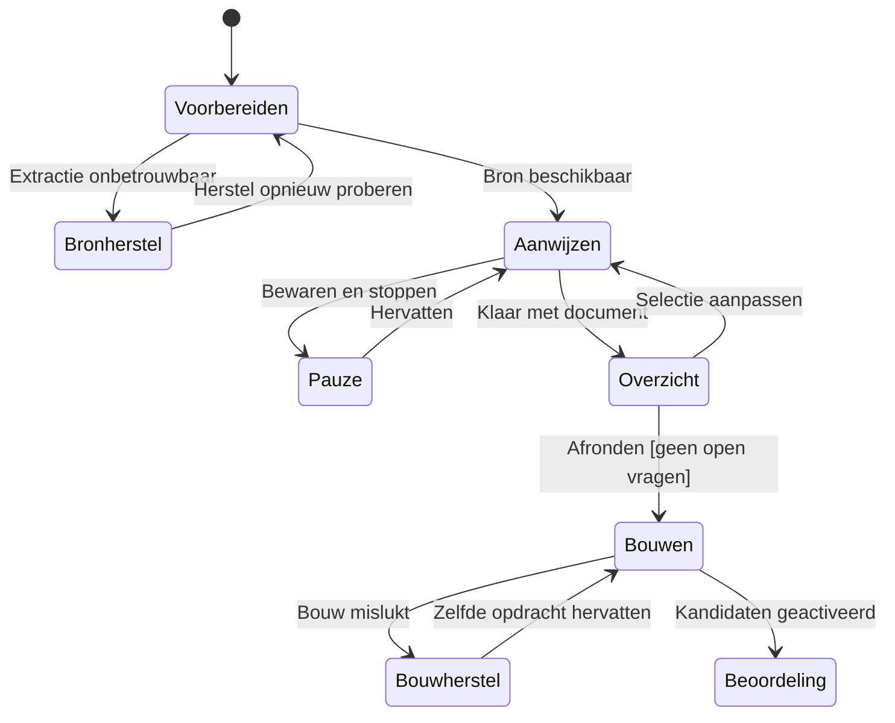

# Vorming na menselijke annotatie — schermontwerp en pstack-toestanden

Status: ontwerpvoorstel voor #1014/#1015; geen implementatie of nieuwe TLC-run. Basis: bestaande annotatiearchitectuur en statechart op deze branch, en huidige `src/vorming/source_selection_ui_v1.py` op main. De bestaande modelcontrole (80 toestanden, zeven invarianten) bewijst de oude abstracte levenscyclus, niet de hieronder nieuwe schermprojectie of kostenclaim.

## Probleem

De huidige Vorming-kaart mengt een automatisch modelverwerkingsproces, technische diagnostiek, bronverantwoording, koppencontrole en de knop naar Review. Een researcher moet daardoor na honderden AI-voorstellen uitzoeken wat kennis is, wat restpassage is en wat een fout is. In de nieuwe route kiest de researcher vóór de opbouw welke brondelen kennis worden; de gebruiker mag niet opnieuw een herstelwachtrij van 285 kandidaten, 436 overige bronpassages en 208 blokkades krijgen.

## Ground: wat bestaat nu

De documentlijst in `source_selection_ui_v1.py` toont in de geselecteerde kaart de status, kosten- en tijdslimiet voor modelverwerking, kandidaat-/restpassage-/blokkeringsaantallen, start/hervat, Review, diagnose, brongebruikverantwoording en koppencontrole. Het detailverzoek roept ook `formation_problems_v1.collect` aan; de lijst zonder detail gebruikt een compactere projectie. Bronverantwoording en koppencontrole zijn aparte taken die de huidige automatische route herstellen/bevestigen. De documentarchitectuur legt vast dat bronextractie, bronafsluiting, Admission, reviewbeleid en publicatievoorwaarden eigen controles behouden. Niet iedere huidige controle is dus dood omdat de knop verdwijnt.

## Twee kandidaatvormen (architect-afweging)

| Vorm | Interactie | Gevolg |
|---|---|---|
| A: huidige Vorming-kaart behouden met andere labels | Alle voortgang, fouten en acties staan op één documentkaart | Bestaande hersteltaal en onnodige modelbudgetinformatie blijven de primaire taak verdringen. |
| B: compacte documentenlijst en één contextuele werkplek per document | Eén volgende actie per toestand; extra bewijs alleen bij een concrete fout | Annoteren en review blijven afzonderlijke taken; oude detailprojecties en knoppen moeten gericht worden vervangen. |

**Keuze: B.** De documentenlijst leest alleen titel, bronversie, eigen werkstatus, laatst bevestigde opslag en één actie. De zware bron-/kandidaatdiagnose wordt pas gelezen wanneer een concrete blokkade geopend wordt. Dit vermindert werk en ruis in de interface; een meetbare snelheids- of geheugensparing is niet aangetoond. Paginering en gerichte reads blijven belangrijk.

## Schermcontract per toestand

| Toestand | Gebruiker ziet | Primaire actie | Secundaire informatie |
|---|---|---|---|
| Bron wordt voorbereid | Documentnaam, bronversie, voortgang | Wachten of document verlaten | Technische details alleen in uitklapbare diagnose |
| Bron moet hersteld | Concrete ontbrekende pagina, mislukte extractie of onleesbare structuur | Bronprobleem oplossen | Bewijs in Inzicht, geen annotaties starten op onbetrouwbare tekst |
| Klaar voor annotatie | Doel, doelgroep, bronbereik, bronversie | Begin met aanwijzen | Ingestbeoordeling alleen als samenvatting |
| Annotatie bezig | Brontekst groot in beeld, geselecteerde uitspraak naast bron | Wijs uitspraak aan / bewaar selectie | Type/context verschijnen pas na aanwijzen; voortgang en conceptopslag klein |
| Gepauzeerd | Aantal gereed, aantal concepten, laatst bevestigde opslag | Verder met aanwijzen | Geen uitvoerige tussenpagina vereist; kaart kan dit tonen |
| Overzicht | Lijst van selecties en gekoppelde passages; open concepten of scopevragen bovenaan | Afronden en opbouwen, alleen indien mogelijk | Per selectie aanpassen; nulselecties mogelijk na verantwoorde volledige scope |
| Opbouw loopt / fout | Opdrachtbevestiging en actuele status | Wachten of gericht herstel | Geen tweede opbouwknop die dezelfde taak verdubbelt |
| Review beschikbaar | Aantal opgebouwde kandidaten, wie volgens ingest moet beoordelen | Naar Review | Bron-/bouwdiagnose alleen bij concrete blokkade |
| Publicatiegereed | Bestaande review- en publicatiewerkplek | Bestaande bevoegde publicatieactie | Geen nieuwe publicatieknop in Vorming |

Op mobiel: één kolom; bron en stapkaart blijven bereikbaar zonder drie gelijktijdige panelen. Een selectie kan over alinea's gaan of bestaan uit meerdere losse bronspans; daarna kunnen elders passages worden gekoppeld. Exacte bronankers blijven zichtbaar. Geen preselectie door AI als voorwaarde om door te gaan.

## Leesbare statechart voor het scherm

Dit is een leesprojectie van het bestaande domeinmodel, **geen nieuwe TLC-uitvoer**. Concepten ontstaan en worden bewaard binnen Aanwijzen. Reviewer-oordelen en publicatie blijven in de bestaande downstream keten en hangen van de ingestkeuze af. Nieuwe pstack-TLA-controles moeten opslagbevestiging, achterhaalde autosave, hervatten, nulselecties, één bouwopdracht en de overgang van bron-/bouwfout naar vervolg modelleren. De eerdere zeven invarianten moeten blijven gelden.

## Verwijderen, verplaatsen en behouden

| Huidig element | Besluit |
|---|---|
| Modelaanroepen, vieruursbudget, taaksaldo, modelrespons-fases op de primaire kaart | Verwijderen bij uitfasering van automatische prozavorming; infrastructuur voor andere bronklassen apart inventariseren. |
| 436 'overige bronpassages' als herstelwerkvoorraad | Verwijderen uit deze route. Toon bronbereik en open selectievragen; geen impliciete claim dat onselecteerde tekst waardeloos is. |
| Brongebruik verantwoorden als aparte herstelwerkplek | De huidige AI-restpassagewerkplek vervalt na cutover. Bestaande bronverplichtingen en bevoegde disposition blijven afdwingbaar; de scopebevestiging alleen sluit ze niet. Toon uitsluitend de concrete nog open verplichting bij de betreffende bronpassage. |
| Koppen controleren als standaard losse ronde | Alleen de losse hoofdroute verdwijnt na migratie van het bevestigingscontract. Bronstructuur blijft zichtbaar. Bevestiging of correctie die het bestaande contract nog eist, blijft als gerichte handeling bereikbaar totdat de nieuwe route hetzelfde bewijs levert. |
| Vormingsproblemen als lijst van AI-afwijzingen en restpassages | Verwijderen voor proza. Toon alleen actuele extractie-, selectie-, opbouw- of Admission-fout met één herstelactie. |
| Bekijk diagnose in Inzicht | Alleen in uitklapbare foutdetails; eigenaar van technisch bewijs blijft Inzicht. |
| Naar Review | Na succesvolle bouw als primaire actie; nooit vóór actueel gebouwde kandidaten. |
| Reviewer-/publicatiegate | Behouden volgens ingest en bestaande autorisatie. |
| Oude proza-API, providers, jobs en herstelcommando's | Verwijderen na migratie en callermap; geen dode tweede route of stil fallbacks. Beslisboompad afzonderlijk beoordelen. |

## Kosten en geheugen

De huidige code reserveert modelaanroepen per documenttaak en toont budget en wachttijd. Vervanging van deze automatische selectie door menselijke aanwijzingen kan modelaanroepen voor die prozastap laten vervallen, **mits** de enige materialiser tekst en velden uit exacte spans bouwt zonder nieuw LLM-verzoek. Dat verlaagt naar verwachting token- en contextgebruik voor die stap. De totale kostenbesparing is onbekend: extractie, opslag, UI en review kosten ook middelen. Meet per representatief document: provider-aanroepen, input-/outputtokens, piekcontext, duur, herstelacties en menselijke tijd vóór/na. Geen nieuwe documentbrede JSON-write per aanwijzing; sla per entry gericht op na betekenisvolle actie of korte rust. Teltijd of geheugenramingen zonder meting niet in de UI zetten.

## Acceptatie voor het scherm

1. Researcher opent één document en ziet één passende actie, zonder modelbudget of lijst van AI-restpassages.
2. Bij onbetrouwbare extractie staat de concrete bronfout vóór annoteren.
3. Een kernuitspraak over meerdere alinea's en twee losse spans kan worden aangewezen en hervat.
4. Context, voorwaarde en uitzondering zijn los te koppelen met exacte vindplaatsen.
5. Concept wordt pas 'opgeslagen' na serverbevestiging; falen houdt werk zichtbaar.
6. Overzicht blokkeert afronding met open concepten; verantwoorde nulselectie is mogelijk.
7. Eén seal geeft één duurzame bouwopdracht; na bouw verschijnt Review conform ingest.
8. Bestaande bronafsluiting, Admission, reviewer- en publicatievoorwaarden blijven aantoonbaar actief.
9. Geen automatische prozavorming of oude herstelactie meer bereikbaar in de nieuwe route.

## Beslisregister: bestaand contract en expliciete verwijdering

**Geen wijziging van de vastgelegde kernkeuzes.** De ingestbeoordeling (personen, verplichte/optionele deelname en aantallen), de onveranderlijke bron, gerichte menselijke selectie, duurzame conceptopslag, documentoverzicht vóór seal, één materialiser, Admission, reviewer-oordeel, publicatiebevoegdheid en het afzonderlijke beslisboompad blijven. De nieuwe schermen wijzigen de *presentatie en de eigenaar van de eerste selectie*, niet de betekenis van review of publicatie.

**Aanscherping 1 — scope is niet bronafsluiting.** De researcher bevestigt welke afgesproken secties zijn doorlopen. Dit bewijst niet dat iedere bestaande bronverplichting is afgehandeld. Wanneer de huidige publicatiegate een bronpassage, pagina of uitgesloten gebied expliciet verantwoord wil zien, blijft de bevoegde afhandeling nodig. Toon dat als gerichte vraag bij de bron; verwijder alleen de herstelwachtrij die door automatische AI-restpassages ontstond. Nul selecties kan uitsluitend na geldige scope- én bronafhandeling, en leidt niet vanzelf tot publicatie.

**Aanscherping 2 — koppen.** Koppen zijn bronstructuur en blijven beschikbaar voor navigatie, citatie en context. Een apart generiek scherm met alle koppen kan pas verdwijnen nadat de vereiste bevestiging via de bronwerkplek of een gelijkwaardig bewezen pad plaatsvindt. Als het bestaande contract kopbevestiging vereist, mag een visuele vereenvoudiging die eis niet wegnemen.

**Aanscherping 3 — herstel en kosten.** Technische extractiefouten, ongeldige offsets, Admission-blokkades en bouwfouten blijven echte hersteltoestanden. Geen aantallen over `source_passages` tonen als te classificeren AI-restvoorraad. De claim over minder modelcontext geldt alleen voor het verwijderde automatische prozaselectiepad; meting van calls/tokens/piekcontext/arbeid is vereist.

| Verwijder bij de proza-cutover | Concreet productonderdeel | Voorwaarde vóór verwijdering |
|---|---|---|
| Automatische initiële kennisselectie | `pre_review_semantic_v1` prozabinding/spec, `console_asgi`-koppeling en oude proza-startactie | Menselijke annotatie → seal → enige materialiser werkt voor alle betrokken prozaklassen. |
| Modelvormingsuitvoering en herstart | Prozaprompts, proposal/providerpad, `bounded_formation` en `recoverable_formation` waar exclusief proza, `processing_retry_v1`/replay/budgetvervolg voor proza | Gedeelde validatie en beslisboomafhankelijkheden verplaatst; onderbroken werk krijgt expliciete takeover. |
| Oude Vorming-kaart en equivalent schrijfpad | Start/hervatformulier voor AI, de modelbudget-/pollingtekst en modelresultaatnamen in `source_selection_ui_v1`; oude dubbele POST-editors | Nieuwe documenttoestanden en een annotatie-eigenaar beschikbaar; historische navigatie hoogstens read-only redirect. |
| Automatische restpassagewachtrij | `overige bronpassages` als generieke nieuwe werkvoorraad; modelafwijzingen als standaard Vormingsproblemen | Concrete bron-/Admission-/bouwblokkades blijven via de juiste eigenaar zichtbaar; publicatiegate blijft intact. |
| Afzonderlijke standaardknoppen | `Brongebruik verantwoorden` als AI-restwerkroute, `Koppen controleren` als generieke tweede ronde | Bronverplichtingen en kopbevestiging hebben een werkend, getest pad in de nieuwe werkplek. |
| Experimenten en configuratie voor oud proza | `route_comparison_app_v1.execute_arm`, `semantic_safety_app_v1`, `audit_semantic_safety_v1`, moduskeuzes en proza modelconfig | Geen uitvoerbare oude prozacreatie in runtime; historische bewijzen leesbaar. |
| Oude tests/documentatie/config | Testverwachtingen van verplichte AI-prozavorming, imports, requirements, env, healthchecks | Vervang door human-only integratie-, bypass-, restart- en review/publicatieproeven. |

**Behoud expliciet:** `knowledge_materialisation_v1` als enige maker; zuivere bronreconstructie en strikte veld-/Admission-controles; extractie-/bronidentiteit; bestaande workflow- en bewijsauthority, reviewerpolicy, publicatie/registry, technische diagnose in Inzicht en historische bewijzen als read-only. Verwijder geen gedeelde helper door de bestandsnaam alleen: de beslisboomroute importeert providerhelpers en de hashfunctie wordt breed gebruikt. Verplaats zulke helpers met equivalentiebewijs.

Dit is een **verwijdercontract, geen uitgevoerde verwijdering**. Het bestaande architectuurplan §7 en §9 blijft de bron voor callermap, migratie, rollback en bewijs van afwezigheid van een tweede pad. Acceptatie vereist dat HTTP, CLI, retry/resume, herextractie, klassewijziging, startup en directe interne aanroepen geen oude prozacreatie meer bereiken.
