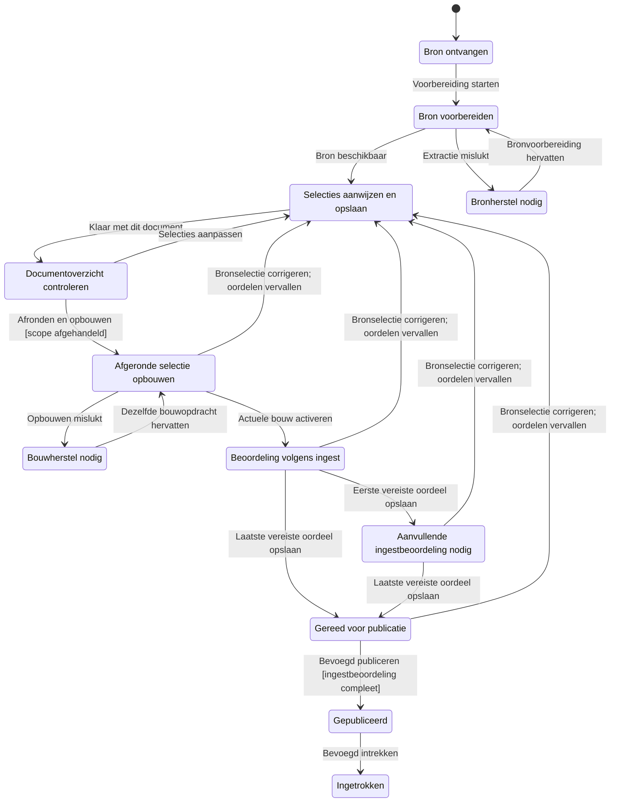

# Statechart: menselijke annotatie vóór objectvorming

Ontwerp bij #1013/#1014 en MET-57/MET-58. Dit model beschrijft de voorgestelde route; het is geen beschrijving of verificatie van de huidige productiecode.

Gemaakt met de echte pstack-statechart-CLI, bron WilliamGomes41/plugins commit `43290811f72aa1a5ff7b0963d1370c2fee2d854b`, pad `pstack/skills/statechart/scripts/statechart`. Tijdelijk uitgevoerd buiten Metis; geen nieuwe permanente skillinstallatie in de repo.

TLC-jar 1.7.4 SHA-256 `936a262061c914694dfd669a543be24573c45d5aa0ff20a8b96b23d01e050e88`; Node 24.22.1, Java 21.0.13.

## Gecontroleerde statechart

Bij ingest kan één of kunnen twee beoordelaars verplicht zijn. Die keuze ligt vóór het begin van de route vast en verandert onderweg niet. De aanvullende beoordeling verschijnt alleen bij de ingestkeuze die haar vereist.



Een opgeslagen selectie is geen oordeel. ‘Klaar met document’ opent het overzicht. Pas ‘Afronden en opbouwen’ verzegelt de invoer en maakt een bouwopdracht. Een broncorrectie tijdens bouwen of review maakt de betreffende oude bouw/goedkeuring ongeldig.

## Uitkomst

| Modelconfiguratie | TLC-toestanden | TLC-stappen | Resultaat |
|---|---:|---:|---|
| Ingestkeuze: één of twee verplichte reviewers | 80 | 208 | 7 invarianten houden; exit 0 |
| Alleen één verplichte reviewer | 38 | 98 | 7 invarianten houden; exit 0 |
| Tegenproef: revisiecontrole bij bouwactivatie verwijderd | 130 | 333 | Verwachte regelbreuken; exit 1 |
| Tegenproef: publicatiecontrole op vereiste review verwijderd | 96 | 256 | Verwachte regelbreuk; exit 1 |

Het hoofdmodel levert 12 zichtbare toestanden en 19 pijlen. Het verbergt 112 concrete stappen die binnen hetzelfde zichtbare label blijven: afzonderlijke selecties opslaan, een deel van de beoordelingen, opnieuw openen zonder inhoudelijke wijziging en stotterstappen. Er zijn geen willekeurige tussen-toestandpijlen weggefilterd.

## Regels

- `TypeOK`: alle waarden blijven in het afgesproken kleine domein.
- `IngestPolicyPreserved`: de ingestkeuze voor verplichte reviewers verandert niet.
- `OnlySealedSelectionsAreBuilt`: review/publicatie gebruikt de actuele volledige selectie die is afgerond.
- `NoApprovalFromAnnotation`: bronvoorbereiding, annoteren, overzicht en bouwen leveren geen goedkeuring op.
- `ServingRequiresIngestReview`: actief aanbieden vereist de ingestbeoordeling én de actuele gebouwde revisie.
- `WithdrawalStaysInactive`: ingetrokken werk wordt niet actief aangeboden.
- `ReleaseIsExact`: de release verwijst naar de gebouwde revisie en bestaat alleen na publiceren/intrekken.

## Tegenvoorbeelden in bewust kapotte modelvarianten

Dit zijn ontwerptegenproeven, geen aangetoonde bugs in de huidige Metis-code. Daarom zijn geen productreproducties geclaimd.

1. `OnlySealedSelectionsAreBuilt`: alleen actuele verzegelde invoer mag worden gebouwd. Pad 0–8 in het rapport: ontvangen → voorbereiden → bron beschikbaar → twee selecties opslaan → overzicht → afronden/bouwen → bronselectie corrigeren → **verouderde bouw activeren**.
2. `ServingRequiresIngestReview` na ontbrekende bouwfence: alleen actuele, juist beoordeelde inhoud mag worden aangeboden. Pad 0–10: het voorgaande pad plus oordeel en publicatie. Het oude bouwresultaat wordt gepubliceerd terwijl de selectierevisie inmiddels is gewijzigd.
3. `ServingRequiresIngestReview` zonder reviewgate: publicatie mag niet vóór de verplichte oordelen. Pad 0–8: ontvangen → voorbereiden → bron beschikbaar → twee selecties → overzicht → afronden/bouwen → actuele bouw activeren → **publiceren zonder vereiste oordelen**.

Volledige pstack-rapporten en TLC-uitvoer staan in `evidence.md`.

## Grenzen en aannames

- Twee abstracte selecties, revisies 0–4, één document, één release en één actieve bouwopdracht; een oude bouw na selectiecorrectie is expliciet gemodelleerd. Geen uitputtend model van meerdere workers, command-ID's of PostgreSQL-isolatie.
- Een of twee verplichte reviewers als concrete voorbeelden van de ingestpolicy. Optionele deelname, quorumvarianten, bevoegdhedenwijziging en actorvervanging zijn niet afzonderlijk uitgewerkt.
- Scope-/Admission-/inhoudscontroles zijn als voorwaarden geabstraheerd; het model controleert geen echte tekst, offsets, klinische betekenis of volledigheid.
- Restart is een stotterstap: aangenomen wordt dat opgeslagen waarden blijven bestaan. Dit bewijst niet de daadwerkelijke databasecommit of crash recovery. Door deze stotterstap is TLC's `NoDeadlock` geen bewijs van voortgang; er is geen liveness-/fairnessclaim.
- Nieuwe bronversie, policy-opvolger naast een actieve v1, atomische supersession, afwijzing en afzonderlijke objectpublicatie zijn niet gemodelleerd. De publicatiestap staat hier voor één al gereed te publiceren scope, niet voor een nieuwe documentbrede publicatieplicht.
- Het model bewijst niet dat de implementatie één maker heeft of oude AI-uitvoering verwijderd is. Die callermap-, opslag-, lifecycle- en bypassproeven blijven in het architectuurplan verplicht.

## Reproduceren

Checkout de genoemde pstack-commit buiten Metis. Gebruik de jar met bovenstaande checksum en Java 11 of hoger. In de map met dit model:

```sh
TLA2TOOLS=/absolute/path/tla2tools.jar /absolute/path/plugins/pstack/skills/statechart/scripts/statechart MetisAnnotation.tla --config MetisAnnotation.cfg --view view.mjs --out reproduce-main
```

`--out` moet nieuw of leeg zijn. De drie aanvullende configbestanden zijn mechanisch uit de hoofdconfig te maken:

```python
from pathlib import Path
s = Path('MetisAnnotation.cfg').read_text()
Path('one-reviewer.cfg').write_text(s.replace('{"r1", "r2"}', '{"r1"}'))
Path('missing-build-fence.cfg').write_text(s.replace('EnforceFence = TRUE', 'EnforceFence = FALSE'))
Path('missing-review-gate.cfg').write_text(s.replace('EnforceReview = TRUE', 'EnforceReview = FALSE'))
```

Voer dezelfde CLI uit met de betreffende config en een eigen nieuwe uitvoermap. Verwachte exits: hoofdconfig/één reviewer 0; beide kapotte varianten 1. De tool genereert `chart.mmd`, `report.md` en `tlc.out`.

## Controle van het artefact

De eerste uitbreiding naar meerdere ingestkeuzes bevatte een ontbrekende `UNCHANGED ingestChoice` in de modelspecificatie. TLC weigerde die specificatie; de fout is hersteld en alle hierboven gerapporteerde runs zijn daarna opnieuw uitgevoerd. Alleen de definitieve runs tellen als bewijs.

Geen productcode gewijzigd; geen deployment of claim van Metis-productacceptatie.
