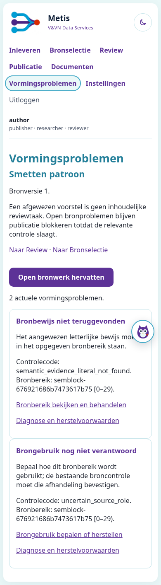

# #848 — lokaal verificatiebewijs

`verification.json` registreert de volledige standaardcollectie op één vaste
codeversie: vier geïsoleerde PostgreSQL-databases, strikte samenvoeging van
collectiedigest en alle uitgevoerde test-ID's, nul ontbrekende delen en nul
PostgreSQL-skips. De velden `skipped` omvatten ook door JUnit als skipped
geregistreerde verwachte fouten; de precieze verdeling staat in het contract.
De aanvullende proeven worden afzonderlijk uitgevoerd en vervangen deze
volledige controle niet.

## Ingevulde vijfstappenchecklist

- [x] **Probleem:** de taakroute weigerde een gedeeltelijk resultaat vóór de
  gezamenlijke materialisatie. De native proef faalde eerst met
  `source_formation_incomplete`; de gewijzigde route geeft onafhankelijk geldig
  werk pas na de bestaande gezamenlijke controles vrij. De actuele Smetten-bron
  is niet opnieuw onderzocht: die is niet aangeleverd.
- [x] **Domein:** noodzakelijke context, exact bronbewijs, Admission en menselijke
  bronverantwoording behouden hun eigen poorten. Een technische afwijzing wordt
  geen menselijke inhoudsreviewtaak. Een generieke afwijzing sluit geen V2-bron;
  een exacte bevoegde bronafhandeling kan uitsluitend het betrokken bereik sluiten.
- [x] **Gegevens/herstel:** bestaande PostgreSQL-taakresultaten, replay,
  bronverantwoording en Admission vormen de autoriteit. De probleemkamer is een
  leesprojectie; geen nieuw register of schema. Herstart, gericht herstel,
  idempotente herhaling en stale revisies zijn gecontroleerd. Menselijke
  wijzigingen blijven beschermd tegen herextractie.
- [x] **Bewijs:** native console/HTTP/PostgreSQL, echte Chromium/Playwright en
  echte Raad-worker; geen paginaverzoek mag verwerking stoppen of domeintoestand
  wijzigen. Een mutatie die de publicatieblokkade verwijdert maakt de beslissende
  proef rood. De aanvullende proeven toetsen de actuele activatierevisie en
  bereikbaarheid van alle 270 afzonderlijke bevindingen.
- [x] **Implementatie/schoonmaak:** afzonderlijke commits voor vrijgave,
  probleemtoegang, activatiebewijs, navigatie en bestaande aanroepers. De oude
  onvoorwaardelijke vroege stop en dubbele statusafleiding zijn vervangen;
  noodzakelijk blokkerende foutpaden en publicatievoorwaarden blijven bestaan.

Volledig domein-/wijzigingscontract:
[`848-review-formation-problems.md`](../../docs/change-contracts/848-review-formation-problems.md).

## Reproduceren

Gebruik de bestaande repositorysetup met Python 3.12, PostgreSQL 16,
`requirements-dev.lock`, `requirements-console.txt`, Chromium en
`METIS_PLAYWRIGHT_MODULE`/`METIS_BROWSER_EXECUTABLE`. Zet de PostgreSQL-binmap ook
in `PATH` voor de bestaande `psql`-proeven. Gebruik uitsluitend een wegwerpdatabase
met CREATEDB-rechten. Er zijn geen betaalde modelcalls nodig.

```bash
export METIS_TEST_POSTGRES_DSN="$(scripts/test_postgres.sh)"
export PYTEST_ADDOPTS="--ignore=work"
python -m pytest -q tests/test_review_formation_problems.py
python -m pytest -q -p tests.conftest evidence/848/probes.py
```

De volledige collectieverificatie gebruikt de bestaande
`scripts/measure_test_suite.py` met `--shard-index 0..3 --shard-count 4` en
`scripts/ci_test_shards.py merge`. Zie `verification.json` voor de geteste commit.
De outputmap is `work/848-suite/shard-N/result.json`; de strikte merge controleert
de complete verzameling vóór het resultaat als geslaagd wordt genoteerd.

`formation-problems-mobile.png` is afkomstig van de gerichte echte browsertest
met uitsluitend de synthetische bron *Smetten patroon*. De test controleert ook
de verwerking tijdens navigatie, stabiele probleemidentiteiten, toegang vanuit
Review, geen horizontale overflow op 390 pixels en geen JavaScript-fouten.



## Nog open buiten lokaal bewijs

Geen Azure-uitrol, actuele productieconfiguratie, live-providerbewijs of klinische
Smetten-eindacceptatie. De bestaande historische Smetten-replay is context, geen
actuele productieproef. #848 en de bredere #837 blijven daarvoor open. Een
verplaatst of nog niet verantwoord bronprobleem geldt niet als opgelost.

De adversariële controle is een afzonderlijke controlepassage door dezelfde
agent; er wordt geen onafhankelijke menselijke review geclaimd.

## Verificatiecorrectie

De eerdere volledige uitvoering op `d09d8e1` had één fout: de migratie-/hervatproef
gaf de echte worker slechts één seconde. Onder parallelle belasting liep dat
budget tijdens eindvalidatie af; de productieguard weigerde activatie terecht.
De test gebruikt nu een echte workergrens van 60 seconden en laat uitsluitend
de gesimuleerde vormingsklok na één call 120 seconden vooruitgaan. Zo blijft de
budgetstop getest zonder de CPU-/databasetijd als toevalsvariabele te gebruiken.
Het hele betrokken testbestand slaagde daarna met 22 tests. Alle vier delen
van de volledige suite zijn vervolgens opnieuw op dezelfde gewijzigde
testcommit uitgevoerd; er worden geen resultaten van verschillende commits
als één groene uitvoering samengevoegd. De productiecode is hiervoor niet
gewijzigd. De echte deadline-/leaseweigeringen blijven in de suite getoetst.
