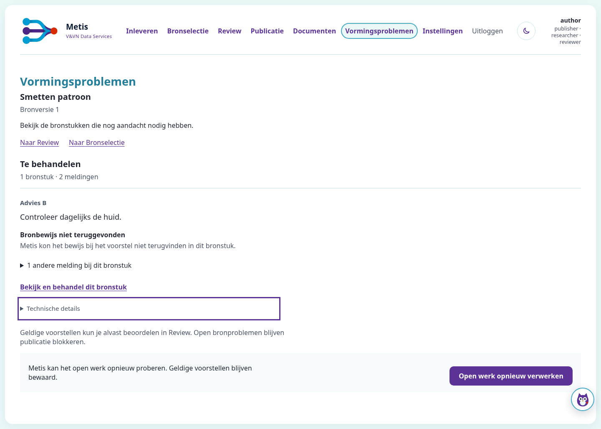
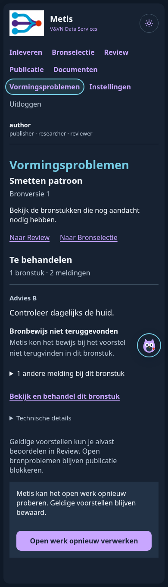

# Vormingsproblemen — Impeccable voor en na

De broninhoud en volgende handeling krijgen voorrang. Twee meldingen over exact
hetzelfde bekende bereik vormen één leesbaar bronstuk. Iedere bevinding behoudt
haar identiteit, reden en beschikbare handelingen. Technische gegevens blijven
beschikbaar via native uitklapbediening. Onbekende en overlappende bereiken
worden niet stilzwijgend als hetzelfde bronstuk behandeld.

| Voor | Na |
| --- | --- |
| Twee losse kaarten voor hetzelfde bereik | Eén bronstuk met twee herkenbare meldingen |
| Geen leesbare brontekst | Letterlijk fragment uit de geverifieerde opgeslagen bron |
| Codes en offsets direct zichtbaar | Onder ‘Technische details’, met toetsenbord te openen |
| Herhaalde diagnose-/herstelingangen | Eén zichtbare behandelhandeling; andere ingangen blijven beschikbaar |
| Algemene herstelknop vóór het bronstuk | Eerst bronstuk en reden, daarna de algemene herstelmogelijkheid |

De beelden gebruiken uitsluitend de synthetische bron *Smetten patroon*.
Dit is geen actuele Smetten-bron of productieacceptatie.

## Werkelijk uitgevoerd

- Verse baseline: bestaande echte Chromium-/Raad-proef, 1 passed.
- Nieuwe presentatie- en bestaande featureproeven: 15 passed; inclusief broncitaat, exacte groepering, XSS-escaping, ontbrekende bronlocatie, ongewijzigde toestand en publicatieblokkade.
- Twee afzonderlijke native adversariële proeven: 2 passed; vervalst activatiebewijs geweigerd en alle 270 bevindingen bereikbaar na groepering/paginering.
- Bestaande browser-, Raad-, taakopslag- en herstelcontroles: 79 passed.
- Karakterisatie: 38 passed. Machinevergelijking bewijst dat bij de 32 gewijzigde referenties uitsluitend de stylesheetversie veranderde.

De gerichte browserproef navigeert tijdens een gepauzeerde modeltaak, controleert
de lopende verwerking en Review, opent details met het toetsenbord en voert de
echte Raad-worker uit zonder domeinmutatie. Dezelfde verplichte CI-browserproef
blijft geselecteerd; de bestaande nul-skips-controle blijft behouden.

`browser-readability.json` bevat metingen uit de echte browser: 320, 390, 768 en
1440 pixels zonder horizontale overflow; 200% tekstvergroting; minimaal 44px
voor behandeling/disclosures. Laagste gemeten tekstcontrast: 7,50:1 licht en
9,62:1 donker, tegenover de AA-grens van 4,5:1. Fysieke apparaten en een handmatige
screenreadersessie zijn niet getest. Ook geen claim van gemeten menselijke taakduur.

Eén gemengde testopdracht laadde conftest dubbel en eindigde met een cleanupfout
na 17 geslaagde testgevallen. Die opdracht geldt niet als groen bewijs. De
correcte afzonderlijke opdrachten voor 15 en 2 tests eindigen beide met exit 0.

## Impeccable

CLI 4.7.0, officiële skillbron 4.7.1, Git-commit
`3671d50f0ac9a662ce0615e85a256110c9cd720b` uit `pbakaus/impeccable`.
De gewone bundeldownload werd door de proxy geblokkeerd. Installatie is daarna
voltooid met `npx impeccable install` en een lokale bundel van die officiële
bron plus de officiële npm-engine. Tooling blijft lokaal, buiten productcode;
geen nieuwe applicatieafhankelijkheid of automatische hooks.

Toegepast: context, audit, clarify, distill, Operate/craft-floor en polish.
Geen eerdere critique-snapshot beschikbaar; de eindbeoordeling is een eigen
afzonderlijke inspectie van bron, gerenderde beelden en interacties.

| Heuristische auditdimensie (0–4) | Voor | Na | Onderbouwing |
| --- | ---: | ---: | --- |
| Toegankelijkheid | 3 | 3 | Contrast en native toetsenbordbediening gecontroleerd; geen volledige handmatige SR-audit |
| Performance | 3 | 3 | Geen nieuwe runtime-JavaScript of netwerk/modelcalls; geen gecontroleerde latencybenchmark |
| Theming | 4 | 4 | Bestaande Metis-tokens en beide thema's behouden |
| Responsive | 3 | 4 | Alle gecontroleerde breedtes, 200% tekst, 44px bediening en ruimte voor Raad |
| Implementatie-integriteit | 2 | 4 | Bron en vervolgstap leidend; technische en herhaalde informatie uitgeklapt op verzoek |
| Totaal | 15/20 | 18/20 | Deskundigenbeoordeling; geen gemeten gebruikersscore |

De mechanische detector is eenmaal uitgevoerd na de UI-wijzigingen.
`impeccable-detector.json` bevat vijf waarschuwingen voor bestaande dikke
zijranden elders in de gedeelde stylesheet (regels 1156–1728). Geen bevinding
valt in de nieuwe componentregels. Deze bestaande patronen zijn niet aangepast
als neveneffect van deze paginaopdracht. De detector gaf daarom exit 2;
dit wordt niet voorgesteld als een volledig schone scan.

## Grenzen

Geen bevinding gesloten, broninhoud herschreven of publicatierecht toegevoegd.
Geen nieuwe probleemregistratie, schema of workflow. Voorwaarden voor modelherstel,
menselijke wijzigingen en nieuwe werkrevisies blijven door de bestaande eigenaren
afgedwongen. Geen merge of deployment door deze uitvoering.
