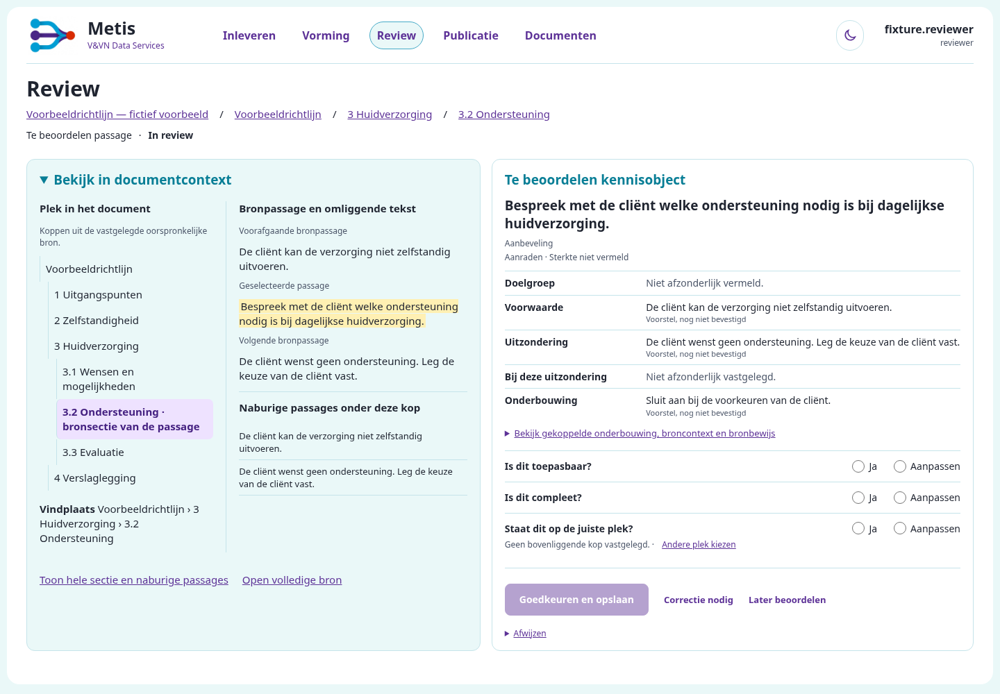
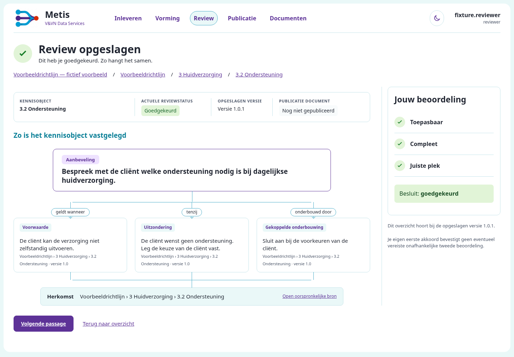

# KO-2: uitvoeringsbewijs

De werkende reviewkaart en de zelfstandige bon volgen de twee goedgekeurde composities in docs/design/review-card-receipt. Dit bewijs gebruikt uitsluitend synthetische gegevens. Merge, deployment en productieacceptatie zijn niet uitgevoerd.

## Werkende schermen

- review-desktop.png en review-mobile.png tonen de bronkolom, objectkolom en drie niet-voorgeselecteerde Ja/Aanpassen-paren.
- receipt-desktop.png en receipt-mobile.png tonen de eigen opgeslagen antwoorden, exacte versie en inhoudelijke relaties, na een echte PostgreSQL-commit.
- review-dark.png en receipt-dark.png tonen de donkere variant. De vier bijgevoegde axe-resultaten hebben geen ernstige of kritieke bevindingen.
- ../ko-2-review.mp4 toont openen, beoordelen, opslaan, de bon en de bestaande vervolgnavigatie. De opname duurt 31,28 seconden, inclusief vier seconden stilstaand eindbeeld.

[Bekijk de werkende flow op video](../ko-2-review.mp4) · [Mobiele kaart](review-mobile.png) · [Mobiele bon](receipt-mobile.png)

Visuele/browserproef op 776be44dcd6db6b9f003da6e59a3ed2995f8e76d: werkende PG/ASGI-app met Chromium, 1440 x 1000 en 375 x 900. Beide panelen beginnen op 228,59 px; de primaire actie eindigt op 886,56 px. Er is geen horizontale paginaschuifbalk. De daaropvolgende productwijzigingen betreffen de bewezen bron-/autorisatielezingen en validatie van het formulier-ID; dezelfde UI en broninhoud blijven behouden. result.json bindt de opname aan de echte eigen interactie en opgeslagen inhoud.

## Functionele controles

De eerste brede run op 1d1396d gaf 7043 geslaagde tests en 67 fouten. Die fouten zijn onderzocht; echte regressies zijn hersteld en oude formulierverwachtingen zijn aangepast met behoud van opslag-, bron-, versie-, rol- en herstelcontroles. Herhaling van alle nog gelijknamige foutgevallen op 776be44d: 65 geslaagd; de twee hernoemde controles zijn afzonderlijk geverifieerd.

Aanvullend vastgelegd:

- 35 karakterisaties slagen. De bestaande mutatiecontrole behoudt alle oorspronkelijke 21 foutdetecties en twee nieuwe, met nul fouten in testuitvoering of skips. De aparte range-coveragevergelijking geeft een bestaande waarschuwing bij gewijzigde bronhashes; daarvoor is geen nieuwe baseline vastgelegd.
- Zeven echte Chromium/PG-proeven slagen: broncontext, aanvulling, type/plaats herstellen, persoonlijk werkbord, inhoudelijk werkbord en legacy-discrepantiegedrag met en zonder JavaScript. Alle controles op onveranderde bron, ouder, versiegeschiedenis en onafhankelijke tweede review blijven behouden.
- Onafhankelijke stale-proef: een vroege validatiefout met verouderde antwoorden levert 409, behoudt de oude token en blokkeert goedkeuring. Heropenen vereist nieuwe antwoorden. Een onveranderde generatie behoudt geldige antwoorden bij 400.
- Exacte bonlezing controleert actuele reviewerrol/uitdiensttreding, deelname, eigen event, eventhash, objectversie/hash en historische relaties. Oud bewijs zonder antwoorden krijgt geen verzonnen vinkjes. Publicatie komt uit de bestaande canonieke registry.
- De rolcontrole gebruikt een verse PostgreSQL-query binnen dezelfde bestaande read-only workflowtransactie. Ingetrokken rollen, uitdiensttreding, ontbrekende deelname en vreemde interacties worden geweigerd. De canonieke publicatielezing blijft buiten die workflowtransactie. Dertien gerichte PG-proeven slagen; de bon gebruikt drie fysieke verbindingen.
- De gerichte bronoptimalisatie op f64c476b is onafhankelijk gecontroleerd met vier PG-proeven, naast 73 gerichte controles. Alleen display-rijen worden vooraf gelezen; raw/payload/views/blocks/complete en de closure blijven identiek. Dezelfde checksum- en onafhankelijke membershipcontroles volgen na sluiten van SQL. Cache-identiteit, fallback, Azure-transport, oorspronkelijke-bronlezing en herstelroutes blijven behouden.

De volledige laatste suite en CI-resultaten staan bij de implementatie-PR en GitHub #1000. PostgreSQL 17 is lokaal gebruikt; CI gebruikt PostgreSQL 16. Productacceptatie door een echte reviewer, RC-21, blijft MET-53.

## Prestatieprotocol en actuele uitslag

**V4.1: FAIL op de ongewijzigde grens van tien procent.** [Uitslag](performance/RESULT.md), [alle meetwaarden](performance/samples.csv), [samenvatting](performance/summary.json) en [analyse van bestaande faseregistraties](performance/DIAGNOSIS.md) zijn opgenomen. Gemeten productversie: f64c476b. Beide native tijdpoorten en alle JSON-bytepoorten slagen; bij legacy falen de p95 voor de kaart (+21,14%) en de volledige opslagroute (+19,07%). Alle zestig goedkeuringen en dertig opgeslagen head-beoordelingen zijn geverifieerd. Dit resultaat is geen merge- of productieacceptatie.

De actuele gemeten uitslag en het exact geteste codehoofd worden in de implementatie-PR en GitHub #1000 vastgelegd. Dit bestand legt de reproduceerbare methode vast, geen verklaring dat een nog lopende meetrun of CI is geslaagd.

performance bevat de bevroren V4.1-proef, server, runner, samenvatter en hashes. Bronopbouw en bewijscontrole draaien in het ouderproces. Een vers HTTPS/Uvicorn-proces heropent dezelfde bestaande PG-/bronconfiguratie en behandelt alleen de echte HTTP-verzoeken. GC-instellingen en productieauthenticatie blijven ongewijzigd; certificaat, sleutel en tijdelijke configuratie zijn niet opgenomen.

Vijf afwisselende baseline/head-paren per fixture, drie verschillende goedkeuringen per uitvoering: 923 bronparagrafen/92 definities en 128 native aanbevelingen. De volledige POST, redirect naar de zelfstandige bon en doorklik naar de bestaande vervolgbestemming tellen mee. Alle 60 goedkeuringen en 30 opgeslagen head-beoordelingen worden gecontroleerd, ook na stoppen van de server. Initiële kaart en JSON-leesbytes worden eveneens gemeten. De grens blijft maximaal tien procent boven de baseline, met p95, mediaan en bereik afzonderlijk vermeld.

Eerdere FAIL-resultaten zijn niet omgeschreven. De bewaarde prior-rapporten tonen de werkelijk gemeten kosten en de gerichte oorzaak van de laatste kaartoverschrijding. V2 plaatste inspectiewerk tussen twee gemeten head-schermen; V3 deelde de applicatieheap met fixture/client. V4 scheidt deze processen. V4.1 sluit alleen een race bij het lezen van het laatste logrecord: het ruwe HTTP-transcript wordt eerst vastgelegd, de server stopt, daarna wordt het complete log gekoppeld. Geen gemeten verzoek, opslagcontrole, dataset of grens is daarvoor gewijzigd.

Reproductie: plaats beide gepinde worktrees onder /tmp/ko2-perf/base en head, kopieer de vier proefbestanden naar /tmp/ko2-perf en maak daar uitsluitend voor de proef een localhost TLS-certificaat. Pas alleen lokale Python-/PG-paden in de runner aan. De runner controleert beide codehoofden en beide bronhashes; de proef wordt tijdelijk naar tests/ko2_perf_probe_tmp.py gekopieerd en na uitvoering verwijderd. Draai zonder andere test-/browserbelasting. De originele bron-/serverbestanden blijven ongewijzigd.
