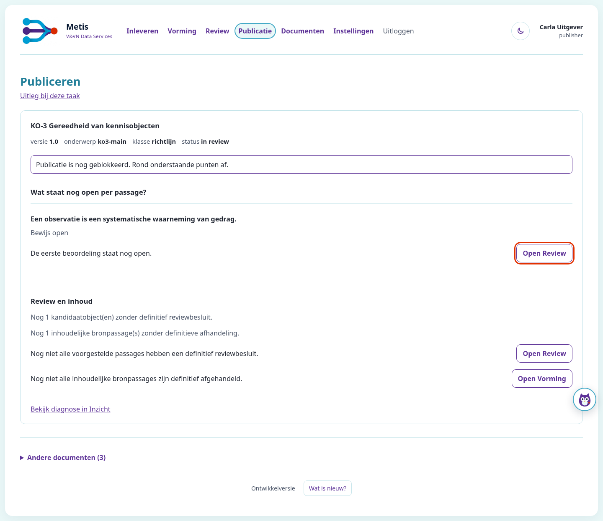

# KO-3 — publication readiness

The publisher sees why each passage still blocks publication. Existing review/source/technical gates remain authoritative. No new status is stored. The selected document comes first; other documents remain available under a keyboard-accessible disclosure. This refines the publication page, not the separate KO-2 review card. All content in these captures is synthetic test data.

[Ready](ko-3-review-ready.png) · [Required second review](ko-3-review-second-open.png) · [Conflict](ko-3-review-conflict.png) · [Mobile](verification/ko3-mobile.png) · [Published](verification/ko3-published.png) · [Withdrawn](verification/ko3-withdraw.png) · [Actual browser video](ko-3-review.mp4)

## Verification

- Combined focused core/package/UI/badge/serving suite: 145 passed on d5febaaf.
- Package withdrawal/recovery fix: 91 preservation tests passed; independent six-case registry audit passed on e74d438e. See [independent report](verification/ko3-registry-adversary-report.md).
- Independent nine-case native PostgreSQL probe compared original c6 readiness against the same stored tuples: all existing fields, blocker order, counts and flags matched after removing only the additive object_readiness field. Physical row identities and immutable source bytes remained unchanged. A deliberately removed waiting-source explanation failed the intended semantic assertion; restoration passed.
- Layout verification: real Chromium with Playwright 1.58.2, actual PostgreSQL and HTTP/forms, separate reviewer/publisher, refusal, review completion, publication, withdrawal and actual server restart. The final browser driver additionally checks selected-document order, native keyboard disclosure and no horizontal overflow at 375/768/1024/1440px.
- The 23 existing UI/copy/compact-overview tests passed after the makeover. The final extended browser layout/lifecycle proof passed in 12.72 seconds. The initially failed recording attempt lacked the local ffmpeg cache; after configuring the installed ffmpeg executable the full recorded browser flow passed (44.68 seconds).
- Impeccable source detector: no findings in changed Python; five existing thick-border warnings elsewhere in console.css, outside the added publication styles. The independent layout assessment and actual desktop/mobile inspection informed the changes. This is not a full WCAG certification.

The original [ten-lane live report](verification/live-report.txt) identifies the earlier d5 proof run. Screenshots/video here were refreshed after the requested layout refinement. Browser timestamps and exact code/test commits are recorded in the implementation PR.

Local PostgreSQL is 17; CI uses 16. Immutable-source tests use the existing Azure adapter with local DiskBlobTransport, not a live Azure account. Publisher work counts are verified in the backend; main has no rendered numeric badge to film. The video follows the publisher while the second browser actually submits review; it does not film that separate reviewer.

## Performance and completion

[The frozen performance method](performance/README.md) was committed before acceptance. At this evidence freeze, exact-head balanced performance and remote CI are pending. Their measured outcome, raw observations, execution order and exact head are recorded on #1002 and its implementation PR. A source check or screenshot is not a performance result. No merge or deployment is authorized by this evidence.
